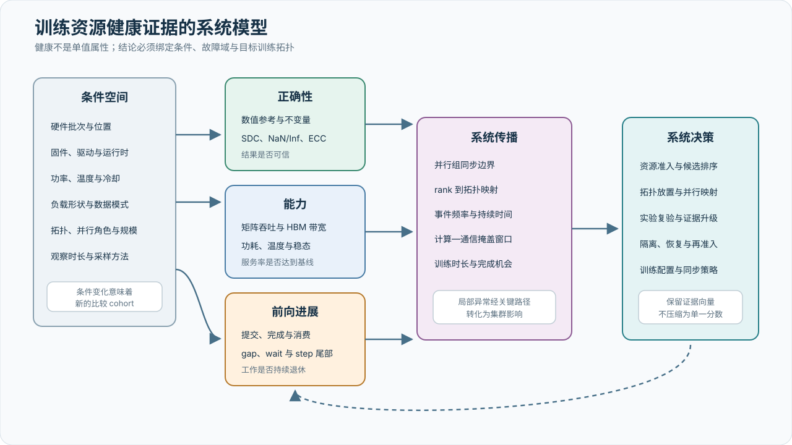

# 万卡训练的系统问题、目标与边界

## 项目背景

项目包含两个独立的国产加速器资源池：8,192 张华为 A3 超节点加速器和 2,048 张沐曦 C550 GPU，总计 10,240 张。本报告研究大规模硬件资源如何在明确的正确性、性能与稳定性约束下转化为可持续、可复现的有效训练算力。

两类硬件的 scale-up 域和软件生态不同：Atlas 900 A3 SuperPoD 以灵衢高速互连构建最大 384 NPU 的逻辑超节点；C550 以 OAM 模组和 MetaXLink 8 卡全互连为基础，并通过 MXMACA 软件栈承载训练任务。产品级公开规格见 [R001](references.md#r001) 和 [R002](references.md#r002)，项目实际组网以内部资产和配置为准。

## 核心问题

规模扩大后，“设备健康”不能由单一状态值充分描述。本报告将其表示为绑定测量条件 \(\mathcal C\) 的证据向量：

\[
\mathbf E(d\mid\mathcal C)
=
\left(
E_{\mathrm{correct}},
E_{\mathrm{capability}},
E_{\mathrm{progress}}
\right),
\]

其中 \(d\) 表示设备或资源集合，\(\mathcal C\) 至少包含硬件批次、软件版本、负载、功率热状态、拓扑与观察时长。三个分量分别对应：

| 证据面 | 主要问题 | 典型观测 |
| --- | --- | --- |
| 正确性 | 计算和存储结果是否可信 | NaN/Inf、参考比对、SDC、ECC/DBE |
| 能力 | 设备能否持续提供预期服务率 | TFLOPS、HBM 有效带宽、功耗、温度、稳态性能 |
| 前向进展 | 已提交工作能否持续、及时地完成 | gap、同步返回、已完成工作量、step 与 collective 尾部 |

{ .technical-diagram loading=lazy }

第三个维度在同步训练中尤其重要。局部事件的发生概率可以很低，但每个 step 包含多个完成机会，训练又可能持续数周；一旦事件进入 barrier 或 collective 的关键路径，影响范围便由单卡扩展至同步组。资源决策因而不是证据向量的简单求和，而是条件化映射：

\[
D
=
\mathcal G
\left(
\mathbf E,
\mathcal T,
\mathcal W,
\mathcal R
\right),
\]

其中 \(\mathcal T\) 为物理与通信拓扑，\(\mathcal W\) 为训练并行结构和工作负载，\(\mathcal R\) 为风险策略。峰值能力、错误计数和短窗口平均值不被压缩为单一“健康分数”，各自的时间、空间和概率语义均予保留。

由此形成四个贯穿全文的研究问题：

1. 如何在两类软硬件栈上建立可比较但不共用阈值的健康证据；
2. 如何区分计算变慢、完成路径等待和集合通信传播；
3. 如何在万 rank 下以有界开销获得足以支持定位的证据；
4. 单卡风险、并行角色和拓扑映射如何共同形成训练资源决策。

## 与已有工作的技术关系

本文不把“大规模训练需要可观测性”作为新的发现。MegaScale 已经在超过 10,000 GPU 的生产训练中展示 CUDA Event 计时、跨 rank 热力图、分布式时间线、故障定位与恢复，并以目标规模 MFU 和数周训练记录验证系统效果。[R022](references.md#r022) Holmes 进一步把通信算子关系建模为图，并以有标签数据报告异常设备定位准确率和端到端延迟。[R023](references.md#r023) FLARE 则将轻量 tracing 扩展到多个训练后端和更深的执行栈，同时报告千卡开销、诊断准确率与长期部署结果。[R024](references.md#r024)

这些工作构成本文的工程基线，而不是用于反衬某个平台。本文研究的重点有所不同：第一，把正确性、可持续能力与前向进展作为并列的健康证据；第二，把单卡完成路径的低频固定时延与 BSP 同步放大连接起来；第三，让观测结果携带 rank/role、覆盖、丢弃、计时模式和 partial 状态；第四，在不同加速器栈之间共享测量和推断框架，而不共享未经验证的阈值和故障率。

这种区别主要属于系统综合与证据方法，不表示组成能力分别首次出现。热力图、分布式 trace、collective recorder、低通信训练和弹性成员管理均有公开先例。[R022](references.md#r022) [R026](references.md#r026) [R031](references.md#r031) 因而本文对自身贡献采用四种证据等级：公开工作用于建立技术坐标，参考实现用于证明机制可构造，平台案例用于形成可检验假设，只有目标资源池的冻结实验才形成项目实测结论。

| 公开工作 | 已公开的实证锚点 | 对本文形成的最低要求 |
| --- | --- | --- |
| MegaScale | 12,288 GPU、175B 模型 55.2% MFU；超过 10,000 GPU 的数周训练中恢复超过 100 次 [R022](references.md#r022) | 报告目标规模性能、优化消融、失败次数和恢复后的有效训练时间 |
| Holmes | 三个月生产通信日志；97.21% 定位准确率；生产原型最长 30.3 秒定位 [R023](references.md#r023) | 以独立标签报告 Hit@k、误报、漏报和定位时间 |
| FLARE | 1,024 H800 上平均 0.43% 训练时延开销；6,000 GPU 持续部署超过八个月 [R024](references.md#r024) | 给出常驻、查询和触发路径各自的规模—开销—证据量曲线 |
| Llama 3 | 16K GPU、54 天可靠性窗口、超过 90% 有效训练时间 [R025](references.md#r025) | 将故障率、自动诊断、恢复时间和有效训练卡时放在同一口径下 |

表中数字只描述相应论文的环境和统计口径，不构成本文资源池的目标值。它们的作用是规定证据形式：设计公式需要由规模曲线验证，诊断视图需要由标签验证，可靠性改进需要由有效训练时间验证。

## 目标

- 将 10,240 张加速卡纳入统一、可审计的资源与健康状态管理。
- 建立两类资源池各自的健康基线，降低功能异常设备、持续性能离群设备和异常链路进入训练集合的概率。
- 完成 Megatron 在两套软件栈上的功能适配和性能调优。
- 建立小规模基线到目标规模的扩容阶梯，并用扩展效率门限控制非线性损失。
- 形成可复现的性能、稳定性和故障数据，区分目标值、观测值与最终结论。
- 建立不依赖全量中心化原始事件的诊断链路，并显式报告观测覆盖、开销和不完整结果。
- 分析从严格全局同步向分层同步、低通信和弹性成员关系演进时，训练状态、收敛与恢复语义需要满足的条件。

## 非目标

- 不假设 A3 与 C550 参加同一个同步训练作业。
- 不用卡数或厂商理论峰值直接推导端到端训练性能。
- 不在模型、精度、批大小和软件版本不一致时做简单横向排名。
- 不公开受限的拓扑、地址、日志、模型或业务数据。
- 不把研究中的低通信容错设计写成已经完成生产验证的训练方案。

## 成功标准

| 维度 | 指标 | 目标 | 测量方式 |
| --- | --- | ---: | --- |
| 纳管规模 | A3 / C550 卡数 | 8,192 / 2,048 | 资产清单与调度系统对账 |
| 健康准入 | 健康卡率、节点通过率 | 待确定 | 分层健康检查 |
| 性能 | 稳态吞吐、端到端吞吐 | 待确定 | 分池、同口径重复实验 |
| 扩展 | 加速比、扩展效率 | 待确定 | 从基准规模逐级放量 |
| 稳定性 | 有效训练时间占比、MTBF、MTTR | 待确定 | 作业、告警与维修记录关联 |
| 观测质量 | rank/step 覆盖、丢弃事件、partial 和有效开销 | 待确定 | 质量收据、交错基线或 on/off A/B |

## 约束与假设

- A3 与 C550 分别建立性能基线和扩展曲线。
- 实际超节点数量、卡型子版本、固件、驱动和组网信息需由资产清单补齐。
- Megatron 分支、模型规模、序列长度和精度策略需在实验前冻结。
- 原始硬件日志和内部拓扑按受限数据管理，报告只保留必要的聚合结果。
