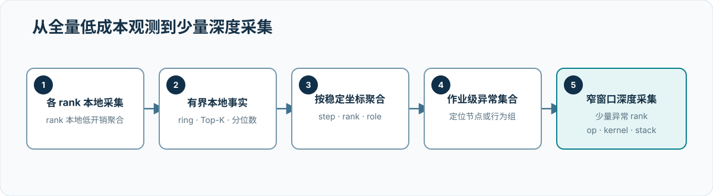
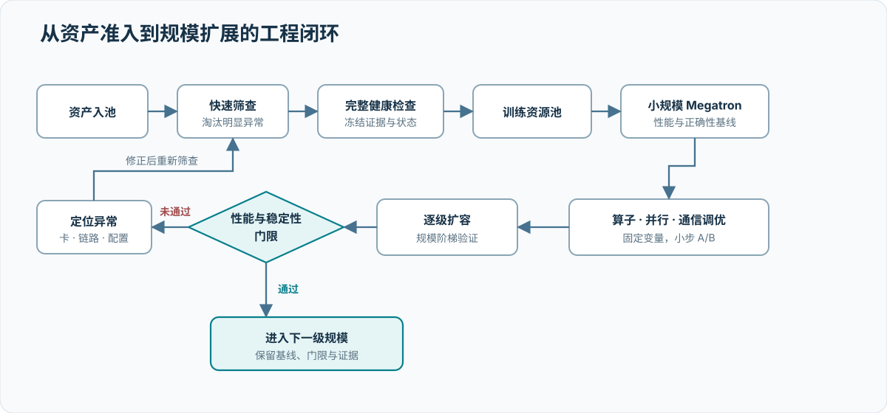

# 系统总体架构：资源池、训练数据面与证据面

## 设计原则

- **异构分池**：A3 与 C550 采用独立的资源池、运行镜像、健康基线和性能曲线。
- **统一控制**：资产、调度、实验编号、指标定义和故障闭环保持统一。
- **拓扑感知**：作业分配尊重卡内、节点内、超节点内和跨超节点互连层级。
- **证据先于放量**：未形成完整准入证据的资源不进入性能基线和大规模训练。
- **逐级扩展**：只有当前规模达到扩展效率和稳定性门限，才进入下一级规模。
- **证据可追溯**：结论可以回溯到实验、配置、日志和软件版本。

## 逻辑架构

{ .technical-diagram loading=lazy }

该图描述逻辑边界，不代表实际网络连接。两个训练数据面彼此独立，控制面统一纳管；项目是否共用存储、调度器和监控后端仍需根据部署配置补充。

## 物理拓扑

物理架构至少分为五级：加速卡、服务器、scale-up 域、scale-out 网络和资源池。A3 的产品级 scale-up 域最大为 384 NPU；C550 产品级基础互连为 8 卡全互连。项目实际采用的服务器、超节点数量、跨域网络与存储挂载方式尚待资产清单确认，不能由总卡数反推。

| 资源池 | 项目规模 | 产品级基础互连 | 项目级待补信息 |
| --- | ---: | --- | --- |
| 华为 A3 | 8,192 张 | 最大 384 NPU 灵衢超节点 | 超节点规格组合、跨超节点网络、故障域 |
| 沐曦 C550 | 2,048 张 | 8 卡 MetaXLink 全互连 | 服务器/超节点形态、scale-out 网络、故障域 |

## 控制面与数据面

控制面负责资产状态、训练资源验证、作业队列、版本和实验元数据。数据面由两条独立训练路径组成，各自完成数据读取、Megatron 执行、梯度通信与检查点写入。证据面以资源池、故障域、作业、rank 和设备身份关联指标、事件与实验结果。

当前生产基线仍以资源池内同步训练为主。面向跨故障域或资源动态供给的前沿设计，可以在高带宽训练数据面之外增加低频 outer state plane：训练岛内部继续执行频繁 collective，岛之间只交换版本化参数差和优化状态，由独立状态服务管理成员、发布和恢复。该平面不进入每个 step 的关键路径，具体权衡见[训练并行、同步域与弹性容错](05-training-and-parallelism.md)。

训练可观测性采用“公共训练语义层 + 可选平台原生层”：两个资源池共享 step、module、rank、通信组和 collective API 数据模型，平台原生适配再补充 task、plane、算法和 transport 等内部事实。这一结构保留了跨平台分析的一致坐标，同时不抹平通信库差异；具体设计见 [Fleet-wide 低开销观测与分布式诊断](06a-training-communication-observability.md)。

多资源池编排遵循“统一实验语义、独立执行数据面”。控制面为两个资源池生成同一实验集合和证据字段，但不建立跨资源池集合通信；各资源池分别完成静态一致性、单节点动态测量、单卡可靠性、链路验证和训练拓扑准入。由此，状态与证据可以统一汇总，而配置、拓扑、门限和性能分布保持隔离。

多资源池控制面的示例规模不代表本项目部署基线。实际运行配置必须按 8,192 张 A3 与 2,048 张 C550 的资产清单、调度边界和故障域逐项对账。

## 观测数据面

万卡训练中的观测系统首先受到训练热路径和数据规模约束。设 rank 数为 \(N\)，每个 rank 的原始事件速率为 \(\lambda\)，平均事件大小为 \(s\)，观察时长为 \(T\)。持续中心化上传的数据量近似为

\[
V_{\mathrm{raw}}
=
N\lambda sT.
\]

若常驻路径只上传速率为 \(h\) 的成员与健康摘要，并在每次查询中仅返回聚合状态 \(S_{\mathrm{agg}}\) 及 \(K\ll N\) 个异常 rank 的原始切片 \(S_{\mathrm{raw}}\)，则

\[
V_{\mathrm{federated}}
\approx
NhT
+Q\left(S_{\mathrm{agg}}+K S_{\mathrm{raw}}\right),
\]

其中 \(Q\) 为查询次数。该式不声称通信量与规模无关，而是说明主要成本可以由查询预算和异常范围约束，而非由全部原始事件数量决定。因此，本报告采用本地采集、稳定坐标、按需归并和逐级下钻的结构。[I004](references.md#i004)

若运行期间出现 \(J\) 次异常触发，第 \(j\) 次仅对 \(K_j\) 个目标 rank 保存平均大小为 \(S_j\) 的调用栈、变量、通信进行中状态或崩溃上下文，则证据增量为

\[
V_{\mathrm{trigger}}
\approx
\sum_{j=1}^{J}K_jS_j.
\]

触发式取证能否保持低摊销，取决于 \(J\)、\(K_j\) 和 \(S_j\) 是否分别受到触发防抖、异常集合收敛和本地证据预算约束；它并不因“按需开启”而天然低开销。[I014](references.md#i014)

{ .technical-diagram loading=lazy }

| 设计约束 | 实现原则 | 避免的问题 |
| --- | --- | --- |
| 训练热路径不依赖中心服务 | 每个 rank 本地追加，查询时才跨 rank fan-out | 中心写入抖动传播到训练 |
| 采集器彼此隔离 | 系统、Torch、通信和堆栈只共享坐标，不在热路径互相调用 | 单个采集器故障扩散 |
| 关联晚于采集 | 统一携带 job、step、rank、并行角色和时间坐标，在查询阶段组合 | 为全局同步观测引入新 barrier |
| 持续观测与深度采集分离 | 常驻路径保留低密度事实，异常窗口才采集 op/kernel/stack | 全程高密度 profiler 开销 |
| 触发取证与训练同步分离 | 各 rank 独立保存变量、栈、通信或崩溃上下文，不插入诊断 barrier | 观测动作放大原有停顿或挂起 |
| 数据量有界 | 本地 ring、Top-K、分位数状态和时间窗口均有预算 | 内存、网络和浏览器随原始事件失控 |
| 不完整结果显式化 | 返回期望/实际 rank、失败节点、丢弃事件和 partial 状态 | 把缺失数据误读为正常 |

跨 rank 概览优先在数据所在 rank 或节点完成过滤与局部聚合，只交换可归并的状态。精确原始事件仅对异常 rank 和窄时间窗读取。不同事实表不能在协调端被无条件拼接成“全局 JOIN”；跨表分析应先在同一 rank 内按 step/role 对齐，再汇总为作业级结果。

这个数据面沿三个尺度展开。常驻层覆盖全部 rank，但只保存 step 墙钟、确定性抽样的 module、collective 摘要和有界系统事实；查询层按成员快照执行 `coordinator → local0 → leaf` 的分层 fan-out，在 rank 或节点侧完成 filter、区间并集、Top-K 和可归并聚合；深度层只针对异常 rank 集合读取窄窗口 op/kernel/stack，并在 watchdog、Python 异常、fatal signal 或受控分析请求下保存变量、通信进行中状态与崩溃上下文。相同调用路径在 rank 本地折叠后，再归并为带权重分布与 rank 覆盖的分布式火焰图。详细语义见[Fleet-wide 低开销观测与分布式诊断](06a-training-communication-observability.md#8-fleet-wide-低摊销观测)。

查询层的首要输出是按并行角色分层的矩阵，而不是全局平均。rank 表示具体执行实例，TP/PP/DP/EP/CP 组合表示可比较的工作负载角色；step × rank 性能、module × rank 显存、time × rank CPU/GPU 状态和 collective × rank 等待矩阵先在角色内建立稳健基线，再沿节点、设备和网络拓扑检查空间聚集。框架 allocated/reserved、驱动设备占用和主机 RSS 保持为三个内存层次，避免把缓存策略、非框架分配和主机泄漏混成一个“显存异常”。

联邦查询不是把远端表伪装成没有边界的单机数据库。可分解聚合、lazy scan 和同 rank 关系计算具有不同执行计划；跨 rank JOIN、全局 Top-K、分位数和重叠区间都需要专门的归并语义。查询覆盖与近似误差属于结果本身，不能作为旁路日志处理。

健康检查数据面还要求设备负载、event、stream 和 synchronize 来自同一后端适配，训练配置摘要与实际 rank/group 覆盖一致，实验来源与设备身份可追溯。反复等待只证明 CPU 到设备再回到 CPU 的整条链路是否持续前进；设备 event 则刻画设备 stream 区间。两种观测共同出现，才能把“性能慢”和“完成链路偶发失去前向进展”分开。

## 三条核心工程链路

{ .technical-diagram loading=lazy }

| 工程链路 | 输入 | 变换 | 输出 |
| --- | --- | --- | --- |
| 资源证据链 | 资产、软件版本、设备与链路测量 | 正确性、能力和前向进展分层验证 | 可审计的候选、排除与证据不足集合 |
| 训练扩展链 | 冻结模型、并行配置和小规模基线 | 拓扑映射、逐级扩容和瓶颈分解 | 目标规模的吞吐、效率与稳定性证据 |
| 分布式诊断链 | rank 本地低密度事实与成员快照 | 角色条件聚合、联邦查询和窄窗口下钻 | 可回溯至原始时间线的异常解释 |

## 待决策事项

- A3 与 C550 是否共用调度、存储和监控后端。
- 两个资源池的最小调度单元和拓扑约束。
- 健康检查阻断、降级和豁免规则。
- 每一级扩容的效率门限与回退条件。

上述取舍应写入 [架构决策记录](decisions.md)。
