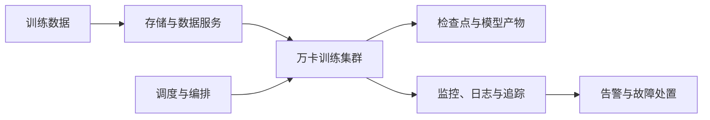

# 系统总体架构

## 设计原则

描述规模扩展、故障隔离、可观测性和可复现性原则。

## 逻辑架构

用正式架构图替换或细化此图，并在图注中标明版本和边界。

## 物理拓扑

说明节点、机架、故障域、网络平面和存储连接关系。

## 控制面与数据面

说明作业提交、资源调度、数据读取、梯度通信、检查点和监控链路。

## 关键设计取舍

链接到 [架构决策记录](../decisions/README.md)，避免只写最终方案而丢失取舍依据。
