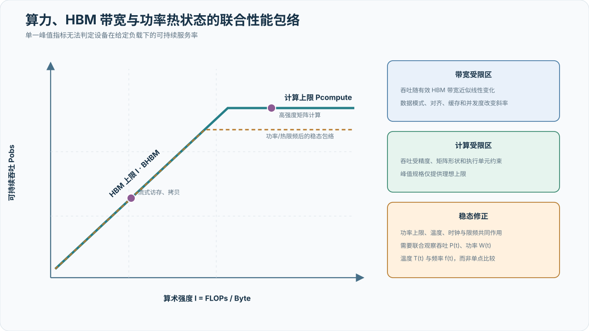

# 加速器、软件栈与执行边界

## 硬件规格与部署形态

项目采用华为 Atlas 900 A3 SuperPoD 和沐曦曦云 C550 两类训练硬件。下表将“项目已知部署事实”与“厂商公开产品规格”分开记录；厂商规格不能替代项目资产与实测结果。

| 资源池 | 项目卡数 | 公开产品形态 | 公开显存/片上内存 | 公开 scale-up 互连 | 来源 |
| --- | ---: | --- | --- | --- | --- |
| Atlas 900 A3 SuperPoD | 8,192 | 12 个计算柜 + 4 个总线设备柜，最大 384 NPU | 最大 128 GB/NPU，整套最大 48 TB | 灵衢，最大 384 NPU；D2D 双向 784 GB/s | [R001](references.md#r001) |
| 曦云 C550 | 2,048 | OAM 1.5/2.0 模组，最大板卡功耗 450 W | 64 GB/卡，全链路 ECC | MetaXLink 8 卡全互连，公开带宽最高 896 GB/s | [R002](references.md#r002) |

### Atlas 900 A3 SuperPoD

华为官方将 Atlas 900 A3 定义为液冷训练超节点，通过灵衢互连让最多 384 张 NPU 作为一台逻辑计算机工作。公开规格包括 12 个计算柜、4 个总线设备柜、最大 192 颗鲲鹏 920 CPU、最大 48 TB 片上内存和 1:1 无收敛总线带宽。其关键架构价值是把传统单机边界扩展到超节点内部，但 8,192 卡项目仍然需要跨超节点 scale-out；实际域划分和网络层级需要用部署拓扑补齐。

### 曦云 C550

C550 是基于沐曦自研 GPU IP 的通用 GPU OAM 模组，单卡配备 64 GB 高带宽显存并提供全链路 ECC。MetaXLink 支持 8 卡全互连，MXMACA 软件栈面向主流 GPU 编程生态提供兼容路径。项目的 2,048 卡规模超过单个 8 卡互连域，因此跨节点或跨超节点网络会直接影响集合通信和扩展效率；实际服务器形态与网络拓扑仍需补充。

### 单卡性能包络与功率热边界

厂商规格、微基准和训练性能是三个不同层次。Atlas 900 A3 的公开规格给出整套 384 NPU 的 FP16 算力以及单 NPU 最大 3.2 TB/s 片上内存带宽；C550 公开页给出 64 GB 显存、ECC 和最大板卡功耗 450 W，但没有给出可直接对应当前 BF16 矩阵计算与显存流式访问测试的公开绝对性能值。[R001](references.md#r001) [R002](references.md#r002)

因此，单卡计算与存储可靠性测试不直接以厂商峰值作为硬准入线。对一次完成 \(F\) 次浮点运算、搬运 \(D\) 字节数据的负载，算术强度为

\[
I=\frac{F}{D}.
\]

在简化 Roofline 模型下，可观测吞吐满足

\[
P_{\mathrm{obs}}
\le
\min
\left(
P_{\mathrm{compute}},
I B_{\mathrm{HBM}}
\right).
\]

该式用于区分计算受限与带宽受限区域，不作为忽略算子调度、缓存、数据布局和运行时开销的性能预测器。

{ .technical-diagram loading=lazy }

性能基线分为两个层次：

- **硬件包络**：公开峰值只用于合理性检查。A3 的 3.2 TB/s 是理论内存带宽上限，C550 的 450 W 是板卡功耗上限，均不等于 PyTorch 探针必须达到的实测值。
- **部署基线**：在相同后端、型号、驱动和固件的参考 cohort 内建立瞬时算力、HBM 有效带宽、稳态算力与满载功耗/温度分布。任一性能指标低于同组中位数 20% 仅作为初始离群候选条件；绝对门限须由冻结的软件栈和已知健康样本另行标定。

功耗不能独立解释设备健康。设备应在持续负载下形成可重复的稳态工作点，并且性能、温度、时钟和限频状态相互一致。设预热后早期窗口和稳态窗口的吞吐中位数分别为 \(P_{\mathrm{early}}\) 与 \(P_{\mathrm{steady}}\)，则稳态衰减可写为

\[
\delta_{\mathrm{steady}}
=
1-\frac{P_{\mathrm{steady}}}{P_{\mathrm{early}}}.
\]

同时，以

\[
\eta_E
=
\frac{F_{\mathrm{completed}}}
{\int_{t_0}^{t_1} P_{\mathrm{device}}(t)\,\mathrm dt}
\]

表示单位设备能量完成的有效运算量，其中 \(P_{\mathrm{device}}(t)\) 为设备功率。接近功率上限且伴随时钟下降和吞吐衰减，支持功率约束解释；温度上升与热限频、吞吐下降同窗出现，支持冷却约束解释；功耗和温度保持在同组正常范围而性能持续偏低，则进入执行路径或设备差异复核。若平台无法提供功率上限、时钟或限频原因，相应机制只能保留为候选解释。

### 项目配置待确认

| 项目 | A3 资源池 | C550 资源池 |
| --- | --- | --- |
| 卡型与硬件批次 | 待补充 | 待补充 |
| 服务器/超节点数量 | 待补充 | 待补充 |
| 每节点卡数 | 待补充 | 待补充 |
| scale-out 网卡与带宽 | 待补充 | 待补充 |
| 固件与驱动 | 待补充 | 待补充 |
| 功率上限与散热策略 | 待补充 | 待补充 |

## 软件栈

两类资源池维护独立的软件物料清单，但采用相同字段和冻结流程：

| 层级 | A3 资源池 | C550 资源池 | 冻结要求 |
| --- | --- | --- | --- |
| 固件/驱动 | 待补充 | 待补充 | 与硬件批次绑定 |
| 通信库 | 待补充 | 待补充 | 记录算法和环境变量 |
| 编译器/算子库 | 待补充 | 待补充 | 记录自定义补丁 |
| 框架与 Megatron | 待补充 | 待补充 | 不可变版本标识 + 变更摘要 |
| 容器镜像 | 待补充 | 待补充 | 不可变摘要 |
| 模型实现与配置 | 待补充 | 待补充 | 不可变版本标识 + 配置摘要 |

### 测量配置基线

训练资源测量可以自动采集并映射部分软件栈字段，作为软件物料清单的证据来源，但不能替代生产版本盘点：

| 字段 | A3/Ascend 参考值 | C550/MetaX 参考值 | 报告要求 |
| --- | --- | --- | --- |
| 设备厂商标识 | `ascend` | `metax` | 与资产系统枚举对齐 |
| PyTorch distributed backend | `hccl` | `nccl` | 同时记录框架版本 |
| 底层通信 runtime | `hccl` | `mccl` | 记录库版本、补丁与关键环境变量 |
| 单节点 rank 数 | 16 | 8 | 以实际节点设备数覆盖 |
| 动态检查精度 | `bf16` | `bf16` | 不等于正式训练精度已冻结 |

正式实验必须归档经过校验的最终配置、实际运行参数和环境摘要；如果实验配置覆盖了推荐基线，以运行时证据为准。配置应采用严格 schema，拒绝未知字段、错误类型和平台不匹配，并集中记录超时、检测矩阵、训练拓扑、超节点策略、保留策略和门限，避免策略散落造成静默漂移。控制环境与目标训练环境的运行时版本必须分开记录。

## 算子与精度策略

对每类硬件分别确认支持的训练精度、优化器状态精度、通信精度与损失缩放策略。算子优化按热点剖析排序，优先检查矩阵乘、注意力、归一化、词表并行交叉熵和优化器更新。任何融合、重计算或低精度改动都要先通过损失曲线、梯度范数和固定输入输出的一致性门限，再进入性能实验。

## 兼容与适配

Megatron 上游能力与厂商软件栈之间使用薄适配层，尽量避免在模型逻辑中散布平台分支。每个适配项记录：上游接口、A3 实现、C550 实现、功能测试、性能测试、已知限制和可回退版本。MXMACA 的“兼容主流 GPU 生态”是厂商产品描述，具体 Megatron 算子与分布式能力仍需逐项验证，不能据此假设零适配成本。

观测与诊断代码使用相同的薄适配原则。公共层只依赖 tensor、module、step 和 `torch.distributed` 等框架语义；设备 event、显存接口和 HCCL/MCCL 内部事件属于可选能力。导入厂商模块失败、设备 event 缺失或原生插件不可用时，应降级到明确标注的 host/API 计时，而不是伪装成设备侧精确计时。能力探测结果必须进入软件物料清单和实验质量收据。

“接口名称兼容”不能替代行为兼容。对每个资源池至少验证：同步与异步 collective 的完成语义、`Work.wait()`、event/stream 计时、显存统计、错误传播、进程创建行为以及 profiler 开关。A3 的 HCCL 原生观测与 C550 的 Torch 公共观测具有不同证据深度，必须在 [Fleet-wide 低开销观测与分布式诊断](06a-training-communication-observability.md) 的能力矩阵中分别报告。

健康检查中的 GEMM、显存拷贝和 collective 只能验证基础运行时路径。Megatron 适配还需覆盖模型构建、优化器、分布式 checkpoint、随机状态恢复、融合算子、并行组创建和长序列内存压力。每项适配在进入扩展实验前至少通过固定输入输出、短程 loss 对齐和故障恢复测试。
