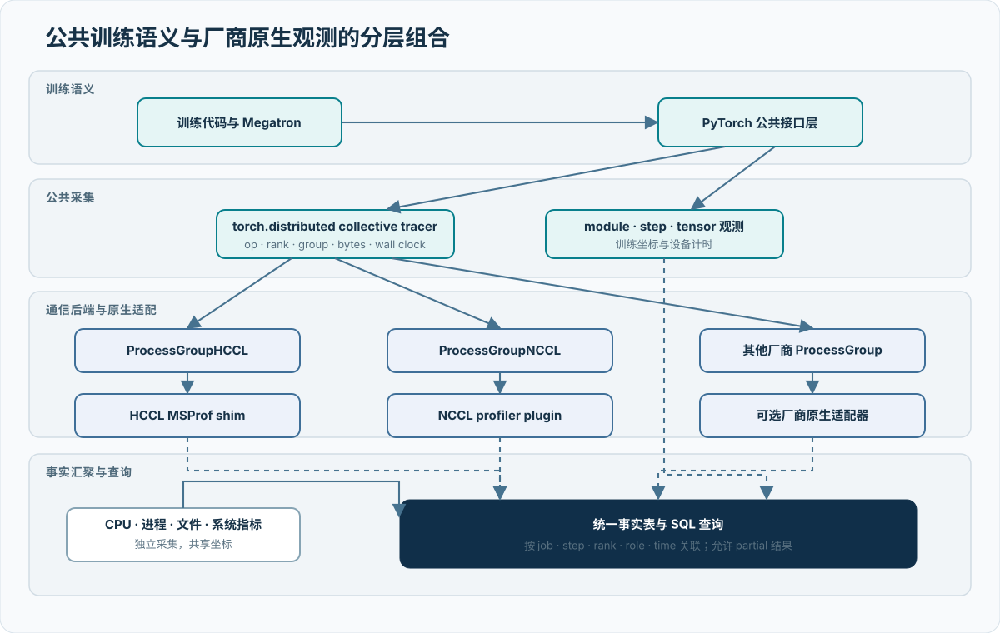

# 集群、网络与存储

## 集群组成与故障域

项目按 A3 与 C550 两个资源池组织训练数据面，控制面使用统一资源标识关联调度对象、物理节点和通信组。

`resource_pool → fault_domain → node_name → pod_name → local_rank → device_id`

每次实验固化节点、rank、设备和故障域映射，使性能波动、集合通信异常和设备事件能够回到具体物理路径。调度与健康检查使用同一资源标识体系，保障成员选择、故障隔离和维修回池的一致性。

| 资源池 | 项目规模 | 基础互连域 | 集合通信 | 训练组织 |
| --- | ---: | --- | --- | --- |
| Atlas 900 A3 | 8,192 卡 | 最大 384 NPU 灵衢逻辑超节点 | HCCL | 4 个 2,048 卡训练组 |
| 曦云 C550 | 2,048 卡 | 8 卡 MetaXLink 全互连 | MCCL | 4 个 512 卡训练组 |

## 网络层次

训练网络按三个层次设计：

1. **scale-up 互连**：承载节点内或逻辑超节点内高频通信。
2. **scale-out 网络**：承载跨节点、跨超节点集合通信和规模扩展流量。
3. **控制与存储网络**：承载调度、状态、训练数据、检查点和结果归档。

各层分别记录接口、链路速率、MTU、路由、拥塞控制、故障域和观测入口。通信性能以当前软件版本和实际拓扑下的 BusBW、AlgBW、collective latency、网络计数器与训练暴露时间共同评价。

## A3 互连与通信

{ .technical-diagram loading=lazy }

A3 在计算节点内使用 HiAM/HCCS-L1，在逻辑超节点内使用 HCCS-L2，跨逻辑超节点通过 Device 网卡与 RoCE 网络通信。该层次直接影响 TP、PP 和 DP 的通信距离：

| 并行组 | 主要通信 | 放置策略 |
| --- | --- | --- |
| TP | 高频 AllReduce / AllGather / ReduceScatter | 优先位于同一逻辑超节点 |
| PP | 相邻 stage Send / Recv | 相邻 stage 就近放置 |
| DP | ReduceScatter / AllGather | 跨超节点对称分布 |
| EP | All-to-All / All-to-AllV | 按节点容量和物理路径固化 |

HCCL rank table 由调度映射生成，校验 rank 唯一性、设备唯一性、组内覆盖、并行组完整性和故障域分布。每次 placement 变化生成新的 rank table 与摘要。

### 超节点亲和与出口均衡

调度器采用两级策略：

1. 将逻辑超节点块放入满足容量和健康状态的物理超节点。
2. 在块内分配节点、设备与出口网卡，使跨域通信负载对称。

评分函数综合跨域边数量、最忙出口负载、故障域分散度和并行组通信权重。高频 TP 组保持局部，DP 与跨组同步流量在可用出口间均衡，降低单个超节点或网卡成为全局尾部的概率。

### HCCL 参数优化

HCCL 配置围绕链路选择、缓存、算法和展开模式进行实验化管理：

| 参数方向 | 作用 | 评价指标 |
| --- | --- | --- |
| 通信域与算法 | 匹配消息大小和拓扑层次 | AlgBW、BusBW、P95 latency |
| buffer 大小 | 平衡流水线深度与显存占用 | 吞吐、显存峰值、尾部延迟 |
| rank 顺序 | 调整并行组物理路径 | 跨域边、出口负载、step time |
| 通信重叠 | 隐藏 DP/TP 通信 | 暴露通信、CV、TFLOPS/GPU |
| Gloo 组策略 | 优化超大规模初始化 | 建组时间、启动成功状态 |

8,192 卡实验通过 `--disable-gloo-group` 完成分布式优化器通信建组并进入训练迭代，验证了无 Gloo 全互连路径在目标规模的启动能力。

## C550 互连与通信

C550 节点内由 MetaXLink 构建 8 卡全互连，节点间使用 MCCL 与 scale-out 网络完成集合通信。健康检查以 Scale8、Scale16、Scale32、Scale64、Scale128 和 Final256 逐级验证通信组。

2,336 卡候选池筛查后形成 256 节点、2,048-rank 训练集合，Final256 通过。主轮 Scale8 的 TIMEOUT 通过换伙伴和定向复测收敛到节点/路径候选，首轮状态和复测结果共同用于成员选择。

C550 通信优化重点包括：

- MCCL/QP 创建与销毁状态。
- 256/512 卡 AllReduce 的 P50/P95/Max 延迟。
- RDMA retry、端口错误与交换路径。
- direct dispatch 对主机派发 Stall 的影响。
- 真实 Megatron 通信组与合成 collective 的同窗对照。

## 通信观测

通信观测采用训练层、通信库层和网络层三层关联：

| 层次 | 数据 | 用途 |
| --- | --- | --- |
| 训练层 | step、rank、并行角色、collective API | 识别异常阶段与等待 rank |
| 通信库层 | HCCL/MCCL task、算法、消息大小、stream | 识别算法展开和任务尾部 |
| 网络层 | NIC/端口/交换机 counter、QP 状态 | 识别流量、重传、拥塞和链路异常 |

常驻路径保存低开销摘要，异常窗口下钻到 task、kernel、stack 和端口计数器。跨 rank 先在节点本地计算分位数、Top-K 和异常集合，再合并为作业级视图。

{ .technical-diagram loading=lazy }

## 带宽与延迟验证

通信性能采用消息大小矩阵与真实训练形状结合：

| 测试 | 目的 | 主要指标 |
| --- | --- | --- |
| 单节点 collective | 校验 scale-up 互连 | BusBW、正确性、方差 |
| 成对节点通信 | 定位节点与链路 | avg/second-lowest BusBW、错误状态 |
| 多节点分组 | 评价 scale-out 路径 | P50/P95/Max、慢组与复测 |
| 训练拓扑 | 验证 TP/PP/DP/EP 真实通信域 | 组覆盖、正确性、完成时间 |
| Megatron 训练 | 评价通信对训练的实际影响 | 暴露通信、step time、扩展效率 |

带宽门限按硬件类型、通信库、拓扑和消息语义分别标定。大消息评价稳态带宽，小消息评价固定时延，真实训练组评价并行映射与并发通信域。

## 数据与存储链路

训练存储由数据读取、检查点、运行日志和实验归档组成：

| 数据类型 | 访问模式 | 存储策略 |
| --- | --- | --- |
| 训练样本 | 大规模顺序读与数据并行分片 | 分片、预取、本地缓存 |
| checkpoint | 周期性大对象写入与恢复读取 | 分层目录、原子提交、完整性校验 |
| 热运行数据 | SQLite、状态、短期日志 | 节点本地热库 |
| 实验结果 | 聚合表、配置、摘要、Git bundle | 受控归档与 SHA256 |
| profiler 原件 | 短窗口高密度事件 | 异常窗口保留与对象清单 |

健康检查运行时实验表明，共享 AFS SQLite 锁等待会放大控制面墙钟。热库迁移到本地路径并将执行、状态和结果回收解耦后，64 节点完整流水线由 1,706 秒缩短至 1,056 秒。

### 检查点容量

完整训练状态按每参数约 14 bytes 估算：

\[
S_{\text{ckpt}} \approx N_{\text{param}} \times 14\ \text{bytes}
\]

由此，200B 模型约 2.8 TB/份，1T 模型约 14 TB/份；保留 25 份时分别约 70 TB 和 350 TB。容量规划进一步加入文件系统冗余、分片元数据、临时写入空间和恢复并发。

### 归档结构

工程资产采用三层管理：

1. 本地运行层保存热状态和短期日志。
2. 实验归档层保存配置、聚合、脚本、Git bundle 与校验清单。
3. 大对象层保存 checkpoint、权重、派生数据和 profiler 原件。

EXP-014 已完成约 2.6 GB 工程快照、10/10 个 tar、6/6 个 Git bundle 和 75/75 项 SHA256 校验；约 22 TB 大对象和 84 GB profiler 原件通过对象清单管理。

## 容量与瓶颈预算

链路容量统一使用以下关系评估：

\[
\text{Headroom} =
\frac{B_{\text{available}} - B_{\text{peak-demand}}}
{B_{\text{available}}}
\]

| 链路 | 可用能力测量 | 峰值需求来源 | 优化手段 |
| --- | --- | --- | --- |
| 卡间互连 | 单节点 collective 与设备 counter | TP/EP 消息矩阵 | 并行组局部化、算法选择 |
| 节点网络 | 成对与多节点 BusBW、端口 counter | DP/跨域 collective | 出口均衡、拥塞控制 |
| 训练数据读取 | 稳态读带宽与数据等待 | batch、样本大小、并发 reader | 分片、预取、本地缓存 |
| 检查点写入 | 稳态写带宽与提交时延 | 状态大小、保存周期 | 分片并发、异步写入 |
| 观测与归档 | 事件率、压缩比、上传吞吐 | rank 数、采样率、保留周期 | 本地聚合、增量归档 |

网络与存储预算与模型配置、并行策略和检查点周期一并固化，形成训练前容量评审、运行中趋势监控和训练后资源复盘的闭环。
