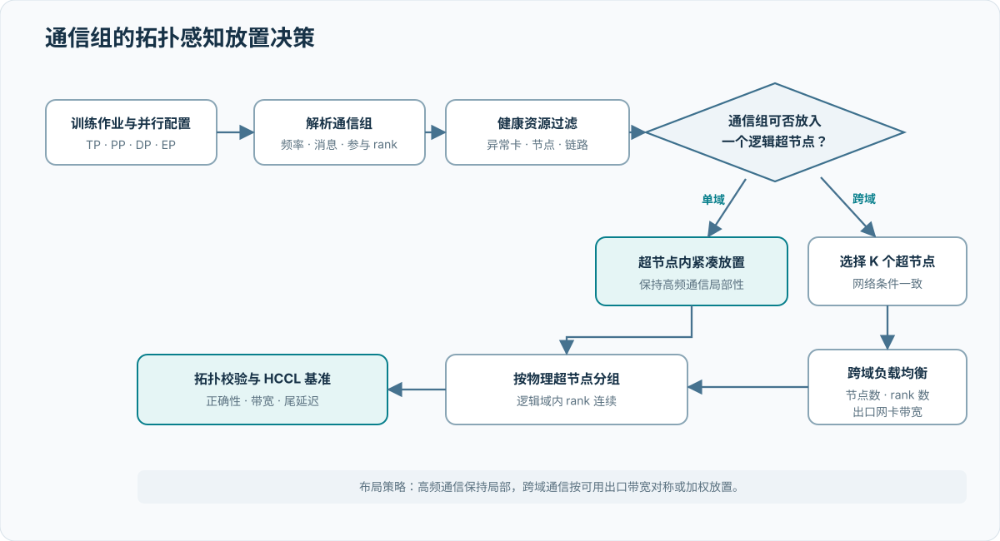

# 集群、网络与存储

## 集群组成与故障域

本项目按 A3 与 C550 两个资源池独立组织训练数据面。当前可确认的是资源池总卡数；节点数、每节点卡数、机架、交换域和电力故障域仍须由资产清单确认。报告中的“万卡”口径见[背景、目标与边界](01-background-and-goals.md)，不得用总卡数反推节点数或实际可参与单作业的卡数。

健康检查工具以 `pod_name`、`node_name`、`pod_ip`、`host_ip`、`rank` 和 `group_id` 关联调度对象、物理节点与通信组。生产部署还应补充 `resource_pool`、机架、交换域和供电域，形成以下最小映射：

```text
resource_pool -> fault_domain -> node_name -> pod_name -> local_rank -> device_id
```

该映射既用于拓扑感知调度，也用于把集合通信异常回溯到可隔离的节点或设备。映射快照必须与每次实验的稳定编号一起归档，不能只保留测试结束后的最新资产状态。

## 网络架构

网络说明按三个层级分别记录：节点内 scale-up 互连、节点间集合通信网络、控制与存储网络。每个层级至少给出接口、链路速率、收敛比、MTU、路由或选路策略、拥塞控制、故障域及观测入口。厂商公开带宽只能作为理论上界，项目可用能力必须由当前拓扑和同版本通信栈实测。

通信路径观测应同时覆盖主机通道、端口速率、地址与网卡映射、设备接口，以及集合通信前后的端口计数器；还应保留通信库的路径选择信息和设备侧状态。此类证据回答“通信库看到了什么、选择了什么”，但不能替代交换机侧遥测。若计算实例内没有有效计数器，只能写成“某条路径被识别或启用”，不能据此断言实际流量比例。

| 需要确认的问题 | 证据 | 判定边界 |
| --- | --- | --- |
| 通信库实际选择了哪些 HCA/rail | debug 日志、HCA 与 netdev 映射 | 日志选择不等于流量均衡 |
| 链路是否在测试期间承载流量 | 测试前后端口 counter 增量 | 需排除同端口其他作业流量 |
| 控制面是否误入数据面 | bootstrap/OOB 与 collective 日志、接口 counter | 需结合交换机侧数据复核 |
| 是否存在慢链路或拥塞 | 同 cohort 的 latency、AlgBW、BusBW 与网络遥测 | 单次低谷不直接归因为硬件 |

## 集合通信

集合通信检查应覆盖全规约、规约散射、全收集、广播、全交换和变长全交换。变长全交换需要包含均匀、倾斜、热点专家、随机和空专家等负载分布，以暴露 MoE/EP 中的非均匀通信问题。框架后端名称与底层通信运行时不是同一层概念，报告必须分别冻结通信库版本、关键参数和运行环境摘要。

通信性能优先采用同硬件、同规模、同一运行窗口内的横向比较。固定绝对门限仅在完成硬件、拓扑、消息规模和软件版本标定后启用，不把其他硬件或其他节点规模的阈值直接移植。具体测量与复测规则见[评测方法](07-evaluation-methodology.md)。

两类资源池现在都有厂家通信工具对照入口：A3 使用官方 HCCL test，C550 使用镜像内置 `mccl_perf`，后者覆盖六类 collective 和 1 KiB～2 GiB 消息矩阵。厂家扫描用于通信库极限、环境复现和实现交叉验证，不属于训练 topology gate；尤其是全局 All-to-All 的 QP 压力可能远高于真实 EP 子组，不能用其失败直接判定 Megatron 训练拓扑失败。

[EXP-008](https://github.com/reiase/tenk_report/blob/master/experiments/exp-008-c550-stall-and-communication-tail/README.md) 补充了一组不同集群上的 C550 文档级 AllReduce 现象：256 MiB、256 卡干净轮次超过 60 GB/s，512 卡约 50 GB/s，但部分重复出现长尾，512 卡 P99 最高 1,043 ms；增加 QP 反而使 256 卡从 63.3 降到 19.4 GB/s、512 卡从 49.7 降到 29.1 GB/s。另有混训记录出现 `IBV_WC_RETRY_EXC_ERR`。这些证据缺少交换机与端口 counter，且不来自同一集群，只能形成通信栈/网络复测候选，不能归因到 C550 芯片或与单卡 Stall 合并。

## A3 通信优化与超节点亲和性调度

本节给出通信优化的概要。硬件通信层级、调度约束、两级放置算法、Megatron rank 映射、HCCL 参数、实验矩阵和故障回退的完整设计见专题章节 [A3 HCCL 通信优化与超节点亲和性调度](04a-a3-hccl-communication-optimization.md)。后续实现和数据以专题章节为权威版本，本节用于说明它与集群网络、健康检查和存储链路的关系。

### 优化目标

A3 资源池包含 8,192 张加速卡。HCCL 在 A3 上支持 AllReduce、ReduceScatter 和 AllGather 等算子跨节点内、超节点内和超节点间通信域执行。[R003](references.md#r003) 大规模 Megatron 训练中的数据并行梯度同步会产生大消息 AllReduce；通信组的完成时间由最慢 rank 和最拥塞路径决定，因此仅保证“卡数足够”并不能保证通信带宽。

本项目同时优化两个目标：

- **局部性**：通信组可以放入一个逻辑超节点时，优先保持超节点内亲和，利用超节点内部高速互连。
- **跨域均衡**：通信组必须跨越多个超节点时，让所选超节点承担相近的节点数、rank 数、通信量和出口网卡负载，避免部分网卡过载而其他网卡空闲。

局部性决定是否跨超节点，负载均衡决定跨超节点以后如何放置。小任务不应为了“均匀”而主动扩大通信距离；跨域大任务也不应沿用只考虑资源碎片的随机或紧凑放置。

### HCCL 拓扑表达

A3 超节点模式使用 HCCL rank table 1.2。资源表中的关键字段如下：

| 字段 | 作用 | 本项目约束 |
| --- | --- | --- |
| `server_id` | AI Server 全局唯一标识 | 与资产、调度和监控标识一致 |
| `device_id` | NPU 在服务器内的物理编号 | 来自设备发现，不手工推断 |
| 超节点内设备编号 | NPU 在超节点系统内的唯一物理编号 | 通过设备管理面查询并校验唯一性 |
| `rank_id` | NPU 在本次通信域中的逻辑编号 | 全局唯一；逻辑超节点内保持连续 |
| `device_ip` | Device 网卡地址 | 多超节点组网必须配置 |
| `backup_device_ip` | 超节点间通信失败时的备用 Device 网卡 | 仅在同一 NPU 的两个 Die 网卡间配对 |
| 超节点标识 | 物理或逻辑超节点归属 | 与调度结果一致 |

HCCL 官方拓扑约束要求同一超节点的 AI Server 在 rank table 中连续成组，不支持将不同物理超节点的 Server 交叉排列。[R004](references.md#r004) 因此必须区分两个动作：

1. 调度器在物理超节点、节点和网卡之间均衡选择资源。
2. 通信拓扑仍按物理超节点分组，并保持逻辑超节点内部 rank 连续。

不能用交叉排列 rank table 的方式模拟物理负载均衡。HCCL 需要正确的拓扑元数据来选择节点内、超节点内和超节点间通信路径。

健康检查还需区分调度使用的逻辑超节点和实际硬件落位。升级后的工具把 pod 注解 `super-pod-rank` 记录为逻辑超节点，把 `super-pod-id` 记录为物理超节点；逻辑分组要求完整且均衡，物理分布允许不均匀。Pairwise 先覆盖物理超节点内路径，再按固定 seed 采样跨物理超节点链路，性能 cohort 按“节点内/精确物理超节点对”分开，避免把不同路径层级直接比较。

链路归因采用独立证据：同一节点跨不同伙伴持续偏离才归为节点候选；同一物理超节点链路上至少两个节点不重叠的 pair 持续异常，且两端超节点内控制组正常，才归为物理超节点链路候选；只在固定 pair 复现时保留为 pair path 候选。该分类用于缩小排查范围，最终仍需设备、HCCL 与交换网络证据确认。

### 调度策略

华为 MindCluster 的亲和性调度以减少资源碎片和网络拥塞为目标。其 A3 逻辑超节点约束包括：逻辑超节点内节点必须属于同一物理超节点、NPU rank ID 连续，并为任务指定逻辑超节点大小。[R005](references.md#r005)

本项目在官方亲和性约束上增加面向跨超节点 AllReduce 的均衡策略：

1. 从候选资源中排除坏卡、慢卡、异常 Device 网卡和降速链路。
2. 从 Megatron 配置解析张量并行、流水线并行、数据并行和专家并行通信组。
3. 将张量并行等高频通信组优先放入同一逻辑超节点。
4. 若数据并行组必须跨越 `K` 个超节点，则选择网络条件一致且健康容量满足要求的超节点集合。
5. 将任务所需的 `J` 个 AI Server 均匀分配到所选超节点，使任意两个超节点的节点数之差不超过 1。
6. 在每个超节点内部继续按节点和出口网卡组对称分配，避免跨域 rank 集中到同一组网卡。
7. 生成 rank table 后，校验每个数据并行组在各超节点中的 rank 数、消息量和网卡映射是否对称。

若 \(a_s\) 表示任务在超节点 \(s\) 上使用的 AI Server 数，则等容量场景满足：

\[
\sum_s a_s=J,
\qquad
\max_s a_s-\min_s a_s\le 1,
\qquad
a_s\le C_s^{\mathrm{healthy}}
\]

若超节点之间的可用网卡数、链路速率或健康状态不同，应按实测可用出口带宽加权，而不是强制等节点数。节点数量相同只是流量均衡的必要条件，不是充分条件。

{ .technical-diagram loading=lazy }

### Megatron rank 映射

Megatron 的并行维度应匹配 A3 物理拓扑：

- **张量并行组**通信频繁，优先完整落在同一逻辑超节点，条件允许时进一步保持在更近的互连域。
- **流水线并行组**主要产生相邻 stage 点对点通信，应避免相邻 stage 反复跨越超节点边界。
- **数据并行组**承担 AllReduce/ReduceScatter/AllGather；跨超节点时，每个超节点应贡献相同或按带宽加权的 rank 数，并保持不同数据并行组的映射对称。
- **专家并行组**产生 AlltoAll/AlltoAllV 流量，需单独建模，不能直接套用 AllReduce 的最优映射。

全局 rank 顺序不能只按主机名或空闲资源发现顺序生成。需要综合调度结果中的物理超节点、节点、设备和网卡拓扑，再共同形成 Megatron 并行组和 HCCL 通信拓扑。

### HCCL 算法选择

HCCL 文档显示，A3 的节点间和超节点间 AllReduce 支持 ring、H-D_R、NHR、NB 等算法或分层算法；支持度与自动回退会随 CANN/HCCL 版本、消息类型和执行模式变化。[R006](references.md#r006) 本项目采用以下流程：

1. 先以 HCCL 自动选型作为基线，不在未经验证时全局固定通信算法。
2. 使用与 Megatron 梯度桶相符的消息大小，分别测试超节点内和跨超节点 AllReduce。
3. 只在冻结软件版本、拓扑和消息范围的 A/B 实验中比较显式算法配置。
4. 同时记录算法带宽、尾延迟、单步时间与正确性，不能只看峰值带宽。
5. 将 CANN/HCCL 版本、环境变量、rank table 哈希和调度映射随实验归档。

HCCL 对 A3 提供零拷贝、确定性计算和通信算子重执行等能力，但文档中的“支持”不表示当前版本默认开启，也不表示对当前消息规模一定更快，必须逐项验证后启用。[R003](references.md#r003)

### 带宽验证

HCCL 性能工具将集合通信算法带宽定义为单个 NPU 参与通信的数据量除以算子耗时：[R007](references.md#r007)

\[
B_{\mathrm{alg}}=
\frac{D_{\mathrm{message}}}{t_{\mathrm{AllReduce}}}
\]

该指标同时受 Server 间 RDMA、Server 内 HCCS/SDMA、PCIe 和通信算法编排影响。验证至少包含以下三组：

| 测试组 | 放置方式 | 目的 |
| --- | --- | --- |
| 超节点内基线 | 单个逻辑超节点内完整放置 | 建立高速互连上限和消息大小曲线 |
| 跨超节点非均衡对照 | 固定一个可复现的不对称放置 | 量化热点链路的影响 |
| 跨超节点均衡实验 | 各超节点节点数和网卡负载对称 | 验证调度优化收益 |

测试消息范围覆盖 Megatron 实际梯度桶，并记录：

- AllReduce 算法带宽及 P50/P95/P99 延迟；
- 各 Device 网卡发送/接收吞吐、重传、丢包和错误计数；
- 每个超节点的 rank 数、通信量和出口带宽；
- 最忙与最闲网卡吞吐比、网卡吞吐变异系数；
- 通信时间占 step 时间比例、计算通信重叠率和端到端吞吐；
- 相同拓扑重复运行的离散程度。

均衡策略只有在 AllReduce 带宽、尾延迟和 Megatron 单步时间同时改善或至少不退化时，才能进入默认配置。具体门限由稳定的小规模基线确定，本报告当前不预设未经验证的目标值。

### 风险与边界

- 均匀铺开会增加资源碎片；小任务优先超节点内紧凑放置，大任务才启用跨域均衡。
- 卡数均衡不等于流量均衡；并行组、消息大小和网卡健康状态都会改变实际负载。
- 物理放置均衡不要求在 rank table 中交叉排列超节点，后者不符合 HCCL 配置约束。
- HCCL 单算子测试不能替代 Megatron 端到端验证，最终结论以真实梯度桶和训练 step 为准。
- 当前缺少项目实际 rail/plane 映射、网卡数和交换网络收敛比，获取部署拓扑后需要补齐加权策略。

## 数据与存储链路

训练数据读取与检查点写入尚无可核验配置，需分别记录数据源、缓存层、预取、并发度、峰值读取带宽、检查点大小、写入频率、写入时延和恢复时延。

健康检查结果采用“共享存储保留紧凑证据、计算实例本地暂存原始明细”的分层策略。共享层保留运行参数、实例映射、聚合结果和异常明细；成功实例的完整输出可以按策略抽样保留，失败、超时或传输校验失败时必须保留排障证据。正式验收应明确实例释放前的原始数据回收窗口，避免证据随临时运行环境消失。

结果传输必须携带结构版本、实验身份、来源实例、测试阶段、数据长度和完整性摘要；出现截断时应从实例侧暂存证据恢复。只有覆盖清单完整且校验通过的数据才能进入汇总。这保证的是传输完整性，不等于测试本身通过。

训练观测采用同样的数据局部性原则：高频事件先在 rank 或节点本地过滤、分桶和聚合，跨网络只传输当前问题需要的分位数状态、Top-K、异常 rank 集合或窄窗口原始事件。容量预算必须分别估算本地环形缓冲、节点聚合、跨节点查询和受控原始证据四层，不能用“平均每条事件大小 × 总 rank 数”直接设计一个永久中心写入通道。节点释放前需要完成异常证据固化，否则本地优先会退化为不可复核。

## 容量与瓶颈预算

| 链路 | 理论能力 | 可用能力 | 峰值需求 | 余量 | 证据 |
| --- | ---: | ---: | ---: | ---: | --- |
| 卡间互联 | 待补充 | 待补充 | 待补充 | 待补充 | 待补充 |
| 节点网络 | 待补充 | 待补充 | 待补充 | 待补充 | 待补充 |
| 训练数据读取 | 待补充 | 待补充 | 待补充 | 待补充 | 待补充 |
| 检查点写入 | 待补充 | 待补充 | 待补充 | 待补充 | 待补充 |

容量表中的“可用能力”采用相同软件版本下的稳态实测值；“峰值需求”来自冻结后的训练配置或通信 trace；“余量”按同一单位计算，并同时报告测量窗口和重复次数。健康检查的 BusBW 只描述合成 collective，不直接等于 Megatron 端到端通信效率。

## 当前证据边界

本章给出了网络与存储的测量原则，并导入了 C550 通信尾延迟与 RDMA retry 的文档级现象，但当前材料仍没有生产资产清单、交换机遥测、存储压测或可独立重算的原始健康检查结果。因此，本章不构成对 10,240 卡生产网络与存储能力的验收结论。复现和证据导入要求见[复现实验清单](appendix-b-reproducibility.md)。
