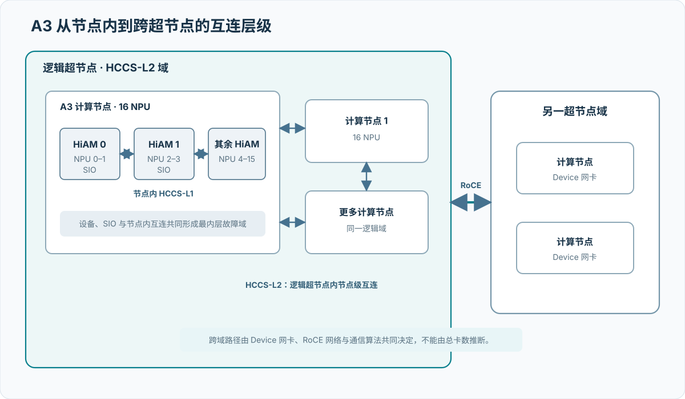
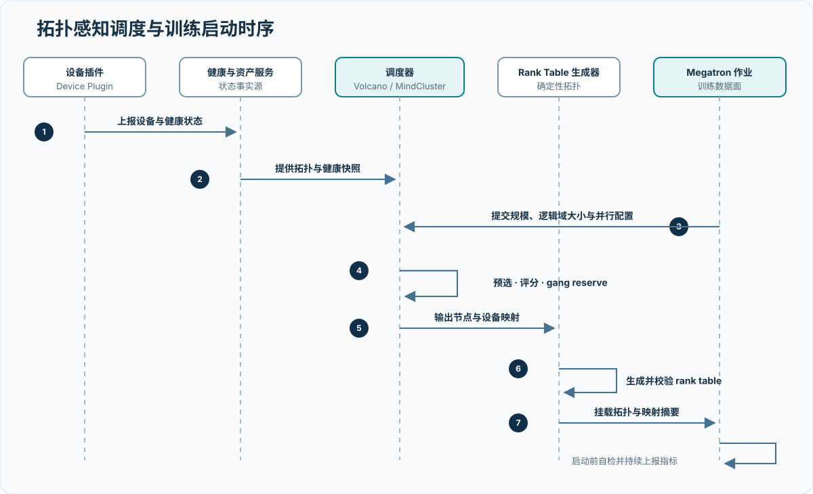

# 拓扑感知通信与 A3 HCCL 案例

## 1. 研究对象与问题

本项目的 A3 资源池包含 8,192 张加速卡。规模扩大后，AllReduce 的性能不只取决于单卡或单链路能力，还取决于训练 rank 如何落在 HiAM 模组、计算节点、逻辑超节点、物理超节点和 RoCE 出口网卡上。只要一个通信组中的部分 rank 共用热点链路，整个集合通信就会等待最慢路径，最终表现为通信尾延迟升高、训练 step 抖动和扩展效率下降。

本章给出一套完整方法：

1. 用统一拓扑模型描述 A3 的硬件和 HCCL 通信层级。
2. 将 Megatron 并行组转换为可计算的通信需求。
3. 先满足硬件和 HCCL 的亲和性约束，再优化跨超节点负载均衡。
4. 让大型任务在选定的物理超节点、计算节点和出口网卡之间对称分配。
5. 生成拓扑正确的 HCCL rank table 和 Megatron rank 组。
6. 用单算子、网卡遥测和端到端训练三层证据验证收益。

这里的核心不是“把 rank 尽量铺散”，而是采用两级策略：

- 能在一个逻辑超节点内完成的通信尽量不跨域。
- 必须跨越多个逻辑或物理超节点的通信，在跨域后尽量均衡。

## 2. 事实、假设与待确认项

### 2.1 已确认事实

- 项目 A3 资源池规模为 8,192 张加速卡。
- Atlas 900 A3 SuperPoD 的厂商公开规格最大支持 384 张 NPU 高速互联。[R001](references.md#r001)
- 华为 MindCluster 文档描述的 A3 计算节点包含 8 个 HiAM 模组，每个 HiAM 由 2 个 NPU 通过 SIO 连接，因此一个计算节点包含 16 个 NPU；HiAM 之间使用 HCCS-L1，计算节点之间使用 HCCS-L2。[R008](references.md#r008)
- 同一逻辑超节点中的计算节点使用 HCCS 通信，不同逻辑超节点之间使用 RoCE 通信。[R008](references.md#r008)
- A3 超节点模式的通信拓扑描述需要显式表达物理超节点、超节点内设备、设备网卡和逻辑 rank 的对应关系。[R004](references.md#r004)

### 2.2 项目策略

- 将训练资源准入作为调度前置条件，功能异常设备、持续性能离群设备和异常链路不进入候选集。
- 将高频、细粒度通信优先保留在更近的互连域。
- 对跨超节点数据并行通信组实施对称放置，避免出口网卡负载倾斜。
- 调度决策和 HCCL 算法参数分别调优，避免同时改变多个变量而无法归因。

### 2.3 尚未确认

生产资产和网络配置决定这套方法能否落地，不能由公开规格或总卡数反推。物理超节点数量及实际规格决定 HCCS-L2 域和跨域边界；每个计算节点的 Device 网卡数量、rail/plane 映射，以及交换拓扑、收敛比和 ECMP 策略，共同决定卡数均衡能否真正转化为链路均衡。CANN、HCCL、MindCluster 和驱动版本决定调度约束与算法行为，Megatron 分支、并行组合和梯度桶决定通信组与消息分布。多租户或共享网络流量则决定可用带宽及实验能否形成有效对照。

## 3. A3 通信层级

### 3.1 硬件拓扑

{ .technical-diagram loading=lazy }

图中只表达通信层级，不代表项目的具体布线。正式报告应使用项目拓扑替换节点和网卡数量。

### 3.2 通信距离

| 层级 | 典型边界 | 官方描述的互连 | 调度含义 |
| --- | --- | --- | --- |
| L0 | 同一 HiAM 内 2 个 NPU | SIO | 成对分配时保持 HiAM 完整 |
| L1 | 同一计算节点内不同 HiAM | HCCS-L1 | 高频组尽量不拆散到多个节点 |
| L2 | 同一逻辑超节点内不同计算节点 | HCCS-L2 | 优先承载超节点内并行组 |
| L3 | 不同逻辑超节点 | RoCE | 需要网卡和交换网络负载均衡 |

MindCluster 不同版本对分布式任务每个 Pod 可申请 NPU 数量的描述存在演进。较新的 7.3 文档允许部分分布式场景申请 2～16 个 NPU，但逻辑超节点亲和任务仍以 16 NPU 为申请单位。[R009](references.md#r009) 本项目必须以实际安装版本和 A3 产品形态为准；下文默认逻辑超节点亲和训练使用完整 16 NPU 计算节点。

### 3.3 逻辑超节点大小的含义

逻辑超节点大小表示一个调度块包含的 NPU 数量。它应当：

- 是单个计算节点 NPU 数的整数倍；
- 能整除任务总 NPU 数；
- 对应的计算节点全部位于同一个物理超节点；
- 在逻辑超节点内部使用连续 rank。

如果总任务规模为 \(N\)，则逻辑超节点数量为：

\[
N_{\mathrm{logical\ superpod}}=\frac{N}{S_{\mathrm{block}}}
\]

例如，\(N=1024\)、\(S_{\mathrm{block}}=256\) 时，任务包含 4 个逻辑超节点，每个逻辑超节点包含 16 个完整计算节点。该示例仅用于解释算法，不代表项目最终配置。

## 4. AllReduce 流量为何受调度影响

### 4.1 集合通信的同步特征

设通信组包含 \(R\) 个 rank，每个 rank 的消息大小为 \(M\)，完成时间为 \(t_r\)。集合通信的可见完成时间近似由最慢 rank 决定：

\[
t_{\mathrm{collective}}=\max_{0\le r<R}t_r
\]

因此，平均网卡利用率较高并不足以证明性能良好。只要某个超节点的出口网卡、交换路径或 rank 映射形成热点，所有其他 rank 都会在同步点等待。

HCCL 性能工具使用的算法带宽为：[R007](references.md#r007)

\[
B_{\mathrm{alg}}=
\frac{D_{\mathrm{message}}}{t_{\mathrm{collective}}}
\]

算法带宽受 HCCS、RoCE、PCIe、通信算法和调度拓扑共同影响。调度优化主要改变数据经过哪些节点和网卡，不能替代 HCCL 算法或网络侧调优。

### 4.2 不均衡如何逐层形成

不均衡首先可能出现在物理超节点之间：大部分 Pod 落入少数超节点后，跨域数据天然集中。即使超节点数量均衡，跨域 rank 仍可能集中在其中少数计算节点，使部分 Device 网卡满载而其他网卡空闲；rank 与 rail/plane 的不对称又会把节点级倾斜进一步压缩到单个网络平面。

另一类不均衡来自训练语义。TP、PP、DP 通信组若没有匹配物理拓扑，高频通信会反复穿越 RoCE 边界。持续性能离群设备、降速链路和错误重传会抬高尾延迟，即使平均带宽仍正常；共享交换域中的其他流量还会使同一映射在不同时间窗口呈现不同结果。因此调度、设备健康和背景网络必须在同一实验中冻结。

### 4.3 优化对象

对每个物理超节点 \(s\) 和出口网卡组 \(r\)，定义预计经过该出口的跨域通信量 \(L(s,r)\) 与当前健康状态下的可用带宽 \(C(s,r)\)。归一化负载为：

\[
\ell(s,r)=\frac{L(s,r)}{C(s,r)}
\]

调度器不直接追求最小总流量，而是按以下优先级优化：

1. 满足所有硬约束和健康准入。
2. 尽量减少必须跨越 RoCE 的高频通信组数量。
3. 最小化最大 `normalized_load`。
4. 最小化各出口之间的负载离散程度。
5. 在性能相当时减少资源碎片和迁移成本。

以 16 个需要承担跨域通信的计算节点和 4 个等容量物理超节点为例：非均衡方案可能形成 `(10, 4, 2, 0)`，均衡方案为 `(4, 4, 4, 4)`。在“每个节点映射到等价出口、网络无其他瓶颈”的理想假设下，最忙超节点承担的份额从 10 下降到 4。这个例子只说明均衡调度降低热点负载的机制，不能据此推导 AllReduce 带宽会提升 2.5 倍；HCCL 算法、交换路径、消息分片和并发方式都会影响实际收益。

## 5. 调度问题建模

### 5.1 输入

调度需要同时读取四类输入。资源拓扑描述物理超节点、节点、设备、网卡组和故障域；健康快照给出卡、HiAM、HCCS、Device 网卡、节点和超节点在同一时刻的状态；作业规模定义总 NPU、工作单元大小和逻辑超节点大小；Megatron 配置则生成 TP、PP、DP、CP、EP 通信组及估计消息量。缺少其中任一类，调度器都只能优化一个不完整的通信图。

每次调度使用不可变的拓扑快照和健康快照。调度完成后若任一快照发生变化，必须重新校验，不允许静默沿用旧映射。

### 5.2 硬约束

候选方案必须满足：

- 所有设备、节点和网卡通过健康准入且不处于隔离状态。
- 逻辑超节点不跨越物理超节点。
- 逻辑超节点包含完整数量的计算节点。
- 逻辑超节点大小是节点 NPU 数的整数倍，且能整除任务总 NPU 数。
- 逻辑超节点内 rank 连续。
- 通信拓扑描述中属于同一物理超节点的服务器连续排列。[R004](references.md#r004)
- 同一设备不能被两个 Pod 或通信组重复占用。
- Megatron 各并行维度的乘积与 world size 一致。
- 分布式逻辑超节点任务的单 Pod NPU 申请满足当前 MindCluster 版本约束。[R009](references.md#r009)

### 5.3 软目标

在所有合法方案中，依次比较：

1. TP、CP 等高频通信组是否完整落在 L0/L1/L2 域。
2. 逻辑超节点块是否均匀分布到选定的物理超节点。
3. 每个数据并行组在各物理超节点中的 rank 数是否对称。
4. 各 Device 网卡或 rail 的预计负载是否均衡。
5. 物理超节点是否保留可继续调度的完整逻辑块。
6. 故障重调度是否尽量保持未故障 rank 的位置不变。

## 6. 两级超节点调度策略

### 6.1 第一级：逻辑超节点块放置

首先把任务拆成 \(L=N/S_{\mathrm{block}}\) 个逻辑超节点块。每个块包含 \(S_{\mathrm{block}}/16\) 个计算节点。若可用物理超节点数量为 \(P\)：

- 当 \(L\le P\) 时，优先将每个逻辑块放到不同物理超节点，前提是这不会增加本可避免的跨域通信。
- 当 `L > P` 时，将逻辑块按物理超节点健康容量和出口带宽加权分配。
- 等容量场景下，任意两个选中物理超节点承载的逻辑块数量之差不超过 1。

设物理超节点 \(s\) 承载的逻辑块数为 \(b_s\)，逻辑块总数为 \(L\)：

\[
\sum_s b_s=L,
\qquad
\max_s b_s-\min_s b_s\le 1,
\qquad
b_sS_{\mathrm{block}}\le N_s^{\mathrm{healthy}}
\]

其中第二个约束适用于等容量场景。

若出口能力不一致，则用可用带宽权重 \(w_s\) 计算目标份额：

\[
b_s^{\mathrm{target}}\approx
L\frac{w_s}{\sum_j w_j}
\]

权重必须来自同版本、同消息矩阵的实测，而不是使用厂商理论峰值。

### 6.2 第二级：计算节点和网卡放置

逻辑块进入物理超节点后，继续选择具体计算节点：

1. 优先选择 16 NPU 全健康且 HCCS 状态一致的节点。
2. 按 `nic_group` 或 rail 对节点分桶。
3. 轮流从当前预计负载最低的桶中选择节点。
4. 对同一数据并行组保持网卡物理位置对称。
5. 若节点只有部分 NPU 健康，不将其用于完整节点逻辑超节点任务。
6. 保存从 `logical_block -> node -> device -> nic_group` 的完整映射。

卡数相同不代表流量相同。如果不同网卡组的速率、上联或当前占用不同，应按 `available_bandwidth` 做加权最小负载选择。

### 6.3 调度评分

每个候选物理超节点的评分可以写成归一化的词典序，而不是一个难以解释的魔法权重：

\[
\operatorname{score}(c)=\Bigl(
I_{\mathrm{hard}}(c),
S_{\mathrm{locality}}(c),
-\ell_{\max}(c),
-\operatorname{Var}[\ell(c)],
C_{\mathrm{contiguous}}(c),
-C_{\mathrm{migration}}(c)
\Bigr)
\]

按元组从左到右比较。这样不会出现“为了少一点碎片而违反健康准入”或“为了均衡网卡而把 TP 组拆出超节点”的情况。

### 6.4 调度步骤

1. 校验任务总规模、每节点设备数、逻辑超节点大小和并行度乘积。
2. 从资产与健康快照中筛出设备完整、版本一致的健康节点。
3. 将任务划分为不可拆分的逻辑超节点块。
4. 为每个逻辑块筛选具有连续容量的物理超节点，并按局部性、网卡最大负载、负载方差、碎片和迁移成本进行词典序选择。
5. 在选定物理超节点内按网卡组均衡选择计算节点，并进行整体资源预留。
6. 将 Megatron 并行组映射到已确定的物理拓扑，生成通信 rank 关系。
7. 校验设备、rank、超节点和网卡映射的不变量，再归档拓扑、健康和调度证据。

## 7. Megatron 并行组映射

### 7.1 原则

| 并行维度 | 主要通信 | 推荐边界 | 原因 |
| --- | --- | --- | --- |
| TP | AllReduce、AllGather、ReduceScatter | 优先 L0/L1，至少保持在 L2 | 高频且位于层内关键路径 |
| CP/SP | AllGather、ReduceScatter、点对点 | 优先同一逻辑超节点 | 消息随序列长度增长 |
| PP | 相邻 stage Send/Recv | 相邻 stage 尽量位于同一逻辑块或相邻节点 | 减少边界激活跨域次数 |
| DP | AllReduce 或 ReduceScatter + AllGather | 允许跨物理超节点，但组内对称 | 扩展维度大，适合利用多组出口网卡 |
| EP | AlltoAll/AlltoAllV | 单独按流量矩阵优化 | 负载可能强烈非均匀 |

调度前应从 Megatron 配置显式生成每个通信组，而不是只看 world size。若启用了分布式优化器，数据并行通信可能从 AllReduce 变成 ReduceScatter 和 AllGather，消息矩阵也随之变化。

### 7.2 对称映射示例

假设仅用于说明：

- 总规模：1,024 NPU；
- 每 256 个 NPU 形成一个逻辑超节点块，共形成 4 个逻辑块；
- 每个逻辑块部署在一个不同的物理超节点；
- 其余并行维度乘积为 256，DP=4。

rank table 按物理超节点分组：

| 物理超节点 | rank 范围 | 逻辑块 |
| --- | --- | --- |
| SP0 | 0～255 | B0 |
| SP1 | 256～511 | B1 |
| SP2 | 512～767 | B2 |
| SP3 | 768～1023 | B3 |

对于某个本地模型分片 `r`，对应的数据并行组为：

\[
G_{\mathrm{DP}}(r)=
\{r,\ 256+r,\ 512+r,\ 768+r\}
\]

这样，每个 DP 组在四个物理超节点各有一个 rank；全部 DP 组共同使用各超节点的多个计算节点和 Device 网卡。rank table 仍按超节点连续分组，没有交叉排列 Server。

该示例成立的前提是 Megatron 并行组由显式 rank 列表构造。若训练系统依赖固定的全局 rank 算术顺序，则需要验证 rank 生成语义是否与上述分组兼容。

### 7.3 错误映射示例

以下做法应在启动前拒绝：

- TP 组一半位于 SP0、一半位于 SP1，导致每层频繁跨 RoCE。
- 四个物理超节点的 DP rank 分布为 70%、20%、10%、0%。
- rank table 为追求轮询而按 SP0、SP1、SP0、SP1 交叉排列 Server。
- 只按节点名称排序，不读取物理超节点和超节点内设备关系。
- 重调度后节点变化，但继续使用旧 rank table 或旧性能基线。

## 8. HCCL rank table 生成与校验

### 8.1 生成流程

```text
调度结果
  -> 按物理超节点、逻辑块和节点排序
  -> 绑定设备与超节点内设备关系
  -> 绑定主用和备用设备网卡
  -> 分配连续逻辑 rank
  -> 形成超节点成员关系
  -> 结构与拓扑校验
  -> 计算内容哈希
  -> 随作业启动并归档
```

### 8.2 必须校验的不变量

- 服务器计数与实际计算实例或节点数一致。
- 服务器标识、设备地址和逻辑 rank 全局唯一。
- 超节点内设备标识在对应超节点中唯一并来自设备管理面。
- 同一物理超节点的服务器在通信拓扑描述中连续出现。
- 超节点成员关系中每个服务器恰好出现一次。
- 每个逻辑超节点内部 rank 连续。
- rank table 中的节点、设备和网卡全部来自本次调度快照。
- 备用 Device 网卡与主网卡属于同一 NPU 的不同 Die，且不存在重复借轨。
- Megatron 总规模、计算实例数、每实例 NPU 数与通信拓扑一致。

### 8.3 证据与复现记录

每次运行至少保存拓扑快照、健康快照、调度决策、Megatron 并行组、HCCL rank 关系、运行环境摘要和完整性校验信息。各项证据必须共享同一运行标识，并能相互验证节点、设备、rank 和超节点关系。

## 9. 调度系统集成

### 9.1 控制链路

{ .technical-diagram loading=lazy }

### 9.2 调度阶段

1. **Admission**：校验总规模、每个工作单元的 NPU 数、逻辑超节点大小和并行度乘积。
2. **Pre-filter**：排除非健康、版本不一致、容量不足或拓扑缺失的节点。
3. **Block construction**：将 Pod 构造成不可拆的逻辑超节点块。
4. **Physical placement**：在物理超节点之间均衡放置逻辑块。
5. **Node ordering**：在超节点内按网卡组和健康余量选择计算节点。
6. **Gang reservation**：一次性预留所有 Pod，避免部分绑定后等待造成资源死锁。
7. **Rank generation**：根据确定的物理映射生成 rank table 和 Megatron 通信组。
8. **Preflight**：执行 Device 网卡连通性和小消息/大消息 HCCL 冒烟测试。
9. **Launch**：只有映射、rank table 和预检全部通过才进入正式训练。

### 9.3 元数据原则

调度元数据至少表达资源池、物理超节点、网卡组、拓扑快照版本和健康快照版本。官方字段必须按实际 MindCluster 版本使用；项目自定义标签应位于独立命名空间，并明确标注为非官方语义。落地前应与设备插件、调度器和资产系统的字段定义对齐。

### 9.4 逻辑超节点参数

MindCluster 7.3 将逻辑超节点大小定义为任务级调度约束；启用后，调度器需要保证同一逻辑块位于一个物理超节点内且 rank 连续。[R013](references.md#r013) 不同 MindCluster/Ascend Operator 版本可能将这一约束放在不同层级。提交前必须依据集群实际安装版本的资源模型确认其生效，并由准入检查读取最终调度结果验证，而不能只检查提交文本中是否声明了该参数。

## 10. HCCL 配置调优

调度优化先保证拓扑正确，再调整 HCCL 参数。推荐采用“默认基线—单变量 A/B—端到端确认”的顺序。

| 参数类别 | 作用 | A3 基线策略 | 风险 |
| --- | --- | --- | --- |
| 通信算法选择 | 指定节点间或超节点间算法 | 先使用自动选型，再按消息范围比较 | 固定算法可能在其他规模或消息大小退化 |
| 超节点内链路选择 | 在 HCCS 与 RoCE 之间选择 | 默认优先 HCCS | 为“多用网卡”切换到 RoCE 可能破坏局部性 |
| 通信缓存大小 | 控制每个通信域的收发缓存 | 根据梯度桶和可用显存做单变量比较 | 通信域多时总缓存可能造成显存压力 |
| 算子展开模式 | 选择控制核或向量核等执行方式 | 以版本默认行为为基线 | 适用性受算子、消息大小和跨域能力限制 |
| RoCE 流量类别 | 将通信流量映射到网络 QoS | 与交换网络统一配置 | 单方面修改可能进入错误队列 |
| 诊断信息级别 | 输出算法与资源选择信息 | 仅在诊断实验中增强 | 增加日志开销和容量 |

### 10.1 链路选择

超节点内通信应优先使用 HCCS/SDMA，跨超节点时才使用 RoCE/RDMA。[R010](references.md#r010) 不应为了提高网卡利用率而把本可在 HCCS 内完成的通信切换到 RoCE。目标是让**不可避免的跨超节点流量**均匀使用网卡，而不是制造额外跨域流量。

### 10.2 缓存大小

通信缓存用于两个 NPU 之间的数据收发，每个通信域都需要分别预留发送和接收空间，因此总占用会随通信域数量近似线性增长。大语言模型需要结合微批大小、序列长度、隐藏维度、梯度桶和并行组数量估算，而不能只追求更大的缓存。[R011](references.md#r011)

调优时需要同时观察：

- 梯度桶或激活通信的消息大小；
- HCCL 通信域数量；
- 通信缓存总占用；
- 峰值显存和碎片；
- 大消息 AlgBW 与端到端 step 时间。

### 10.3 算法和展开模式

A3 上 AllReduce 支持 ring、H-D_R、NHR、NB 等选项，实际选择受版本、算子、数据类型、规模和消息大小影响。[R006](references.md#r006) CANN 8.5.0 的发布说明还提到 ReduceScatter/AllGather 的 pipeline 算法可用于改善跨超节点大数据量场景。[R012](references.md#r012)

建议测试顺序：

1. 默认自动选型。
2. 固定放置，仅改变 HCCL 算法。
3. 固定算法，仅改变均衡/非均衡放置。
4. 对最优组合做重复实验。
5. 用 Megatron 实际通信 trace 验证，不以单算子峰值直接定版。

## 11. 验证设计

### 11.1 三层证据

验证沿着三个层次逐步收敛。HCCL 微基准先回答单一通信域和消息大小能否达到稳定带宽；与同一时间窗对齐的 Device 网卡 counter、交换机端口、重传和拥塞指标，随后判断流量是否真正均匀进入多个出口和网络平面；最后回到 Megatron 训练，以 step time、暴露通信时间、吞吐、MFU 和扩展效率判断局部通信改善是否进入端到端关键路径。只有三个层次方向一致，才能把收益归因于放置或通信策略，而不是测量口径变化。

HCCL 事件的采集、collective/task 事实语义、与 Torch step 的关联方式，以及 task 数据量不能替代真实网卡 counter 的原因，见 [Fleet-wide 低开销观测与分布式诊断](06a-training-communication-observability.md)。

三层证据采用不同采集密度：训练常驻路径只保留 step、rank、并行角色和 collective 摘要，用于发现持续热点；命中异常窗口后再读取 HCCL task/plane 和调用栈；真实 NIC 与交换端口 counter 在相同时间窗独立采集。不能为追求一次采全而在全部 rank 上长期开启最高密度 profiling，也不能因深度事件缺失就把网络负载解释为零。

### 11.2 A/B 实验矩阵

| 变量 | 基线组 | 实验组 |
| --- | --- | --- |
| 物理放置 | 可复现的非均衡超节点分布 | 均衡逻辑块与网卡分布 |
| rank table | 拓扑合法，固定版本 | 与基线同格式，仅资源映射变化 |
| HCCL 算法 | 自动选型 | 自动选型，第一轮不改变 |
| 消息大小 | 来自 Megatron 梯度桶 trace | 完全相同 |
| 节点与健康状态 | 固定健康 cohort | 固定健康 cohort |
| 网络窗口 | 独占或记录背景流量 | 与基线同条件 |

在证明调度收益后，再单独增加 HCCL 算法、缓存或展开模式实验。不要在第一轮同时改变放置和算法。

### 11.3 规模阶梯

建议以逻辑超节点为扩容单位：

```text
1 个计算节点
  -> 1 个逻辑超节点
  -> 2 个逻辑超节点
  -> 4 个逻辑超节点
  -> 单个物理超节点上限
  -> 2 个物理超节点
  -> 多物理超节点目标规模
```

每一级都需要通过正确性、带宽稳定性和训练短跑，才进入下一级。

### 11.4 指标

调度均衡指标：

\[
\Delta_{\mathrm{superpod}}
=\max_s R_s-\min_s R_s,
\qquad
\rho_{\mathrm{NIC}}
=\frac{\max_i q_i}{\operatorname{mean}_i(q_i)},
\qquad
\mathrm{CV}_{\mathrm{NIC}}
=\frac{\operatorname{stddev}_i(q_i)}{\operatorname{mean}_i(q_i)}
\]

通信指标：

\[
B_{\mathrm{alg}}=\frac{D_{\mathrm{message}}}{t_{\mathrm{collective}}},
\qquad
R_{\mathrm{tail}}=\frac{P_{99}(t_{\mathrm{collective}})}
                         {P_{50}(t_{\mathrm{collective}})},
\qquad
G_{\mathrm{placement}}=
\frac{B_{\mathrm{alg}}^{\mathrm{balanced}}}
     {B_{\mathrm{alg}}^{\mathrm{baseline}}}-1
\]

训练指标：

\[
E_{\mathrm{comm}}=\frac{t_{\mathrm{comm,exposed}}}{t_{\mathrm{step}}},
\qquad
J_{\mathrm{step}}=\frac{P_{99}(t_{\mathrm{step}})}{P_{50}(t_{\mathrm{step}})},
\qquad
\eta_{\mathrm{scale}}=
\frac{T(N)}{T(N_0)(N/N_0)}
\]

### 11.5 准入规则

均衡调度进入默认配置必须同时满足：

- 所有 HCCL 正确性检查通过。
- 网卡负载离散度相对基线下降，且没有新增持续热点。
- AllReduce/ReduceScatter 的 P50 和 P99 不退化。
- Megatron 稳态吞吐不退化，step P99 不上升。
- loss、梯度范数和数值一致性满足既有门限。
- 结果在多个时间窗口和至少三次独立运行中复现。

具体百分比阈值由小规模稳定基线标定，不在没有生产数据时预设。

## 12. 故障与重调度

逻辑超节点内节点故障时，MindCluster 的公开策略是优先在原物理超节点内替换；如果原物理超节点无法满足完整逻辑块，则迁移整个逻辑超节点。[R005](references.md#r005)

项目恢复流程：

1. 停止或隔离受影响通信域。
2. 将故障卡、节点或网卡写入健康状态并冻结快照。
3. 优先在同一物理超节点、同一网卡组能力级别内选择替代节点。
4. 无法容纳完整逻辑块时，整体迁移该逻辑块，不拆分残留 rank。
5. 重新计算所有物理超节点和网卡负载。
6. 重新生成 rank table、并行组和哈希。
7. 重新执行 HCCL 冒烟测试和 Megatron 检查点恢复短跑。
8. 新旧映射作为两个独立实验版本保存。

备用 Device 网卡和 HCCL 算子重执行可提升瞬态链路故障下的恢复能力，但不会自动解决长期负载倾斜。借轨、重执行和重新调度应分别统计，避免把可靠性回退流量混入正常带宽基线。

## 13. 从现象回到因果链

诊断的起点不是为某种现象匹配一个故障标签，而是判断性能损失首先出现在哪一层。如果 AlgBW 偏低且所有网卡都未被充分利用，问题通常尚未进入网络拥塞层，应该固定放置，检查消息大小、HCCL 算法和缓存配置。若只有少数网卡满载而其余出口空闲，则应沿 rank 到 `nic_group`、ECMP 路径和交换端口继续追踪，区分调度不均与网络散列偏斜。

平均带宽正常而 P99 明显恶化，说明系统容量未必不足，但尾部 rank、重传或持续性能离群设备正在决定同步完成时间。此时需要冻结异常 rank 和时间窗，做成对通信与链路复测。超节点内通信稳定、跨超节点性能陡降，则把调查边界进一步收缩到 RoCE 连通性、QoS、交换拓扑以及 TC/PFC/ECN 和端口 counter。

微基准改善但训练 step 不变并不构成矛盾：通信可能已经被计算覆盖，或者不位于训练关键路径。只有将 collective 事件与 Megatron timeline 对齐，才能判断它是否真正暴露。类似地，重调度后的退化应先比较新旧拓扑和 rank table 摘要，再检查映射不对称或降级网卡；在执行身份尚未证明一致之前，不宜把变化归因于算法本身。

## 14. 实验记录与证据组织

每次 A3 通信实验至少保存：

- 作业与实验编号；
- 物理和逻辑超节点映射；
- 每个 Pod 的节点、设备、rank、Device IP 和网卡组；
- Megatron 并行配置与显式通信组；
- HCCL rank table、版本、环境变量和哈希；
- 健康快照和排除资源；
- HCCL 每消息大小的延迟与 AlgBW；
- 网卡和交换端口 counter；
- Megatron step、吞吐、通信暴露和扩展效率；
- 异常、重试、借轨、重调度与人工操作。

结果章节只呈现足以支持结论的代表性对照：先交代规模、逻辑块、物理超节点和放置策略，再把 AllReduce 的 P50/P99、AlgBW 与 NIC 离散度连接到 step 尾延迟、吞吐和扩展效率。完整实验行与失败运行保留在实验登记中；正文不预置空表，也不把尚未产生的数据写成结果形态。

## 15. 适用前提与验证条件

专题方案首先依赖可追溯的执行身份：物理超节点、计算节点、NPU、Device 网卡和 rail/plane 必须能够映射到 rank。缺少这条链路时，报告最多描述逻辑 rank 的分布，不能把热点归因到物理资源。MindCluster、CANN、HCCL 版本和资源申请语义也必须冻结，否则调度约束和算法选择无法外推到目标环境。

训练侧需要能够重建并行组，并证明逻辑超节点大小与 Megatron 并行组合兼容；资源侧则应提前排除功能异常设备、持续性能离群设备和异常链路，同时保持逻辑块不可拆分。经过拓扑不变量校验并保存摘要的 rank table，是连接设计映射与实际执行身份的证据，而不只是一个启动配置。

最后，因果结论还要求可复现的非均衡/均衡对照、来自真实训练的消息矩阵，以及能够与 collective 时间窗对齐的逐网卡和交换端口观测。缺少网络 counter 时，task 分布只能作为流量代理；没有验证节点故障后的块内替换和整块迁移时，也不能进一步声称重调度保持了通信与状态语义。任一前提缺失都应降低结论层级，而不是由另一种观测量代替。

## 16. 证据边界

本章已经给出可实现、可验证的系统方案，但尚未获得项目生产拓扑、HCCL 日志、网卡 counter 或训练结果。因此目前可以确认的是设计约束和实验方法，不能确认均衡调度已经提升了实际 AllReduce 带宽。最终结论必须由 [实验登记](experiments.md) 中同配置的 A3 超节点放置 A/B 数据支撑。
