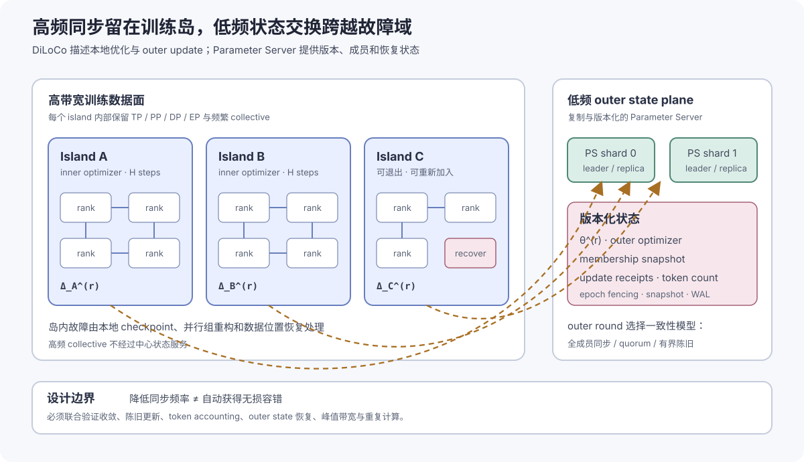

# 训练并行、同步域与弹性容错

## 模型与工作负载

训练性能结论必须绑定工作负载定义。最小定义包括模型参数量、层数、隐藏维度、序列长度、全局与微批大小、精度、优化器、数据规模、训练阶段和并行配置。可将一次实验的工作负载表示为

\[
\mathcal W
=
\left(
M,L,B_{\mathrm{global}},B_{\mathrm{micro}},
\pi,\mathbf p,\mathcal D
\right),
\]

其中 \(M\) 为模型结构，\(L\) 为序列长度，\(\pi\) 为精度策略，\(\mathbf p=(p_{\mathrm{TP}},p_{\mathrm{PP}},p_{\mathrm{DP}},p_{\mathrm{EP}},p_{\mathrm{CP}})\) 为并行配置，\(\mathcal D\) 为数据和采样状态。敏感参数可以区间或脱敏标识呈现，但比较实验中的等价关系必须可验证。

## 并行策略

并行策略不仅决定计算与显存切分，也决定 HCCL 通信组如何映射到 A3 的节点、逻辑超节点和跨超节点网络。A3 上的完整映射方法见 [拓扑感知通信与 A3 HCCL 案例](04a-a3-hccl-communication-optimization.md)：高频张量并行组优先保留在超节点内，跨超节点的数据并行组在各超节点和出口网卡之间对称分配。

| 维度 | 并行度 | 分组方式 | 主要通信 | 选择依据 |
| --- | ---: | --- | --- | --- |
| 数据并行 | 待补充 | 跨超节点时对称分布 | AllReduce / ReduceScatter / AllGather | 均衡出口网卡负载 |
| 张量并行 | 待补充 | 优先位于同一逻辑超节点 | AllReduce / AllGather / ReduceScatter | 降低高频通信距离 |
| 流水线并行 | 待补充 | 减少相邻 stage 跨域次数 | Send / Recv | 控制边界激活传输 |
| 专家并行 | 待补充 | 按 AlltoAll 实测单独映射 | AlltoAll / AlltoAllV | 不复用 AllReduce 假设 |

## 从同步域到故障域

并行组不仅定义数据如何切分，也定义等待和故障如何传播。张量并行通常位于单层计算的关键路径，任何成员缺席都会阻断该层；流水线并行连接相邻 stage，某个 stage 变慢会形成气泡并向前后传播；数据并行在梯度归约处汇合，一个慢 rank 会拖长整个副本组；专家并行则同时受到 token 路由不均衡和 AlltoAll 到达偏斜影响。对简化的同步阶段，其完成时间可以表示为

\[
T_{\mathrm{phase}}
\approx
\max_{r\in\mathcal G}
\left(
T_{\mathrm{compute},r}
+T_{\mathrm{comm,exposed},r}
+T_{\mathrm{completion},r}
\right),
\]

其中 \(\mathcal G\) 为同步组。该最大值关系解释了局部离群为何会传播为组级尾延迟；实际流水线执行还需考虑 stage 重叠和气泡。

因此，训练系统需要区分三个范围：

| 范围 | 典型同步 | 事件传播方式 |
| --- | --- | --- |
| 加速器/节点内 | kernel、stream、节点内 collective | 完成路径或节点内互连异常先影响局部 rank |
| 高带宽训练岛 | TP/PP/EP/DP 的频繁同步 | 慢者进入 step 关键路径，影响整个 island |
| 训练岛之间 | 模型或优化状态的低频交换 | 网络和成员变化主要影响 outer round |

传统 BSP 训练通常让这三个范围共享接近相同的存活条件：任意关键 rank 退出，整个 world 需要恢复。另一条正在发展的路线是让高频同步保留在高速、相对稳定的训练岛内部，而岛之间只进行低频、版本化的状态交换。它减少跨故障域的同步次数，但同时把问题从“每步 collective 是否完成”转化成“多个本地优化轨迹如何重新汇合”。

## 低通信训练的行业演进

DiLoCo 将多个设备组织成训练 worker 或 island，每个 island 从同一个 outer 参数出发，独立执行较多 inner optimization steps，再交换参数差分并执行 outer optimization。原始研究将它描述为带 AdamW inner optimizer 和 Nesterov momentum outer optimizer的联邦平均变体，并在其 8-worker 实验中报告了与完全同步训练相近的效果和约 500 倍更低的通信频率；论文也研究了资源动态加入和退出。[R018](references.md#r018)

后续研究说明这一方向仍在演进，而不是已经收敛成固定架构。OpenDiLoCo 复现并扩展到十亿参数级实验，同时观察到更多 worker 在训练早期未必具有与同步数据并行相同的 FLOP efficiency，最终质量、通信量和训练进度需要共同比较。[R019](references.md#r019) Streaming DiLoCo 则进一步采用分片参数同步、通信计算重叠和低精度 outer update，研究重点从“降低平均通信频率”延伸到“降低峰值带宽和阻塞时间”。[R020](references.md#r020)

Decoupled DiLoCo 将这一方向推进到异步 learner 与中央 synchronizer：参数分片独立传输，聚合由 minimum quorum、自适应 grace window 和按实际 token 加权共同决定，并用事件带与混沌实验研究规模扩大后的可用性。[R032](references.md#r032) 这说明“训练岛允许退出”不是一个调度开关，而是优化算法、成员协议和状态机的共同改变。固定 quorum 只保证更新数量下限；样本效率还取决于迟到 learner 是否进入 grace window、每个 learner 实际处理多少 token，以及不同参数分片是否来自一致的逻辑轮次。

另一类工作不通过降低 outer 同步频率获得容错。Oobleck 预生成异质 pipeline template，并以至少 \(f+1\) 个等价副本给出容忍 \(f\) 个同时故障的资源覆盖保证；TorchFT 则提供按 step 成员协调、可重配置 ProcessGroup 和健康副本状态恢复，并覆盖同步 DDP/HSDP 与实验性的 LocalSGD/DiLoCo 路径。[R030](references.md#r030) [R031](references.md#r031) 它们分别代表“带形式化资源保证的执行计划”和“框架内可重配置训练原语”，应与低通信方案按故障域、状态复制成本、恢复粒度和模型质量共同比较。

设 outer round \(r\) 发布的全局参数为 \(\theta^{(r)}\)，island \(m\) 执行 \(H\) 个本地 step 后得到 \(\theta_{m,H}^{(r)}\)，可以把待聚合的参数差写成

\[
\Delta_m^{(r)}
=\theta^{(r)}-\theta_{m,H}^{(r)}.
\]

outer 层根据本轮接受的更新集合 \(\mathcal A_r\) 形成

\[
\bar{\Delta}^{(r)}
=\operatorname{Aggregate}
\left(\left\{\Delta_m^{(r)}:m\in\mathcal A_r\right\}\right),
\qquad
\theta^{(r+1)}
=\operatorname{OuterOpt}
\left(\theta^{(r)},\bar{\Delta}^{(r)}\right).
\]

这里真正决定训练语义的不是公式形式，而是 \(H\)、\(\mathcal A_r\)、数据分布、outer optimizer、更新精度和版本策略。增大 \(H\) 会减少通信次数，却也让不同 island 的本地轨迹分离得更远；允许缺失成员可以提高资源可用性，却会改变每个 outer round 实际消耗的 token、样本权重和优化噪声。

## Parameter Server 作为候选 outer state plane

Parameter Server 的经典职责是保存全局共享参数，并提供异步通信、可配置一致性、弹性扩展和持续容错能力。[R021](references.md#r021) 在低通信语言模型训练中，更合适的组合方式不是让 PS 接收每个 micro-batch 的稠密梯度，而是将它限制在低频 outer state plane：

- 训练岛内部继续使用适合高速互连的 TP/PP/DP/EP 和 collective；
- PS 保存全局参数版本、outer optimizer 状态、成员快照和更新收据；
- island 每 \(H\) 个本地 step 发布一次带版本的参数差；
- outer round 根据冻结的成员与一致性策略聚合，再发布新版本；
- 本地 checkpoint 与 outer snapshot 分别覆盖岛内恢复和全局恢复。

{ .technical-diagram loading=lazy }

这种设计把高频训练数据面和低频全局状态面分开。PS 的价值主要来自版本、成员和恢复语义，而不是用中心服务替代节点内或岛内的高带宽 collective。其吞吐要求由 outer update 大小、同步周期和 island 数决定；若 outer round 仍一次交换完整模型，峰值带宽、分片、复制和发布原子性仍是实际约束。

PS 不是这一状态面的默认答案。中央 synchronizer、可重配置 ProcessGroup 和分布式状态服务都可以承担部分职责，选择取决于所需语义：

| 候选组织 | 主要优势 | 需要证明的边界 |
| --- | --- | --- |
| 版本化 Parameter Server | 分片状态、显式版本、更新收据和持久化接口 | 分片一致性、主备接管、热点与发布原子性 |
| Quorum synchronizer | 可以直接表达 minimum quorum、grace window 和 token 权重 | synchronizer 故障、分片跨轮一致性和确定性重放 |
| 可重配置 ProcessGroup | 接近现有训练框架，可在 step 粒度改变成员 | 后端错误传播、组重建时间、健康副本恢复和并行组合兼容 |
| Pipeline template 与副本 | 能给出明确的同时故障容忍和资源覆盖条件 | 状态复制成本、模型切分约束和异质资源重排 |

本文保留 PS 作为架构候选，是因为版本化 outer state 与高频 island 数据面之间具有清晰边界；是否采用它，应由同一故障注入和质量实验决定，而不是由经典系统能力直接推出。

设 \(M\) 个 island 每隔 \(H\) 个 inner step 交换大小为 \(S_u\) 的更新，则忽略协议开销时，平均 outer 通信速率近似为

\[
R_{\mathrm{outer}}
\approx
\frac{M S_u}{H T_{\mathrm{inner}}},
\]

其中 \(T_{\mathrm{inner}}\) 为单个 inner step 的平均时间。增大 \(H\) 会降低平均通信速率，但不会自动降低单轮峰值流量；分片、重叠和量化分别作用于峰值带宽、阻塞时间和传输字节。

## 容错语义必须显式定义

“允许资源退出”只有在状态语义明确时才构成容错。组合设计至少需要处理以下情况：

| 事件 | 可选处理 | 需要保存的语义 |
| --- | --- | --- |
| island 内单 rank 失败 | island 局部重启、缩容重构，或从最近本地 checkpoint 恢复 | 并行组、随机状态、inner optimizer 和数据位置 |
| island 在 outer round 前失败 | 等待恢复，或按预注册 quorum 跳过 | 本轮成员快照、实际 token 数和聚合权重 |
| 更新迟到或网络分区恢复 | 拒绝旧 epoch，或在有界陈旧策略下接收 | 参数版本、staleness 上界和重复提交标识 |
| PS 分片失败 | 副本接管、日志重放或 snapshot 恢复 | 全局参数、outer optimizer、round 和已提交更新集合 |
| island 重新加入 | 从已发布 outer 版本重新初始化 | 版本栅栏，避免旧本地状态污染新 round |

outer round 可以选择不同的一致性模型：

- **全成员同步**最接近原始同步语义，但一个失联 island 仍会阻塞全局进度；
- **固定 quorum**允许部分成员缺席，但必须按实际样本量重新定义聚合权重；
- **有界陈旧**进一步提高弹性，同时引入模型版本差和更复杂的收敛问题；
- **完全异步**具有更高可用性，但已不再等价于同步 DiLoCo，需要独立的优化算法和质量基线。

因此，“DiLoCo 降低通信频率”和“Parameter Server 支持弹性状态管理”是两个可组合的性质，不自动推出组合系统已经具备收敛保持、无损恢复或任意成员变更能力。

## 评估低通信容错训练

这一路线应始终以冻结的同步训练作为参考，而不是只报告网络流量下降：

| 评估面 | 主要指标 | 关键对照 |
| --- | --- | --- |
| 模型质量 | loss、困惑度、下游任务、相同 token 下的收敛 | 同模型、数据顺序和总计算预算的同步训练 |
| 计算效率 | 有效 token/s、MFU、重复计算和恢复重放 | inner step 数 \(H\) 与 island 数扫描 |
| 通信效率 | 平均/峰值带宽、outer round 阻塞时间、传输字节 | 完整、分片、重叠和低精度 outer update |
| 可用性与 goodput | 分配卡时中执行有效训练 step 的比例、全局停顿和缩扩容空窗 | 同步重启、固定 quorum、自适应 grace 与按 step 重配置 |
| 故障恢复 | 检出、隔离、恢复时间和丢失进度 | rank、island、PS 分片和网络分区故障注入 |
| 状态正确性 | 版本单调、重复更新抑制、token accounting、checkpoint 一致性 | 正常运行与故障恢复后的状态审计 |

故障注入至少覆盖 learner 变慢、learner 退出、整岛丢失、网络分区、outer state 进程故障和成员重新加入，并使用冻结的事件带让不同方案经历相同故障序列。除平均结果外，还要报告最坏恢复窗口、参与每个 outer round 的 learner/token 分布、迟到更新拒绝数和重新加入后的版本来源。事件带可以提高系统对照的可复现性，但异步聚合仍可能因真实墙钟顺序产生非确定性，应单独记录提交与采纳顺序。[R032](references.md#r032)

低通信方案适合研究跨机房、跨资源池、高延迟网络或资源供给会变化的训练形态；在单个高带宽超节点或严格时间到解优先的作业中，完全同步训练仍可能具有更直接的收敛和执行效率。两者不是替代关系，而是对同步频率、网络条件、优化效率和可用性作不同权衡。

## 内存与显存优化

峰值显存应按语义拆分，而不是仅记录设备总占用：

\[
M_{\mathrm{peak}}
=
M_{\mathrm{param}}
+M_{\mathrm{grad}}
+M_{\mathrm{optimizer}}
+M_{\mathrm{activation}}
+M_{\mathrm{communication}}
+M_{\mathrm{runtime}}.
\]

状态切分主要降低参数、梯度和优化器状态的单 rank 份额；激活重计算以额外 FLOPs 换取激活内存；通信缓冲、编译 workspace 和分配器碎片则可能在框架统计之外形成峰值。正式比较同时报告框架 active/reserved、驱动设备占用和主机 RSS，并保留 OOM 前最后一个完整 step 的分层快照。

设可用 HBM 容量为 \(M_{\mathrm{HBM}}\)，预留给运行时波动和异常下钻的安全余量为 \(M_{\mathrm{reserve}}\)，则配置约束为

\[
M_{\mathrm{peak}}
\le
M_{\mathrm{HBM}}-M_{\mathrm{reserve}}.
\]

余量不是固定百分比，应依据序列长度变化、专家负载偏斜、通信算法 workspace 和在线观测峰值进行标定。

## 训练坐标与阶段边界

性能事实只有在训练坐标稳定时才能跨 rank 比较。每条 step、module 和通信记录至少携带 `global_step`、`micro_step`、`rank`、`world_size` 和并行角色；角色由 TP、PP、DP、EP、CP 等维度组成。Megatron 适配层只负责把版本敏感的并行状态转换为这些公共坐标，不应让系统、通信或 profiler 采集器直接依赖 Megatron 内部 getter。[I004](references.md#i004)

梯度累积场景必须区分 micro step 与 logical step。一个训练 step 的边界从本次 logical iteration 的首次 forward 开始，到 optimizer 完成结束；中间的多次 forward/backward 不应制造多个完整 step。forward、backward 和 optimizer 阶段还需要单一状态所有者：若训练代码已经显式标记阶段，自动 hook 只补充 module 事实，不重复创建同名区间。否则同一段时间会被重复计算，通信暴露比例和阶段占用可能超过 100%。

## 渐进式性能诊断

训练性能定位采用由低成本到高密度的递进过程：

```text
持续 step 墙钟与资源趋势
  -> 找到异常 step、rank 和并行角色
  -> module/collective 采样确定计算或通信方向
  -> 对少量 rank 和窄时间窗采集 op、kernel 或调用栈
  -> 用通信库原生事件与 NIC counter 完成链路归因
```

常驻观测只回答“何时、哪些 rank、哪个阶段偏离”；短窗口 profiler 回答“哪些 op/kernel/调用路径构成偏离”；HCCL/NCCL 等原生数据回答“通信库内部如何展开”。三层拥有不同计时边界，不能相互替代。尤其是 Python collective API 耗时不等于设备侧通信完成时间，module duration 的重叠区间也不能直接相加为 step wall time。

确定性采样使用 step 序号和 layer 标识决定命中，使各 rank 在同一批 step 上保留可比较证据。优先采集少量 step 的完整层关系，而不是每个 step 随机留下互不相连的少量层；后者虽然事件数相同，却难以恢复层间关键路径。

## 调度与作业状态转换

训练作业的状态转换以证据完整性为前置条件。资源身份、软件版本、并行配置或通信拓扑发生变化时，先前性能基线不再自动有效；系统需要生成新的 cohort，并执行与变化范围相匹配的复验。

调度器在健康准入通过后执行超节点选择和出口网卡负载均衡。必须保存调度映射、Megatron rank 组、HCCL 通信拓扑及其完整性摘要。故障重调度后若节点或超节点集合变化，应生成新的映射版本并重新运行通信准入，不能沿用原性能基线。

状态序列依次覆盖资源与拓扑快照、静态一致性、单节点动态测量、单卡计算与存储可靠性、成对链路验证、精确目标集合、训练通信组验收、短程训练和正式训练。各阶段输出独立的覆盖与失败状态；后序成功不能覆盖前序缺失或失败。

多节点测量采用准备、统一激活和结果回收三个逻辑阶段。所有通信成员就绪后才进入有效测量窗口，控制连接状态与实例内任务状态分别记录。调度映射、运行环境、驱动或通信库发生变化，以及设备维修后重新进入资源池时，均触发相应证据域的重新验证。

训练异常后，应冻结原作业条件和计算实例到物理节点的映射，在原物理节点上建立受控复现环境。复现实验必须与原训练使用相同的训练系统版本、运行环境、配置和数据版本；如果只复用了节点而改变了其他变量，结论只能用于缩小范围，不能声称复现了原故障。

## 规模扩展路径

规模扩展分为两条互补路径：成对测试负责硬件与链路筛查，训练拓扑检查负责真实通信组的功能准入。不采用将小规模全局集合通信矩阵直接放大的方式，因为它会产生真实训练中不存在的超大全局 All-to-All 和连接资源压力。

达到目标规模后，必须依据实际 Megatron/MindSpeed 版本和并行配置生成训练通信组定义。该定义需要冻结训练系统版本、并行参数、rank 顺序、每节点 rank 数，以及各规模的 TP、dense-DP、expert-DP、EP、PP 分组和真实工作负载形状；运行时再次校验其完整性、目标规模、组内覆盖和不重叠性。

| 阶段 | 健康检查准入 | Megatron 准入 | 失败后的动作 |
| --- | --- | --- | --- |
| 单节点 | 静态与动态检查无硬失败 | 单机短程 loss、显存和吞吐基线通过 | 定位设备、运行时或节点内互连 |
| 小规模多节点 | 基础通信、成对测试和专家并行正确性通过 | 并行组和检查点恢复通过 | 换伙伴定位节点或链路，回退配置 |
| 中等规模 | 成对性能候选完成复测；对应训练拓扑功能通过 | 达到预设扩展效率与稳定性门限 | 剖析通信、数据和负载不均衡 |
| 目标规模 | 全部真实子通信组通过 | 端到端训练、检查点与故障演练通过 | 保留失败覆盖，回退到最近通过规模 |

健康检查通过只允许资源进入下一阶段，不替代 Megatron 的性能与收敛验证。训练拓扑检查只验证通信域初始化、正确性、NaN/Inf、进程、超时和结果完整性；性能准入默认仅放在可比较的成对测试群体。反之，短程训练偶然成功也不能替代系统化静态、单卡、正确性和通信检查。扩展效率公式与变量控制见[评测方法](07-evaluation-methodology.md)。

## 当前证据缺口

现有材料包含 4,096 卡 A3、2,048 卡 C550 的 Qwen3-200B 稠密训练拓扑设想，以及若干 Qwen3 MoE 诊断场景；它们只能说明预期覆盖范围，不是生产训练事实。由于尚无目标训练系统的完整版本证据和对应运行结果，模型负载、并行度与显存优化仍需由实际训练配置、通信组定义和实测结果共同证明，不能从通用健康检查中的示例专家并行度或非均匀全交换模式反推正式训练并行度。
