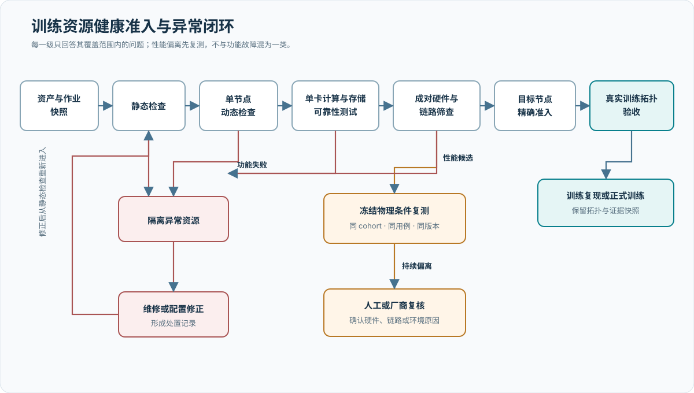
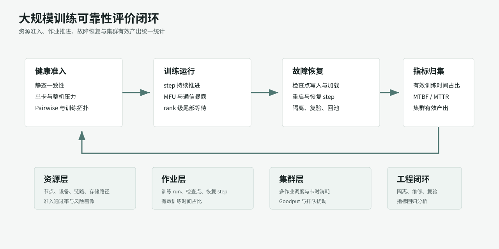
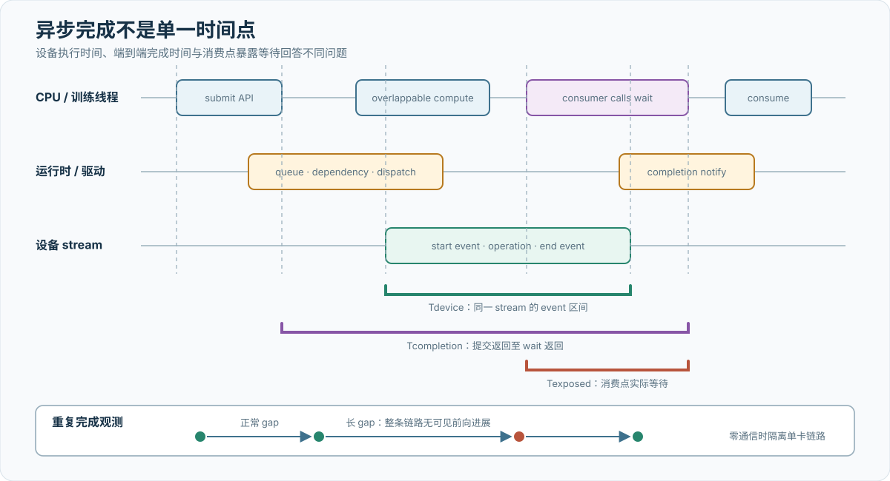
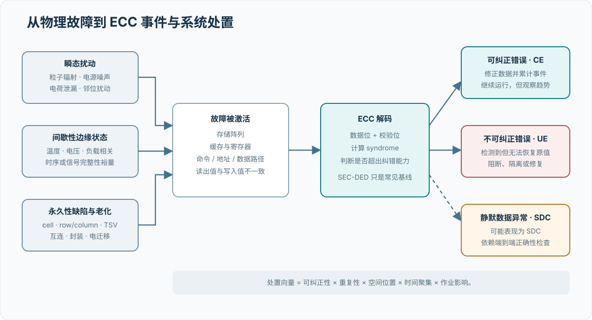
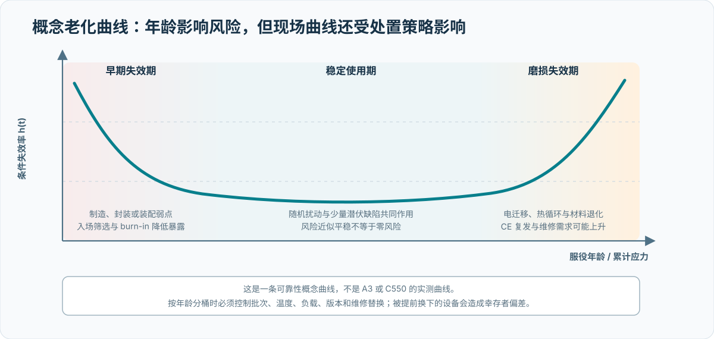
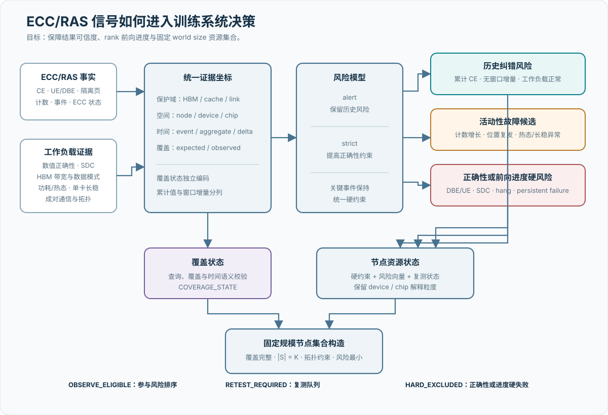

# 稳定性、容错与可观测性

## 本章结论

训练资源准入采用“静态一致性、单节点可运行性、单卡压力筛查、成对硬件筛查、目标节点选择、训练拓扑验收、训练复现”七级流程。A3 已完成两个 4,096 卡批次与 96 卡备机筛查，C550 已完成 2,336 卡候选池筛查并形成 2,048-rank Final256 训练拓扑。correctness、ECC、SDC、HBM、性能偏离、结果传输和通信异常分别进入隔离、复测或操作处置路径，形成可解释的训练成员集合。面向万卡训练，可靠性评价同时采用健康准入通过率、作业成功率、MTBF/MTTR、有效训练时间占比和集群 Goodput，把“资源是否可用”“作业是否持续推进”“故障后是否快速恢复”放在同一工程闭环内。[R019](references.md#r019)
{ .technical-diagram loading=lazy }

## 可靠性评价框架

大规模同步训练的可靠性评价需要同时覆盖资源、作业和集群三个层级。单卡或单链路异常会通过 collective、流水线 stage、专家并行和数据并行组放大全局等待；调度重启、检查点加载和排队等待也会消耗墙钟时间。因此，本项目把健康准入、故障隔离、作业恢复和训练有效产出统一纳入评价框架，避免将可靠性简化为训练进程退出状态。

HPCA 2025 的 Meta 研究基于两个大规模多租户 ML 集群提出了 MTTF、ETTR 和 Goodput 的联合分析方法，用于量化故障、重启、检查点和调度扰动对训练生产率的影响。[R019](references.md#r019) 本报告采用其指标框架，并按国产加速卡训练实践进行工程化命名：`有效训练时间占比` 对应 ETTR 的工程含义，衡量训练 run 在墙钟时间中真正推进 step 的比例；`集群有效产出` 对应 Goodput 的工程含义，衡量资源池单位时间完成的有效训练工作；`MTBF/MTTF` 分别用于资源池事件和作业中断事件，刻画故障到达速度。

{ .technical-diagram loading=lazy }

该框架在报告中承担三项作用：首先，把 MFU 与可靠性指标分开，MFU 描述稳态 step 内的计算效率，有效训练时间占比描述跨故障和重启后的训练推进效率；其次，把健康检查从“上线前动作”提升为训练生命周期管理机制，准入、运行、隔离、复验和回池形成闭环；最后，把单点事件转化为资源池统计，使节点画像、通信组覆盖、检查点恢复和调度放置能够共同服务于万卡训练稳定运行。

## 分层健康检查

| 层级 | 主要检查 | 主要输出 | 准入作用 |
| --- | --- | --- | --- |
| 静态 | 设备数量与可见性、驱动/框架、ECC/RAS、HCA/RDMA/接口、CPU/NUMA、磁盘和必要环境变量 | 静态事实、异常项与 ECC 专项报告 | 直接定位节点或设备的配置/硬件异常 |
| 单节点动态 | 基础运行、矩阵计算、显存访问、六类集合通信、MoE/EP 非均匀负载 | 用例指标、异常与证据完整性报告 | 验证节点内多卡计算、正确性和通信可运行性 |
| 单卡计算与存储可靠性测试 | 单卡正确性、算力、HBM、稳态功耗/散热与 SDC | 逐卡结果、逐轮曲线、聚合摘要和物理卡映射 | 刻画计算、存储和热态下的设备行为 |
| 单卡长稳筛查 | 单卡零通信长循环和热态检查 | 逐卡状态、异常卡表和汇总 | 将单卡停顿与通信组整体停顿分离 |
| Pairwise | 多轮换伙伴、物理超节点内与跨超节点链路检查 | 节点、链路、固定路径候选与覆盖报告 | 定位硬件节点和链路持续异常；承担性能 gate |
| 准入选择 | 汇总前述阶段覆盖和硬/软理由，选出精确目标节点数 | 选中、备用、排除节点清单和选择依据 | 目标数量不足时产生阻断结论，目标训练规模保持不变 |
| 训练拓扑 | 训练定义中的 TP、dense-DP、expert-DP、EP、PP 子通信组 | 通信组计划、覆盖率、拓扑摘要与通信栈失败 | 验证真实训练通信组的初始化和正确性，支撑通信组级诊断 |
| 训练复现 | 在原节点、镜像、配置和训练栈上复现失败或长稳运行 | 训练日志、检查点、故障与恢复记录 | 验证合成检查是否能解释真实训练问题 |

### 已导入的资源池准入事实

[EXP-010](https://github.com/reiase/tenk_report/blob/master/experiments/exp-010-fleet-health-admission/README.md) 首次把分层方法映射到实际资源池汇总。A3 的两个 4,096 卡批次分别得到 4,093 GOOD / 2 BAD / 1 CONTENDED 和 4,093 GOOD / 0 BAD / 3 CONTENDED；96 卡备机为 96 GOOD。两个 256 节点 Job 均完成过 Final256，但首轮 Scale64/128 的结果传输与 HCCL 初始化异常仍保留在首轮记录中。

C550 对 292 节点、2,336 张卡完成全量筛查，来源记录 1 张 correctness BAD、3 张 SDC-SUSPECT、7 张累计不可纠正 ECC 的 DEAD、70 张 HBM SLOW、1 个 ECC 禁用节点、1 个单机通信性能候选和 1 个多伙伴复现的 RDMA/MCCL 运行期通信候选。随后选择 256 节点完成 2,048-rank Final256。该结果建立了 C550 资源池的独立健康准入基线，并为后续训练扩展、长稳运行和维修复验提供了可复用的节点选择依据。

状态类型保持互斥：`CONTENDED` 表示计时质量受资源竞争影响，`SLOW` 表示同 cohort 性能偏离，`SDC-SUSPECT` 进入确定性复验，累计 ECC 按历史风险和新增事件分开统计，结果传输失败按控制面事件处理。将这些状态与节点选择、复测和工单关联后，可以形成可解释的生产健康率。

单节点动态检查在同一个分布式进程组中依次执行冒烟、快速计算、All-Reduce 带宽和多类 collective，减少重复初始化的成本。消息矩阵应覆盖小消息延迟区、中等消息过渡区和大消息带宽区；非均匀 All-to-All 还需覆盖均匀、热点和空目标等负载。实际参数作为实验条件归档，推荐值作为配置起点。

## 单卡计算与存储可靠性测试

### 测量对象与执行模型

该测试的基本实验单元是一张加速卡。节点内各卡同时执行相同负载，卡之间没有数据依赖或集合通信。对第 `i` 张卡，可观测量写为：

\[
\mathbf{X}_i(t)=
\bigl\{Q_i(t),\,B_i(t),\,E_i(t),\,P_i(t),\,T_i(t),\,f_i(t),\,L_i(t)\bigr\}
\]

其中，\(Q\)、\(B\)、\(E\)、\(P\)、\(T\)、\(f\) 和 \(L\) 分别表示计算吞吐、HBM 有效带宽、数值误差、功耗、温度、有效时钟和限频状态。

“单卡独立”限定数据通路，“整机并发”限定供电与散热条件。测量仍然包含框架调度、算子实现、设备运行时、频率策略、HBM、板级供电和整机冷却等多个层次，因此异常结果需要结合复测、遥测和物理位置进行归因。

实验由五类负载组成：

| 负载 | 核心运算 | 控制变量 | 观测量 |
| --- | --- | --- | --- |
| 矩阵计算 | 低精度矩阵乘法与高精度参考比较 | 数据类型、矩阵形状、累加精度、预热与迭代次数 | 数值误差、执行时间、吞吐 |
| HBM 流式访问 | 大工作集连续读取、轻量变换和写回 | 元素类型、工作集大小、访问方向、迭代次数 | 有效读写带宽及轮间波动 |
| 持续计算 | 长时间重复矩阵计算 | 负载占空比、持续时间、并发卡数 | 吞吐、功耗、温度、时钟的时间序列 |
| SDC 数值检查 | 矩阵、向量、特殊函数和规约的重复计算 | 输入分布、参考精度、容差和重复次数 | 不一致元素数、误差幅度、首次异常时间 |
| HBM 数据模式 | 已知位模式的写入、读回和比较 | 数据模式、覆盖容量、地址范围和轮数 | 位错误、地址相关错误和实际覆盖率 |

性能测量成立的前提是设备不存在外部计算负载，且可用显存足以形成一致的工作集。存在外部竞争时，正确性结果仍可记录，但吞吐和带宽不属于可比较样本。设备不可见、不可纠正 ECC、温度或功耗遥测缺失属于不同类型的观测，不能相互替代。

### 数值正确性与矩阵吞吐

对矩阵乘法 \(C=A\times B\)，被测结果记为 \(C_{\mathrm{test}}\)，独立高精度参考记为 \(C_{\mathrm{ref}}\)。至少记录最大绝对误差和归一化最大误差：

\[
E_{\mathrm{abs}}
=\max \left|C_{\mathrm{test}}-C_{\mathrm{ref}}\right|,
\qquad
E_{\mathrm{rel}}
=\frac{\max \left|C_{\mathrm{test}}-C_{\mathrm{ref}}\right|}
       {\max \left|C_{\mathrm{ref}}\right|+\varepsilon}
\]

容差由输入精度、累加精度、矩阵维度和舍入模式共同决定。BF16、FP16 等低精度结果不能使用与 FP32 相同的逐位相等条件；但容差必须在观察结果前冻结，否则会形成事后调整。固定随机种子只保证输入可复现，不保证参考结果独立。独立性要求参考计算使用更高精度或不同的计算路径。

一般矩阵乘法 \(M\times K\) 与 \(K\times N\) 的名义运算量为：

\[
F_{\mathrm{GEMM}}=2MNK,
\qquad
Q_{\mathrm{GEMM}}=\frac{F_{\mathrm{GEMM}}}{t_{\mathrm{device}}}
\]

吞吐以设备侧计时为主，内存分配、首次编译和初始化不进入稳态计时窗口。预热用于消除首次加载、缓存建立和频率爬升；正式结果同时报告中位数、低分位、最小值和轮间变异，而不是只保留最好一次。

单一矩阵形状只覆盖特定的 tile、并行度和内存访问模式。形状扫描应改变 \(M/N/K\)、对齐关系和工作集大小，用于区分以下情况：

- 所有大形状均低：可能与频率、功率限制或计算单元有效利用率有关；
- 仅特定对齐或形状低：更可能与算子选择、tile 映射或尾块效率有关；
- 短时正常、持续负载下降：需要转入功耗与热稳态分析。

### HBM 有效带宽

HBM 测量采用工作集大于片上缓存的流式访问。设元素数为 `N`，每元素字节数为 `b`，每轮对输入读取 `r` 次、对输出写入 `w` 次，设备执行时间为 `t`，则名义有效带宽为：

\[
D_{\mathrm{nominal}}=Nb(r+w),
\qquad
B_{\mathrm{effective}}=\frac{D_{\mathrm{nominal}}}{t}
\]

一次读取和一次写回对应 \(r=1,\ w=1\)。如果运算还读取第二输入、执行读—改—写或包含额外中间结果，字节模型必须相应调整。只按张量容量而不按实际读写次数计算，会系统性低估或高估带宽。

\(B_{\mathrm{effective}}\) 是端到端流式算子的有效带宽，满足但通常不会逼近以下理想关系：

\[
B_{\mathrm{effective}}\le B_{\mathrm{physical\ peak}}
\]

两者差异包含指令开销、访存合并、访问对齐、缓存行为、并发度、数据类型、运行时调度和计时起止。厂商峰值描述物理接口的理论传输能力，本测试描述特定算子路径，因此二者不能直接相除后作为统一通过率。跨卡比较必须保持数据类型、工作集、访问模式、预热、迭代数和软件栈一致。

HBM 带宽与 HBM 正确性是两个正交维度：

- 带宽测试关注单位时间完成的名义数据流量；
- 数据模式测试关注写入值、读取值与地址之间的关系。

数据模式至少包含全零/全一、交替位、walking-bit 和地址即数据。它们分别对固定翻转、相邻位耦合、stuck-at、地址译码和别名错误敏感。结论只能覆盖实际成功分配并完成读写比较的地址范围；抽样若只覆盖部分显存，就不能表述为“全 HBM 无错误”。

### 功耗、温度与稳态性能

持续负载期间，将计算吞吐 `Q(t)`、板卡功耗 `P(t)`、温度 `T(t)`、有效时钟 `f(t)` 和限频状态 `L(t)` 对齐到同一时间轴。遥测采样应位于计算计时区之外，避免设备管理访问进入吞吐计时。

热稳态不是固定运行时长，而是温度变化率进入小范围并持续若干窗口：

\[
\left|\frac{\mathrm{d}T}{\mathrm{d}t}\right|<\delta_T
\]

该条件需要连续 \(W\) 个观察窗口成立。

若测试在达到该条件前结束，只能报告有限时长持续性能，不能称为热稳态性能。可派生三个诊断量：

\[
\rho_Q=
\frac{\operatorname{median}(Q_{\mathrm{steady}})}
     {\operatorname{median}(Q_{\mathrm{initial}})},
\qquad
\rho_P=
\frac{\operatorname{median}(P_{\mathrm{steady}})}{P_{\mathrm{limit}}},
\qquad
\eta=
\frac{\operatorname{median}(Q_{\mathrm{steady}})}
     {\operatorname{median}(P_{\mathrm{steady}})}
\]

`P_limit` 不可获得时，不计算归一化功耗。能效只用于相同负载和相同计时口径下的比较，不能单独作为健康门限。

| 时间序列特征 | 与数据一致的解释 | 仍不能排除的因素 |
| --- | --- | --- |
| `Q(t)`、`P(t)`、`T(t)` 和 `f(t)` 均进入稳定平台 | 当前负载下达到可重复工作点 | 平台整体被统一功率策略压低 |
| `P(t)` 接近功耗上限，限频出现且 `Q(t)` 下降 | 性能受功率包络约束 | 上限配置、供电能力或固件策略差异 |
| `T(t)` 上升后热限频出现，`f(t)` 与 `Q(t)` 同步下降 | 性能受热包络约束 | 风道、冷却介质、环境温度或传感器偏差 |
| `Q(t)` 低，但 `P(t)`、`T(t)`、`f(t)` 和限频均无异常 | 不能由功耗或热限频解释 | 算子路径、NUMA、外部竞争或设备本征差异 |
| 未达到目标功耗或时钟，且 SDC 未命中 | 负载强度不足时的阴性观察 | 更高电流密度或更高温度下的间歇故障 |

C550 的 450 W 是最大板卡功耗包络，不是负载必须达到的目标值。A3 与 C550 的功耗、温度和性能曲线不能按相同百分比直接比较；板卡设计、传感器位置、功率上限定义和频率策略不同，都需要独立基线。

功耗与 SDC 的因果关系需要单独实验。至少设置低、中、高三个负载水平，重复冷热循环，并将每次数值异常与 `P(t)`、`T(t)`、`f(t)` 对齐。只有异常概率随负载或温度可重复变化，且软件、输入和运行环境保持不变时，才有证据讨论功耗或热状态的条件相关性。单次高负载下出现异常按同时发生事件登记，因果关系由上述可重复实验确认。

### SDC 故障模型与检测

SDC 指计算或存储路径返回了语法和状态均正常、但数值内容错误的结果。它与进程退出、设备掉卡、ECC 明确上报和超时不同：后四类属于显式故障，不应混入 SDC 命中率。

| 故障模型 | 时间特征 | 观测形式 | 检测难点 |
| --- | --- | --- | --- |
| 瞬态错误 | 单轮或短时间出现 | 某次结果偏离，随后恢复 | 需要足够重复次数和逐轮留痕 |
| 间歇错误 | 与温度、功耗、数据模式或地址相关 | 特定条件下重复出现 | 需要负载分档、冷热循环和地址覆盖 |
| 永久错误 | 相同路径持续产生错误 | 多轮、重启后仍在固定位置复现 | 自一致比较可能把稳定错误当作参考 |
| 系统性数值偏差 | 同版本、同算子在多卡上共同出现 | 大量设备以相同方式偏离高精度参考 | 需要独立实现或高精度参考区分软硬件原因 |

检测参考分为三类：

1. **独立参考**：使用更高精度或不同计算路径生成期望结果，用于发现稳定且可重复的偏差。
2. **时间自一致**：相同输入重复计算，比较轮间结果，用于发现瞬态和间歇错误。
3. **跨设备共识**：同批设备执行相同输入，以多数结果建立共识，用于定位单卡离群，但依赖多数设备正确这一假设。

不同目标单元需要不同输入与不变量：

| 目标路径 | 负载与不变量 | 主要覆盖 | 主要盲区 |
| --- | --- | --- | --- |
| 矩阵单元 | 固定矩阵乘法；独立高精度结果与轮间一致性 | 乘累加路径的数值损坏 | 未覆盖的形状、精度和内部数据通路 |
| 向量单元 | 大规模逐元素运算；位级或严格数值比较 | 向量执行路径的偶发错误 | 高级算子到物理单元的映射不固定 |
| 特殊函数单元 | 指数、对数等函数；数学恒等式与高精度参考 | 超越函数近似路径异常 | 输入范围、近似阶数和容差设置 |
| 规约路径 | 固定输入长规约；结果范围和重复一致性 | 累加器、规约树和顺序相关异常 | 浮点非结合性造成的合法差异 |
| HBM 与缓存 | 已知位模式的写入、读回和地址关系 | 位翻转、stuck-at、地址译码和别名 | 未分配地址、控制器内部不可见路径 |
| 热态计算 | 持续负载期间周期插入确定性计算 | 高温或高电流条件下的间歇错误 | 两次采样之间的短暂错误 |

浮点规约和低精度矩阵计算可能因非结合性、并行顺序或随机算法产生合法差异。SDC 判定必须先固定确定性条件，或使用与误差传播模型一致的容差。执行异常、超时和参考生成失败应单独分类，不能计为数值命中，也不能计为“未发现 SDC”。

若 \(n\) 次相互独立试验均未命中，理想二项或泊松近似下，事件率的 95% 单侧上界约为 \(3/n\)。实际轮次通常共享设备、温度轨迹和数据路径，并非严格独立，因此该上界只能作为条件化估计；报告更应披露总轮数、独立输入数、热循环数和 HBM 地址覆盖率。

### 统计比较方法

性能分布只在设备型号、硬件批次、计算后端、驱动、固件、功率上限、冷却条件和负载参数一致的样本群体内比较。对指标 `x_i`，基本相对量为：

\[
r_i=\frac{x_i}{\operatorname{median}_j(x_j)}
\]

`r_i < 0.8` 可作为初始工程候选线，但它不是设备规格，也不是跨环境通用门限。该规则隐含“群体中多数设备正常”的假设；如果整批设备受相同固件、功率策略或环境温度影响，中位数会同步下移。生产基线因此需要同时保留已知健康样本的绝对分布，并使用中位数、P10/P90、MAD 或变异系数描述离散程度。

单卡计算与存储可靠性测试的直接结论限于以下范围：

- 某张卡在指定负载、软件环境和热状态下的计算、显存与数值表现；
- 同一可比群体中的相对性能位置；
- 数值异常与功耗、温度或时间的相关关系。

它不能单独证明训练收敛、集合通信性能、所有显存地址均无错误，或异常已经归因到永久硬件故障。跨卡通信、训练算子覆盖和长期故障率需要独立实验。

## 异步计时与前向进展

健康检查中的“耗时”不是一个自然唯一的量。CPU 提交、运行时排队、设备执行、完成通知和消费者等待处于不同时间轴；计时起止选错后，同一操作既可能看起来接近零，也可能包含前序队列、主机调度和同步开销。健康检查体系同时使用设备 event、同步主机计时、稳态批次计时和反复等待观测，必须按它们实际回答的问题解释，而不是把所有毫秒数放进同一性能分布。[I006](references.md#i006)

{ .technical-diagram loading=lazy }

### 五种时间语义

| 时间语义 | 起止点 | 适合回答的问题 | 主要混入或遗漏 |
| --- | --- | --- | --- |
| API 提交时间 | CPU 进入调用到 API 返回 | 包装层与提交开销是否异常 | 异步设备执行通常仍处于异步执行阶段 |
| 设备 event 时间 | 同一设备 stream 上 start/end event 的差 | 该 stream 中操作的设备执行区间 | 不含大部分 CPU 提交；受前序 stream 依赖影响 |
| 流门控 event 时间 | 设备 stream 被门控后，在 start/end event 间执行负载 | 将冷启动与主机排队从设备区间中剥离 | 仍是设备队列区间，不是端到端等待 |
| 同步主机时间 | CPU 高精度时钟包围操作与设备同步 | CPU 到运行时、驱动、设备及完成返回的总链路 | 主机调度、同步和前序工作都可能进入结果 |
| 稳态批次时间 | 预热与预分配后，用 event 包围连续 \(K\) 次操作 | 吞吐和带宽 gate，摊薄单次事件开销 | 只给批次均值，隐藏逐次尖峰 |

设备 event 可用时，主性能测量应在预热和 workspace 分配之后执行；事件在同一设备/stream 上记录，结束后只同步一次，再除以有效迭代数。主机同步时间保留为诊断量，它覆盖的系统链更长，不能在 event 可用和不可用的样本间静默切换。任何回退都要记录计时模式，并在同模式内建立基线。[I006](references.md#i006)

流门控把“何时开始执行”留在设备 stream 上：主 stream 先等待一个设备侧条件，条件满足后依次经过 start event、负载与 end event。它适合把运行时初始化和主机命令提交从设备执行区间剥离；独立进程中的门控自检还可以把长启动阶段与短操作完成阶段分开。门控自检验证设备与运行时遵守 stream 编排；负载正确性和主机链路稳定性由对应测试项分别评价。

### 异步操作必须观测提交、完成与暴露等待

异步 collective 至少经过

\[
\text{submit}\rightarrow\text{queued}\rightarrow
\text{device start}\rightarrow\text{device complete}
\rightarrow\text{wait return}
\]

五个状态。只包围 API 返回得到的是提交延迟；在通信 stream 上记录 event 得到的是设备侧区间；在消费点调用 `wait` 得到的是在消费点暴露的等待。设提交返回时刻为 \(t_s\)，开始等待为 \(t_b\)，等待返回为 \(t_e\)，则

\[
T_{\mathrm{overlap}}=t_b-t_s,
\qquad
T_{\mathrm{exposed}}=t_e-t_b,
\qquad
T_{\mathrm{completion}}=t_e-t_s
\]

其中 \(T_{\mathrm{overlap}}\) 是允许其他工作发生的窗口，不等于实际被计算覆盖的时间；\(T_{\mathrm{exposed}}\) 才是消费点直接承担的等待。设备事件区间与 \(T_{\mathrm{completion}}\) 不要求相等，因为后者还受队列、主机唤醒和后端完成契约影响。

性能实验在记录精细时需要保持被测对象的原始重叠语义；若在每个异步操作后强制同步，被测对象已从重叠通信变成串行通信。更合适的分工是：正常重叠负载记录 submit 与真实消费点 wait；独立诊断轮次再加入设备同步和事件，建立两种时间的配对分布。多通信域重叠测试中，每个已提交 work 都被等待或以等价完成机制收口，“进程未报错”仅作为进程级状态记录。

### 反复等待观测的是整条前向进展链

单卡零通信长循环可以反复执行固定设备负载，在每轮或固定轮数后读取标量并显式等待设备完成，以相邻两次完成返回之间的墙钟间隔

\[
G_k=t^{\mathrm{return}}_k-t^{\mathrm{return}}_{k-1}
\]

观察 forward progress。若 \(G_k\) 超过预注册的 gap 门限，该事件表示在这段时间内 CPU 观察不到下一次完成。它覆盖的链路包括 CPU 线程调度、Python/框架派发、设备运行时、驱动队列、设备计算、完成通知与同步返回；因此特别适合发现短平均吞吐会掩盖的长尾停顿。[I006](references.md#i006)

这一方法的强项是故障域清楚：默认不包含集合通信，每张卡独立推进，避免一个 rank 的停顿通过 collective 扩散成全组现象。它的适用范围也同样清楚：gap 表示端到端进展延迟，纯 GEMM 时间、隐式同步、CPU 调度、驱动和设备执行需要结合配对计时与系统 trace 共同解释。通信版本适合观察“停顿是否会扩散成组级尾延迟”，但不能再把异常直接归属到某张卡。

### A3 与 C550 的已观测 Stall

[EXP-007](https://github.com/reiase/tenk_report/blob/master/experiments/exp-007-a3-forward-progress-stall/README.md) 与 [EXP-008](https://github.com/reiase/tenk_report/blob/master/experiments/exp-008-c550-stall-and-communication-tail/README.md) 使用相同的 200 ms 事件阈值，但运行时、主机、同步 API 和样本窗口不同，不能直接做芯片排名：

| 资源池 | 规模与时长 | 事件数 | 事件率 | 宽度特征 |
| --- | --- | ---: | ---: | --- |
| A3 | 1,024 卡 x 19 min | 7,658 | 0.393 次/卡/min | P50 504 ms，P90 697 ms，max 822 ms |
| A3 | 512 卡 x 30 min | 6,972 | 0.454 次/卡/min | 主要为约 500 ms 与 640--690 ms 两簇 |
| C550 | 64 卡 x 60 min | 40 | 0.0104 次/卡/min | P50 212.6 ms，max 272.3 ms |
| C550 | 64 卡 x 20 min | 15 | 0.0117 次/卡/min | P50 211 ms，max 228 ms |

A3 来源报告使用 ftrace 记录到约 871--875 ms 的 IPVS `estimation_timer` 占用 `TIMER_SOFTIRQ`。同 CPU 上 NPU CQ IRQ 到达后已调度 tasklet，但 tasklet 延迟 875.392 ms 才执行；5 次 Stall 中 3 次直接配对，2 次因 trace buffer 溢出按约 2.94 s 周期推断。将 CQ IRQ 移离命中 CPU 后，被测设备的 Stall 消失。该证据把代表事件从“CPU/运行时/设备候选”收敛到“IPVS timer 与 CQ tasklet 同 CPU 竞争”，但完整 1.7 GB ftrace 未入库，因此按文档内闭环使用。

C550 厂商材料把非 direct 模式的额外 CPU 派发线程、锁竞争与频繁同步列为候选，并报告 `MACA_DIRECT_DISPATCH=1` 后未复现；材料没有观察时长和同步次数，只能作为缓解方向。另一个集群的 AllReduce 长尾属于通信域证据，不与单卡 Stall 合并。

A3 训练侧消融中，TaskQueue level 2、jemalloc 及组合相对基线的 step 3--500 窗口耗时分别为 80.46%、88.45% 和 73.46%。这些优化面向训练侧 Stall 暴露和主机开销，IPVS/IRQ 则采用系统级治理。探针热度剔除在 8B Dense 中比三个随机组快 5.8%--10.0%，MoE 采用随机组表现更优，说明热点排名具有工作负载相关性，适合作为复测风险向量。

定位依赖同一时间窗的联合事实：CPU 利用率、线程状态、等待通道、主动/被动上下文切换和 RSS；设备利用率、显存、功耗、温度和时钟；ECC/RAS 与内核/驱动事件；以及是否发生 collective。典型推断是：CPU 长时间不可运行且设备空闲，优先检查主机调度与系统压力；CPU 在设备等待中停留且设备无进展，候选落在运行时、驱动或设备；设备保持忙碌但完成迟迟不返回，则需要区分真实长 kernel、设备调度和完成通知。这些都是竞争假设，必须用复测或更深事件证据区分。

### 软硬件一致性是测量成立的前提

健康检查不是“先查软件、再查硬件”的线性流程，而是验证多层接口是否共同描述同一台机器、同一次运行和同一完成契约：

| 一致性平面 | 必须一致的对象 | 不一致的后果 |
| --- | --- | --- |
| 资产身份 | 实例、节点、物理设备、逻辑 rank、设备可见序号 | 结果归错卡，复测和隔离均失去意义 |
| 软件栈 | 驱动、固件、设备运行时、框架、通信后端与能力集合 | 同名操作具有不同数值、同步或错误语义 |
| 计时适配 | 负载设备、event API、当前 stream、同步 API | event 测到另一后端或同步了错误设备 |
| 训练拓扑 | world、rank、TP/PP/DP/EP/CP 组、成员覆盖与配置摘要 | 检查完整覆盖了错误的通信图 |
| 证据链 | 实验身份、阶段、来源、完整性摘要、期望/实际成员 | 缺失或串跑被误读为健康样本 |

设备选择、event、stream 与 synchronize 由同一后端适配实例绑定并交叉验证。训练组同时校验成员覆盖、重复 rank、配置摘要和计时模式，使设备执行、主机等待和通信完成具有一致的技术语义。[I006](references.md#i006)

软硬件一致性检查按以下机制实施：[I005](references.md#i005) [I006](references.md#i006)

| 检查面 | 实施机制 | 工程应用 |
| --- | --- | --- |
| 静态事实 | 枚举设备、互连、驱动、运行时与关键环境 | 建立节点级软件物料与拓扑快照 |
| 计算与 HBM | workspace 预分配、warmup、设备 event、正确性与 NaN/Inf 分轨 | 形成同 cohort 计算与存储基线 |
| 集合通信 | 以最慢 rank 形成组耗时，性能与逐轮诊断分别统计 | 识别慢组、慢 rank 与链路异常 |
| 异步并发 | TP/DP/EP 多通信域同时提交并逐一确认完成 | 验证并发通信域前向进展 |
| 训练拓扑 | 校验并行组覆盖、rank 唯一性、配置身份与真实通信 | 验证冻结训练图的通信能力 |
| 结果完整性 | 结果帧校验来源、结构版本、长度与 SHA256 | 保证聚合结果与运行成员一致 |
| 单卡长稳 | 固定负载、零通信、逐 gap 记录与窗口概率统计 | 评价设备到主机返回链的持续前向进展 |
## 静态规则与 ECC/RAS

静态结果应按节点独立采集，再用多数投票建立同批基线。设备数量不足、拓扑不一致、关键状态无法取得或关键状态异常应进入异常明细。静态事实已经带有节点归属，不需要使用通信测试式的二分定位。

### 从物理故障到可见错误

理解 ECC 之前，首先要区分故障、错误和失效三个层次。**故障**是器件或环境中的根因，例如存储单元漏电、TSV 缺陷或粒子辐射；故障被某次访问、数据模式或温度条件激活后，读出值与写入值不一致，形成**错误**；错误超出系统的检测、纠正或隔离能力，最终让作业或设备无法继续提供正确服务，才构成**失效**。同一个故障可能长期潜伏，也可能反复触发大量错误；因此 ECC 计数是故障的观测投影，不是根因本身。[R014](references.md#r014)

{ .technical-diagram loading=lazy }

加速卡中的存储错误不只来自 HBM cell。完整的数据路径还包括片上 SRAM、寄存器、缓存、内存控制器、命令/地址通道、数据链路、TSV、micro-bump 和封装互连。根因可按时间行为分为三类：

| 根因类型 | 典型物理机制 | 事件特征 | 不能直接得出的结论 |
| --- | --- | --- | --- |
| 瞬态故障 | 高能粒子或封装材料产生的粒子、电源噪声、瞬时电压扰动、电荷泄漏、邻位干扰 | 一次或短时间出现，重写后可能消失 | 单次 CE 不足以证明器件已老化 |
| 间歇故障 | 温度、电压、访问强度或数据模式触发的边缘时序；信号完整性和保持时间裕量不足 | 在相似负载、温度、地址或数据模式下复现 | 与高功耗同时发生不等于功耗是直接根因 |
| 永久故障 | stuck-at cell、row/column、sense amplifier、TSV 或互连缺陷；电迁移、热载流子、介质与封装退化 | 相同地址、行列、bank 或路径持续复现 | 重复位置只能缩小范围，仍需厂商诊断确认物理部件 |

HBM 的三维堆叠使空间结构尤其重要。2024 年一项覆盖 19 个数据中心、超过 6 万颗 HBM2、两年观测窗口的现场研究发现，HBM 的空间局部性、时间相关性和传感器特征与传统 DRAM 不同；列相关故障较突出，TSV、层间位置和串扰均可能参与形成错误模式。[R014](references.md#r014) 这意味着传统 DIMM 上按“某月 CE 总量”建立的预测规则不能未经验证直接迁移到 HBM。

### ECC 如何把位错误分流

ECC 将一组数据位和附加校验位组成一个码字。写入时生成校验位，读取时重新计算并形成 syndrome；syndrome 表示读出码字与合法码字集合之间的关系。常见的 SEC-DED，即单错纠正、双错检测，可以这样理解：

1. 码字未发生可见变化时，数据正常返回。
2. 一个受保护位翻转时，syndrome 通常能够定位该位，硬件修正后返回数据，并增加可纠正错误计数。
3. 同一 ECC 码字内两个受保护位翻转时，编码能够识别“结果不可信”，但无法唯一确定原始值，因此报告不可纠正错误。
4. 超过编码设计距离的多位错误不再有统一保证；某些模式能够被检测，某些可能别名到另一个 syndrome，甚至被误纠正。具体能力由设备实际采用的 ECC、数据交织和链路保护决定。

因此，生产语义应优先使用 **CE（correctable error，可纠正错误）** 和 **UE/UCE（uncorrectable error，不可纠正错误）**。SBE 与 DBE 适合描述采用 SEC-DED 时的典型 syndrome，但“DBE”不一定证明恰好有两个独立 cell 同时损坏，也不代表错误一定发生在 HBM 阵列。不同设备还可能使用 symbol correction、Chipkill 类方案、片内 ECC、链路 parity 或重传，此时“一个错误”的物理粒度并不相同。[R017](references.md#r017)

DBE 或其他不可纠正事件通常来自以下路径：

- 第一个可纠正位错误在同一码字中等待重写或 scrub 修复期间，暴露窗口内又出现第二个位错误；
- 一次粒子作用或电气扰动同时影响相邻多个位，即 multi-bit upset，而不是两个独立事件相遇；
- 一个永久弱 cell 与另一次瞬态错误叠加；
- 行、列、bank、TSV、命令/地址或数据路径的共因故障一次影响多个位；
- 编码交织不足，使物理相邻位被放入同一纠错域，单个局部扰动直接越过纠错能力。

scrub 的作用不是“清零计数”，而是周期读取码字、纠正仍在能力范围内的错误并写回正确值，缩短多个独立位翻转在同一码字中累积的时间窗口。OCP 的加速器 RAS 要求把 memory scrubbing、page offlining、row remapping、bad-page map-out、数据 poison 和错误隔离视为一条系统链路，而不是只要求设备提供一个 ECC 开关。[R017](references.md#r017)

### 错误出现概率应该怎样表达

不存在一个可以跨器件、容量、批次和机房复用的“DBE 概率”。至少需要给出设备数、受保护容量、卡时、访问强度、温度范围、scrub 周期、固件版本、计数器语义和维修策略。概率模型的作用是统一分母，不是替代现场数据。

若每个受保护位的条件错误率近似为 \(\lambda_b\)，观测 \(B\) 个位、持续 \(t\) 小时，且暂时假设事件独立、速率恒定，则期望错误数与至少一次事件概率为：

\[
\Lambda=\lambda_bBt,
\qquad
\Pr(N_{\mathrm{error}}\ge 1)=1-\exp(-\Lambda)
\]

对于含 \(w\) 个受保护位的 ECC 码字，若单个位在一次修正或 scrub 间隔 \(\Delta t\) 内翻转的概率很小，两个**独立**位错误在同一码字内累积的量级近似为：

\[
P_{\mathrm{DBE,independent}}
\approx \binom{w}{2}\left(\lambda_b\Delta t\right)^2
\]

这个平方关系解释了缩短 scrub 周期为何能显著降低“两个独立错误相遇”的风险，但它不适用于粒子多位翻转、TSV/列故障、地址通道错误和 CE storm 等相关事件。真实 HBM 错误具有明显空间与时间聚集时，独立泊松模型通常会低估尾部风险。

FIT 表示每十亿设备小时的事件数。若某类设备的条件事件率为 \(R_{\mathrm{FIT}}\)，集群包含 \(N\) 个同类设备，观察 \(t\) 小时，在小概率近似下：

\[
\mathbb{E}[N_{\mathrm{event}}]
\approx \frac{R_{\mathrm{FIT}}Nt}{10^9}
\]

FIT 的“事件”必须注明是原始位错误、CE、UE、设备失效还是作业中断。把 CE FIT 直接当作设备报废率，或把单卡 UE 率直接当作作业失败率，都会混淆 ECC、错误隔离和应用恢复带来的条件概率变化。

公开现场数据适合说明数量级和分布形态，但不能作为本项目门限：

- Google 对早期服务器 DDR/FBDIMM 的研究中，每年超过 8% 的 DIMM 至少出现一次 CE，UE 年发生比例约为每 DIMM 0.22%；错误高度集中在少数 DIMM，CE 与后续 UE 显著相关。[R015](references.md#r015) 这些数据来自旧式服务器内存，不是 HBM 规格。
- HBM 现场研究在超过 6 万颗 HBM2 中观察到 808 颗出现 CE、64 颗出现巡检发现且可延后处置的 UE、229 颗出现需要立即动作的 UE；同时记录了超过 4.6 亿次 CE。[R014](references.md#r014) “受影响 HBM 数”和“错误事件数”相差巨大，说明大量事件由少数部件重复贡献，不能用总事件数除以总卡数得到一张卡的独立概率。

本项目应分别报告 `cards_with_CE/card-hours`、`CE_events/card-hours`、`cards_with_UE/card-hours`、`jobs_affected/job-hours` 和 `repeated_locations`。前两项区分受影响设备比例与事件强度，第三项描述纠错能力被越过的风险，后两项才连接到业务影响与永久故障候选。

### 老化曲线与幸存者偏差

可靠性工程常用条件失效率 `h(t)` 描述“设备已存活到年龄 `t` 的前提下，下一小段时间发生失效的速率”。经典浴盆曲线包含早期失效、稳定使用和磨损失效三段：[R016](references.md#r016)

{ .technical-diagram loading=lazy }

- **早期失效期**：制造、封装、焊接、TSV 或装配中的弱点较快暴露；入场筛选和 burn-in 会把一部分早期失效移出生产样本。
- **稳定使用期**：随机瞬态扰动和少量潜伏缺陷共同作用，条件失效率可能近似平稳，但不是零；设备规模扩大后，集群级事件仍会近似随总卡时增长。
- **磨损失效期**：电迁移、热载流子、介质退化、反复热循环、micro-bump/TSV 与封装应力逐渐压缩电压、时序和保持裕量，CE 复发、可修复位置消耗和 UE 风险可能上升。

浴盆曲线是组织假设的起点，不是对 A3、C550 或某代 HBM 的既定结论。Google 的旧式 DIMM 数据曾观察到部分平台 CE 在约 10～18 个月后上升，但 UE 随年龄反而下降，主要原因是发生 UE 的 DIMM 已被替换，剩余样本形成“适者生存”。[R015](references.md#r015) 因而生产老化曲线必须同时记录退役、维修和删失样本；只看仍在线设备，会把主动维修的效果误读成硬件越老越可靠。

本项目的经验老化曲线应按资源池、硬件批次和投产月份建立 cohort，并采用卡时作为暴露量：

\[
\widehat{h}_k=\frac{d_k}{\sum_i y_{ik}}
\]

其中，\(d_k\) 是年龄区间 \(k\) 内的首次目标事件数，\(y_{ik}\) 是设备 \(i\) 在该区间贡献的实际暴露卡时。

目标事件至少分为首次 CE、重复地址 CE、CE storm、首次 UE、因显存错误隔离和因显存错误中断作业。每个年龄桶同时控制软件/固件版本、功率上限、冷却条件和负载类型，并保留置信区间。若某批卡在中途统一升级固件或更换冷却部件，应切分观察期，而不是把前后样本连成一条自然老化曲线。

### ECC/RAS 信号如何进入训练系统决策

对机器学习系统而言，关键问题不是“这张卡应当怎样维修”，而是一个 RAS 信号是否改变了三个系统假设：计算结果仍然可信、每个 rank 能持续向前推进、目标规模的同步训练集合仍然可构造。项目因此把 ECC/RAS 作为训练资源选择的证据，而不是独立的设备告警列表。项目已经建立事实完整性门、两种风险策略、设备/芯片级定位以及精确节点选择；时间增量、跨轮次空间复发和 ECC 事件到训练 step/检查点的关联进入持续观测模型。[I005](references.md#i005)

{ .technical-diagram loading=lazy }

#### 观测必须具有空间、时间和覆盖坐标

一个非零计数只有放入以下坐标后才具有可解释性：它属于 HBM、片上存储还是链路保护域；来自哪个节点、设备和芯片；表示当前事件、历史累计还是某个压力窗口内的增量；查询是否覆盖全部可见设备。查询失败、字段缺失、非法值和设备/芯片覆盖不完整在系统状态上表现为 `FAIL`，但其认识论含义是 `EVIDENCE_BLOCKED`：证据不足以建立健康结论，并不等价于已经证明硬件损坏。ECC 未启用则是另一类情况，它直接破坏“显存错误受到预期保护”的运行假设。

这一区分避免两类常见误判。第一，不能把缺失值折算成零，从而在资源池规模扩大时系统性制造假阴性。第二，不能把累计值直接当成当前错误率；设备经历重启、驱动重载、固件升级或内部修复后，计数器是否保留决定了两个快照能否相减。项目已经验证查询状态、计数完整性和设备覆盖，并以跨运行基线、计数重置语义和单位卡时增量作为长期可靠性统计口径。

#### `alert` 与 `strict` 是两种风险模型

项目保留 `alert` 与 `strict` 两种策略。`alert` 适用于计数同时包含历史事件、已修复位置或厂家接受状态的资源池，目标是保留风险信息而不把所有非零历史值都解释为当前失效；`strict` 适用于新资源基线、修复后重新认证或高正确性敏感任务。它们改变的是证据到资源状态的映射，保持关键事件和证据缺失的处置原则一致。

| 观测 | `alert` 的系统语义 | `strict` 的系统语义 | 对训练系统的含义 |
| --- | --- | --- | --- |
| Ascend 单比特当前或累计计数 | `WARN`，保留历史风险 | `SUSPECT`，需要主动验证 | ECC 完成数据纠正，重复位置或趋势变化进入主动验证 |
| Ascend 双比特当前/累计计数、单双比特隔离页及待隔离页 | `WARN`，沿用厂家接受口径 | `FAIL`，不可进入候选集合 | 可能越过纠错能力或已消耗存储修复资源 |
| MetaX 可纠正累计计数或可纠正 RAS 事件 | `WARN` | `SUSPECT` | 事件证据比累计总量更接近当前故障活动 |
| MetaX 无关键事件佐证的不可纠正累计计数 | `WARN`，记录历史累计风险 | `FAIL` | 时间语义缺省时，两个策略对历史风险采取不同容忍度 |
| MetaX 关键 RAS/DBE 事件 | `FAIL` | `FAIL` | 当前执行上下文的数据正确性或可继续执行性不再可信 |
| ECC 未启用 | `FAIL` | `FAIL` | 预期的错误 containment 前提不存在 |
| 查询、数值或覆盖不完整 | `EVIDENCE_BLOCKED` | `EVIDENCE_BLOCKED` | 不能形成资源选择结论 |

`alert` 下的 `WARN` 不是“干净设备”。当前实现允许静态阶段总状态保持 `PASS`，同时独立保留 ECC 风险状态及其节点、设备、芯片和计数器坐标；节点选择阶段再把它作为风险维度。在其他证据相同时，无风险节点排在带 ECC 历史的节点之前。这个设计把“曾经出现过可被硬件吸收的错误”与“当前无法可靠参与训练”分开，又不会在聚合状态中丢掉历史。

#### RAS 信号必须与工作负载证据联合解释

ECC 只描述被编码覆盖的数据路径，不能单独判断矩阵计算、未保护缓存、设备前向进度或训练收敛。项目中的单卡正确性、HBM 数据模式与有效带宽、零通信长稳、功耗/热态和成对通信因此不是 ECC 的重复测试，而是对不同故障域施加独立约束。

| RAS 与工作负载联合观测 | 更合理的技术解释 | 对训练集合的影响 |
| --- | --- | --- |
| 累计 CE 非零，但压力窗口无增量，正确性、HBM 和长稳均正常 | 历史上发生过被纠正事件；当前窗口没有活动性证据 | 可保留为较低优先级候选，不能宣称“从未出错” |
| CE 在 HBM 压力或热稳态阶段增长，并集中在同一芯片或位置 | 存储单元、控制器、TSV/互连或时序裕量的活动性故障候选 | 在重复条件下验证；风险关闭前不应进入正式训练集合 |
| 关键 DBE/UE 事件与进程退出、poison 或错误结果同窗出现 | 纠错能力被越过，当前执行上下文可能已损坏 | 节点不能进入本轮集合；事件后的检查点需独立验证完整性 |
| SDC 可复现但 ECC 无事件 | 故障可能位于计算单元、未保护存储/链路或软件路径 | 仍是正确性硬失败；“ECC 干净”不能覆盖端到端错误 |
| HBM 带宽持续偏低，但无错误增量、SDC 或超时 | 更接近性能路径或热/功率约束，而非数据损坏 | 作为同步训练 straggler 风险进入性能排序，不与 DBE 混类 |
| 零通信长稳出现停滞，同时伴随时钟、功耗或温度异常 | 单设备 forward progress 或热稳定性问题，不依赖网络归因 | 排除该节点可避免一个 rank 拖死整个同步作业 |
| 只在成对或特定物理路径上失败，单卡长稳正常 | 节点间链路、通信栈或固定路径候选 | 通过换伙伴和拓扑分组决定是节点、链路还是路径风险 |

这里的主动验证不是简单重复一次测试，而是在冻结软件版本、负载形状和功率/热条件后，比较压力前后的错误计数，并要求最初的故障激活条件重新出现。只有累计总量而没有时间差分，只能证明设备存在历史；只有负载通过而没有复测后的计数，也不能排除 ECC 在后台吸收了新的错误。

#### 节点选择是带约束的集合构造问题

同步训练要求固定 `world size`，且一个 rank 的停滞或错误可能阻塞整个通信组，因此单卡证据最终必须收敛到节点集合。项目以节点作为选择单元，同时保留设备和芯片粒度用于解释。SDC 可疑、单卡失效或停滞、关键 ECC/RAS 事件以及跨伙伴复现的通信失败形成硬约束；历史 ECC、热态、慢卡、资源争用和性能可疑形成风险向量。

若目标节点数为 `K`，理想选择可写成：

\[
\operatorname{eligible}(n)=
\operatorname{coverage\_complete}(n)
\land \neg\operatorname{hard\_failure}(n)
\land \neg\operatorname{retest\_pending}(n)
\]

\[
S^\star=\operatorname*{arg\,min}_{S}\operatorname{risk}(S)
\quad\text{s.t.}\quad
|S|=K,\ \operatorname{topology\_constraints}(S)
\]

项目要求静态、单节点、逐卡计算与存储可靠性、逐卡长稳和成对测试覆盖完整，排除带硬失败的节点，并按风险负担选出精确的 `K` 个节点；候选不足时返回 `BLOCKED`，而不是缩小规模后冒充目标拓扑通过。最终集合还带有内容摘要，训练阶段可以验证资源身份没有漂移。[I005](references.md#i005)

节点选择策略将风险排序与验证约束分开表达：`OBSERVE_ELIGIBLE` 参与风险排序，`RETEST_REQUIRED` 在验证完成前不属于候选集合，`HARD_EXCLUDED` 表示正确性或 forward progress 硬失败，`EVIDENCE_BLOCKED` 表示覆盖不足使整次集合构造无效。该划分把历史风险、活动性异常和硬失败分离，避免在无风险节点不足时把待复验节点纳入正式训练集合。

page offlining、row remapping 和 spare replacement 属于底层 RAS 能力，本报告不展开其操作流程。机器学习系统需要消费的是修复后的可见容量、剩余修复裕量、计数基线是否重置，以及同一负载下是否仍出现错误增量。项目读取隔离页相关计数并参与策略分级，长期统计进一步围绕跨轮次 CE storm、重复位置、剩余 spare 容量及其与训练任务的联合关系展开。[R017](references.md#r017)

ECC 也不能替代端到端正确性检查。它只保护设计中被编码覆盖的存储和传输域，无法保证计算单元、未保护缓存、软件索引、通信协议或错误的参考数据正确。反过来，ECC 上报 UE 也不等于错误数据一定被应用消费：containment、poison、进程终止和 scrub 可能在消费前阻断传播。训练系统仍需使用确定性重算、checksum、loss/梯度异常检测和检查点完整性验证，连接 ECC 事件与实际作业影响。

Ascend 主机侧可见 RoCE 设备可能包含存储或业务接口，其数量和状态差异只作诊断证据；训练 NPU 网卡仍需通过设备管理面、HCCL 日志和网络侧事实验证。计算实例无法读取宿主机内核日志时，PCIe AER、MCE、soft lockup 和历史设备错误属于宿主机侧需补充证据，不能把“未采集”解释为“无错误”。

## 动态性能比较与复测

单节点动态比较只在测试阶段、算子、消息大小、负载模式和通信组规模完全相同时建立 cohort。Pairwise 还必须匹配物理路径层级、精确物理超节点对、拓扑类型和工作负载形状，不能把超节点内、不同跨域链路或不同训练通信组混为同一基线。默认规则如下：

- 小于 1 GiB 的 case 记录 latency、BusBW 和正确性，不因相对性能偏离阻断准入；正确性、NaN/Inf、超时和进程失败仍是硬失败。
- 大于等于 1 GiB 的用例主要比较平均总线带宽；候选阈值默认是低于同类基线的 70%。同类样本少于 3 个时不能作出横向性能判定。
- 首轮候选冻结为明确的算子、负载模式和消息大小，并加入相邻消息规模进行一次定向复测。首轮默认一个测量批次，复测默认至少三个批次。
- 同一节点在复测中持续偏离才标记为可疑；只在首轮出现或候选转移到其他节点时作为瞬态观察保留。

固定绝对 BusBW 门限默认关闭。示例阈值不能跨硬件、通信库或节点规模复用，必须先用同批资源建立基线。详细统计口径见[评测方法](07-evaluation-methodology.md)。

## 大规模分组与定位

通过单节点与单卡筛查后，多节点检查先用固定随机种子组织多轮 Pairwise。A3 超节点模式先覆盖物理超节点内 pair，再采样跨物理超节点链路；普通集群则通过多轮不同伙伴配对提高节点归因证据。不同轮次串行，同一轮中互不重叠的通信组并行；启动采用准备与统一激活协议，控制面轮询和结果回收不依赖长连接。

功能失败与性能候选采用不同处置路径：正确性、建联、进程、超时和结果传输失败进入拆分或重配对定位，并阻断异常节点进入硬准入集合；持续低带宽先在相同物理 cohort 中冻结复测。只有跨不同伙伴复现才归为节点候选；多个不重叠 pair 在同一物理链路复现且端点内部控制组正常，才归为链路候选；只在固定 pair 复现则保留为 path 候选。大量 group 同时偏离时记录系统性事件，优先排查全局负载、通信配置和网络面。

目标规模不能通过一个全局合成通信矩阵验收，而应依据目标训练的并行配置生成真实通信组定义，只在实际 TP、dense-DP、expert-DP、EP 和 PP 子组中通信。结果以最慢子组聚合，并校验用例和子组覆盖。大通信组失败时可拆成较小子组定位；若子组通过而父组失败，应归为规模相关的通信栈候选，不能把父组所有节点归为坏硬件。

候选池大于训练所需规模时，准入必须同时要求静态、单节点、单卡计算与存储可靠性测试、单卡长稳和成对筛查覆盖完整。带硬失败理由的节点进入排除集合，其余按风险负担排序，选出精确目标数并保留备用节点；数量不足时阻断，不用更小规模冒充目标验收。

## 健康检查运行时与控制面

[EXP-011](https://github.com/reiase/tenk_report/blob/master/experiments/exp-011-healthcheck-runtime-optimization/README.md) 说明千卡检查的一至两小时墙钟主要不是 collective kernel 本身。128 节点专项实验中，并发 32 的 64 个 no-op group 约 4 秒完成；真实 Pairwise 的 64 个 group 在小矩阵和 22 档消息矩阵下分别约 74.58 秒和 75.71 秒。单组生命周期中位数 34.65 秒，其中 Pod 内测试 19.68 秒，外层 driver、连接、进程和结果回收 15.04 秒。

历史实现把并发 SQLite 热库放在共享 AFS，并在真正启动 group 前写事件。于是数据库锁等待进入 `elapsed_seconds`，collective 超时倒计时却在进程启动后才开始；约 2,600 秒的记录混合了存储等待、启动、执行与清理，不能解释为通信 kernel 跑了 40 多分钟。Pairwise 多执行波次、round barrier、300/420 秒硬超时和复测继续放大尾部。运行时数据库与高频输出因此放开发机本地 `/tmp`，共享存储只接收阶段检查点和最终压缩报告。

64 节点、1,024 ranks、相同 TP4/EP64/ETP1/PP4/CP1 拓扑的完整流水线从旧版 1,706 秒降至 main 的 1,056 秒，观察下降 650 秒、38.1%。main 使用短连接后台任务、显式状态机、只对 `RUNNING` 计 collective 时间，以及按块长度/SHA256 校验和定向重传。两轮使用不同 Job、物理节点和 Pairwise 计划，且旧轮 Final64 的约 900 秒长尾未复现，因此该值是受混杂影响的端到端观察，不是纯软件加速比。

## 作业存活与恢复安全

多节点运行应保存实例身份、所在节点、地址和就绪状态基线，并周期复查。实例缺失或替换、调度节点变化、状态异常或地址缺失时，应停止受影响的通信组并保存存活性证据；无法满足目标规模时应阻断。连续查询失败达到预设门限时终止监控，避免在成员视图不可信时继续给出准入结论。

断点续跑必须校验实验条件、训练通信组定义、预准入与已选择节点集合、逻辑/物理超节点映射、覆盖模式和分组随机种子的完整性摘要。任一输入改变就视为一次新实验。每个阶段都保存检查点，最终证据包应排除运行时临时状态，并保证外部故障证据可独立读取和审计。

## 稳定性指标

稳定性指标分为准入质量、运行质量、恢复质量和资源池产出四类。准入质量回答训练集合是否由可解释的健康节点构成；运行质量回答 step 是否持续推进；恢复质量回答故障后的重算、加载和回池成本；资源池产出回答多作业环境下单位时间完成了多少有效训练工作。

以下指标按资源池分别统计，并同时报告时间窗口、作业数量与卡时：

| 指标 | 定义 |
| --- | --- |
| 节点准入通过率 | 最终通过准入的节点数 / 纳入本轮检查的节点数 |
| 有效训练时间占比 | 有效训练卡时 / 训练 run 墙钟卡时；启动、排队、检查点、重启和恢复按预注册规则计入 |
| 作业成功率 | 达到预定训练终点的作业数 / 纳入统计的作业数 |
| MTBF | 统计窗口内有效训练时间 / 导致训练中断的故障次数 |
| MTTR | 从故障确认到资源重新通过准入并恢复训练的平均时长 |
| 误隔离率 | 经独立复验确认健康的被隔离节点数 / 被隔离节点数 |

健康检查耗时 SLA 反映筛查成本，与资源健康状态分开统计。超出运行时目标记录为 `WARN`，并与功能失败、性能偏离和控制面事件分别归类。

## 故障分类

| 类别 | 判定规则 | 发现方式 | 处置方式 | 统计位置 |
| --- | --- | --- | --- | --- |
| 硬件 | 设备缺失、ECC 禁用、本轮关键 ECC/RAS 状态或可复现计算错误 | static、GEMM、显存拷贝、故障日志 | 隔离节点/设备，维修后全量复验 | static 与工单关联表 |
| 网络 | 建联失败、collective 超时/错误，或同 case 复测持续偏离 | smoke、collective、通信路径与交换机遥测 | 重配对定位；检查 HCA、rail、路由和拥塞 | dynamic/batch 与网络遥测 |
| 软件 | backend 初始化、进程退出、版本或环境不一致 | 运行日志、版本快照、错误输出 | 回退或修复版本，重跑同一冻结 case | 运行参数、环境摘要与版本记录 |
| 数据 | checksum、NaN/Inf、固定输入输出不一致 | rank 级 correctness 结果、训练 loss | 停止准入；区分注入、算子和真实数据问题 | rank 明细与训练日志 |
| 操作 | 实例映射错误、端口冲突、超时设置不当、结果传输不完整 | 执行前预演、成员快照与传输完整性证据 | 修正编排后重跑，不归因于硬件 | 编排与结果传输记录 |

## 检查点与恢复

训练检查点策略纳入作业级可靠性设计。每次训练至少记录保存周期、成功判定、分片完整性、写入和加载时延、保留数量以及跨故障域副本。恢复完成后，修复或替换后的资源重新通过静态、单节点和所需规模的多节点检查，再回到训练资源池。

检查点周期直接影响有效训练时间占比。周期过长会增加故障后重算窗口，周期过短会增加同步写入和存储压力；重启初始化、排队等待和检查点加载同样消耗墙钟时间。Meta 的大规模集群分析使用 ETTR 模型量化检查点写入开销、重启开销和 MTTF 的共同影响，本项目采用同一工程思想，将 checkpoint 写入耗时、加载耗时、恢复 step、恢复后吞吐和恢复后正确性纳入训练 run 的统一统计。[R019](references.md#r019)

训练故障复现应冻结原作业条件、实例到物理节点的映射和资源约束，并尽量在相近环境中重放。任何复现实验都需要人工确认运行环境、数据挂载、凭据范围和资源限制，不能把故障重放直接当作通用恢复机制。

## 可观测性

统一观测关联至少包含实验、资源池、作业、通信组、节点、计算实例、逻辑 rank、设备、阶段、算子、消息大小和负载模式。静态事实、通信组汇总、rank 明细、网络计数器、训练 step、告警和维修工单都通过这些维度关联。

训练与通信事件采用分层观测：通用路径在 `torch.distributed` 层保存 collective、rank、group、bytes 和 step 上下文；A3 再通过 HCCL MSProf shim 补充 host op、algorithm、task、plane 和 transport 信息。具体接入、跨卡兼容矩阵、测量验证和覆盖范围见 [训练通信观测与多加速卡兼容设计](06a-training-communication-observability.md)。

采集发生在数据所在进程，各采集器只追加自己的有界本地事实，不要求训练 rank 在热路径等待中心服务。系统指标按周期采样，训练阶段和 collective 按事件触发，调用栈和高密度 profiler 只在异常窗口开启。它们通过 step、rank、并行角色和时间坐标在查询阶段关联，不共享一条同步采集总线。[I004](references.md#i004)

### 观测质量收据

每次跨 rank 查询或诊断产物必须同时返回结果和质量信息：

| 字段 | 含义 | 解释规则 |
| --- | --- | --- |
| `ranks_expected/ranks_seen` | 期望和实际参与的 rank 数 | 未覆盖 rank 保留在分母中 |
| `nodes_expected/nodes_seen` | 期望和实际响应的节点数 | 节点超时不能折算为零指标 |
| `failed_nodes/failed_partitions` | 查询或数据分区失败集合 | 与“无匹配事件”分开 |
| `rows_dropped/events_dropped` | 本地有界缓冲或队列丢弃量 | 非零时降低完整性等级 |
| `partial` | 是否为部分结果 | 非严格诊断可返回部分数据，准入结论默认不可由 partial 结果通过 |
| `exact/error_bound` | 精确结果或 sketch/抽样误差 | 图表必须披露分辨率和误差 |
| `time_alignment` | wall clock、step、collective 或自定义 marker | 不同对齐方式回答不同因果问题 |

对于交互式异常分析，部分结果比整次查询失败更有诊断价值，但必须显式标记；对于资源准入和正式性能结论，缺失关键 rank、节点或分区应产生 `BLOCKED`，不能用剩余样本计算一个看似完整的平均值。

### 从概览到原始证据

万卡首屏不展示“一 rank 一条完整 timeline”。先在 rank 本地过滤时间窗并生成 step、分位数、Top-K 或区间占用摘要；节点侧合并本机 rank，作业侧再识别异常行为组和尾部 rank。只有选中少量 rank 和窄时间窗后，才读取精确 event、kernel 或 stack。这个下钻顺序让所有 rank 参与异常检测，但跨网络交换的数据量由问题范围和显示分辨率决定，而不是由全部原始事件数决定。

概览矩阵按并行角色建立参考群体：step × rank 观察耗时偏离，module × rank 观察 duration 与 allocator 显存增量，time × rank 并列观察驱动显存、主机 RSS、CPU/GPU 利用率和上下文切换，collective × rank 区分到达偏斜与暴露等待。缺失单元不填零，绝对值与角色内稳健偏差不共用色标。完整的坐标、内存层次和 tile 语义见[Rank、并行角色与多维热力图](06a-training-communication-observability.md#9-rank并行角色与多维热力图)。

这一过程通过分层联邦查询完成：协调层冻结成员快照，节点代理归并本机 rank，leaf rank 只查询本地事实。可归并的 `count/sum/min/max`、Top-K、分位数 sketch 和路径权重在数据侧先收敛；无法保持语义的跨 rank JOIN、逐 rank `LIMIT K` 和 duration 直接求和不能伪装成全局结果。交互式分析允许携带覆盖收据返回 partial 数据，资源准入和正式性能结论则要求完整覆盖。

分布式火焰图位于下钻链末端。各 rank 先把重复调用路径折叠，再合并相同路径的权重和贡献 rank；module 火焰图使用同一 step 的 duration 或显存变化，CPU/Python 混合栈使用采样次数。聚合宽度不能替代 rank 分布：路径还需要携带覆盖率、P50/P95/Max、异常 rank 数以及慢组相对参考组的差值，否则“更多 rank 经过该路径”和“每个 rank 在该路径更慢”无法区分。实现方案与后续模型扩展见[分布式火焰图](06a-training-communication-observability.md#10-分布式火焰图)。

时间区间存在重叠时先求区间并集，再计算 compute/communication/idle occupancy；直接累加 module、kernel 或 collective duration 可能超过 step wall time。跨机绝对先后依赖时钟校准；未校准时优先用 `global_step`、communicator/sequence 或显式 marker 对齐，并限制因果表述。

共享结果默认保留紧凑聚合，失败组保留摘要与原始证据入口。原始日志不进入共享证据库时，实验记录必须写明受控存储位置、完整性摘要和保留窗口。成功实例可以采用抽样留存以降低共享存储压力，但正式验收需要保留足够的随机原始样本，用于验证传输和聚合逻辑。

## 异常证据的状态传播

这些状态不是工单阶段，而是证据如何影响后续实验和训练资源选择的类型系统：

| 状态 | 证据语义 | 对后续计算的影响 |
| --- | --- | --- |
| `PASS` | 当前测试域内没有观察到阻断证据 | 可以进入下一层推断，但不能外推到未覆盖故障域 |
| `WARN` | 存在历史、环境或轻度性能风险，未破坏本轮执行假设 | 作为风险特征参与排序和趋势分析 |
| `SUSPECT` | 候选异常进入冻结条件下的复验流程 | 形成复验约束，与普通 `WARN` 分开处理 |
| `FAIL` | 正确性、关键状态、forward progress 或通信功能假设被反例推翻 | 成为节点集合构造的硬排除约束 |
| `BLOCKED` | 覆盖、样本量、成员数或目标规模不足 | 本次实验不能产生所请求尺度的结论 |
| `EXCLUDED` | 节点未进入最终集合 | 这是选择结果；需要结合 hard reason 与风险向量解释，不是独立故障类型 |

状态聚合采用覆盖向量、硬约束和风险向量共同表达。`BLOCKED` 描述目标规模条件未满足，`FAIL` 描述已观察到反例，`SUSPECT` 描述仍在复验流程中的候选异常，三者处于不同语义轴。训练系统在目标 `world size` 与拓扑条件下计算节点集合；单一健康分数仅用于展示。
