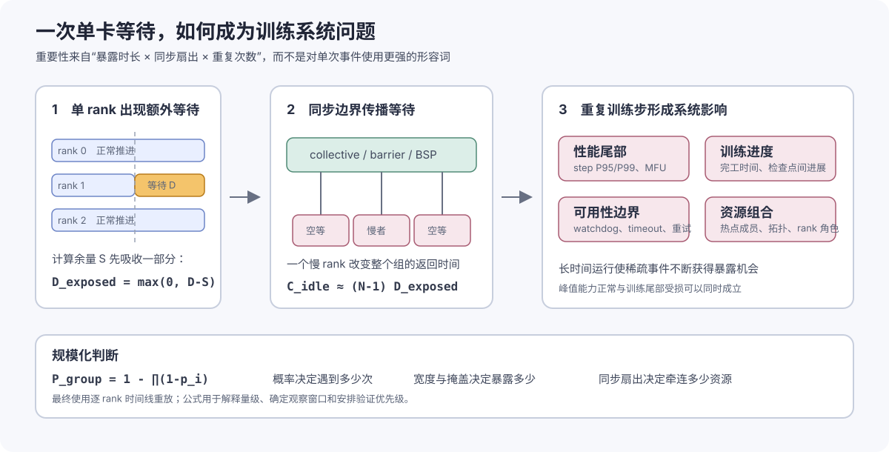

# 加速器健康、内存可靠性与前向进展

## 本章结论

训练资源准入采用“静态一致性、单节点可运行性、单卡压力筛查、成对硬件筛查、目标节点选择、训练拓扑验收、训练复现”分层检查。当前材料能够支撑方法设计，但不等价于 10,240 卡生产环境已经通过验收。任何健康率、通过率和稳定性数字都必须由固定测量条件下的原始证据重新汇总。

{ .technical-diagram loading=lazy }

## 分层健康检查

| 层级 | 主要检查 | 主要输出 | 准入作用 |
| --- | --- | --- | --- |
| 静态 | 设备数量与可见性、驱动/框架、ECC/RAS、HCA/RDMA/接口、CPU/NUMA、磁盘和必要环境变量 | 静态事实、异常项与 ECC 专项报告 | 直接定位节点或设备的配置/硬件异常 |
| 单节点动态 | 基础运行、矩阵计算、显存访问、六类集合通信、MoE/EP 非均匀负载 | 用例指标、异常与证据完整性报告 | 验证节点内多卡计算、正确性和通信可运行性 |
| 单卡计算与存储可靠性测试 | 单卡正确性、算力、HBM、稳态功耗/散热与 SDC | 逐卡结果、逐轮曲线、聚合摘要和物理卡映射 | 刻画计算、存储和热态下的设备行为 |
| 单卡长稳筛查 | 单卡零通信长循环和热态检查 | 逐卡状态、异常卡表和汇总 | 将单卡停顿与通信组整体停顿分离 |
| Pairwise | 多轮换伙伴、物理超节点内与跨超节点链路检查 | 节点、链路、固定路径候选与覆盖报告 | 定位硬件节点和链路持续异常；承担性能 gate |
| 准入选择 | 汇总前述阶段覆盖和硬/软理由，选出精确目标节点数 | 选中、备用、排除节点清单和选择依据 | 目标数量不足时阻断，不降低训练规模 |
| 训练拓扑 | 训练定义中的 TP、dense-DP、expert-DP、EP、PP 子通信组 | 通信组计划、覆盖率、拓扑摘要与通信栈失败 | 验证真实训练通信组的初始化和正确性，不作大组性能归因 |
| 训练复现 | 在原节点、镜像、配置和训练栈上复现失败或长稳运行 | 训练日志、检查点、故障与恢复记录 | 验证合成检查是否能解释真实训练问题 |

单节点动态检查在同一个分布式进程组中依次执行冒烟、快速计算、All-Reduce 带宽和多类 collective，减少重复初始化的成本。消息矩阵应覆盖小消息延迟区、中等消息过渡区和大消息带宽区；非均匀 All-to-All 还需覆盖均匀、热点和空目标等负载。实际参数必须作为实验条件归档，不能只引用推荐值。

## 单卡计算与存储可靠性测试

### 测量对象与执行模型

该测试的基本实验单元是一张加速卡。节点内各卡同时执行相同负载，卡之间没有数据依赖或集合通信。对第 `i` 张卡，可观测量写为：

\[
\mathbf{X}_i(t)=
\bigl\{Q_i(t),\,B_i(t),\,E_i(t),\,P_i(t),\,T_i(t),\,f_i(t),\,L_i(t)\bigr\}
\]

其中，\(Q\)、\(B\)、\(E\)、\(P\)、\(T\)、\(f\) 和 \(L\) 分别表示计算吞吐、HBM 有效带宽、数值误差、功耗、温度、有效时钟和限频状态。

“单卡独立”限定了数据通路，“整机并发”限定了供电与散热边界。测量仍然包含框架调度、算子实现、设备运行时、频率策略、HBM、板级供电和整机冷却等多个层次，因此异常结果不能只凭单次测量归因到某一个物理部件。

实验由五类负载组成：

| 负载 | 核心运算 | 控制变量 | 观测量 |
| --- | --- | --- | --- |
| 矩阵计算 | 低精度矩阵乘法与高精度参考比较 | 数据类型、矩阵形状、累加精度、预热与迭代次数 | 数值误差、执行时间、吞吐 |
| HBM 流式访问 | 大工作集连续读取、轻量变换和写回 | 元素类型、工作集大小、访问方向、迭代次数 | 有效读写带宽及轮间波动 |
| 持续计算 | 长时间重复矩阵计算 | 负载占空比、持续时间、并发卡数 | 吞吐、功耗、温度、时钟的时间序列 |
| SDC 数值检查 | 矩阵、向量、特殊函数和规约的重复计算 | 输入分布、参考精度、容差和重复次数 | 不一致元素数、误差幅度、首次异常时间 |
| HBM 数据模式 | 已知位模式的写入、读回和比较 | 数据模式、覆盖容量、地址范围和轮数 | 位错误、地址相关错误和实际覆盖率 |

性能测量成立的前提是设备不存在外部计算负载，且可用显存足以形成一致的工作集。存在外部竞争时，正确性结果仍可记录，但吞吐和带宽不属于可比较样本。设备不可见、不可纠正 ECC、温度或功耗遥测缺失属于不同类型的观测，不能相互替代。

### 数值正确性与矩阵吞吐

对矩阵乘法 \(C=A\times B\)，被测结果记为 \(C_{\mathrm{test}}\)，独立高精度参考记为 \(C_{\mathrm{ref}}\)。至少记录最大绝对误差和归一化最大误差：

\[
E_{\mathrm{abs}}
=\max \left|C_{\mathrm{test}}-C_{\mathrm{ref}}\right|,
\qquad
E_{\mathrm{rel}}
=\frac{\max \left|C_{\mathrm{test}}-C_{\mathrm{ref}}\right|}
       {\max \left|C_{\mathrm{ref}}\right|+\varepsilon}
\]

容差由输入精度、累加精度、矩阵维度和舍入模式共同决定。BF16、FP16 等低精度结果不能使用与 FP32 相同的逐位相等条件；但容差必须在观察结果前冻结，否则会形成事后调整。固定随机种子只保证输入可复现，不保证参考结果独立。独立性要求参考计算使用更高精度或不同的计算路径。

一般矩阵乘法 \(M\times K\) 与 \(K\times N\) 的名义运算量为：

\[
F_{\mathrm{GEMM}}=2MNK,
\qquad
Q_{\mathrm{GEMM}}=\frac{F_{\mathrm{GEMM}}}{t_{\mathrm{device}}}
\]

吞吐以设备侧计时为主，内存分配、首次编译和初始化不进入稳态计时窗口。预热用于消除首次加载、缓存建立和频率爬升；正式结果同时报告中位数、低分位、最小值和轮间变异，而不是只保留最好一次。

单一矩阵形状只覆盖特定的 tile、并行度和内存访问模式。形状扫描应改变 \(M/N/K\)、对齐关系和工作集大小，用于区分以下情况：

- 所有大形状均低：可能与频率、功率限制或计算单元有效利用率有关；
- 仅特定对齐或形状低：更可能与算子选择、tile 映射或尾块效率有关；
- 短时正常、持续负载下降：需要转入功耗与热稳态分析。

### HBM 有效带宽

HBM 测量采用工作集大于片上缓存的流式访问。设元素数为 `N`，每元素字节数为 `b`，每轮对输入读取 `r` 次、对输出写入 `w` 次，设备执行时间为 `t`，则名义有效带宽为：

\[
D_{\mathrm{nominal}}=Nb(r+w),
\qquad
B_{\mathrm{effective}}=\frac{D_{\mathrm{nominal}}}{t}
\]

一次读取和一次写回对应 \(r=1,\ w=1\)。如果运算还读取第二输入、执行读—改—写或包含额外中间结果，字节模型必须相应调整。只按张量容量而不按实际读写次数计算，会系统性低估或高估带宽。

\(B_{\mathrm{effective}}\) 是端到端流式算子的有效带宽，满足但通常不会逼近以下理想关系：

\[
B_{\mathrm{effective}}\le B_{\mathrm{physical\ peak}}
\]

两者差异包含指令开销、访存合并、访问对齐、缓存行为、并发度、数据类型、运行时调度和计时边界。厂商峰值描述物理接口的理论传输能力，本测试描述特定算子路径，因此二者不能直接相除后作为统一通过率。跨卡比较必须保持数据类型、工作集、访问模式、预热、迭代数和软件栈一致。

HBM 带宽与 HBM 正确性是两个正交维度：

- 带宽测试关注单位时间完成的名义数据流量；
- 数据模式测试关注写入值、读取值与地址之间的关系。

数据模式至少包含全零/全一、交替位、walking-bit 和地址即数据。它们分别对固定翻转、相邻位耦合、stuck-at、地址译码和别名错误敏感。结论只能覆盖实际成功分配并完成读写比较的地址范围；抽样若只覆盖部分显存，就不能表述为“全 HBM 无错误”。

### 功耗、温度与稳态性能

持续负载期间，将计算吞吐 `Q(t)`、板卡功耗 `P(t)`、温度 `T(t)`、有效时钟 `f(t)` 和限频状态 `L(t)` 对齐到同一时间轴。遥测采样应位于计算计时区之外，避免设备管理访问进入吞吐计时。

热稳态不是固定运行时长，而是温度变化率进入小范围并持续若干窗口：

\[
\left|\frac{\mathrm{d}T}{\mathrm{d}t}\right|<\delta_T
\]

该条件需要连续 \(W\) 个观察窗口成立。

若测试在达到该条件前结束，只能报告有限时长持续性能，不能称为热稳态性能。可派生三个诊断量：

\[
\rho_Q=
\frac{\operatorname{median}(Q_{\mathrm{steady}})}
     {\operatorname{median}(Q_{\mathrm{initial}})},
\qquad
\rho_P=
\frac{\operatorname{median}(P_{\mathrm{steady}})}{P_{\mathrm{limit}}},
\qquad
\eta=
\frac{\operatorname{median}(Q_{\mathrm{steady}})}
     {\operatorname{median}(P_{\mathrm{steady}})}
\]

`P_limit` 不可获得时，不计算归一化功耗。能效只用于相同负载和相同计时口径下的比较，不能单独作为健康门限。

时间序列需要按变量之间的共同变化解释。当 \(Q(t)\)、\(P(t)\)、\(T(t)\) 和 \(f(t)\) 都进入稳定平台时，只能说明当前负载形成了可重复工作点，仍要排除整批设备被统一功率策略压低。功耗接近上限、限频出现且吞吐下降，更符合功率包络约束；温度上升后时钟与吞吐同步下降，则更符合热包络约束，但两者都要继续区分配置、供电、风道、冷却和传感器差异。

若吞吐偏低而功耗、温度、时钟和限频均无异常，功率热状态便不能解释全部差异，候选应转向算子路径、NUMA、外部竞争或设备差异。相反，负载从未达到目标功耗或时钟且 SDC 没有命中，只能形成“当前压力不足”的阴性观察，不能覆盖更高电流密度或更高温度下才出现的间歇故障。

C550 的 450 W 是最大板卡功耗包络，不是负载必须达到的目标值。A3 与 C550 的功耗、温度和性能曲线不能按相同百分比直接比较；板卡设计、传感器位置、功率上限定义和频率策略不同，都需要独立基线。

功耗与 SDC 的因果关系需要单独实验。至少设置低、中、高三个负载水平，重复冷热循环，并将每次数值异常与 `P(t)`、`T(t)`、`f(t)` 对齐。只有异常概率随负载或温度可重复变化，且软件、输入和运行环境保持不变时，才有证据讨论功耗或热状态的条件相关性。单次高负载下出现异常只能说明同时发生，不能证明因果。

### SDC 故障模型与检测

SDC 指计算或存储路径返回了语法和状态均正常、但数值内容错误的结果。它与进程退出、设备掉卡、ECC 明确上报和超时不同：后四类属于显式故障，不应混入 SDC 命中率。

公开研究说明，SDC 的系统影响不能只由“错误位数”或一次算子误差预测。对生产中识别出的健康节点和 SDC 异常节点进行确定性配对实验后，研究者观察到不同异常节点在子模块、单优化步和训练区间上的影响并不一致：部分局部扰动较小，仍可能改变最终权重或形成 loss spike。[R028](references.md#r028) 因此本文把 SDC 证据分成三层：硬件或算子测试是否产生不一致、训练状态是否偏离参考轨迹、相同 token/计算预算下模型质量是否改变。前一层命中提高后两层的研究优先级，却不能直接替代训练级结果。

SDC 的时间形态决定检测方法。只在单轮出现并随后恢复的瞬态错误，需要足够重复和逐轮留痕；与温度、功耗、数据模式或地址相关的间歇错误，需要负载分档、冷热循环和地址覆盖。跨重启仍在同一路径复现的永久错误不能只依赖时间自一致，因为一个稳定的错误实现可能反复给出同一错误结果。若同版本、同算子在大量设备上以相同方式偏离，则更像系统性数值偏差，需要独立实现或高精度参考区分软件与硬件路径。

检测参考分为三类：

1. **独立参考**：使用更高精度或不同计算路径生成期望结果，用于发现稳定且可重复的偏差。
2. **时间自一致**：相同输入重复计算，比较轮间结果，用于发现瞬态和间歇错误。
3. **跨设备共识**：同批设备执行相同输入，以多数结果建立共识，用于定位单卡离群，但依赖多数设备正确这一假设。

不同目标单元需要不同输入与不变量：

| 目标路径 | 负载与不变量 | 主要覆盖 | 主要盲区 |
| --- | --- | --- | --- |
| 矩阵单元 | 固定矩阵乘法；独立高精度结果与轮间一致性 | 乘累加路径的数值损坏 | 未覆盖的形状、精度和内部数据通路 |
| 向量单元 | 大规模逐元素运算；位级或严格数值比较 | 向量执行路径的偶发错误 | 高级算子到物理单元的映射不固定 |
| 特殊函数单元 | 指数、对数等函数；数学恒等式与高精度参考 | 超越函数近似路径异常 | 输入范围、近似阶数和容差设置 |
| 规约路径 | 固定输入长规约；结果范围和重复一致性 | 累加器、规约树和顺序相关异常 | 浮点非结合性造成的合法差异 |
| HBM 与缓存 | 已知位模式的写入、读回和地址关系 | 位翻转、stuck-at、地址译码和别名 | 未分配地址、控制器内部不可见路径 |
| 热态计算 | 持续负载期间周期插入确定性计算 | 高温或高电流条件下的间歇错误 | 两次采样之间的短暂错误 |

浮点规约和低精度矩阵计算可能因非结合性、并行顺序或随机算法产生合法差异。SDC 判定必须先固定确定性条件，或使用与误差传播模型一致的容差。执行异常、超时和参考生成失败应单独分类，不能计为数值命中，也不能计为“未发现 SDC”。

若 \(n\) 次相互独立试验均未命中，理想二项或泊松近似下，事件率的 95% 单侧上界约为 \(3/n\)。实际轮次通常共享设备、温度轨迹和数据路径，并非严格独立，因此该上界只能作为条件化估计；报告更应披露总轮数、独立输入数、热循环数和 HBM 地址覆盖率。

### 从训练前准入到生命周期检测

训练前筛查只能覆盖一次设备状态和有限输入空间。Meta 的公开实践将静态、瞬态与静默故障分开，并组合周期性专项测试、与生产负载共置的快速测试和分析面检测，以覆盖设备生命周期内随数据、温度、电压、频率和老化状态变化的故障。[R027](references.md#r027) 这类方法不提供 A3 或 C550 的先验故障率，但说明“一次通过后永久健康”不是适合大规模训练资源的状态模型。

本文采用三阶段证据循环：准入阶段以高强度、确定性负载建立初始状态；训练阶段以低频 canary、数值不变量和异常梯度/NaN 信号形成在线证据；异常后以冻结输入、软件版本和物理设备身份进行确定性复验。在线检测不应在每个 step 复制完整计算，而应按错误风险、训练阶段和证据成本分配抽样预算。复验恢复表示当前条件下未再次命中，不自动抹除历史证据；持续命中、跨重启命中和只在特定热态命中属于不同风险状态。

HBM 也需要独立于传统 DRAM 建模。超过 4.6 亿条现场错误事件的 HBM 研究发现，其空间局部性、时间相关性和传感器关系与传统 DRAM 不同，并据此构建分层预测方法。[R014](references.md#r014) 因此 CE 聚集、地址模式、堆叠层次、时间窗口和热状态应共同进入 HBM 证据；仅将通用 DRAM 的年龄或 CE 阈值迁移为 HBM 准入线，会丢失器件结构和工作负载差异。

### 统计比较与结论边界

性能分布只在设备型号、硬件批次、计算后端、驱动、固件、功率上限、冷却条件和负载参数一致的样本群体内比较。对指标 `x_i`，基本相对量为：

\[
r_i=\frac{x_i}{\operatorname{median}_j(x_j)}
\]

`r_i < 0.8` 可作为初始工程候选线，但它不是设备规格，也不是跨环境通用门限。该规则隐含“群体中多数设备正常”的假设；如果整批设备受相同固件、功率策略或环境温度影响，中位数会同步下移。生产基线因此需要同时保留已知健康样本的绝对分布，并使用中位数、P10/P90、MAD 或变异系数描述离散程度。

单卡计算与存储可靠性测试的直接结论限于以下范围：

- 某张卡在指定负载、软件环境和热状态下的计算、显存与数值表现；
- 同一可比群体中的相对性能位置；
- 数值异常与功耗、温度或时间的相关关系。

它不能单独证明训练收敛、集合通信性能、所有显存地址均无错误，或异常已经归因到永久硬件故障。跨卡通信、训练算子覆盖和长期故障率需要独立实验。

## 时间边界、异步完成与前向进展

健康检查中的“耗时”不是一个自然唯一的量。CPU 提交、运行时排队、设备执行、完成通知和消费者等待处于不同时间轴；计时边界选错后，同一操作既可能看起来接近零，也可能包含前序队列、主机调度和同步开销。当前健康检查体系同时使用设备 event、同步主机计时、稳态批次计时和反复等待观测，必须按它们实际回答的问题解释，而不是把所有毫秒数放进同一性能分布。[I006](references.md#i006)

{ .technical-diagram loading=lazy }

### 五种时间语义

| 时间语义 | 起止边界 | 适合回答的问题 | 主要混入或遗漏 |
| --- | --- | --- | --- |
| API 提交时间 | CPU 进入调用到 API 返回 | 包装层与提交开销是否异常 | 异步设备执行通常尚未完成 |
| 设备 event 时间 | 同一设备 stream 上 start/end event 的差 | 该 stream 中操作的设备执行区间 | 不含大部分 CPU 提交；受前序 stream 依赖影响 |
| 流门控 event 时间 | 设备 stream 被门控后，在 start/end event 间执行负载 | 将冷启动与主机排队从设备区间中剥离 | 仍是设备队列区间，不是端到端等待 |
| 同步主机时间 | CPU 高精度时钟包围操作与设备同步 | CPU 到运行时、驱动、设备及完成返回的总链路 | 主机调度、同步和前序工作都可能进入结果 |
| 稳态批次时间 | 预热与预分配后，用 event 包围连续 \(K\) 次操作 | 吞吐和带宽 gate，摊薄单次事件开销 | 只给批次均值，隐藏逐次尖峰 |

设备 event 可用时，主性能测量应在预热和 workspace 分配之后执行；事件在同一设备/stream 上记录，结束后只同步一次，再除以有效迭代数。主机同步时间保留为诊断量，它覆盖的系统链更长，不能在 event 可用和不可用的样本间静默切换。任何回退都要记录计时模式，并在同模式内建立基线。[I006](references.md#i006)

流门控把“何时开始执行”留在设备 stream 上：主 stream 先等待一个设备侧条件，条件满足后依次经过 start event、负载与 end event。它适合把运行时初始化和主机命令提交从设备执行区间剥离；独立进程中的门控自检还可以把长启动阶段与短操作完成阶段分开。门控成功只证明该设备/运行时组合遵守这套 stream 编排，不证明负载正确，也不证明整条主机链路稳定。

### 异步操作必须观测提交、完成与暴露等待

异步 collective 至少经过

\[
\text{submit}\rightarrow\text{queued}\rightarrow
\text{device start}\rightarrow\text{device complete}
\rightarrow\text{wait return}
\]

五个状态。只包围 API 返回得到的是提交延迟；在通信 stream 上记录 event 得到的是设备侧区间；在消费点调用 `wait` 得到的是尚未被计算覆盖的暴露等待。设提交返回时刻为 \(t_s\)，开始等待为 \(t_b\)，等待返回为 \(t_e\)，则

\[
T_{\mathrm{overlap}}=t_b-t_s,
\qquad
T_{\mathrm{exposed}}=t_e-t_b,
\qquad
T_{\mathrm{completion}}=t_e-t_s
\]

其中 \(T_{\mathrm{overlap}}\) 是允许其他工作发生的窗口，不等于实际被计算覆盖的时间；\(T_{\mathrm{exposed}}\) 才是消费点直接承担的等待。设备事件区间与 \(T_{\mathrm{completion}}\) 不要求相等，因为后者还受队列、主机唤醒和后端完成契约影响。

性能实验不能为了“计得准”而在每个异步操作后强制同步，否则被测对象已从重叠通信变成串行通信。更合适的分工是：正常重叠负载记录 submit 与真实消费点 wait；独立诊断轮次再加入设备同步和事件，建立两种时间的配对分布。多通信域重叠测试中，每个已提交 work 都必须被等待或以等价完成机制收口，否则“进程未报错”不能证明所有通信域完成。

### 反复等待观测的是整条前向进展链

单卡零通信长循环可以反复执行固定设备负载，在每轮或固定轮数后读取标量并显式等待设备完成，以相邻两次完成返回之间的墙钟间隔

\[
G_k=t^{\mathrm{return}}_k-t^{\mathrm{return}}_{k-1}
\]

观察 forward progress。若 \(G_k\) 超过预注册的 gap 门限，该事件表示在这段时间内 CPU 观察不到下一次完成。它覆盖的链路包括 CPU 线程调度、Python/框架派发、设备运行时、驱动队列、设备计算、完成通知与同步返回；因此特别适合发现短平均吞吐会掩盖的长尾停顿。[I006](references.md#i006)

这一方法的强项是故障域清楚：默认不包含集合通信，每张卡独立推进，避免一个 rank 的停顿通过 collective 扩散成全组现象。它的边界也同样清楚：gap 是端到端进展延迟，不是纯 GEMM 时间；标量读取本身可能形成隐式同步；事件能够证明链路停顿，却不能单独指出停顿发生在 CPU 调度、驱动还是设备。通信版本适合观察“停顿是否会扩散成组级尾延迟”，但不能再把异常直接归属到某张卡。

定位依赖同一时间窗的联合事实：CPU 利用率、线程状态、等待通道、主动/被动上下文切换和 RSS；设备利用率、显存、功耗、温度和时钟；ECC/RAS 与内核/驱动事件；以及是否发生 collective。典型推断是：CPU 长时间不可运行且设备空闲，优先检查主机调度与系统压力；CPU 在设备等待中停留且设备无进展，候选落在运行时、驱动或设备；设备保持忙碌但完成迟迟不返回，则需要区分真实长 kernel、设备调度和完成通知。这些都是竞争假设，必须用复测或更深事件证据区分。

### 固定时延在同步边界上的暴露机制

加速器程序通常采用异步执行：Host 提交任务后即可继续准备后续工作，设备在另一条时间线上完成计算。同步操作的作用不是“执行一段计算”，而是把这两条时间线重新汇合。一次同步返回，至少意味着它之前的任务已经执行完成，完成信号已经穿过运行时和驱动，并且等待线程重新获得了执行机会。因此，同步点看到的时间可以写成

\[
T_{\mathrm{sync}}
=T_{\mathrm{unfinished}}
+T_{\mathrm{completion\ path}}
+T_{\mathrm{host\ resume}},
\]

其中第一项是到达同步点时设备尚未完成的正常工作，第二项是完成通知经过 runtime、驱动和信号路径的时间，第三项是 Host 线程收到条件后恢复执行的时间。延迟最终记录在同步 API 上，只表示“等待在这里变得可见”，并不要求额外时间也从这一层产生。对异步系统而言，同步点更像一台观察完成链的显微镜。

这一区分也解释了为什么固定宽度的停顿与普通降速不同。若算子本身按比例变慢，增加矩阵规模通常会相应拉长异常时间；若不同工作量上都叠加近似相同的数百毫秒，则时间形态更接近完成链中加入了一段离散等待。它可能来自调度、队列、轮询、信号唤醒或其他周期性状态，但峰宽本身只告诉我们“额外时间近似定长”，具体机制仍需分层计时确定。

固定等待是否进入训练墙钟，还取决于它与其他工作的重叠。设一次额外等待为 \(D\)，到下一关键同步边界之前可用于掩盖它的计算余量为 \(S\)，则可见的附加时间可以近似写为

\[
D_{\mathrm{exposed}}=\max(0,D-S).
\]

短模型、频繁取标量或无通信计算掩盖的实验中，\(S\) 很小，等待大多直接进入 step 时间；计算更长、流水更深且重叠充分时，部分等待会被隐藏。到了 barrier、collective 或其他 BSP 关键路径，最慢 rank 的剩余等待又会成为整个同步组的等待。这不是矛盾，而是同一事件在不同计算图和并行结构下的暴露程度不同。

### 平台案例用于验证共同机制

A3 与 C550 的长窗数据都说明：峰值能力正常与同步完成长尾可以同时存在，单卡现象又会通过训练同步边界传播。但两个平台的事件率、宽度、空间聚集和软件敏感性不同，因此共同框架只用于组织问题，不用于合并发生率或底层机制。

共同分析从五个问题推进。单卡固定负载和零通信长循环先回答事件是否依赖模型或 collective；工作量扫描再区分算子按比例变慢和附加等待。随后把 submit、Host wait、device event 与训练 trace 配对，判断时间在哪一层被看见。单卡 gap 与 collective 到达、step 和并行角色对齐后，才能估计事件如何进入训练关键路径；最后把稳态基线、事件率、条件宽度和总时间拆开，检验任务下发、分配器或 dispatch 改变的是哪一部分。

A3 与 C550 在这条路径上给出的答案并不相同。A3 呈现近似固定的亚秒密集区，并形成 host-bound 与驱动完成等待证据；C550 当前样本更短、更稀疏，厂商说明指向 dispatch 与 wait-signal 交互。两者都说明单卡完成链可以影响同步训练，但暴露程度仍取决于同步组、并行角色和通信计算掩盖。

具体事件数、概率分布、软件消融和训练对照集中在[平台案例与结果分析](08-results-and-analysis.md)。本章只保留由案例支持的通用认识：同步 API 是等待显现的边界，额外时间可能分布在 Host 调度、runtime dispatch、内核驱动、设备执行和完成通知之间；只有同一次 spike 的配对时间线才能继续分配层内时间。

这类现象可概括为“同步完成路径固定时延”：进程和 rank 保持存活，操作最终完成，但同步返回偶发叠加近似固定的额外等待。它属于完成链的缓慢失效，与 crash、hang、SDC 和显式设备错误不同；单卡固定负载即可观察，进入 BSP 关键路径后则会传播到整个同步组。

分层计时还需要处理观测者效应。高频 profiler 或细粒度 event 可能改变线程调度、队列和同步节奏，因此事件率估计与机制定位使用不同 cohort：低侵入探针估计自然率，少量固定对象承担深度插桩。设备利用率也只说明某个采样窗口内的忙碌状态，用户 kernel 完成、有效吞吐或 retired work 才能证明训练持续前进。

### 影响面：从完成链到同步训练

这些数据描述的是特定测量条件下的完成延迟分布，不是对设备整体能力或质量的单一评价。对机器学习系统更有意义的是它会改变哪些运行假设：

#### 稀疏单卡事件的规模放大

同步训练的 step 时间由关键路径上的最慢 rank 决定。设 rank \(i\) 在一个有效窗口内出现完成等待的概率为 \(p_i\)，在近似独立条件下，同步组至少有一个 rank 命中的概率为

\[
P_{\mathrm{group}}
=1-\prod_{i=1}^{N}(1-p_i)
\approx \sum_{i=1}^{N}p_i
\quad (p_i\ll1).
\]

单卡看来很小的概率，会随同步组成员和完成机会增加而进入可见区间。真实数据又具有明显异质性，因此规模效应通常由少量高率卡、节点共享状态和 rank 映射共同决定，而不是简单的 \(Np\)。这也是为什么平均单卡吞吐正常、绝大多数短测无事件，仍可能与大规模训练中的频繁慢步同时成立。

若一个 rank 在关键路径上暴露额外等待 \(D_{\mathrm{exposed}}\)，其余 rank 已经到达同步边界，则该事件对应的空等资源量近似为

\[
C_{\mathrm{idle}}
\approx (N_{\mathrm{group}}-1)D_{\mathrm{exposed}}
\quad\text{accelerator-seconds}.
\]

例如，在 1,024 rank 同步组中，一次完全暴露的 0.6 秒等待约对应 614 accelerator-seconds，也就是约 10.2 accelerator-minutes 的等待容量。多个 rank 同时变慢时，step 增量取关键路径上的最大剩余等待，而空等资源量还取决于各 rank 的到达时刻；因此这个公式用于理解放大方向，不代替时间线重放。

{ .technical-diagram loading=lazy }

这种问题的重要性主要体现在四个方面：

1. **它消耗的是集群资源时间，而非单一离群设备的时间。** 一个 rank 的完成等待可以使同一通信组中已经到达边界的设备共同空等，降低 MFU 和扩展效率。
2. **它改变尾部而不明显改变峰值。** TFLOPS、HBM 带宽、ECC 和短窗口均值都可能正常，受影响的却是 step P95/P99、检查点间有效进展和作业完工时间。
3. **它可能跨越软件超时边界。** 单次事件仍能自行恢复时表现为 fail-slow；当连续等待、多个完成点或通信阶段叠加后，可能进一步触发 watchdog、collective timeout 或上层作业重试，把性能问题转化为可用性损失。
4. **它使资源组合具有非线性。** 高率成员进入哪个 TP/PP/DP/EP 组、位于哪个流水段，会改变等待传播范围；因此卡级风险、节点共享状态和 rank 角色需要联合考虑。

从容量视角，可以用

\[
\text{impact priority}
\propto
\text{exposure probability}
\times \text{exposed duration}
\times \text{synchronization fan-out}
\times \text{remaining run horizon}
\]

比较问题优先级。这个表达式不是新的健康分数，而是一张分析地图：事件频率决定遇到多少次，事件宽度和掩盖余量决定每次暴露多少，同步扇出决定牵连多少资源，剩余训练时长决定累积成本。对数周运行、数百至数千 rank 的训练，即使事件不造成 crash，也值得作为独立于峰值性能和 ECC 的稳定性维度持续观测。

从系统影响看，峰值能力、空间身份和长窗进展必须同时保留。绝大多数轮次正常会让均值掩盖稀疏长尾；事件又在卡和节点间分布不均，所以资产身份不能只有逻辑设备号，还要关联物理卡、槽位和共享节点。A3 当前表现为更明显的卡级热点，C550 则仍需区分卡、位置和节点共享效应。

进入训练后，单 rank 延迟是否成为 step 增量取决于暴露点、并行组和可用掩盖。A3 材料从热点节点约 7%–12% 的总时间增加到特定 1,024 卡窗口的大面积慢步均有观察；C550 单卡模型给出的自然影响较小，也无法直接解释另一集群的秒级 collective 尾部。因此训练损失要用真实 step 和通信时间线重放，不能由平均单卡率线性代替。软件 cohort 也必须冻结，因为 event、dispatch、分配器、同步和完成通知语义都会随版本改变。

固定 32 节点、512 卡的 A3 训练对照进一步显示，资源风险特征如何转化为训练影响取决于并行结构。同为 448 卡时，移除 4 个高事件节点相对三组随机移除的步时间中位数，在小模型 DP 和 Dense 8B 中分别低 28.3% 和 6.3%，在 MoE 中反而高 3.7%；移除 4 个低事件节点则在三类负载中都是最慢组。[I009](references.md#i009) 这支持“探针排序与训练关键路径存在关联”，但不支持“按事件数排序即可得到通用最优资源集合”。TP、PP、EP、rank 映射、通信组边界和单步基线时长都会改变某个节点进入关键路径的机会。

因此，分析和资源选择的基本单位应是“测量条件下的风险 cohort”。数据足够时，可以据此评估同步组构成或增加观察窗口；对平台或单张设备的更一般判断仍需通过版本、位置、共享层和时间线实验确认。

### 软硬件一致性是测量成立的前提

健康检查不是“先查软件、再查硬件”的线性流程，而是验证多层接口是否共同描述同一台机器、同一次运行和同一完成契约。资产层必须把实例、节点、物理设备、逻辑 rank 和可见序号绑定，否则结果会归错卡；软件层必须冻结驱动、固件、运行时、框架和通信后端，否则同名操作可能具有不同的数值、同步或错误语义。计时层要求负载设备、event、stream 和 synchronize 属于同一后端；训练层要求 world、rank 和各并行组与配置摘要一致。最后，实验身份、阶段、来源、完整性摘要和期望/实际成员共同证明数据确实来自这次运行，而不是缺失或串跑样本。

设备选择、event、stream 与 synchronize 应由同一个后端适配实例绑定并交叉验证，不能分别依据“系统里哪种设备可用”独立选择。参考设计已经覆盖训练组成员、重复 rank 和配置摘要校验，并为不同计时路径记录模式；跨厂商静态事实深度、全部设备路径的 event/同步绑定，以及主机侧硬件日志覆盖仍不完全一致。这些缺口应表现为能力和证据状态，而不是被一个总体 `PASS` 隐藏。[I006](references.md#i006)

已审阅的参考实现已经建立了这条链的基本机制。[I005](references.md#i005) [I006](references.md#i006) 静态阶段能够枚举设备、互连和关键环境并按节点形成证据，但两个资源池的事实深度并不对称，尚未验证的配置不能充当一致性 gate。计算与 HBM 路径采用 workspace 预分配、warmup 后设备 event 计时，并把正确性和 NaN/Inf 独立判定；它仍要求 event、stream 与同步选择统一绑定，主机回退结果也不能混入设备基线。

通信阶段以关键路径上的最慢 rank 形成组耗时，同时把性能汇总与逐轮诊断分开。微基准带宽不等于训练中真正暴露的通信，不同组规模、拓扑和 payload 也不能共享门限。TP、DP、EP 多通信域同时提交并逐一等待，适合作为 forward-progress canary，而不是普通带宽验收；某个重叠用例失败不能抹去常规通信已经通过的事实。

训练拓扑检查会验证各类并行组覆盖、重复 rank、配置身份和实际通信，但它只证明被冻结的通信图，训练版本或 rank 顺序改变后必须重建证据。结果交换采用有界负载并校验来源和长度，可以减少异常长度放大故障，却不等于测量完整；期望用例、子组和 rank 覆盖仍需独立核对。

最后，单卡零通信长稳通过逐 gap 和窗口概率观察端到端链路，短运行零命中不能支持稀有事件“通过”。节点集合在覆盖与硬失败约束下按风险排序并选出精确目标规模；待复测状态仍需从一般风险中分离，避免未关闭候选进入最终集合。

这里的“一致”不是要求两个资源池输出相同数值，而是要求每个样本内部自洽：声明的设备与实际执行设备一致、计时器与同步器属于同一后端、配置摘要与实际通信组一致、结果身份与资产映射一致。跨资源池只共享证据结构与推断规则，不共享设备阈值和性能分布。

稳定性最终是条件概率陈述：在给定软件栈、温度、功率、负载与观察时长下未看到停顿，只能约束相应条件下的事件率。观察时长、窗口相关性、采样相位和万 rank 多重比较如何影响结论，见[概率、覆盖与重复观测](07-evaluation-methodology.md#概率覆盖与重复观测)。

## 静态规则与 ECC/RAS

静态结果应按节点独立采集，再用多数投票建立同批基线。设备数量不足、拓扑不一致、关键状态无法取得或关键状态异常应进入异常明细。静态事实已经带有节点归属，不需要使用通信测试式的二分定位。

### 从物理故障到可见错误

理解 ECC 之前，首先要区分故障、错误和失效三个层次。**故障**是器件或环境中的根因，例如存储单元漏电、TSV 缺陷或粒子辐射；故障被某次访问、数据模式或温度条件激活后，读出值与写入值不一致，形成**错误**；错误超出系统的检测、纠正或隔离能力，最终让作业或设备无法继续提供正确服务，才构成**失效**。同一个故障可能长期潜伏，也可能反复触发大量错误；因此 ECC 计数是故障的观测投影，不是根因本身。[R014](references.md#r014)

{ .technical-diagram loading=lazy }

加速卡中的存储错误不只来自 HBM cell。完整的数据路径还包括片上 SRAM、寄存器、缓存、内存控制器、命令/地址通道、数据链路、TSV、micro-bump 和封装互连。根因可按时间行为分为三类：

| 根因类型 | 典型物理机制 | 事件特征 | 不能直接得出的结论 |
| --- | --- | --- | --- |
| 瞬态故障 | 高能粒子或封装材料产生的粒子、电源噪声、瞬时电压扰动、电荷泄漏、邻位干扰 | 一次或短时间出现，重写后可能消失 | 单次 CE 不足以证明器件已老化 |
| 间歇故障 | 温度、电压、访问强度或数据模式触发的边缘时序；信号完整性和保持时间裕量不足 | 在相似负载、温度、地址或数据模式下复现 | 与高功耗同时发生不等于功耗是直接根因 |
| 永久故障 | stuck-at cell、row/column、sense amplifier、TSV 或互连缺陷；电迁移、热载流子、介质与封装退化 | 相同地址、行列、bank 或路径持续复现 | 重复位置只能缩小范围，仍需厂商诊断确认物理部件 |

HBM 的三维堆叠使空间结构尤其重要。2024 年一项覆盖 19 个数据中心、超过 6 万颗 HBM2、两年观测窗口的现场研究发现，HBM 的空间局部性、时间相关性和传感器特征与传统 DRAM 不同；列相关故障较突出，TSV、层间位置和串扰均可能参与形成错误模式。[R014](references.md#r014) 这意味着传统 DIMM 上按“某月 CE 总量”建立的预测规则不能未经验证直接迁移到 HBM。

### ECC 对位错误的检测与分流

ECC 将一组数据位和附加校验位组成一个码字。写入时生成校验位，读取时重新计算并形成 syndrome；syndrome 表示读出码字与合法码字集合之间的关系。常见的 SEC-DED，即单错纠正、双错检测，可以这样理解：

1. 码字未发生可见变化时，数据正常返回。
2. 一个受保护位翻转时，syndrome 通常能够定位该位，硬件修正后返回数据，并增加可纠正错误计数。
3. 同一 ECC 码字内两个受保护位翻转时，编码能够识别“结果不可信”，但无法唯一确定原始值，因此报告不可纠正错误。
4. 超过编码设计距离的多位错误不再有统一保证；某些模式能够被检测，某些可能别名到另一个 syndrome，甚至被误纠正。具体边界由设备实际采用的 ECC、数据交织和链路保护决定。

因此，生产语义应优先使用 **CE（correctable error，可纠正错误）** 和 **UE/UCE（uncorrectable error，不可纠正错误）**。SBE 与 DBE 适合描述采用 SEC-DED 时的典型 syndrome，但“DBE”不一定证明恰好有两个独立 cell 同时损坏，也不代表错误一定发生在 HBM 阵列。不同设备还可能使用 symbol correction、Chipkill 类方案、片内 ECC、链路 parity 或重传，此时“一个错误”的物理粒度并不相同。[R017](references.md#r017)

DBE 或其他不可纠正事件通常来自以下路径：

- 第一个可纠正位错误在同一码字中尚未被重写或 scrub 修复，暴露窗口内又出现第二个位错误；
- 一次粒子作用或电气扰动同时影响相邻多个位，即 multi-bit upset，而不是两个独立事件相遇；
- 一个永久弱 cell 与另一次瞬态错误叠加；
- 行、列、bank、TSV、命令/地址或数据路径的共因故障一次影响多个位；
- 编码交织不足，使物理相邻位被放入同一纠错域，单个局部扰动直接越过纠错能力。

scrub 的作用不是“清零计数”，而是周期读取码字、纠正仍在能力范围内的错误并写回正确值，缩短多个独立位翻转在同一码字中累积的时间窗口。OCP 的加速器 RAS 要求把 memory scrubbing、page offlining、row remapping、bad-page map-out、数据 poison 和错误隔离视为一条系统链路，而不是只要求设备提供一个 ECC 开关。[R017](references.md#r017)

### 错误发生概率的统计口径

不存在一个可以跨器件、容量、批次和机房复用的“DBE 概率”。至少需要给出设备数、受保护容量、卡时、访问强度、温度范围、scrub 周期、固件版本、计数器语义和维修策略。概率模型的作用是统一分母，不是替代现场数据。

若每个受保护位的条件错误率近似为 \(\lambda_b\)，观测 \(B\) 个位、持续 \(t\) 小时，且暂时假设事件独立、速率恒定，则期望错误数与至少一次事件概率为：

\[
\Lambda=\lambda_bBt,
\qquad
\Pr(N_{\mathrm{error}}\ge 1)=1-\exp(-\Lambda)
\]

对于含 \(w\) 个受保护位的 ECC 码字，若单个位在一次修正或 scrub 间隔 \(\Delta t\) 内翻转的概率很小，两个**独立**位错误在同一码字内累积的量级近似为：

\[
P_{\mathrm{DBE,independent}}
\approx \binom{w}{2}\left(\lambda_b\Delta t\right)^2
\]

这个平方关系解释了缩短 scrub 周期为何能显著降低“两个独立错误相遇”的风险，但它不适用于粒子多位翻转、TSV/列故障、地址通道错误和 CE storm 等相关事件。真实 HBM 错误具有明显空间与时间聚集时，独立泊松模型通常会低估尾部风险。

FIT 表示每十亿设备小时的事件数。若某类设备的条件事件率为 \(R_{\mathrm{FIT}}\)，集群包含 \(N\) 个同类设备，观察 \(t\) 小时，在小概率近似下：

\[
\mathbb{E}[N_{\mathrm{event}}]
\approx \frac{R_{\mathrm{FIT}}Nt}{10^9}
\]

FIT 的“事件”必须注明是原始位错误、CE、UE、设备失效还是作业中断。把 CE FIT 直接当作设备报废率，或把单卡 UE 率直接当作作业失败率，都会混淆 ECC、错误隔离和应用恢复带来的条件概率变化。

公开现场数据适合说明数量级和分布形态，但不能作为本项目门限：

- Google 对早期服务器 DDR/FBDIMM 的研究中，每年超过 8% 的 DIMM 至少出现一次 CE，UE 年发生比例约为每 DIMM 0.22%；错误高度集中在少数 DIMM，CE 与后续 UE 显著相关。[R015](references.md#r015) 这些数据来自旧式服务器内存，不是 HBM 规格。
- HBM 现场研究在超过 6 万颗 HBM2 中观察到 808 颗出现 CE、64 颗出现巡检发现且可延后处置的 UE、229 颗出现需要立即动作的 UE；同时记录了超过 4.6 亿次 CE。[R014](references.md#r014) “受影响 HBM 数”和“错误事件数”相差巨大，说明大量事件由少数部件重复贡献，不能用总事件数除以总卡数得到一张卡的独立概率。

本项目应分别报告 `cards_with_CE/card-hours`、`CE_events/card-hours`、`cards_with_UE/card-hours`、`jobs_affected/job-hours` 和 `repeated_locations`。前两项区分受影响设备比例与事件强度，第三项描述纠错能力被越过的风险，后两项才连接到业务影响与永久故障候选。

### 老化曲线与幸存者偏差

可靠性工程常用条件失效率 `h(t)` 描述“设备已存活到年龄 `t` 的前提下，下一小段时间发生失效的速率”。经典浴盆曲线包含早期失效、稳定使用和磨损失效三段：[R016](references.md#r016)

{ .technical-diagram loading=lazy }

- **早期失效期**：制造、封装、焊接、TSV 或装配中的弱点较快暴露；入场筛选和 burn-in 会把一部分早期失效移出生产样本。
- **稳定使用期**：随机瞬态扰动和少量潜伏缺陷共同作用，条件失效率可能近似平稳，但不是零；设备规模扩大后，集群级事件仍会近似随总卡时增长。
- **磨损失效期**：电迁移、热载流子、介质退化、反复热循环、micro-bump/TSV 与封装应力逐渐压缩电压、时序和保持裕量，CE 复发、可修复位置消耗和 UE 风险可能上升。

浴盆曲线是组织假设的起点，不是对 A3、C550 或某代 HBM 的既定结论。Google 的旧式 DIMM 数据曾观察到部分平台 CE 在约 10～18 个月后上升，但 UE 随年龄反而下降，主要原因是发生 UE 的 DIMM 已被替换，剩余样本形成“适者生存”。[R015](references.md#r015) 因而生产老化曲线必须同时记录退役、维修和删失样本；只看仍在线设备，会把主动维修的效果误读成硬件越老越可靠。

本项目的经验老化曲线应按资源池、硬件批次和投产月份建立 cohort，并采用卡时作为暴露量：

\[
\widehat{h}_k=\frac{d_k}{\sum_i y_{ik}}
\]

其中，\(d_k\) 是年龄区间 \(k\) 内的首次目标事件数，\(y_{ik}\) 是设备 \(i\) 在该区间贡献的实际暴露卡时。

目标事件至少分为首次 CE、重复地址 CE、CE storm、首次 UE、因显存错误隔离和因显存错误中断作业。每个年龄桶同时控制软件/固件版本、功率上限、冷却条件和负载类型，并保留置信区间。若某批卡在中途统一升级固件或更换冷却部件，应切分观察期，而不是把前后样本连成一条自然老化曲线。

### ECC/RAS 信号如何进入训练系统决策

对机器学习系统而言，关键问题不是具体维修流程，而是一个 RAS 信号是否改变了三个系统假设：计算结果仍然可信、每个 rank 能持续向前推进、目标规模的同步训练集合仍然可构造。项目因此将 ECC/RAS 作为训练资源选择的证据，而不是独立的设备告警列表。参考设计已经建立事实完整性约束、两种风险策略、设备/芯片级定位以及精确节点选择；时间增量、跨轮次空间复发和 ECC 事件到训练 step/检查点的关联仍未闭合。[I005](references.md#i005)

{ .technical-diagram loading=lazy }

#### 观测必须具有空间、时间和覆盖坐标

一个非零计数只有放入以下坐标后才具有可解释性：它属于 HBM、片上存储还是链路保护域；来自哪个节点、设备和芯片；表示当前事件、历史累计还是某个压力窗口内的增量；查询是否覆盖全部可见设备。查询失败、字段缺失、非法值和设备/芯片覆盖不完整在系统状态上表现为 `FAIL`，但其认识论含义是 `EVIDENCE_BLOCKED`：证据不足以建立健康结论，并不等价于已经证明硬件损坏。ECC 未启用则是另一类情况，它直接破坏“显存错误受到预期保护”的运行假设。

这一区分避免两类常见误判。第一，不能把缺失值折算成零，从而在资源池规模扩大时系统性制造假阴性。第二，不能把累计值直接当成当前错误率；设备经历重启、驱动重载、固件升级或内部修复后，计数器是否保留决定了两个快照能否相减。现有实现证据覆盖查询状态、计数完整性和设备覆盖，但尚未对跨运行基线、计数重置语义和单位卡时增量建模。

#### `alert` 与 `strict` 是两种风险模型

项目保留 `alert` 与 `strict` 两种策略。`alert` 适用于计数同时包含历史事件、已修复位置或厂家接受状态的资源池，目标是保留风险信息而不把所有非零历史值都解释为当前失效；`strict` 适用于新资源基线、修复后重新认证或高正确性敏感任务。它们改变的是证据到资源状态的映射，不改变关键事件和证据缺失的边界。

`alert` 和 `strict` 的差异主要落在历史或已经纠正的信号上。Ascend 单比特计数以及 MetaX 可纠正累计计数，在 `alert` 下记为 `WARN` 并保留风险，在 `strict` 下进入 `SUSPECT` 和主动验证。没有关键事件佐证的不可纠正累计值也依赖时间语义：宽松策略不把历史总量外推为当前 DBE，严格策略则在重新认证前拒绝其进入候选集合。

当信号越过这一历史风险边界，两种策略不再分歧。MetaX 关键 RAS/DBE 事件在两种模式下均为 `FAIL`；ECC 未启用同样直接破坏预期的错误 containment。查询失败、非法值或覆盖不完整则标为 `EVIDENCE_BLOCKED`，表示无法形成资源选择结论，而不是已经证明硬件损坏。Ascend 双比特计数、隔离页和待隔离页在 `strict` 下为 `FAIL`；`alert` 仅在沿用已确认的厂家接受口径时保留为带风险的 `WARN`。

`alert` 策略下的 `WARN` 不表示设备不存在历史风险。参考设计允许静态阶段总状态保持 `PASS`，同时独立保留 ECC 风险状态及其节点、设备、芯片和计数器坐标；节点选择阶段再将其作为风险维度。在其他证据相同时，无风险节点优先于具有 ECC 历史的节点。该设计区分“曾发生但已被硬件纠正的错误”与“当前无法可靠参与训练”，同时保留历史信息。

#### RAS 信号必须与工作负载证据联合解释

ECC 只描述被编码覆盖的数据路径，不能单独判断矩阵计算、未保护缓存、设备前向进度或训练收敛。项目中的单卡正确性、HBM 数据模式与有效带宽、零通信长稳、功耗/热态和成对通信因此不是 ECC 的重复测试，而是对不同故障域施加独立约束。

联合解释从“错误是否仍在活动”开始。累计 CE 非零但压力窗口没有增量，且正确性、HBM 和长稳均正常，只能说明历史上发生过被纠正事件；节点可以保留为较低优先级候选，但不能宣称从未出错。若 CE 在 HBM 压力或热稳态阶段继续增长，并集中到同一芯片或位置，则存储单元、控制器、TSV/互连或时序裕量成为活动性故障候选，风险关闭前不应进入正式训练集合。

关键 DBE/UE 与进程退出、poison 或错误结果同窗出现，表示纠错能力可能已经被越过；节点不能进入本轮集合，事件后的检查点也要独立验证。反过来，可复现 SDC 即使没有 ECC 事件，仍然是端到端正确性硬失败，因为故障可能位于计算单元、未保护存储、链路或软件路径，“ECC 干净”不能覆盖错误结果。

没有错误增量、SDC 或超时时，HBM 带宽持续偏低更接近性能、热或功率约束，应作为 straggler 风险而不是 DBE 处理。零通信长稳停滞且伴随时钟、功耗或温度异常，更接近单设备前向进展或热稳定性问题；只在成对或固定物理路径上失败而单卡长稳正常，则优先检查链路、通信栈和路径，并通过换伙伴与拓扑分组继续区分。

这里的主动验证不是简单重复一次测试，而是在冻结软件版本、负载形状和功率/热条件后，比较压力前后的错误计数，并要求最初的故障激活条件重新出现。只有累计总量而没有时间差分，只能证明设备存在历史；只有负载通过而没有复测后的计数，也不能排除 ECC 在后台吸收了新的错误。

#### 节点选择是带约束的集合构造问题

同步训练要求固定 `world size`，且一个 rank 的停滞或错误可能阻塞整个通信组，因此单卡证据最终必须收敛到节点集合。项目以节点作为选择单元，同时保留设备和芯片粒度用于解释。SDC 可疑、单卡失效或停滞、关键 ECC/RAS 事件以及跨伙伴复现的通信失败形成硬约束；历史 ECC、热态、持续性能离群、资源争用和性能可疑形成风险向量。

若目标节点数为 `K`，理想选择可写成：

\[
\operatorname{eligible}(n)=
\operatorname{coverage\_complete}(n)
\land \neg\operatorname{hard\_failure}(n)
\land \neg\operatorname{retest\_pending}(n)
\]

\[
S^\star=\operatorname*{arg\,min}_{S}\operatorname{risk}(S)
\quad\text{s.t.}\quad
|S|=K,\ \operatorname{topology\_constraints}(S)
\]

参考实现要求静态、单节点、逐卡计算与存储可靠性、逐卡长稳和成对测试覆盖完整，排除具有硬失败证据的节点，并按风险负担选出精确的 \(K\) 个节点；候选不足时返回 `BLOCKED`，不得将较小规模结果表述为目标拓扑通过。最终集合携带内容摘要，使训练阶段能够验证资源身份是否发生漂移。[I005](references.md#i005)

实现与上述模型仍有一个重要差距：当前 `WARN` 和 `SUSPECT` 都进入风险排序，尚未把 `retest_pending(n)` 实现为独立约束。因此在无风险节点不足时，一个尚未关闭主动验证的节点仍可能被选中。更适合训练系统的状态划分是：`OBSERVE_ELIGIBLE` 参与风险排序，`RETEST_REQUIRED` 在验证完成前不属于候选集合，`HARD_EXCLUDED` 表示正确性或 forward progress 硬失败，`EVIDENCE_BLOCKED` 表示覆盖不足使整次集合构造无效。

page offlining、row remapping 和 spare replacement 属于底层 RAS 能力，本报告不展开其操作流程。机器学习系统需要消费的是修复后的可见容量、剩余修复裕量、计数基线是否重置，以及同一负载下是否仍出现错误增量。目前项目能够读取隔离页相关计数并参与策略分级，但还没有形成跨轮次 CE storm、重复位置、剩余 spare 容量及其与训练任务的联合模型。[R017](references.md#r017)

ECC 也不能替代端到端正确性检查。它只保护设计中被编码覆盖的存储和传输域，无法保证计算单元、未保护缓存、软件索引、通信协议或错误的参考数据正确。反过来，ECC 上报 UE 也不等于错误数据一定被应用消费：containment、poison、进程终止和 scrub 可能在消费前阻断传播。训练系统仍需使用确定性重算、checksum、loss/梯度异常检测和检查点完整性验证，连接 ECC 事件与实际作业影响。

Ascend 主机侧可见 RoCE 设备可能包含存储或业务接口，其数量和状态差异只作诊断证据；训练 NPU 网卡仍需通过设备管理面、HCCL 日志和网络侧事实验证。计算实例无法读取宿主机内核日志时，PCIe AER、MCE、soft lockup 和历史设备错误属于宿主机侧证据缺口，不能把“未采集”解释为“无错误”。

## 动态性能比较与复测

单节点动态比较只在测试阶段、算子、消息大小、负载模式和通信组规模完全相同时建立 cohort。Pairwise 还必须匹配物理路径层级、精确物理超节点对、拓扑类型和工作负载形状，不能把超节点内、不同跨域链路或不同训练通信组混为同一基线。默认规则如下：

- 小于 1 GiB 的 case 记录 latency、BusBW 和正确性，不因相对性能偏离阻断准入；正确性、NaN/Inf、超时和进程失败仍是硬失败。
- 大于等于 1 GiB 的用例主要比较平均总线带宽；候选阈值默认是低于同类基线的 70%。同类样本少于 3 个时不能作出横向性能判定。
- 首轮候选冻结为明确的算子、负载模式和消息大小，并加入相邻消息规模进行一次定向复测。首轮默认一个测量批次，复测默认至少三个批次。
- 同一节点在复测中持续偏离才标记为可疑；只在首轮出现或候选转移到其他节点时作为瞬态观察保留。

固定绝对 BusBW 门限默认关闭。示例阈值不能跨硬件、通信库或节点规模复用，必须先用同批资源建立基线。详细统计口径见[评测方法](07-evaluation-methodology.md)。

## 大规模分组与定位

通过单节点与单卡筛查后，多节点检查先用固定随机种子组织多轮 Pairwise。A3 超节点模式先覆盖物理超节点内 pair，再采样跨物理超节点链路；普通集群则通过多轮不同伙伴配对提高节点归因证据。不同轮次串行，同一轮中互不重叠的通信组并行；启动采用准备与统一激活协议，控制面轮询和结果回收不依赖长连接。

功能失败与性能候选采用不同处置路径：正确性、建联、进程、超时和结果传输失败进入拆分或重配对定位，并阻断异常节点进入硬准入集合；持续低带宽先在相同物理 cohort 中冻结复测。只有跨不同伙伴复现才归为节点候选；多个不重叠 pair 在同一物理链路复现且端点内部控制组正常，才归为链路候选；只在固定 pair 复现则保留为 path 候选。大量 group 同时偏离时记录系统性事件，优先排查全局负载、通信配置和网络面。

目标规模不能通过一个全局合成通信矩阵验收，而应依据目标训练的并行配置生成真实通信组定义，只在实际 TP、dense-DP、expert-DP、EP 和 PP 子组中通信。结果以最慢子组聚合，并校验用例和子组覆盖。大通信组失败时可拆成较小子组定位；若子组通过而父组失败，应归为规模相关的通信栈候选，不能据此将父组全部节点判定为硬件故障。

候选池大于训练所需规模时，准入必须同时要求静态、单节点、单卡计算与存储可靠性测试、单卡长稳和成对筛查覆盖完整。带硬失败理由的节点进入排除集合，其余按风险负担排序，选出精确目标数并保留备用节点；数量不足时阻断，不得以较小规模结果替代目标规模验收。

## 作业存活与恢复安全

多节点运行应保存实例身份、所在节点、地址和就绪状态基线，并周期复查。实例缺失或替换、调度节点变化、状态异常或地址缺失时，应停止受影响的通信组并保存存活性证据；无法满足目标规模时应阻断。连续查询失败达到预设门限时终止监控，避免在成员视图不可信时继续给出准入结论。

断点续跑必须校验实验条件、训练通信组定义、预准入与已选择节点集合、逻辑/物理超节点映射、覆盖模式和分组随机种子的完整性摘要。任一输入改变就视为一次新实验。每个阶段都保存检查点，最终证据包应排除运行时临时状态，并保证外部故障证据可独立读取和审计。

## 稳定性指标

以下指标按资源池分别统计，并同时报告时间窗口、作业数量与卡时：

| 指标 | 定义 |
| --- | --- |
| 节点准入通过率 | 最终通过准入的节点数 / 纳入本轮检查的节点数 |
| 有效训练时间占比 | 有效训练卡时 / 已分配训练卡时；启动、等待、检查点和故障恢复是否计入需预先冻结 |
| 作业成功率 | 达到预定训练终点的作业数 / 纳入统计的作业数 |
| MTBF | 统计窗口内有效训练时间 / 导致训练中断的故障次数 |
| MTTR | 从故障确认到资源重新通过准入并恢复训练的平均时长 |
| 误隔离率 | 经独立复验确认健康的被隔离节点数 / 被隔离节点数 |

Llama 3 的公开训练记录提供了一个行业参照：16K GPU 训练在 54 天窗口内经历 466 次中断，其中 419 次为非预期中断，约 78% 被归为已确认或疑似硬件问题，同时通过自动化维护、诊断与恢复维持超过 90% 的有效训练时间。[R025](references.md#r025) 这些比例不应迁移为本文资源池的目标或先验分布；其价值在于说明 MTBF、诊断覆盖、恢复自动化和有效训练时间必须联合报告，单独降低故障次数不等于提高训练产出。

训练资源验证耗时 SLA 只反映测量成本，不属于资源健康状态。超出运行时目标可记录 `WARN`，但不能在没有功能或性能失败时自动将节点判为不健康。

## 故障分类

| 类别 | 判定规则 | 发现方式 | 处置方式 | 统计位置 |
| --- | --- | --- | --- | --- |
| 硬件 | 设备缺失、ECC 禁用、当前关键 ECC/RAS 状态或可复现计算错误 | static、GEMM、显存拷贝、故障日志 | 隔离节点/设备，维修后全量复验 | static 与工单关联表 |
| 网络 | 建联失败、collective 超时/错误，或同 case 复测持续偏离 | smoke、collective、通信路径与交换机遥测 | 重配对定位；检查 HCA、rail、路由和拥塞 | dynamic/batch 与网络遥测 |
| 软件 | backend 初始化、进程退出、版本或环境不一致 | 运行日志、版本快照、错误输出 | 回退或修复版本，重跑同一冻结 case | 运行参数、环境摘要与版本记录 |
| 数据 | checksum、NaN/Inf、固定输入输出不一致 | rank 级 correctness 结果、训练 loss | 停止准入；区分注入、算子和真实数据问题 | rank 明细与训练日志 |
| 操作 | 实例映射错误、端口冲突、超时设置不当、结果传输不完整 | 执行前预演、成员快照与传输完整性证据 | 修正编排后重跑，不归因于硬件 | 编排与结果传输记录 |

## 检查点与恢复

训练检查点策略尚待项目实测补充。至少应记录保存周期、成功判定、分片完整性、写入和加载时延、保留数量以及跨故障域副本。恢复完成不等于故障闭环结束：修复或替换后的资源必须重新通过静态、单节点和所需规模的多节点检查，再回到训练资源池。

训练故障复现应冻结原作业条件、实例到物理节点的映射和资源约束，并尽量在相近环境中重放。任何复现实验都需要人工确认运行环境、数据挂载、凭据边界和资源限制，不能把故障重放直接当作通用恢复机制。

## 可观测性

统一观测关联至少包含实验、资源池、作业、通信组、节点、计算实例、逻辑 rank、设备、阶段、算子、消息大小和负载模式。静态事实、通信组汇总、rank 明细、网络计数器、训练 step、告警和维修工单都通过这些维度关联。

训练与通信事件采用分层观测：公共语义层保存 collective、rank、group、bytes 和 step 上下文；平台原生层再补充 host op、algorithm、task、plane 和 transport 信息。跨卡能力边界、测量验证和已知覆盖缺口见 [Fleet-wide 低开销观测与分布式诊断](06a-training-communication-observability.md)。

采集发生在数据所在进程，各采集器只追加自己的有界本地事实，不要求训练 rank 在热路径等待中心服务。系统指标按周期采样，训练阶段和 collective 按事件触发，调用栈和高密度 profiler 只在异常窗口开启。watchdog、Python 异常、fatal signal 或受控分析请求还可以触发变量、线程栈、通信进行中状态与崩溃上下文快照。它们通过 step、rank、并行角色和时间坐标在查询阶段关联，不共享一条同步采集总线。[I004](references.md#i004) [I014](references.md#i014)

### 观测质量收据

每次跨 rank 查询或诊断产物必须同时返回结果和质量信息：

| 字段 | 含义 | 解释规则 |
| --- | --- | --- |
| `ranks_expected/ranks_seen` | 期望和实际参与的 rank 数 | 未覆盖 rank 保留在分母中 |
| `nodes_expected/nodes_seen` | 期望和实际响应的节点数 | 节点超时不能折算为零指标 |
| `failed_nodes/failed_partitions` | 查询或数据分区失败集合 | 与“无匹配事件”分开 |
| `rows_dropped/events_dropped` | 本地有界缓冲或队列丢弃量 | 非零时降低完整性等级 |
| `partial` | 是否为部分结果 | 非严格诊断可返回部分数据，准入结论默认不可由 partial 结果通过 |
| `exact/error_bound` | 精确结果或 sketch/抽样误差 | 图表必须披露分辨率和误差 |
| `time_alignment` | wall clock、step、collective 或自定义 marker | 不同对齐方式回答不同因果问题 |

对于交互式异常分析，部分结果比整次查询失败更有诊断价值，但必须显式标记；对于资源准入和正式性能结论，缺失关键 rank、节点或分区应产生 `BLOCKED`，不能用剩余样本计算一个看似完整的平均值。

### 从概览到原始证据

万卡首屏不展示“一 rank 一条完整 timeline”。先在 rank 本地过滤时间窗并生成 step、分位数、Top-K 或区间占用摘要；节点侧合并本机 rank，作业侧再识别异常行为组和尾部 rank。只有选中少量 rank 和窄时间窗后，才读取精确 event、kernel 或 stack。这个下钻顺序让所有 rank 参与异常检测，但跨网络交换的数据量由问题范围和显示分辨率决定，而不是由全部原始事件数决定。

概览矩阵按并行角色建立参考群体：step × rank 观察耗时偏离，module × rank 观察 duration 与 allocator 显存增量，time × rank 并列观察驱动显存、主机 RSS、CPU/GPU 利用率和上下文切换，collective × rank 区分到达偏斜与暴露等待。缺失单元不填零，绝对值与角色内稳健偏差不共用色标。完整的坐标、内存层次和 tile 语义见[Rank、并行角色与多维热力图](06a-training-communication-observability.md#10-rank并行角色与多维热力图)。

这一过程通过分层联邦查询完成：协调层冻结成员快照，节点代理归并本机 rank，leaf rank 只查询本地事实。可归并的 `count/sum/min/max`、Top-K、分位数 sketch 和路径权重在数据侧先收敛；无法保持语义的跨 rank JOIN、逐 rank `LIMIT K` 和 duration 直接求和不能伪装成全局结果。交互式分析允许携带覆盖收据返回 partial 数据，资源准入和正式性能结论则要求完整覆盖。

分布式火焰图位于下钻链末端。各 rank 先将重复调用路径折叠，再合并相同路径的权重和贡献 rank；module 火焰图使用同一 step 的 duration 或显存变化，CPU/Python 混合栈使用采样次数。聚合宽度不能替代 rank 分布：路径还需要携带覆盖率、P50/P95/Max、异常 rank 数以及离群组相对参考组的差值，否则“更多 rank 经过该路径”和“每个 rank 在该路径更慢”无法区分。参考实现与后续模型边界见[分布式火焰图](06a-training-communication-observability.md#11-分布式火焰图)。

当异常属于瞬态控制状态或进程终止时，时间线本身可能不足。指定函数的 Python 变量变化可以在少量 rank 和短时间窗内形成 variable × rank × step 状态矩阵；通信 watchdog 可以冻结未完成 operation 与 Flight Recorder；异常捕获则保存线程、训练阶段、最近通信和内存上下文。变量字符串化、逐行 tracing 和实时 eval 均可能产生显著扰动或副作用，fatal signal 现场也只能尽力保全，因此这些结果必须携带采集模式、权限、完整性和扰动等级。详细边界见[触发式运行时取证](06a-training-communication-observability.md#12-触发式运行时取证)。

时间区间存在重叠时先求区间并集，再计算 compute/communication/idle occupancy；直接累加 module、kernel 或 collective duration 可能超过 step wall time。跨机绝对先后依赖时钟校准；未校准时优先用 `global_step`、communicator/sequence 或显式 marker 对齐，并限制因果表述。

共享结果默认保留紧凑聚合，失败组保留摘要与原始证据入口。原始日志不进入共享证据库时，实验记录必须写明受控存储位置、完整性摘要和保留窗口。成功实例可以采用抽样留存以降低共享存储压力，但正式验收需要保留足够的随机原始样本，用于验证传输和聚合逻辑。

## 异常证据的状态传播

这些状态不是工单阶段，而是证据如何影响后续实验和训练资源选择的类型系统：

| 状态 | 证据语义 | 对后续计算的影响 |
| --- | --- | --- |
| `PASS` | 当前测试域内没有观察到阻断证据 | 可以进入下一层推断，但不能外推到未覆盖故障域 |
| `WARN` | 存在历史、环境或轻度性能风险，尚未破坏当前执行假设 | 作为风险特征参与排序和趋势分析 |
| `SUSPECT` | 候选异常需要在冻结条件下进一步辨别 | 形成待验证约束，不应与普通 `WARN` 等价合并 |
| `FAIL` | 正确性、关键状态、forward progress 或通信功能假设被反例推翻 | 成为节点集合构造的硬排除约束 |
| `BLOCKED` | 覆盖、样本量、成员数或目标规模不足 | 本次实验不能产生所请求尺度的结论 |
| `EXCLUDED` | 节点未进入最终集合 | 这是选择结果；需要结合 hard reason 与风险向量解释，不是独立故障类型 |

状态聚合不能只取一个“最严重字符串”。`BLOCKED` 描述结论不可识别，`FAIL` 描述已观察到反例，`SUSPECT` 描述尚未关闭的竞争假设，三者处于不同语义轴。训练系统应保留覆盖向量、硬约束和风险向量，再在目标 `world size` 与拓扑条件下计算节点集合；单一健康分数只适合展示，不应成为最终选择依据。
