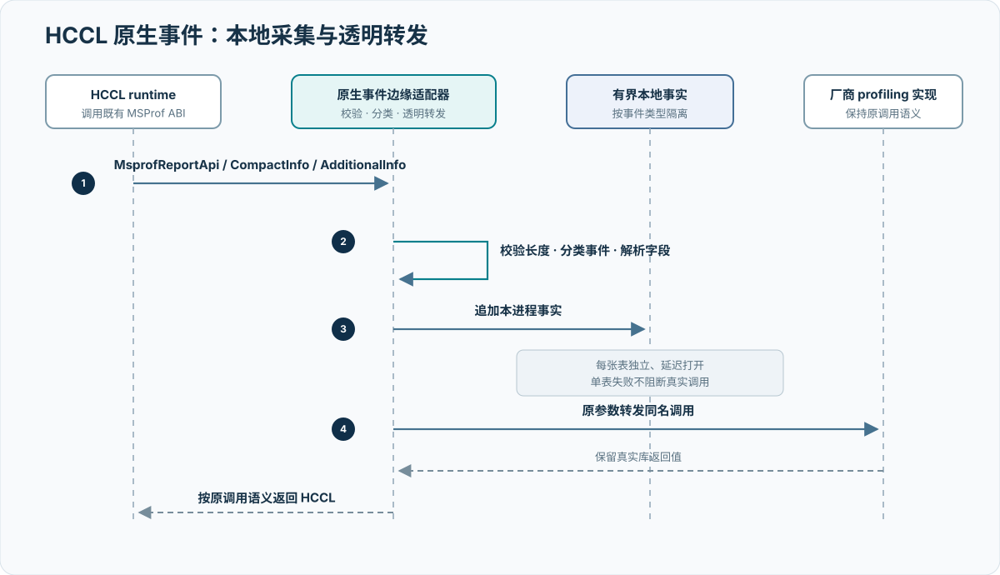
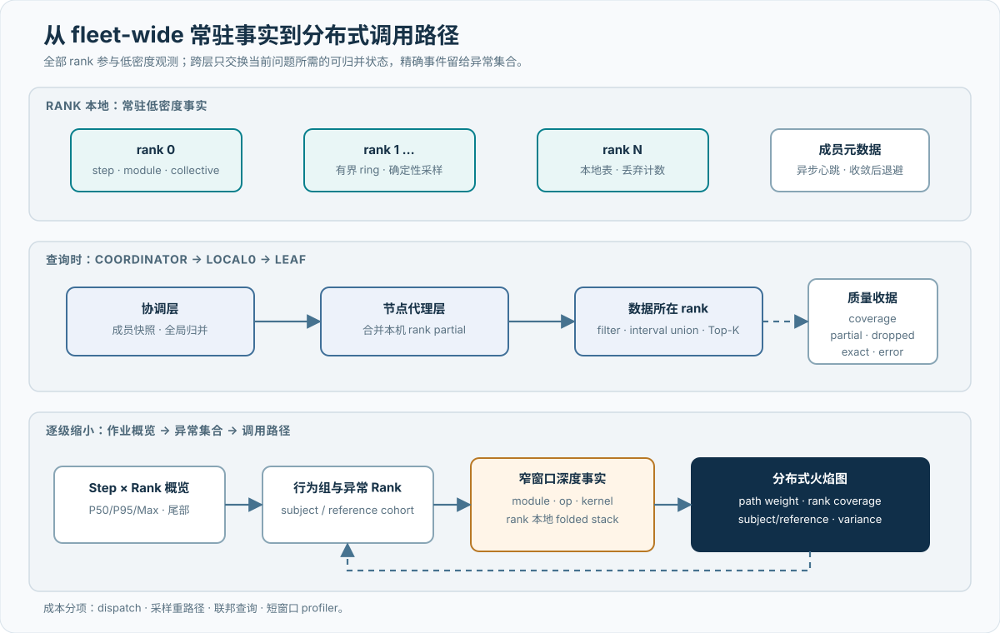
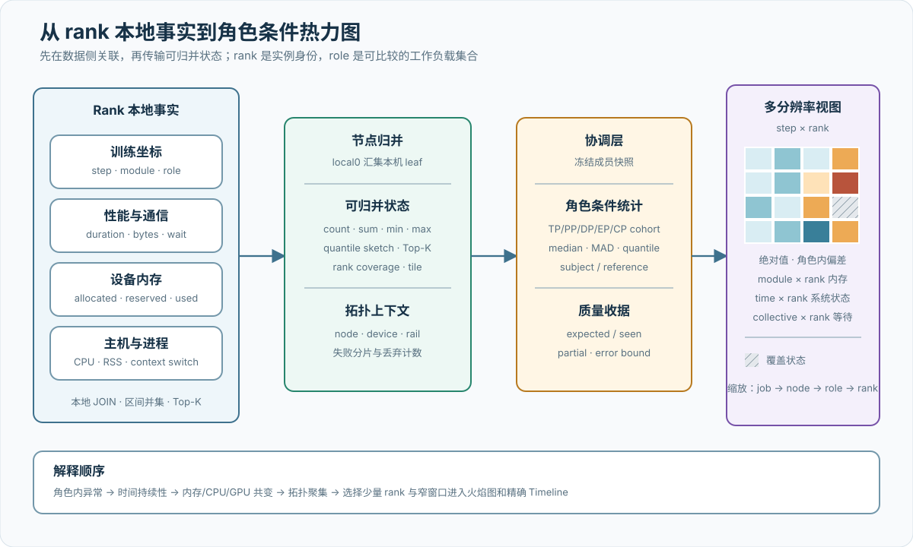

# 训练通信观测与多加速卡兼容设计

## 本章结论

训练通信观测不要求所有硬件共享同一套原生通信接口，而是拆成两个层次：上层通过 PyTorch 和 `torch.distributed` 采集跨厂商都能表达的训练、张量和 collective API 事实；下层再用 NCCL profiler、HCCL MSProf shim 等可选原生适配器补充通信库内部细节。当前实现以 Probing 承载这两层数据。[I001](references.md#i001) [I002](references.md#i002)

观测数据面还包含三个相互依赖的尺度。常驻路径以确定性采样、有界缓冲和本地写入保留 fleet-wide 低密度事实；联邦查询在数据所在 rank 或节点执行过滤和可归并聚合；分布式火焰图只在异常 rank 与窄 step 窗口确定后合并调用路径。三者共同回答“异常在哪里、属于哪类行为、具体消耗在哪条路径”，而不是把全量原始事件持续汇入中心。[I004](references.md#i004)

这一分层使公共观测链路不依赖每家厂商的 C++ 扩展：厂商的 PyTorch 后端若保持标准张量与 `torch.distributed` 接口，collective 名称、通信组、消息字节数、rank、step 和 Python API 耗时可以使用同一数据模型；算法、plane、transport 和 RDMA 类型等信息仍来自对应的原生插件。

对当前两个资源池，应采用不同的能力组合：

- A3：通用 Torch 路径与 HCCL shim 并用，前者提供训练 step 上下文，后者提供 HCCL host op、collective 元数据和 task/plane/transport 细节。
- C550：当前 Probing 代码中没有 C550、MetaX 或 MCCL 专用采集器；应先验证其 PyTorch 栈是否完整兼容标准 `torch.distributed` 路径，再把通信库内部采集作为独立适配工作，不能把 API 层可见性表述成 MCCL 内部已经可见。[I002](references.md#i002)

## 1. 设计目标与系统范围

这套观测链路在本项目中承担四类职责：

1. 为训练 step、并行角色、collective API 和原生通信事件提供统一查询入口。
2. 在不改变训练主逻辑的前提下，定位慢 rank、慢通信组和异常时间窗口。
3. 支撑 A3 超节点放置 A/B 实验，验证通信是否按预期跨域，以及热点是否集中在少数 rank 或 plane。
4. 允许两个资源池共享分析方法，同时保留 HCCL、NCCL 或其他通信库的厂商差异。

它不替代以下系统：

- HCCL test、MCCL 测试或训练框架自身的正确性检查；
- Device 网卡与交换机端口的真实字节、拥塞、丢包、PFC/ECN 和重传计数器；
- 调度器保存的物理超节点、节点、设备、网卡和 rank 映射；
- 生产告警、故障工单和资源隔离控制面。

因此，观测组件只是通信优化证据链的一部分，不是单一事实来源。

## 2. 分层兼容架构

{ .technical-diagram loading=lazy }

该架构包含四个兼容层级：

| 层级 | 主要接口 | 可移植性 | 信息深度 | 版本耦合 |
| --- | --- | --- | --- | --- |
| 系统公共层 | 进程、CPU、文件、环境与通用 tracing | 高 | 主机与进程状态 | 低 |
| Torch 语义层 | module hook、tensor、step、`torch.distributed` | 较高 | 训练语义与 API 层级 | 受 PyTorch/厂商后端接口影响 |
| 加速器适配层 | `torch.cuda`、`torch.npu`、event/stream | 中 | 设备计时与显存 | 受设备模块能力影响 |
| 通信库原生层 | NCCL profiler、HCCL MSProf shim | 较低 | 算法、task、transport、proxy/plane | 与通信库 ABI 和版本紧密耦合 |

公共查询层只消费已经落表的事实，HCCL/NCCL schema 文档由 server 的 composition root 注册，核心查询引擎不反向依赖某个通信库的运行时。[I003](references.md#i003) 因此新增一种卡时，优先增加边缘适配器，而不是修改整个采集、存储和分析链路。

## 3. HCCL 原生采集路径

### 3.1 接入点

HCCL 会通过 `dlopen("libprofapi.so")` 和 `dlsym` 使用 MSProf 接口。Probing 构建同名 `libprofapi.so` shim，放在动态库搜索路径前部：

{ .technical-diagram loading=lazy }

shim 先记录事件，再把原始参数和返回语义转发给真实 CANN 库。真实库按以下顺序解析：[I001](references.md#i001)

1. `PROBING_HCCL_PROFAPI_REAL` 指定的绝对路径；
2. shim 同目录的 `libprofapi.so.real`；
3. `ASCEND_HOME` 或 `ASCEND_INSTALL_PATH` 下的 `lib64/libprofapi.so`。

实现不会再次按裸名称加载 `libprofapi.so`，以避免 shim 递归加载自身。真实库使用一次性初始化并在进程生命周期内保持加载；转发真实调用时不持有初始化锁，以避免回调重入造成死锁。

### 3.2 MSProf 采集层

这一接入点产生三个直接后果：

- HCCL 仍调用其既有 MSProf ABI，不需要修改 Megatron 或训练脚本中的 collective 调用。
- shim 能观察 HCCL 已经产生的 host API、compact 元数据和 additional task 信息，无需在 Python 层推测所有内部阶段。
- 采集器与真实 CANN 库串联，原有 profiling 流程仍可继续工作。

但它仍然是原生 ABI 适配，不是完全跨版本的 Python 接口。MSProf 结构体布局来自开放 HCCL 实现的 best-effort 对齐；CANN/HCCL 升级后必须重新验证字段长度、枚举含义和表内容。

### 3.3 数据表及语义

| 事实集 | 主要来源 | 核心语义 | 适合回答的问题 |
| --- | --- | --- | --- |
| Host 事件 | Host API 回调 | 事件类别、起止时间、持续时间、进程与线程 | 哪类 host 通信或运行时事件耗时异常 |
| Collective 元数据 | Host API 与 compact 元数据 | op、count、通信组、算法、重试和行来源 | collective 耗时与算法/通信组是否共同变化 |
| 通信 task | additional task 元数据 | 本地/远端 rank、plane、数据规模、链路与 transport | 通信被拆成了哪些 rank 对、plane 和 transport task |
| Communicator stream | communicator 元数据 | rank 与通信 stream 集合 | communicator 使用怎样的 stream 拓扑 |
| Dispatch context | context 元数据 | context 范围 | 设备 dispatch 与通信上下文如何关联 |

Collective 的 host API 耗时与参数元数据来自不同类型的事实。它们可以在同一进程/线程、算子序列和窄时间窗内形成候选关联，但必须先验证当前版本的时间单位和事件顺序；仅凭“时间最近”不能建立一一对应的强主键。未匹配率本身也是数据质量指标。

### 3.4 失败隔离

每张 HCCL 表独立、延迟打开。某张 mmap 表创建失败后，该表停止采集并记录一次告警，其他表以及真实 CANN 调用仍继续。这可以避免一个观测表故障扩散到全部采集路径。[I001](references.md#i001)

这个行为不能替代部署前检查。若真实 `libprofapi.so` 未找到，当前实现会让 MSProf 转发退化为 stub；生产启动器必须把“真实库已解析、关键符号可见、冒烟表有数据”设为 preflight 条件，不能依赖运行时静默降级。

## 4. 用分层观测验证 A3 超节点均衡

A3 的调度目标是让需要跨物理超节点的 rank 和逻辑块均匀分布，进而避免少数超节点出口或网卡持续成为 AllReduce 的瓶颈。完整调度方法见 [A3 HCCL 通信优化与超节点亲和性调度](04a-a3-hccl-communication-optimization.md)。观测链路主要回答“实际执行路径是否与调度设计一致”，而不是替代调度器。

### 4.1 必须关联的三类事实

| 事实层 | 数据来源 | 关键关联字段 |
| --- | --- | --- |
| 计划拓扑 | 调度映射、HCCL rank table、Megatron 并行组 | job、rank、node、device、physical superpod、logical block、NIC/rail |
| 实际通信 | `hccl.collectives`、`hccl.tasks`、Torch collective rows | process、rank、group、op、step、time、remote rank、plane、bytes |
| 真实网络负载 | Device 网卡与交换端口 counter | node、NIC/rail、端口、时间窗、发送/接收字节、拥塞与重传 |

HCCL 表中的 `data_size` 表示被上报 task 的数据规模，可作为 rank 对或 plane 负载代理；它不等于某张物理网卡的真实线速字节数。算法分片、重试、协议开销和一条 collective 拆成多个 task 都可能改变两者关系。因此超节点均衡必须同时查看 HCCL task 分布和真实 NIC/交换机 counter。

### 4.2 分析步骤

1. 保存本次作业的 `rank -> node -> device -> physical_superpod -> nic_group` 映射及哈希。
2. 从全局 collective 事实识别 AllReduce、ReduceScatter 和 AllGather 的通信组、消息规模、算法和重试。
3. 从全局 task 事实按本地/远端 rank、plane 和 transport 类型汇总 task 数与上报数据规模。
4. 将两端 rank 映射到物理超节点，区分超节点内和跨超节点 task。
5. 按相同时间窗汇总 Device 网卡和交换端口发送/接收字节，计算 NIC CV、最大/平均负载比和持续热点。
6. 把通信窗口关联到 Megatron `global_step` 和并行角色，确认热点是否落在真实 DP/TP/EP 通信组上。
7. 对均衡与非均衡放置做同配置 A/B；固定节点健康 cohort、消息矩阵、HCCL 算法和背景网络负载。

rank 对负载候选以“进程 rank、本地/远端 rank、plane、链路和 transport”为分组坐标，局部累计 task 数和上报数据规模，再经联邦归并形成全局分布。HCCL 上报的持续时间估计不应当作设备侧实测完成时间。AllReduce 带宽的验收仍以通信微基准、真实通信耗时和网络 counter 联合计算。

### 4.3 可诊断的异常模式

| 观测组合 | 更可能的解释 | 后续验证 |
| --- | --- | --- |
| 计划 rank 均衡，跨超节点 task 仍集中 | 并行组映射或 HCCL 算法展开不对称 | 检查 group/alg hash、rank 组和 plane 分布 |
| task 分布均衡，少数 NIC counter 持续高 | rank 到 NIC/rail 映射、ECMP 或交换路径倾斜 | 核对 Device IP、rail 与交换端口 |
| NIC 负载均衡但 collective P99 高 | 慢卡、重试、同步等待或少数 rank 尾延迟 | 检查 retry、host op 和慢 rank step |
| HCCL API 耗时高但 task 数据量正常 | host 调度、同步或前序计算阻塞 | 关联 Torch step、CPU 栈和 host event |
| 微基准改善而训练 step 不变 | 通信被计算隐藏或不在关键路径 | 检查通信暴露比例和 Megatron timeline |

## 5. Torch 路径为何更容易兼容多种卡

### 5.1 collective tracer 不绑定通信库名称

通用 collective tracer 在 Python 层包装 `torch.distributed` 的 `all_reduce`、`all_gather`、`reduce_scatter`、`broadcast` 及 tensor 变体。它读取标准 `ProcessGroup` 的 rank/size、张量 shape/dtype/bytes 和 `async_op`，并把结果写入 `python.comm_collective`。[I002](references.md#i002)

当 PyTorch 后端从 NCCL 切到 HCCL 或其他厂商通信库时，训练代码仍调用相同的 `torch.distributed` API，tracer 不需要理解下层算法即可保留公共字段。兼容范围覆盖 API 公共语义；下层算法与 transport 通过厂商适配补充。

但它测量的是 Python API 周围的 wall clock：

- 同步调用的结束表示 API 返回，不一定等于设备上最后一个通信 task 完成；
- 异步调用在包装后的 `Work.wait()` 返回时结束；若调用方不执行 `wait()`，该记录不会完成；
- `cuda_sync` 只调用 `torch.cuda.synchronize()`，不应在 NPU 或其他后端开启；
- tracer 默认关闭，必须显式启用，并评估 monkey patch 对训练的影响。

因此该路径适合低门槛建立 step/rank/op 上下文和发现相对异常，不适合单独计算精确 HCCL/NCCL 内核带宽。

### 5.2 可选导入与能力探测

`probing.timing.backend` 采用能力探测：尝试导入 `torch_npu` 完成 NPU 后端注册；若 `torch.npu.is_available()` 为真则优先选择 NPU，否则选择 CUDA，最后回退 CPU。事件创建只要求设备模块提供 `Event` 和 `current_stream`，缺失时返回 `None`，让调用者决定是否使用 host timer。[I002](references.md#i002)

这种写法比在公共代码中直接链接某个厂商 SDK 更容易维护：

- 未安装 `torch_npu` 时不会阻塞 CUDA/CPU 环境导入；
- 设备模块能力不足时可以显式降级；
- 同一测试可以用 fake backend 验证 NPU 优先级、CUDA 回退和 CPU 回退；
- 厂商差异被限制在小型 backend adapter 中。

不过，不能由此推断全部 timing 模块已经跨后端。当前 `AcceleratorTimer` 仍依赖 CUDA stream value gate；长期 `TorchProbe` 的 backend 选择当前只覆盖 CUDA 和 MPS，没有接入 `torch.npu`。这些路径在 A3 上需要分别验证或补充 NPU adapter，不能用一个已支持 NPU 的 helper 替整个 Probing 宣布全量兼容。[I002](references.md#i002)

### 5.3 “不走 C++”的准确含义

本项目采用的设计是：**公共训练语义和 collective API 观测优先走 Python/Torch 接口，避免为每种卡维护一套 C++ 扩展；深度通信观测仍允许使用隔离的原生插件。**

这不等于 Probing 没有原生代码：

- HCCL shim 由 Rust 编译成 Linux `cdylib`，以 C ABI 导出 `Msprof*` 符号；
- NCCL 精细观测也需要原生 profiler plugin；
- 这些原生组件仍受操作系统、动态链接、ABI 和通信库版本约束。

这里采用“公共语义位于 Torch 层，原生适配器位于边缘”的分层方式，保持公共采集与厂商原生信息各自清晰。

## 6. 两个资源池的能力矩阵

| 能力 | A3 / HCCL | C550 / 现行软件栈 | 结论 |
| --- | --- | --- | --- |
| `torch.distributed` API 名称、rank、group、bytes | 可通过通用 tracer；需关闭 CUDA 专用 sync | 若厂商 PyTorch ProcessGroup 保持标准接口则可复用，需实机验证 | 公共兼容基线 |
| step/并行角色关联 | 可复用公共 tracing/Megatron 坐标 | 可复用公共 tracing/Megatron 坐标 | 与通信库解耦 |
| NPU event helper | `torch.npu` 已有能力探测和单元测试 | 不适用或取决于厂商接口 | 只是局部 helper，不代表全部模块 |
| 长期 TorchProbe 设备计时/显存 | 现行 backend 按 `torch.npu` 补充适配 | 按厂商 PyTorch 接口完成实机验证 | backend 适配项 |
| 通信库内部事件 | HCCL MSProf shim 已实现 | API 层采集先覆盖公共字段，MCCL 原生 adapter 作为增强接入 | A3 支持原生下钻，C550 保持公共观测路径 |
| NIC/交换机真实 counter | HCCL 表不能替代，需要单独接入 | 同样需要厂商/网络侧采集 | 两池均是外部证据 |

C550 的兼容准入至少包括：导入训练环境中的 `torch`、枚举设备、初始化目标 ProcessGroup、对八类被 hook collective 做同步与异步冒烟、校验 tensor bytes/rank/group、测量 hook 开销，并确认不会调用 CUDA 专属同步。通过这些检查后，才能把 Torch 路径标记为“已验证兼容”。

## 7. Fleet-wide 低摊销观测

“fleet-wide”表示每个目标 rank 都参与基础观测，而不是只在少量抽样机器部署探针；它不意味着每个 rank 都持续产生算子、内核和调用栈全量事件。规模无关的关键在于把常驻成本限制在本进程内，把跨 rank 数据交换推迟到查询发生时，并让深度采集只覆盖已经缩小的 rank 与时间窗口。

{ .technical-diagram loading=lazy }

### 7.1 常驻路径的成本分解

TorchProbe 的 step gate 决定“多久采一次完整 module 快照”，layer gate 决定“命中 step 后覆盖多少层”。step gate 由 step 序号确定，layer gate 由 `(step, layer)` 的稳定哈希确定，因此不同 rank 在同一训练坐标上做出一致选择。现行默认采样 5% 的 step，并在命中的 step 上保留完整 module 关系；未命中的 step 仍记录墙钟，使长期趋势不因采样形成空洞。[I004](references.md#i004)

常驻成本需要拆成两个执行路径，并按采样率摊销：

\[
C_{\mathrm{effective}}
=(1-r)C_{\mathrm{dispatch}}
+rC_{\mathrm{sampled}}
\]

其中，\(C_{\mathrm{dispatch}}\) 是每个 step 都可能支付的 hook 派发与 step timing；\(C_{\mathrm{sampled}}\) 还包含命中采样后的 module 事件、设备计时和持久化。

降低采样率只能摊薄 `sampled`，不能消除已经挂载到模型树上的 `dispatch`。设备 event 的提交与读取也被分开：训练线程只记录 event，经过 settle 窗口后由异步路径读取并批量保存；队列容量固定，满时采用有界回退，避免无上限内存增长。调用栈连续采样使用有界 ring 和双发布缓冲，缓冲繁忙时丢弃快照并增加丢弃计数，而不是等待训练线程。

采集器之间不共享热路径调度线程。step/module、collective、系统指标、HCCL/NCCL 事件和调用栈分别写入本地事实，只共享 job、step、rank、role 和时间坐标。这种隔离意味着某个采集器的锁竞争、版本不兼容或缓冲压力不必传播到其他采集器，但跨表解释只能在查询阶段完成。

### 7.2 成员控制与数据控制分离

每个 rank 的训练事实默认保留在本地；持续跨网络传播的只是 endpoint、rank、node rank、local rank、并行角色和存活状态等小型成员元数据。成员收敛后，心跳周期指数退避，同时受失效检测窗口约束。心跳和查询在独立异步执行路径运行，不由训练 callback 直接发起网络请求。

因此，世界规模增加时，常驻训练热路径不会因为中心写入而增加一次新的全局同步；增长发生在成员元数据、查询 fan-out 和查询结果大小上。后两项通过分层拓扑、聚合下推和结果预算控制。该性质用于描述成本结构的可扩展性。生产评价同步报告 step time 的 P50/P95/Max、控制流量、丢弃事件、查询期间的额外开销和作业规模曲线。

### 7.3 同作业内的 shadow 基线

现行设计以交错 shadow step 估计 TorchProbe 自身开销。shadow step 保留相同训练负载和其他采集器，但绕过 TorchProbe 的 module 重路径；默认按四个 probed step 配一个 shadow step。设 \(M_s\)、\(M_d\)、\(M_p\) 分别为 shadow、未采样 probed 和采样 probed step 的中位数，则：

\[
O_{\mathrm{dispatch}}=\frac{M_d}{M_s}-1,
\qquad
O_{\mathrm{sampled}}=\frac{M_p}{M_s}-1
\]

\[
O_{\mathrm{effective}}
=(1-r)O_{\mathrm{dispatch}}
+rO_{\mathrm{sampled}}
\]

shadow 只隔离 TorchProbe，不能代表关闭全部观测的纯训练基线。HCCL/NCCL 原生回调、联邦查询和短窗口 profiler 必须分别测量；跨 rank 汇总也应先计算每个 rank 的局部开销，再报告分布，不能把不同流水段和并行角色的 step 混成一个总体均值。

## 8. 分布式联邦查询

联邦查询的基本约束是“本地写、按需读”。每个 rank 只写自己的事实表；查询入口冻结一次成员快照，将逻辑全局表改写为各 endpoint 的本地查询，给返回分片注入 host、rank、node rank、local rank 和 role 等来源坐标，再执行全局归并。训练数据不因可查询而预先复制到中心。[I004](references.md#i004)

### 8.1 三类执行计划

查询计划不能统一退化成“向所有 rank 广播任意 SQL，再拼接结果”。现行联邦引擎根据关系代数是否可分解选择三条路径：

| 路径 | 数据侧计算 | 协调侧计算 | 语义范围 |
| --- | --- | --- | --- |
| 聚合下推 | 过滤、分组和 `count/sum/min/max` 等可归并 partial | 按来源坐标二次归并、全局排序和截断 | `avg` 以 sum/count 状态进入下推路径 |
| 联邦扫描 | 精确可下推的过滤与投影；远端分区按需读取 | 完成剩余 filter/sort/limit | `LIMIT K` 只能在全局合并后执行，不能每个 rank 各取 K 行 |
| 本地关系计算后汇集 | 每个 rank 在共址事实上完成 JOIN、CTE 或窗口计算 | 注入 rank 坐标并拼接局部结果 | 结果不是跨 rank JOIN；不同 rank 的表不能在协调端假装天然共址 |

这种区分首先服务查询正确性，其次才是性能。无法安全拆分的表达式宁可回到局部计算或显式拒绝，也不能把逐 rank 结果拼接后声称得到全局 `count(distinct)`、窗口函数或 Top-K。compute 与 communication 的关联应先在同一 rank 内按 step/role 完成，再把每个 rank 的聚合状态向上归并。

### 8.2 分层 fan-out 与可归并状态

扁平 fan-out 需要协调器直接维护 `O(world_size)` 个远端请求。分层模式使用 `coordinator → 每机 local0 → 本机 leaf rank`：协调器连接数约为节点数，本机代理再连接少量本地 rank。以每机 8 卡、1,024 个节点为例，协调器面对约 1,023 个远端节点代理，每个代理处理约 7 个 leaf，而不是由协调器直接管理 8,191 个远端 rank。

现行联邦引擎对 `count/sum/min/max` 执行可归并 partial，对单表扫描执行按需读取。面向分布式 profiler 的模型规定：分位数传输 quantile sketch，热点传输有界 Top-K，rank 覆盖传输压缩集合，时间占用先在 rank 本地求区间并集，调用栈先折叠为路径与权重。profiler 专用状态接入执行路径时保持上述可归并语义；选中少量 rank 和窄窗口后，查询读取精确 slice 或原始 stack。

### 8.3 部分结果是查询语义的一部分

成员快照描述期望 endpoint，查询收据描述实际响应。结果至少携带期望/实际 rank 与节点、失败分片、扫描行数/字节数、是否 partial、是否精确、误差界和耗时。缺少 capture、capture 中没有匹配事件、缓冲丢弃和 endpoint 查询失败必须分别表达。

交互式诊断可以返回带收据的部分结果，因为已响应 rank 仍可能提供定位线索；正式性能比较和资源准入默认不能由 partial 结果产生通过结论。严格模式的作用不是让网络更可靠，而是把任一成员失败转换成整个查询失败，适用于覆盖完整性高于可用性的场景。

## 9. Rank、并行角色与多维热力图

热力图不是把“每个 rank 一条时间线”压缩成更小的图片，而是把训练行为投影到稳定坐标上。万卡作业首先需要区分两个身份：`rank` 是一次运行中的进程实例，`role` 是由 TP、PP、DP、EP、CP 等并行坐标组成的工作负载角色。同一 role 内的 rank 执行结构近似相同，才适合形成横向参考；不同流水段、专家分片或张量并行位置的耗时与显存天然不同，不能直接混成一个总体中位数。[I004](references.md#i004)

{ .technical-diagram loading=lazy }

### 9.1 统一矩阵不是单一指标

所有矩阵单元都应携带 `(job, step/time, rank, role, node, device, metric, quality)` 坐标，但不同视图使用不同的行列与单元语义：

| 视图 | 行 × 列 | 单元值 | 主要回答的问题 |
| --- | --- | --- | --- |
| step 性能 | step × rank | step wall time、角色内偏差、慢步持续率 | 哪些 rank 从何时开始脱离同角色分布 |
| module 性能 | module × rank | duration、相对参考组的增量 | 差异集中在哪个训练阶段或模型层 |
| 显存 | module/step × rank | allocated/reserved 的值、峰值或增量 | 哪个角色在何处扩大活跃张量或缓存 |
| 系统状态 | time bucket × rank | 设备利用率、驱动显存、主机 RSS、CPU、上下文切换 | 性能异常是否伴随主机或设备资源变化 |
| 通信 | collective/sequence × rank | 到达时间、完成时间、bytes、暴露等待 | 慢 rank 是先到后等，还是自身较晚到达 |
| 拓扑 | node/rail × role | 异常比例、尾延迟、流量或重试 | 异常是否沿节点、链路或并行组聚集 |

同一张图只能选择一种颜色语义。绝对值适合观察容量和总体阶段变化；角色内偏差适合找异常 rank；subject/reference 差值适合比较两个行为组。若把三者混在一个色标中，颜色既不能表示工程量，也不能表示异常程度。

### 9.2 角色条件基线

对指标 \(x_{r,s}\)，先在 step \(s\) 和角色 \(c(r)\) 内构造参考集合。使用中位数和 MAD 可以降低少量尾部 rank 对基线的污染：

\[
m_{c,s}=\operatorname{median}_{r:c(r)=c}(x_{r,s}),
\qquad
d_{c,s}=\operatorname{median}_{r:c(r)=c}|x_{r,s}-m_{c,s}|
\]

\[
z^{\ast}_{r,s}=0.6745\,\frac{x_{r,s}-m_{c(r),s}}{d_{c(r),s}}
\]

当 \(d_{c,s}=0\)、角色样本太少或参考集合本身发生整体退化时，稳健分数不可识别，应退回绝对差值、历史基线或相邻健康 cohort，而不是把分母替换成任意小常数后继续着色。单个高 \(z^{\ast}\) 只表示相对异常；只有它跨连续 step、复测或不同负载仍存在，才构成稳定偏离证据。

角色不是永久标签。并行配置、虚拟流水段、专家路由或弹性成员改变后，必须生成新的 cohort 身份；否则热力图会把配置变更画成硬件异常。对 MoE 还应同时展示 token 负载，因为专家 rank 的耗时差异可能来自路由不均，而不是计算能力不一致。

### 9.3 内存必须分层解释

训练中的“显存”至少包含三种不同事实：框架分配器的活跃分配量、框架保留但暂未活跃的缓存量，以及驱动看到的设备总占用。主机侧还需要独立观察 RSS。它们不能互相替代：

| 层次 | 代表量 | 可见范围 | 典型解释 |
| --- | --- | --- | --- |
| 框架活跃分配 | allocated、peak allocated、module delta | 受框架分配器管理的张量 | 激活、梯度、参数或临时张量增长 |
| 框架保留缓存 | reserved、peak reserved、cache delta | 分配器保留的设备内存 | 缓存扩张、碎片与复用策略 |
| 驱动设备占用 | used/total/free | 设备层可见的进程与运行时占用 | 通信 workspace、非框架分配或其他进程影响 |
| 主机进程内存 | RSS 及其变化 | CPU 地址空间中的常驻页 | dataloader、编译缓存、通信元数据或泄漏 |

在采样时间足够接近且设备归属一致时，可以把

\[
M_{\mathrm{other}}(t)=M_{\mathrm{driver}}(t)-M_{\mathrm{reserved}}(t)
\]

作为“框架分配器之外占用”的候选量，而不能将其视为精确归因。异步释放、采样偏移、统一内存和多个进程共享设备都会改变该差值。module 热力图更适合使用 Δallocated 与 Δreserved；time × rank 热力图更适合并列显示驱动占用、框架缓存和 RSS。三层同时变化指向端到端容量压力，只有驱动层变化则优先检查通信库、运行时或外部进程。

### 9.4 查询执行与多分辨率表达

跨表特征先在 rank 本地计算。例如 step 耗时与同 step 的 CPU、GPU、显存事实先按本地时间窗或训练坐标关联，再只上传角色分组的计数、和、极值、分位数 sketch、Top-K 候选和覆盖集合。节点层加入本机拓扑，协调层再完成角色分位数、异常集合和显示矩阵。现有联邦关系计算采用“本地 JOIN 后汇集”；跨 rank 关系计算改写成明确的归并状态。[I004](references.md#i004)

时间热力图按屏幕分辨率返回 tile，而不是把原始 slice 全部发送到浏览器。对一个 rank 和一个时间桶，compute、communication、idle 的占用必须先对重叠区间求并集，再计算比例：

\[
\rho_{r,b}=\frac{\left|\bigcup_k I_{r,b,k}\right|}{|b|}
\]

直接累加区间长度可能得到大于 100% 的占用。rank 轴同样可以按 job、node、role、行为聚类和具体 rank 逐级展开；缩放改变的是分辨率和聚合层级，不改变底层坐标语义。

缺失单元使用独立视觉编码，不能填成零：无采样、无匹配事件、采集缓冲丢弃和查询分片失败是四种不同状态。每张热力图必须附带期望/实际 rank、角色覆盖、时间对齐方式、采样率、丢弃量、partial 状态和近似误差。当前已有 step 矩阵与基础联邦能力；角色化的多指标 tile、分位数状态和完整交互视图仍属于需要验证的分布式 profiler 设计，不能表述成已全部实现。[I004](references.md#i004)

## 10. 分布式火焰图

单进程火焰图将相同调用路径的样本折叠并以宽度表示权重；分布式训练还需要回答路径出现在哪些 rank、跨 rank 的消耗分布如何，以及慢组相对健康组在哪条路径上增加了时间。简单地把所有 rank 的 folded stack 相加会隐藏这些差异，也容易把“更多 rank 走过该路径”误读为“每个 rank 都更慢”。

### 10.1 两类火焰图事实

当前体系包含两类来源不同但可共享展示模型的火焰图：

| 类型 | 输入 | 权重 | 主要问题 |
| --- | --- | --- | --- |
| Module 火焰图 | 同一 step 的 module timing 与显存变化 | duration 或 peak memory delta | 哪个模型层或训练阶段贡献了时间/显存差异 |
| CPU/Python 混合栈 | 周期采样或按需栈快照 | stack sample count | rank 在等待、框架调度、通信调用还是运行时路径上停留 |

栈采集先在本进程完成 snapshot、异步符号化和 fold。跨 rank 合并前移除进程/线程特有根前缀，规范化相同路径；合并时对相同路径累加权重，并保留贡献 rank 集合。需要只观察 Python 控制路径时，可以过滤 native/C frame，但这会改变解释范围，不能与混合栈结果直接比较。

### 10.2 聚合值不能替代 rank 分布

面向万 rank 的火焰图节点至少需要以下语义：稳定路径身份、inclusive/self 权重、贡献 rank 数与覆盖率、P50/P95/Max、异常 rank 数，以及 subject/reference cohort 的差值。图形宽度和颜色因此可以承载不同问题：

| 模式 | 宽度 | 颜色 | 解释 |
| --- | --- | --- | --- |
| 聚合 | 总权重或典型值 | frame 类型 | 全体 rank 的主要执行路径 |
| 差分 | `abs(subject-reference)` | 慢组增加或减少 | 慢 rank 相对参考组多花时间的位置 |
| 方差 | 典型权重 | 离散度或异常比例 | 哪条路径在 rank 之间最不一致 |
| 覆盖 | 路径权重 | rank coverage | 控制流是否只发生在部分并行角色或异常 rank |

当前实现已经具备跨 rank folded stack 规范化、同路径合并、贡献 rank 保留、Python-only 过滤，以及同 step module duration/peak-memory 火焰图。稳定 path hash、压缩 Rank Set Token、节点级分位数和完整的差分/方差/覆盖模式仍属于后续分布式 profiler 模型，不能写成已经完成。[I004](references.md#i004)

### 10.3 从异常集合到调用路径

分布式火焰图位于诊断链的末端，而不是 fleet-wide 首屏：

1. 常驻 step 与 collective 事实确定异常时间窗，并区分持续慢与偶发尖峰。
2. 联邦聚合形成 step × rank、role 或节点热力图，选择 subject 与 reference cohort。
3. 对选中的 rank 集合和窄 step 窗口启动或读取短窗口 profiler、module timing 与调用栈。
4. 各 rank 本地过滤并折叠路径，节点层合并本机 rank，协调层合并路径分布和覆盖。
5. 火焰图中的异常 frame 反向选择贡献 rank，再回到相同时间窗的 Timeline、collective 瀑布图或拓扑视图验证。

对齐坐标必须显式声明。`global_step` 适合比较相同训练迭代的结构，communicator/sequence 适合分析 collective 到达偏斜，wall clock 只有在跨机时钟误差已知时才能用于绝对因果。不同 rank 若处于不同 micro-batch 或 pipeline stage，即使墙钟重叠，也不能直接合并成同一执行路径分布。

## 11. 兼容性与测量验证

### 11.1 原生通信观测能力

原生通信观测必须验证“记录层存在”与“底层真实库仍按原语义执行”两个条件。需要固定通信库与运行时版本，确认所有关键事件类型可解析，并用最小通信组对照无观测基线验证初始化、collective 正确性、完成语义和退出行为。若原生事件为空，不能仅凭训练仍在运行就判断采集成功；若原生适配退化，也不能让它改变训练路径的返回值、错误传播或同步关系。

### 11.2 验证矩阵

| 维度 | 对照 | 必须保持或披露的量 |
| --- | --- | --- |
| 语义一致性 | 开启/关闭观测 | collective 结果、异步完成、错误传播、初始化与退出 |
| 时间一致性 | API wall clock、设备 event、原生事件 | 各自起止点及差值分布，不要求数值强行相等 |
| 数据一致性 | 公共 Torch 行与原生通信行 | rank、group、op、bytes、sequence 与窄时间窗候选关联 |
| 资源一致性 | 无观测、常驻采样、短窗口深度采集 | step P50/P95/Max、CPU、内存、丢弃和控制流量 |
| 覆盖一致性 | 成员快照与查询收据 | 期望/实际 rank、失败分片、重复来源与时间对齐 |

原生 host 事件和 task 元数据不一定与一个 Torch API 行一一对应。关联需要组合 rank、线程/stream、op 序列、group 和窄时间窗，并保留未匹配率；仅用最近时间戳配对会制造虚假的强因果。

### 11.3 公共 Torch 路径验证

公共路径的验证对象不是某个 API 名称是否存在，而是张量、stream、event、同步和 `Work.wait()` 是否保持同一后端的完成契约。同步与异步 collective 必须分开测量；API 返回、设备完成与消费点暴露等待分别记录。每个资源池还要验证显存统计的层次、未支持 collective、未完成 async work 和参与 rank 解析失败的数量。若某个后端只能回退到主机计时，结果必须携带不同的计时模式，不能与设备 event 样本直接混合。

## 12. 实现能力与生产验证

观测结果与实现仓库 commit、Python/PyTorch、CANN/HCCL 或 C550 软件栈版本、采集器、环境变量、表覆盖率和时间窗口共同归档。

### 已实现能力

- HCCL MSProf shim 支持五类 `hccl.*` 表、真实库转发与独立表失败隔离。
- 通用 collective tracer 基于 `torch.distributed` 提供跨厂商公共 API 观测面。
- timing helper 完成 `torch.npu` 能力探测，并按设备 event 与主机计时分别标记。
- 分层成员发现、按需联邦查询、聚合下推、lazy scan、来源标签和 partial 质量信息已纳入实现。
- 分布式调用栈在 rank 本地折叠后合并相同路径并保留贡献 rank，module 火焰图支持 duration 与 peak-memory。
- C550 使用公共 Torch 路径接入，MCCL 原生事件通过独立适配器扩展。

### 生产验证路径

1. 对当前 CANN/HCCL 与 MXMACA/MCCL 版本执行 ABI 字段抽样和语义对照。
2. 在 A3 与 C550 分别校验 collective、event、stream、显存和异步完成契约。
3. 按规模报告常驻采样、成员心跳和查询 fan-out 的 P50/P95/Max 开销。
4. 使用 Rank Set Token、稳定 Path Hash 和多分辨率 Timeline 固化跨 rank 查询结果。
5. 通过通信放置 A/B 关联 NIC 利用率、AllReduce 尾部与 Megatron step time。

该路径将代码能力、运行时兼容性、观测开销和训练收益纳入同一验证矩阵，为两类国产加速卡提供一致的通信诊断接口。
