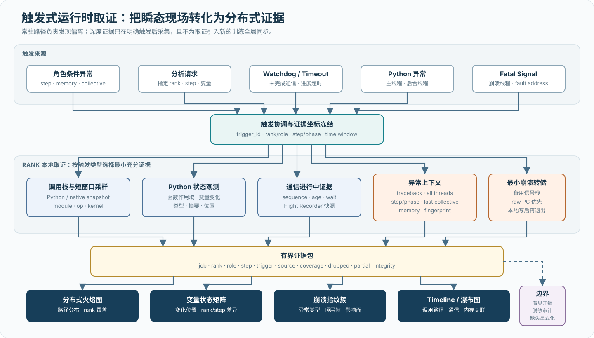

# Fleet-wide 低开销观测与分布式诊断

## 本章结论

万 rank 观测的首要问题不是“能采多少事件”，而是如何在不增加新全局同步、不持续上传全量原始数据的条件下，仍然找到异常 step、rank、并行角色和调用路径。本章采用三级诊断：常驻路径以确定性采样、有界缓冲和本地写入保留低密度事实；联邦查询在数据所在 rank 或节点执行过滤和可归并聚合；触发式取证只在异常集合与窄时间窗确定后，采集调用栈、Python 状态、通信进行中状态或崩溃上下文。[I004](references.md#i004) [I014](references.md#i014)

跨加速器兼容采用“公共语义 + 边缘适配”。上层通过 PyTorch 和 `torch.distributed` 表达训练、张量、step 和 collective API 事实；下层以可选的 NCCL profiler、HCCL MSProf shim 或其他后端适配器补充通信库内部信息。算法、plane、transport 和 RDMA 类型等信息只在对应能力存在时出现，不为了统一 schema 伪造底层事实。

这一分层使公共观测链路不依赖每家厂商的 C++ 扩展：厂商的 PyTorch 后端若保持标准张量与 `torch.distributed` 接口，collective 名称、通信组、消息字节数、rank、step 和 Python API 耗时可以使用同一数据模型；算法、plane、transport 和 RDMA 类型等信息仍来自对应的原生插件。

Probing 是本项目用于检验这些原则的一种参考实现，而不是本章方法成立的前提。[I001](references.md#i001) [I002](references.md#i002) 在 A3 上，公共 Torch 事实可以与 HCCL 原生事件组合；在 C550 上，公共 API 层与通信库内部层仍需分别验证。这里的差异体现适配深度，不改变公共观测模型。

## 1. 设计目标与边界

这套观测链路在本项目中承担六类职责：

1. 为训练 step、并行角色、collective API 和原生通信事件提供统一查询入口。
2. 在不改变训练主逻辑的前提下，定位尾部 rank、尾部通信组和异常时间窗口。
3. 支撑 A3 超节点放置 A/B 实验，验证通信是否按预期跨域，以及热点是否集中在少数 rank 或 plane。
4. 允许两个资源池共享分析方法，同时保留 HCCL、NCCL 或其他通信库的厂商差异。
5. 在函数、rank 和时间窗已经收窄后，观测指定 Python 状态的变化，并与 step、调用位置和并行角色关联。
6. 在 Python 异常、watchdog 或原生 fatal signal 发生时，尽可能保全崩溃前的训练、通信、堆栈和内存上下文。

它不替代以下系统：

- HCCL test、MCCL 测试或训练框架自身的正确性检查；
- Device 网卡与交换机端口的真实字节、拥塞、丢包、PFC/ECN 和重传计数器；
- 调度器保存的物理超节点、节点、设备、网卡和 rank 映射；
- 生产告警、故障工单和资源隔离控制面。

因此，观测组件只是通信优化证据链的一部分，不是单一事实来源。

## 2. 分层兼容架构

{ .technical-diagram loading=lazy }

该架构包含四个兼容层级：

| 层级 | 主要接口 | 可移植性 | 信息深度 | 版本耦合 |
| --- | --- | --- | --- | --- |
| 系统公共层 | 进程、CPU、文件、环境与通用 tracing | 高 | 主机与进程状态 | 低 |
| Torch 语义层 | module hook、tensor、step、`torch.distributed` | 较高 | 训练语义与 API 边界 | 受 PyTorch/厂商后端接口影响 |
| 加速器适配层 | `torch.cuda`、`torch.npu`、event/stream | 中 | 设备计时与显存 | 受设备模块能力影响 |
| 通信库原生层 | NCCL profiler、HCCL MSProf shim | 较低 | 算法、task、transport、proxy/plane | 与通信库 ABI 和版本紧密耦合 |

公共查询层只消费已经落表的事实，HCCL/NCCL schema 文档由 server 的 composition root 注册，核心查询引擎不反向依赖某个通信库的运行时。[I003](references.md#i003) 因此新增一种卡时，优先增加边缘适配器，而不是修改整个采集、存储和分析链路。

## 3. 从全局概览到窄窗口证据

渐进诊断先按 step、rank 和并行角色形成低分辨率矩阵，再观察时间持续性、节点与拓扑聚集，以及 CPU、设备和内存共变；异常集合稳定后，才读取更精确的 collective、module、kernel 或 stack。这样，常驻成本由每个 rank 的固定小预算决定，深度成本由问题范围决定，而不是由集群总事件量决定。

通用正文关注这种成本结构和证据语义。后续 HCCL、Torch 和平台能力矩阵用于说明边缘适配如何落地；它们是实现案例，不改变 fleet-wide 观测的公共模型。

## 4. 边缘适配案例：通信库原生事件

### 4.1 接入点

HCCL 可以通过既有 profiling ABI 暴露 host API、collective 元数据和通信 task。观测层位于通信库和原 profiling 接口之间，记录必要事实后保持原调用继续执行：

{ .technical-diagram loading=lazy }

这一边界的基本约束是透明性：参数、返回值、错误传播和初始化顺序不能因观测而改变；记录路径不得在持有内部锁时触发可能重入的回调；原 profiling 能力也不应因旁路采集而丢失。[I001](references.md#i001)

### 4.2 原生 profiling 边界的选择依据

这一接入点产生三个直接后果：

- HCCL 仍调用其既有 profiling ABI，不需要修改训练框架中的 collective 语义。
- shim 能观察 HCCL 已经产生的 host API、compact 元数据和 additional task 信息，无需在 Python 层推测所有内部阶段。
- 采集器与真实 CANN 库串联，原有 profiling 流程仍可继续工作。

该路径仍属于原生 ABI 适配，并非跨版本稳定的 Python 接口。事件结构依据公开 HCCL 实现进行兼容性对齐；CANN/HCCL 升级后必须重新验证字段长度、枚举含义和事实内容。

### 4.3 数据表及语义

| 事实集 | 主要来源 | 核心语义 | 适合回答的问题 |
| --- | --- | --- | --- |
| Host 事件 | Host API 回调 | 事件类别、起止时间、持续时间、进程与线程 | 哪类 host 通信或运行时事件耗时异常 |
| Collective 元数据 | Host API 与 compact 元数据 | op、count、通信组、算法、重试和行来源 | collective 耗时与算法/通信组是否共同变化 |
| 通信 task | additional task 元数据 | 本地/远端 rank、plane、数据规模、链路与 transport | 通信被拆成了哪些 rank 对、plane 和 transport task |
| Communicator stream | communicator 元数据 | rank 与通信 stream 集合 | communicator 使用怎样的 stream 拓扑 |
| Dispatch context | context 元数据 | context 范围 | 设备 dispatch 与通信上下文如何关联 |

Collective 的 host API 耗时与参数元数据来自不同类型的事实。它们可以在同一进程/线程、算子序列和窄时间窗内形成候选关联，但必须先验证当前版本的时间单位和事件顺序；仅凭“时间最近”不能建立一一对应的强主键。未匹配率本身也是数据质量指标。

### 4.4 失败隔离

原生适配器应按事实类型隔离缓冲和持久化故障：一个非关键事实集不可用时，其他采集以及通信库原调用仍继续；影响原调用透明性的错误则必须阻止带观测运行进入正式实验。[I001](references.md#i001) 这两类错误不能都用“尽力而为”处理，否则观测故障会被误写成训练或通信事实。

## 5. 拓扑观测应用：验证 A3 超节点均衡

A3 的调度目标是让需要跨物理超节点的 rank 和逻辑块均匀分布，进而避免少数超节点出口或网卡持续成为 AllReduce 的瓶颈。完整调度方法见 [拓扑感知通信与 A3 HCCL 案例](04a-a3-hccl-communication-optimization.md)。观测链路主要回答“实际执行路径是否与调度设计一致”，而不是替代调度器。

### 5.1 必须关联的三类事实

分析从计划拓扑开始：调度映射、HCCL rank table 和 Megatron 并行组共同给出 job、rank、node、device、物理超节点、逻辑块与 NIC/rail 的预期关系。随后用 `hccl.collectives`、`hccl.tasks` 和 Torch collective 事实还原实际通信，把 process、group、op、step、remote rank、plane 和 bytes 放回这张映射。最后加入 Device 网卡与交换端口在同一时间窗的发送、接收、拥塞和重传计数，确认逻辑 task 分布是否真的形成物理链路负载。

HCCL 表中的 `data_size` 表示被上报 task 的数据规模，可作为 rank 对或 plane 负载代理；它不等于某张物理网卡的真实线速字节数。算法分片、重试、协议开销和一条 collective 拆成多个 task 都可能改变两者关系。因此超节点均衡必须同时查看 HCCL task 分布和真实 NIC/交换机 counter。

### 5.2 分析步骤

1. 保存本次作业的 `rank -> node -> device -> physical_superpod -> nic_group` 映射及哈希。
2. 从全局 collective 事实识别 AllReduce、ReduceScatter 和 AllGather 的通信组、消息规模、算法和重试。
3. 从全局 task 事实按本地/远端 rank、plane 和 transport 类型汇总 task 数与上报数据规模。
4. 将两端 rank 映射到物理超节点，区分超节点内和跨超节点 task。
5. 按相同时间窗汇总 Device 网卡和交换端口发送/接收字节，计算 NIC CV、最大/平均负载比和持续热点。
6. 把通信窗口关联到 Megatron `global_step` 和并行角色，确认热点是否落在真实 DP/TP/EP 通信组上。
7. 对均衡与非均衡放置做同配置 A/B；固定节点健康 cohort、消息矩阵、HCCL 算法和背景网络负载。

rank 对负载候选以“进程 rank、本地/远端 rank、plane、链路和 transport”为分组坐标，局部累计 task 数和上报数据规模，再经联邦归并形成全局分布。HCCL 上报的持续时间估计不应当作设备侧实测完成时间。AllReduce 带宽的验收仍以通信微基准、真实通信耗时和网络 counter 联合计算。

### 5.3 从偏离位置选择下一层证据

不同层之间第一次出现偏离的位置决定下一步。若计划 rank 已经均衡，但跨超节点 task 仍然集中，应检查并行组、算法 hash 和 plane 展开；若 task 均衡而少数 NIC 持续高负载，则转向 rank—NIC/rail 映射、ECMP 和交换路径。NIC 负载均衡但 collective P99 仍高时，设备持续离群、重试、同步等待或晚到 rank 更值得检查。

同理，HCCL API 耗时高而 task 数据量正常，更可能是 Host 调度、同步或前序计算在 API 边界显现，需要关联 Torch step、CPU 栈和 host event。微基准改善但训练 step 不变，则说明通信可能被计算隐藏或不在关键路径，应回到 Megatron timeline 测量暴露比例，而不是继续调高微基准带宽。

## 6. 公共 Torch 语义与多后端边界

### 6.1 collective API 事实不绑定通信库名称

公共观测层围绕 `torch.distributed` 的 collective API 保存操作类型、通信组、rank、张量形状、数据类型、消息字节和同步方式。[I002](references.md#i002)

当 PyTorch 后端从 NCCL 切到 HCCL 或其他厂商通信库时，训练代码仍调用相同的 `torch.distributed` API，tracer 不需要理解下层算法即可保留公共字段。兼容范围止于 API 边界；下层算法与 transport 仍需要厂商适配。

但 API 层墙钟只覆盖调用边界：

- 同步调用的结束表示 API 返回，不一定等于设备上最后一个通信 task 完成；
- 异步调用在包装后的 `Work.wait()` 返回时结束；若调用方不执行 `wait()`，该记录不会完成；
- 强制设备同步会改变异步重叠，不能为了得到“完整耗时”而静默加入；
- API 包装会引入派发成本，必须作为独立观测路径评估。

因此该路径适合低门槛建立 step/rank/op 上下文和发现相对异常，不适合单独计算精确 HCCL/NCCL 内核带宽。

### 6.2 能力协商优于设备名称分支

跨加速器计时应协商 event、stream、synchronize 和 memory statistics 等能力，而不是只根据设备名称选择一组假定接口。[I002](references.md#i002) 这种设计具有三个好处：

- 不支持某项能力时可以显式降级并记录计时模式；
- 设备选择、event、stream 和同步来自同一适配对象，避免跨后端混用；
- 厂商差异限制在边缘，公共事实仍可按相同坐标查询。

能力探测也不能由一个成功调用外推为“后端已经兼容”。同步与异步 collective、设备 event、显存层次、stream 归属和错误传播都需要独立验证；缺失能力应表现为字段不可用或不同计时模式，而不是由主机墙钟静默填充设备时间。

### 6.3 公共语义与原生深度的边界

公共训练语义和 collective API 事实优先位于 Torch 层；算法、transport、proxy、plane 和设备 task 等深层事实仍由隔离的原生适配器提供。前者便于跨平台比较，后者提高单平台解释深度。原生适配器受 ABI 和版本约束，因此必须携带独立的兼容性状态，不能因公共层可用就默认深层事实也可用。

## 7. 两个资源池的能力矩阵

| 能力 | A3 / HCCL | C550 / MCCL | 结论 |
| --- | --- | --- | --- |
| `torch.distributed` API 名称、rank、group、bytes | 可通过通用 tracer；需关闭 CUDA 专用 sync | 若厂商 PyTorch ProcessGroup 保持标准接口则可复用，需实机验证 | 公共兼容基线 |
| step/并行角色关联 | 可复用公共 tracing/Megatron 坐标 | 可复用公共 tracing/Megatron 坐标 | 与通信库解耦 |
| 设备 event/stream | 可经后端适配，需验证同设备归属 | 取决于厂商 PyTorch 接口 | 按能力准入，不按名称假定 |
| 长期设备计时与显存 | 需要验证 event 与内存层次 | 需要验证接口语义与覆盖 | 公共字段可相同，测量边界未必相同 |
| 通信库内部事件 | 可通过 HCCL profiling ABI 深挖 | 需要独立的 MCCL 原生适配证据 | API 可见性不等于库内部可见性 |
| NIC/交换机真实 counter | HCCL 表不能替代，需要单独接入 | 同样需要厂商/网络侧采集 | 两池均是外部证据 |

C550 的兼容准入至少包括：设备枚举、目标 ProcessGroup 初始化、同步与异步 collective、消息字节/rank/group 语义、event/stream 归属、显存层次和 API 观测开销。通过这些检查后，才能把公共 Torch 路径标记为“已验证兼容”。

### 7.1 C550 单卡软停顿与大规模通信尾部的观测边界

C550 内部材料包含两个来自不同集群、边界不同的观测对象。单卡实验在零通信路径上报告 0.0104 次/卡/分钟、200.7–272.3 ms 的低频软停顿；另一集群的大消息 AllReduce 实验报告部分重复运行出现秒级 P99 尾部。前者表明在该测量条件下，Host—runtime—设备完成链出现稀疏的长延迟；后者表明大规模 collective 关键路径存在间歇性尾部。它们不能因为都表现为“慢”而合并归因。[I008](references.md#i008)

沐曦后续说明把单卡现象进一步解释为非 direct dispatch 下的 CPU 线程、队列与 wait-signal 累积，并报告 direct dispatch 能降低复现概率。[I011](references.md#i011) 该解释强化了两类问题的分离：单卡长延迟首先属于 Host—runtime—驱动完成路径，而另一集群的 collective 秒级尾部仍需独立的通信库阶段和网络证据。即使两者最终都在同步调用处暴露，也不能把 API 暴露点当成共同根因。

单卡事件率和持续时间可以作为通信实验的反事实基线：若逐 rank collective 尾部与同窗单卡 gap 对齐，单卡完成链可能参与放大；若没有对齐，或出现远高于单卡模型预测的频率和持续时间，则需要在 communicator、网络与同步阶段寻找额外机制。这个判断必须使用时间线联合，而不是仅比较两个 P99。

材料中的 QP A/B 没有出现“增加 QP 后带宽单调回升”，因此简单的 ECMP 哈希极化解释缺少支持。但 QP 同时改变连接数、队列状态、内存与通信库调度，结果变差不能反向证明网络无关。缺少 RNIC/交换机 counter、隔离 fabric 和背景流量时，网络、QoS、多租户、MCCL 调度与设备完成路径仍是竞争假设。

该问题要求的最小公共观测面包括：每个 rank 的 collective submit/complete/wait、通信组与 sequence、消息大小、到达偏斜、通信库阶段事件、CPU 等待状态、设备利用与进展、RNIC/交换机字节/拥塞/重传，以及同窗单卡 gap。查询先在 rank 本地对齐，再按节点、通信组和慢/快运行 cohort 联邦归并。通信组销毁阶段的进程崩溃属于生命周期正确性，应单独记录退出阶段、rank 和版本，不能与运行期尾延迟合成一个性能指标。

## 8. Fleet-wide 低摊销观测

“fleet-wide”表示每个目标 rank 都参与基础观测，而不是只在少量抽样机器部署探针；它不意味着每个 rank 都持续产生算子、内核和调用栈全量事件。规模无关的关键在于把常驻成本限制在本进程内，把跨 rank 数据交换推迟到查询发生时，并让深度采集只覆盖已经缩小的 rank 与时间窗口。

{ .technical-diagram loading=lazy }

### 8.1 常驻路径的成本分解

常驻采样可以由 step gate 决定“多久采一次完整 module 快照”，再由 layer gate 决定命中 step 后的层覆盖。两者应由稳定训练坐标和确定性哈希决定，使不同 rank 在同一坐标上作出可复现选择；未命中的 step 仍保存低成本墙钟，避免长期趋势因深度采样形成空洞。[I004](references.md#i004)

常驻成本需要拆成两个执行路径，并按采样率摊销：

\[
C_{\mathrm{effective}}
=(1-r)C_{\mathrm{dispatch}}
+rC_{\mathrm{sampled}}
\]

其中，\(C_{\mathrm{dispatch}}\) 是每个 step 都可能支付的 hook 派发与 step timing；\(C_{\mathrm{sampled}}\) 还包含命中采样后的 module 事件、设备计时和持久化。

降低采样率只能摊薄 `sampled`，不能消除已经挂载到模型树上的 `dispatch`。设备 event 的提交与读取也被分开：训练线程只记录 event，经过 settle 窗口后由异步路径读取并批量保存；队列容量固定，满时采用有界回退，避免无上限内存增长。调用栈连续采样使用有界 ring 和双发布缓冲，缓冲繁忙时丢弃快照并增加丢弃计数，而不是等待训练线程。

采集器之间不共享热路径调度线程。step/module、collective、系统指标、HCCL/NCCL 事件和调用栈分别写入本地事实，只共享 job、step、rank、role 和时间坐标。这种隔离意味着某个采集器的锁竞争、版本不兼容或缓冲压力不必传播到其他采集器，但跨表解释只能在查询阶段完成。

### 8.2 成员控制与数据控制分离

每个 rank 的训练事实默认保留在本地；持续跨网络传播的只是 endpoint、rank、node rank、local rank、并行角色和存活状态等小型成员元数据。成员收敛后，心跳周期指数退避，同时受失效检测窗口约束。心跳和查询在独立异步执行路径运行，不由训练 callback 直接发起网络请求。

因此，世界规模增加时，常驻训练热路径不会因为中心写入而增加一次新的全局同步；增长发生在成员元数据、查询 fan-out 和查询结果大小上。后两项通过分层拓扑、聚合下推和结果预算控制。这个性质只能说明成本结构可扩展，不能直接证明 8,192 卡上的开销已经“极低”。生产结论仍需报告 step time 的 P50/P95/Max、控制流量、丢弃事件、查询期间的额外开销和作业规模曲线。

### 8.3 同作业内的交错基线

交错基线用于估计某条观测路径自身的开销：基线 step 保留相同训练负载和其他采集器，但绕过被评估的 module 重路径。设 \(M_s\)、\(M_d\)、\(M_p\) 分别为交错基线、未命中深度采样和命中深度采样 step 的中位数，则：

\[
O_{\mathrm{dispatch}}=\frac{M_d}{M_s}-1,
\qquad
O_{\mathrm{sampled}}=\frac{M_p}{M_s}-1
\]

\[
O_{\mathrm{effective}}
=(1-r)O_{\mathrm{dispatch}}
+rO_{\mathrm{sampled}}
\]

交错基线只隔离指定采集路径，不能代表关闭全部观测的纯训练基线。原生通信回调、联邦查询和短窗口 profiler 必须分别测量；跨 rank 汇总也应先计算每个 rank 的局部开销，再报告分布，不能把不同流水段和并行角色的 step 混成一个总体均值。

### 8.4 与大规模训练诊断系统的关系

公开系统已经覆盖了本文观测链中的多个组成部分。MegaScale 使用 CUDA Event 降低同步扰动，并提供跨 rank 性能热力图和分布式时间线；其生产结果说明，少量慢机足以改变整次训练的峰值效率。[R022](references.md#r022) Holmes 从通信算子日志构建算子关系图，用有标签生产数据评估异常设备定位准确率和时延。[R023](references.md#r023) FLARE 采用选择性全栈 tracing、后台计时和聚合微指标，报告多后端、千卡规模的运行开销以及真实作业诊断结果。[R024](references.md#r024) PyTorch HTA 则代表以 Kineto trace 为输入的成熟离线分布式分析路径。[R033](references.md#r033)

这些工作限定了本文可以成立的差异。热力图、分布式 timeline 和低开销 tracing 本身不是新的技术主张；本文重点是将长期低密度事实、角色条件基线、本地关系计算、按需联邦查询、partial/coverage 收据和触发式运行时现场放入同一证据协议，并面向多个加速器后端保持显式降级。该综合是否有实际价值，需要通过同一组标签故障比较“仅通信日志”“全栈常驻事实”和“联邦下钻加触发取证”的诊断准确率、证据量与训练扰动。

目标规模评测由四条曲线把这一设计落到证据。常驻采集报告 step P50/P95/Max 增量、CPU、设备 event、日志字节和丢弃，用来回答低扰动是否成立。联邦查询报告 world size—延迟、控制流量、扫描字节、partial 比例和误差界，用来验证本地写、分层 fan-out 与聚合下推是否实际扩展。

异常定位使用冻结标签报告 Top-1/Top-K、误报、漏报和 time-to-localize，与 Holmes、FLARE 的证据形式对齐。深度取证再报告触发命中、证据完整率、单次证据大小和附加停顿，证明变量、火焰图和崩溃现场没有把异常观测变成新的故障源。

## 9. 分布式联邦查询

联邦查询的基本约束是“本地写、按需读”。每个 rank 只写自己的事实表；查询入口冻结一次成员快照，将逻辑全局表改写为各 endpoint 的本地查询，给返回分片注入 host、rank、node rank、local rank 和 role 等来源坐标，再执行全局归并。训练数据不因可查询而预先复制到中心。[I004](references.md#i004)

### 9.1 三类执行计划

查询计划不能统一退化成“向所有 rank 广播任意 SQL，再拼接结果”。联邦执行根据关系代数是否可分解选择三条路径：

| 路径 | 数据侧计算 | 协调侧计算 | 语义边界 |
| --- | --- | --- | --- |
| 聚合下推 | 过滤、分组和 `count/sum/min/max` 等可归并 partial | 按来源坐标二次归并、全局排序和截断 | `avg` 需要传输 sum/count 状态，不能归并局部平均值 |
| 联邦扫描 | 精确可下推的过滤与投影；远端分区按需读取 | 完成剩余 filter/sort/limit | `LIMIT K` 只能在全局合并后执行，不能每个 rank 各取 K 行 |
| 本地关系计算后汇集 | 每个 rank 在共址事实上完成 JOIN、CTE 或窗口计算 | 注入 rank 坐标并拼接局部结果 | 结果不是跨 rank JOIN；不同 rank 的表不能在协调端假装天然共址 |

这种区分首先服务查询正确性，其次才是性能。无法安全拆分的表达式宁可回到局部计算或显式拒绝，也不能把逐 rank 结果拼接后声称得到全局 `count(distinct)`、窗口函数或 Top-K。compute 与 communication 的关联应先在同一 rank 内按 step/role 完成，再把每个 rank 的聚合状态向上归并。

### 9.2 分层 fan-out 与可归并状态

扁平 fan-out 需要协调器直接维护 `O(world_size)` 个远端请求。分层模式使用 `coordinator → 每机 local0 → 本机 leaf rank`：协调器连接数约为节点数，本机代理再连接少量本地 rank。以每机 8 卡、1,024 个节点为例，协调器面对约 1,023 个远端节点代理，每个代理处理约 7 个 leaf，而不是由协调器直接管理 8,191 个远端 rank。

可归并聚合传输 partial state，单表扫描按需读取。分位数传输 quantile sketch，热点传输有界 Top-K，rank 覆盖传输压缩集合，时间占用先在 rank 本地求区间并集，调用栈先折叠为路径与权重。只有选中少量 rank 和窄窗口后，查询才应读取精确 slice 或原始 stack。

### 9.3 部分结果是查询语义的一部分

成员快照描述期望 endpoint，查询收据描述实际响应。结果至少携带期望/实际 rank 与节点、失败分片、扫描行数/字节数、是否 partial、是否精确、误差界和耗时。缺少 capture、capture 中没有匹配事件、缓冲丢弃和 endpoint 查询失败必须分别表达。

交互式诊断可以返回带收据的部分结果，因为已响应 rank 仍可能提供定位线索；正式性能比较和资源准入默认不能由 partial 结果产生通过结论。严格模式的作用不是让网络更可靠，而是把任一成员失败转换成整个查询失败，适用于覆盖完整性高于可用性的场景。

## 10. Rank、并行角色与多维热力图

热力图不是把“每个 rank 一条时间线”压缩成更小的图片，而是把训练行为投影到稳定坐标上。万卡作业首先需要区分两个身份：`rank` 是一次运行中的进程实例，`role` 是由 TP、PP、DP、EP、CP 等并行坐标组成的工作负载角色。同一 role 内的 rank 执行结构近似相同，才适合形成横向参考；不同流水段、专家分片或张量并行位置的耗时与显存天然不同，不能直接混成一个总体中位数。[I004](references.md#i004)

{ .technical-diagram loading=lazy }

### 10.1 统一矩阵不是单一指标

所有矩阵单元都携带 `(job, step/time, rank, role, node, device, metric, quality)` 坐标，但每个视图只回答一个问题。step × rank 以墙钟、角色内偏差和慢步持续率定位哪些 rank 从何时脱离同角色分布；module × rank 用 duration 或相对参考组增量把差异收窄到训练阶段和模型层；module/step × rank 的显存视图则观察 active、reserved 的值、峰值和变化。

系统状态视图按 time bucket × rank 并列设备利用、驱动显存、RSS、CPU 和上下文切换，检查性能异常是否伴随资源状态改变。通信视图按 collective/sequence × rank 对齐到达、完成、bytes 和暴露等待，以区分“先到后等”和“自身晚到”；拓扑视图再把异常比例、尾延迟、流量与重试投影到 node/rail × role，观察问题是否沿节点、链路或并行组聚集。

同一张图只能选择一种颜色语义。绝对值适合观察容量和总体阶段变化；角色内偏差适合找异常 rank；subject/reference 差值适合比较两个行为组。若把三者混在一个色标中，颜色既不能表示工程量，也不能表示异常程度。

### 10.2 角色条件基线

对指标 \(x_{r,s}\)，先在 step \(s\) 和角色 \(c(r)\) 内构造参考集合。使用中位数和 MAD 可以降低少量尾部 rank 对基线的污染：

\[
m_{c,s}=\operatorname{median}_{r:c(r)=c}(x_{r,s}),
\qquad
d_{c,s}=\operatorname{median}_{r:c(r)=c}|x_{r,s}-m_{c,s}|
\]

\[
z^{\ast}_{r,s}=0.6745\,\frac{x_{r,s}-m_{c(r),s}}{d_{c(r),s}}
\]

当 \(d_{c,s}=0\)、角色样本太少或参考集合本身发生整体退化时，稳健分数不可识别，应退回绝对差值、历史基线或相邻健康 cohort，而不是把分母替换成任意小常数后继续着色。单个高 \(z^{\ast}\) 只表示相对异常；只有它跨连续 step、复测或不同负载仍存在，才构成稳定偏离证据。

角色不是永久标签。并行配置、虚拟流水段、专家路由或弹性成员改变后，必须生成新的 cohort 身份；否则热力图会把配置变更画成硬件异常。对 MoE 还应同时展示 token 负载，因为专家 rank 的耗时差异可能来自路由不均，而不是计算能力不一致。

### 10.3 内存必须分层解释

训练中的“显存”至少包含三种不同事实：框架分配器的活跃分配量、框架保留但暂未活跃的缓存量，以及驱动看到的设备总占用。主机侧还需要独立观察 RSS。它们不能互相替代：

| 层次 | 代表量 | 可见范围 | 典型解释 |
| --- | --- | --- | --- |
| 框架活跃分配 | allocated、peak allocated、module delta | 受框架分配器管理的张量 | 激活、梯度、参数或临时张量增长 |
| 框架保留缓存 | reserved、peak reserved、cache delta | 分配器保留的设备内存 | 缓存扩张、碎片与复用策略 |
| 驱动设备占用 | used/total/free | 设备层可见的进程与运行时占用 | 通信 workspace、非框架分配或其他进程影响 |
| 主机进程内存 | RSS 及其变化 | CPU 地址空间中的常驻页 | dataloader、编译缓存、通信元数据或泄漏 |

在采样时间足够接近且设备归属一致时，可以把

\[
M_{\mathrm{other}}(t)=M_{\mathrm{driver}}(t)-M_{\mathrm{reserved}}(t)
\]

作为“框架分配器之外占用”的候选量，而不能将其视为精确归因。异步释放、采样偏移、统一内存和多个进程共享设备都会改变该差值。module 热力图更适合使用 Δallocated 与 Δreserved；time × rank 热力图更适合并列显示驱动占用、框架缓存和 RSS。三层同时变化指向端到端容量压力，只有驱动层变化则优先检查通信库、运行时或外部进程。

### 10.4 查询执行与多分辨率表达

跨表特征先在 rank 本地计算。例如 step 耗时与同 step 的 CPU、GPU、显存事实先按本地时间窗或训练坐标关联，再只上传角色分组的计数、和、极值、分位数 sketch、Top-K 候选和覆盖集合。节点层加入本机拓扑，协调层再完成角色分位数、异常集合和显示矩阵。现有联邦关系计算支持“本地 JOIN 后汇集”，但不支持任意跨 rank JOIN；后者必须改写成明确的归并状态。[I004](references.md#i004)

时间热力图按屏幕分辨率返回 tile，而不是把原始 slice 全部发送到浏览器。对一个 rank 和一个时间桶，compute、communication、idle 的占用必须先对重叠区间求并集，再计算比例：

\[
\rho_{r,b}=\frac{\left|\bigcup_k I_{r,b,k}\right|}{|b|}
\]

直接累加区间长度可能得到大于 100% 的占用。rank 轴同样可以按 job、node、role、行为聚类和具体 rank 逐级展开；缩放改变的是分辨率和聚合层级，不改变底层坐标语义。

缺失单元使用独立视觉编码，不能填成零：无采样、无匹配事件、采集缓冲丢弃和查询分片失败是四种不同状态。每张热力图必须附带期望/实际 rank、角色覆盖、时间对齐方式、采样率、丢弃量、partial 状态和近似误差。当前已有 step 矩阵与基础联邦能力；角色化的多指标 tile、分位数状态和完整交互视图仍属于需要验证的分布式 profiler 设计，不能表述成已全部实现。[I004](references.md#i004)

## 11. 分布式火焰图

单进程火焰图将相同调用路径的样本折叠并以宽度表示权重；分布式训练还需要回答路径出现在哪些 rank、跨 rank 的消耗分布如何，以及离群组相对参考组在哪条路径上增加了时间。简单地把所有 rank 的 folded stack 相加会隐藏这些差异，也容易把“更多 rank 走过该路径”误读为“每个 rank 都具有更高路径权重”。

设路径 \(p\) 在 rank \(r\) 上的样本或时间权重为 \(w_{p,r}\)，实际返回证据的 rank 集合为 \(\mathcal R_{\mathrm{seen}}\)。路径总权重与覆盖率分别为

\[
W_p=\sum_{r\in\mathcal R_{\mathrm{seen}}}w_{p,r},
\qquad
\kappa_p=
\frac{\left|\{r:w_{p,r}>0\}\right|}
     {|\mathcal R_{\mathrm{seen}}|}.
\]

\(W_p\) 高但 \(\kappa_p\) 低，可能表示少量 rank 在该路径上高度集中；\(\kappa_p\) 高但每 rank 的 \(w_{p,r}\) 接近参考组，则只说明路径普遍存在。火焰图因此需要同时保留总权重、rank 分布和覆盖率，而不能让矩形宽度承担全部语义。

### 11.1 两类火焰图事实

体系包含两类来源不同但可以共享展示模型的火焰图。Module 火焰图以同一 step 的 module timing 和显存变化为输入，用 duration 或 peak memory delta 回答哪个模型层、哪个训练阶段贡献了时间或容量差异。CPU/Python 混合栈来自周期采样或按需快照，以样本数为权重，回答 rank 更常停留在等待、框架调度、通信调用还是运行时路径。

栈采集先在本进程完成 snapshot、异步符号化和 fold。跨 rank 合并前移除进程/线程特有根前缀，规范化相同路径；合并时对相同路径累加权重，并保留贡献 rank 集合。需要只观察 Python 控制路径时，可以过滤 native/C frame，但这会改变解释范围，不能与混合栈结果直接比较。

### 11.2 聚合值不能替代 rank 分布

面向万 rank 的火焰图节点至少保留稳定路径身份、inclusive/self 权重、贡献 rank 与覆盖率、P50/P95/Max、异常 rank 数，以及 subject/reference cohort 的差值。展示模式由分析问题选择：聚合模式用宽度表示总权重或典型值，用 frame 类型着色；差分模式用 `abs(subject-reference)` 控制宽度，以颜色区分离群组增加或减少；方差模式固定典型权重并突出离散度；覆盖模式则让颜色表达 rank coverage，显示控制流是否只发生在部分角色或异常 rank。一个视图只采用一套语义，不能让宽度和颜色在交互过程中悄然改变含义。

一个完整实现应支持跨 rank folded stack 规范化、同路径合并、贡献 rank 保留和 module/混合栈两类权重；稳定 path identity、压缩 rank 集合、节点级分位数和差分/方差/覆盖模式则决定它能否扩展到万 rank。[I004](references.md#i004)

### 11.3 从异常集合到调用路径

分布式火焰图位于诊断链的末端，而不是 fleet-wide 首屏：

1. 常驻 step 与 collective 事实确定异常时间窗，并区分持续慢与偶发尖峰。
2. 联邦聚合形成 step × rank、role 或节点热力图，选择 subject 与 reference cohort。
3. 对选中的 rank 集合和窄 step 窗口启动或读取短窗口 profiler、module timing 与调用栈。
4. 各 rank 本地过滤并折叠路径，节点层合并本机 rank，协调层合并路径分布和覆盖。
5. 火焰图中的异常 frame 反向选择贡献 rank，再回到相同时间窗的 Timeline、collective 瀑布图或拓扑视图验证。

对齐坐标必须显式声明。`global_step` 适合比较相同训练迭代的结构，communicator/sequence 适合分析 collective 到达偏斜，wall clock 只有在跨机时钟误差已知时才能用于绝对因果。不同 rank 若处于不同 micro-batch 或 pipeline stage，即使墙钟重叠，也不能直接合并成同一执行路径分布。

## 12. 触发式运行时取证

常驻观测擅长回答“何时开始偏离”，却未必能保留只存在数毫秒的 Python 局部状态、尚未完成的通信操作，或进程退出前的调用栈。触发式取证在异常条件已经成立时临时扩大观测面，其目标不是持续复制进程状态，而是在有限时间和空间预算内保存能够区分竞争假设的最小证据集。[I014](references.md#i014)

{ .technical-diagram loading=lazy }

设常驻路径单位时间成本为 \(\dot C_{\mathrm{base}}\)，触发事件和联邦查询的发生率分别为 \(\lambda_{\mathrm{trig}}\) 与 \(\lambda_{\mathrm{query}}\)，单次成本为随机变量 \(C_{\mathrm{capture}}\) 与 \(C_{\mathrm{federate}}\)。长期平均观测成本近似为

\[
\dot C_{\mathrm{obs}}
=
\dot C_{\mathrm{base}}
+\lambda_{\mathrm{trig}}\,\mathbb E[C_{\mathrm{capture}}]
+\lambda_{\mathrm{query}}\,\mathbb E[C_{\mathrm{federate}}].
\]

该分解说明“平时低开销”和“异常时证据充分”可以同时成立，但前提是触发率、单次采集上限和查询预算均受控。若触发条件抖动、变量观测作用于高频函数或查询持续覆盖全部 rank，深度路径仍会退化为常驻高开销路径。

### 12.1 触发条件与证据坐标

触发来源至少分为四类：角色条件基线检测到 step、内存或通信偏离；watchdog/timeout 检测到未完成工作；Python 主线程或后台线程抛出未处理异常；原生进程收到致命信号。人工请求也可以指定少量 rank、函数、变量和时间窗，但它与自动触发使用相同的预算、权限和审计边界。

每次触发先冻结 `trigger_id`、job、rank、role、step、phase、时间窗、软件版本和成员快照。目标 rank 独立采集本地证据，不为“同时抓取”插入新的训练 barrier；响应先后差异和未响应 rank 进入质量收据。跨 rank 比较优先使用 step、collective sequence 或显式 marker 对齐，只有时钟误差已知时才使用绝对墙钟建立跨机先后关系。

### 12.2 Fatal error 的现场保全

异常捕获需要区分三种终止语义：主线程未处理异常通常导致进程退出；后台线程异常可能仅终止该线程并让进程继续处于无进展状态；`SIGSEGV`、`SIGBUS`、`SIGABRT`、`SIGILL` 或 `SIGFPE` 等原生 fatal signal 表示进程已经处于不可信执行上下文。三者不能用同一个“crash count”合并。[I014](references.md#i014)

在 Python 异常路径中，可保存异常类型与消息、traceback、全部线程栈、崩溃线程，以及 rank/local-rank/world-size、global/local/micro step、训练 phase、活动 span、最近一次 collective 和主机/设备/框架内存摘要。异常类型、顶层帧和规范化消息可以形成稳定 fingerprint，用于把大量 rank 的同类崩溃归并为少量故障簇；fingerprint 相同表示现场特征相似，不等于底层根因必然相同。

fatal signal 路径必须采用更严格的最小化原则。处理器运行在备用信号栈上，优先写入信号号、fault address、线程、rank、step 和原始程序计数器；符号化只能作为尽力而为的后处理。证据首先写入本地预先确定的位置，随后恢复默认信号处置并重新触发信号，以保留正常退出状态和 core dump 语义。短暂 grace window 可以为外部调试器或旁路采集器提供附着机会，但它是取证窗口，不是故障恢复或可用性机制。若故障 rank 在宽限期内仍被同伴视为通信成员，同步组额外空等资源量上界近似为

\[
C_{\mathrm{grace}}
\lesssim
(N_{\mathrm{group}}-1)T_{\mathrm{grace}}.
\]

因此宽限期需要与 watchdog、通信超时和调试收益联合设定；对所有 rank 同时保持现场，可能把一次局部崩溃扩展为大规模资源滞留。

崩溃现场天然可能不完整：堆、锁、Python 运行时或文件系统均可能已损坏，网络上传也不应成为 fatal handler 的依赖。因此报告必须区分“未捕获”“仅有最小信号转储”“具有 Python/线程上下文”和“具有完整联邦配对”四种覆盖状态，不能把缺少崩溃记录解释为该 rank 没有异常。

### 12.3 Python 变量 watch 与实时内省

变量 watch 的分析对象不是任意时刻的整个 Python 堆，而是已指定函数作用域内的少量命名变量。函数执行期间，在受控调用深度内观察 call/line/return 事件；变量发生可见变化时保存函数、源码位置、变量名、类型、受限长度的值摘要和观测时间。另一条采样路径可以从指定训练调用栈读取变量摘要并携带 micro-step。只有时间窗或 step marker 已完成对齐时，才能回答例如“loss scale 在哪些 rank、哪个 step 首先改变”，并通过联邦查询形成 variable × rank × step 状态矩阵；缺少训练坐标的变化记录不得被强行归入最近 step。[I014](references.md#i014)

若函数调用率为 \(\nu_f\)，每次调用平均产生 \(L_f\) 个被追踪事件，观测 \(k\) 个变量，则附加成本可近似写为

\[
\dot C_{\mathrm{watch}}
\approx
\nu_f L_f
\left(
c_{\mathrm{trace}}+k(c_{\mathrm{compare}}+c_{\mathrm{repr}}+c_{\mathrm{store}})
\right).
\]

这一路径可能获得 GIL、执行对象字符串化，并增加逐行 tracing 开销；对张量取值或格式化还可能引发设备同步和数据搬运。因此变量 watch 应限定函数、变量、rank 和持续时间，优先记录类型、shape、dtype、有限性、范数或枚举状态等有界摘要，而不是序列化完整张量。高频训练内核、数据样本、凭据和用户输入默认不进入变量证据；字符串表示需要长度上限、脱敏规则、访问控制和审计记录。

CPython 3.12 引入的 `sys.monitoring` 支持按工具和按 code object 启用事件，为受限作用域监控提供了比传统全局 tracing 更合适的实现基础；但 PEP 669 同时指出 LINE instrumentation 仍会明显影响性能，在不要求精确事件计数时应优先考虑统计采样。[R029](references.md#r029) 因此变量观测至少保留三种模式：低频栈采样只确认控制路径；函数进入/退出事件观察阶段状态；逐行变量变化仅用于少量已选 rank 的短窗口。三者分别测量开销，不因接口名称包含“低影响”就共享一个开销结论。

实时 Python REPL/eval 属于另一种能力边界：它可以读取当前对象、线程和框架状态，也可能执行具有副作用的代码。它适合在已授权的隔离诊断窗口验证假设，不能被描述为被动观测，也不能让其结果未经复验直接进入性能基线。变量 watch、一次性状态读取和可写 eval 必须以不同权限等级呈现。

### 12.4 触发式证据的组合

触发式取证不是单一 profiler，而是可以按问题组合的证据面：

| 能力 | 主要证据 | 典型触发 | 关键边界 |
| --- | --- | --- | --- |
| 按需混合栈 | Python/native 栈、线程和采样来源 | step 停滞、CPU 偏高、人工请求 | 样本权重不等于精确墙钟；信号/暂停路径有平台差异 |
| 分布式火焰图 | folded path、权重分布、rank 覆盖 | 异常 cohort 已确定 | 先本地折叠再归并；必须保留 partial 和贡献 rank |
| 短窗口训练 profiler | module、op、kernel、runtime 和 memcpy | 窄 step 窗口复现 | 高密度采集只用于有限窗口，串行化不能替代真实重叠 |
| Python 变量 watch | 变量变化、类型、位置、时间及可用的 step 坐标 | 控制流或数值状态出现分歧 | 逐行 tracing 与字符串化可能产生显著扰动；坐标缺失不得猜测 |
| 通信进行中快照 | communicator、sequence、未完成年龄、wait 状态 | watchdog、collective timeout | 只表示捕获时仍未完成，不自动识别 culprit 与 victim |
| 崩溃上下文 | traceback、线程栈、step/phase、最近通信、内存与 fingerprint | Python 异常或 fatal signal | dying process 只保证最小本地证据；完整性分级报告 |

通信 watchdog 触发时，可以将仍处于 active 状态的通信 Flight Recorder 与最近 collective、线程栈和 step 坐标共同冻结。PyTorch 的原生实现按 process group 保存 collective sequence、类型、调用栈与开始/完成状态，并在 watchdog 超时时以旁路信号触发各 rank 尽力转储；其生产经验同样强调，首先超时的 rank 和当时的 collective 通常不是直接根因。[R026](references.md#r026) 本文应优先复用或导入这类原生记录，再补充角色、变量、内存、平台原生通信事件和质量收据；若 sequence 或 group 无法对齐，跨来源关联只能标为候选。

本地证据最终形成带完整性摘要的有界证据包。调用栈在 rank 侧折叠，变量值在 rank 侧摘要和脱敏，崩溃按 fingerprint 局部归类，节点层再加入主机与拓扑坐标；协调层只归并路径分布、状态矩阵、故障簇和少量原始切片。这样，fatal error、变量变化和火焰图共享同一 rank/step/role 证据坐标，却保持各自不同的采集安全性和推断边界。

## 13. 兼容性与测量验证

### 13.1 原生通信观测边界

原生通信观测必须验证“记录层存在”与“底层真实库仍按原语义执行”两个条件。需要固定通信库与运行时版本，确认所有关键事件类型可解析，并用最小通信组对照无观测基线验证初始化、collective 正确性、完成语义和退出行为。若原生事件为空，不能仅凭训练仍在运行就判断采集成功；若原生适配退化，也不能让它改变训练路径的返回值、错误传播或同步关系。

### 13.2 验证矩阵

| 维度 | 对照 | 必须保持或披露的量 |
| --- | --- | --- |
| 语义一致性 | 开启/关闭观测 | collective 结果、异步完成、错误传播、初始化与退出 |
| 时间一致性 | API wall clock、设备 event、原生事件 | 各自起止边界及差值分布，不要求数值强行相等 |
| 数据一致性 | 公共 Torch 行与原生通信行 | rank、group、op、bytes、sequence 与窄时间窗候选关联 |
| 资源一致性 | 无观测、常驻采样、短窗口深度采集 | step P50/P95/Max、CPU、内存、丢弃和控制流量 |
| 覆盖一致性 | 成员快照与查询收据 | 期望/实际 rank、失败分片、重复来源与时间对齐 |

原生 host 事件和 task 元数据不一定与一个 Torch API 行一一对应。关联需要组合 rank、线程/stream、op 序列、group 和窄时间窗，并保留未匹配率；仅用最近时间戳配对会制造虚假的强因果。

### 13.3 公共 Torch 路径验证

公共路径的验证对象不是某个 API 名称是否存在，而是张量、stream、event、同步和 `Work.wait()` 是否保持同一后端的完成契约。同步与异步 collective 必须分开测量；API 返回、设备完成与消费点暴露等待分别记录。每个资源池还要验证显存统计的层次、未支持 collective、未完成 async work 和参与 rank 解析失败的数量。若某个后端只能回退到主机计时，结果必须携带不同的计时模式，不能与设备 event 样本直接混合。

## 14. 数据质量与结论边界

观测结论必须携带软件版本、启用的事实层、成员覆盖、丢弃量、时间窗口和计时模式。参考实现可以证明某种数据流与查询语义可构造，却不能单独证明目标集群的 ABI 兼容、生产开销或事件完整率。

当前成熟度沿数据路径逐层降低。公共语义已经定义 Torch collective、step/rank/role 坐标和多层计时模型，但两个资源池的同步、异步、event 与显存行为仍需分别验证。分布式查询已经具备本地事实、成员快照、可归并聚合、partial 收据和分层 fan-out，尚缺万 rank 的查询延迟、控制流量、丢弃和故障分片比例。

深度证据方面，A3 可以接入 HCCL 原生事件，调用路径也能在 rank 本地折叠；生产 ABI、跨 rank 对时、C550 原生通信事件和完整差分视图仍未闭环。触发式取证已有路径合并、函数变量变化、Python/线程异常、fatal signal 和 watchdog 快照的基础实现，但目标规模触发风暴、变量扰动、权限脱敏和崩溃证据完整率仍需要故障注入。

因此，“具备参考实现”只对应机制可行性；“适合目标资源池”需要兼容性实验；“低摊销且足以支持结论”还需要目标规模的开销、覆盖和复现结果。相关验证分别进入观测开销实验和通信放置 A/B，不由本章的架构描述代替。
