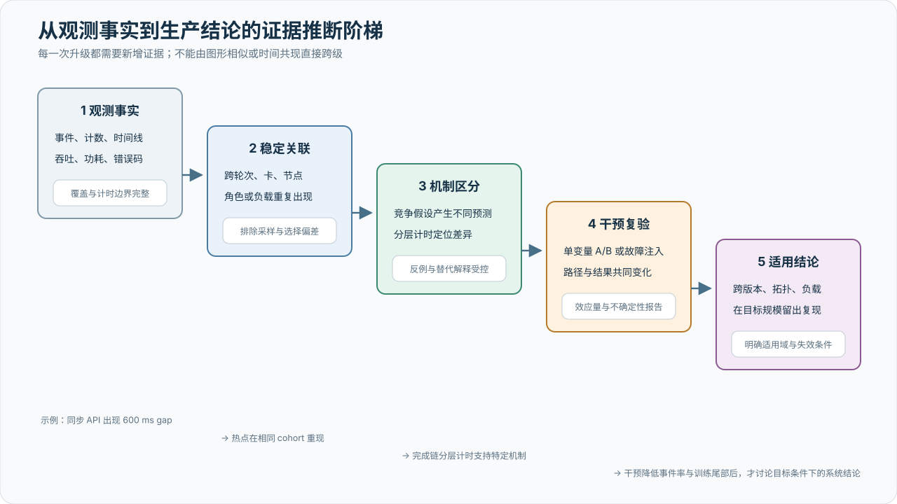

# 计时、概率与实验设计

## 研究问题

实验问题沿训练资源进入系统并最终形成有效进展的顺序展开，而不是彼此独立的检查清单。

首先要确认资源是否可信。静态事实、单节点动态检查、单卡计算与 HBM/SDC 测试回答节点是否具备基本正确性；同 cohort 比较与冻结复测进一步判断性能偏离是否持续。任何关键状态缺失、数值错误、建联失败、覆盖不足或复测不再出现，都会改变相应结论。

资源通过基础检查后，问题转向训练拓扑。目标节点集合必须完整承载实际 TP、PP、DP、EP 通信组，A3 的跨超节点放置还要通过同配置 A/B 证明网卡均衡最终改善 collective 尾部或 step 时间。规模扩展和优化实验只接受端到端结果：微基准改善但训练吞吐、稳定性或收敛没有改善，不构成系统收益。

第三组问题是前向进展。配对计时、异步重叠实验和零通信长循环用于区分设备执行、完成路径和暴露等待；A3 需要把 Host、dispatch、内核驱动和训练同步边界闭合到同一次 spike，C550 则要检验单卡软停顿能否解释另一集群的 collective 秒级尾部。时间模式未标记、深度观测改变被测负载或实验窗口不足时，只保留观察事实。

第四组问题是诊断本身是否有效。在线观测必须在给定预算下保持 rank/step 覆盖，角色条件热力图不能把正常并行差异误判为异常，联邦下钻和触发取证还要在冻结标签上改善 Top-K 命中或定位时间。若收益依赖未披露的人工先验，或者 partial、丢弃和观测扰动没有进入结果，诊断主张不成立。

最后才讨论放松同步。低频 outer synchronization 需要在相同 token、FLOPs 和墙钟口径下保持模型质量；PS、quorum synchronizer 或可重配置 ProcessGroup 的容错实验还要证明版本单调、token accounting 闭合、重复更新被抑制且恢复后质量不越界。网络字节下降本身不是训练系统结论。

## 指标定义

设基准规模为 \(N_0\)，目标规模为 \(N\)，稳态吞吐为 \(T(N)\)：

\[
S(N;N_0)=\frac{T(N)}{T(N_0)}
\]

\[
E(N;N_0)
=\frac{T(N)}{T(N_0)\,(N/N_0)}
=\frac{S(N;N_0)}{N/N_0}
\]

强扩展保持全局 batch、模型、序列长度和精度不变；弱扩展保持单卡工作量不变，并显式报告全局 batch 的变化。两种口径不得混在一条曲线中。A3 与 C550 分别选取本资源池基准规模，不计算跨资源池的单一扩展效率。

| 指标 | 单位与聚合 | 必须记录的边界 |
| --- | --- | --- |
| 训练吞吐 | token/s 或 sample/s；报告均值、中位数与分位数 | 稳态 step 区间、是否排除评估与检查点 |
| 端到端吞吐 | token/s 或 sample/s | 包含启动、数据等待、检查点和故障恢复的墙钟窗口 |
| collective latency | ms；按 case、rank、measurement batch 聚合 | 同步位置、device event 或 host timing |
| AlgBW/BusBW | GB/s | 算法、group size、payload 解释和换算公式 |
| MFU | % | 模型 FLOPs 公式、理论峰值、是否包含重计算 |
| 扩展效率 | % | \(N_0\)、强/弱扩展口径和吞吐定义 |
| 有效训练时间占比 | % | 分子、分母、维护和排队时间的排除规则 |
| 观测有效开销 | % | collector、采样率、交错基线定义和稳定窗口 |
| 观测覆盖率 | % | 期望/实际 rank、有效 step、丢弃事件和 partial 状态 |
| 诊断命中率 | Hit@1/Hit@k、误报与漏报 | ground truth 来源、候选集合定义、故障与受害 rank 的区分 |
| 诊断延迟 | 秒；发现、收窄、形成候选分别报告 | 起点、终点、是否包含人工交互和读取证据量 |

健康检查带宽采用稳态计时：tensor 与通信 workspace 在计时前分配并复用，warmup 完成后测量；每个 measurement batch 仅在连续 collective 循环前后同步，使用设备 event 计算平均单次耗时。逐轮 host timing 只用于诊断抖动和慢 rank，不进入主性能 gate。

### 单卡计算与存储可靠性测试指标

单卡计算与存储可靠性测试与集合通信使用不同口径。数值正确性取全部测量轮的最大相对误差，并与观察前冻结的容差比较；它不能外推为训练全算子、全精度一致。矩阵算力按 \(2N^3/t\) 计算，HBM 有效带宽按实际读写字节除以设备时间计算，二者都在充分预热后取多轮中位数。当前同 cohort 中位数的 80% 只是一条初始候选线，不是厂商规格、MFU 或训练吞吐保证。

持续负载进一步比较稳态算力与瞬时算力，报告 P10/P50/P90 及时间曲线，并把功耗、温度、时钟和限频状态对齐到相同窗口。功耗本身没有独立 PASS 线，较高功耗也不自动意味着较高性能。SDC 检查覆盖矩阵、向量、特殊函数、规约、HBM 数据模式和热稳态插入测试；任一数值命中进入可疑状态，但执行异常单列，HBM 实际地址覆盖必须披露，命中也不能单独完成永久硬件故障归因。

报告还应派生但不直接作硬门限的诊断量：稳态算力与瞬时算力之比、峰值功耗与功耗上限之比、HBM/矩阵算力各轮的 P10/P50/P90 与变异系数，以及温升区间内算力对温度和功耗的变化。任何新绝对门限都要先在已知健康卡上预注册，并说明样本量、时间窗口和误报/漏报代价。

基线标定至少包含冷启动后复测和热稳态复测，并保证所有卡空闲、整机并发方式一致。对每个计算后端、设备型号、驱动和固件组合分别保存原始分布；A3 和 C550 不共用中位数，硬件批次、功率上限、冷却策略或测试参数改变后重新标定。相对比较必须设置最小样本量；单卡或很小样本“自动等于自身中位数”的通过不具备生产准入意义。

## 基线与变量控制

每条对比曲线冻结以下变量：资源池与硬件批次、节点集合或分组随机种子、固件/驱动/通信库、框架与训练系统版本、运行环境摘要、模型、精度、序列长度、全局/微批大小、并行组合、数据版本、通信参数、消息矩阵、预热轮数、迭代数和测量方法版本。

单节点健康检查的横向性能比较仅在测试阶段、算子、消息大小、负载模式和通信组规模完全一致时成立。成对检查还需匹配物理拓扑层级、精确物理路径和工作负载形状。默认至少三个通信组才形成可比较群体。小于 1 GiB 的性能只作观察，大于等于 1 GiB 以平均总线带宽为主；首轮低于同批基线 70% 的用例进入持续性能离群候选，不直接形成设备故障结论。

候选复测在首轮结束后一次性冻结用例，并加入相邻消息规模。复测默认至少三个测量批次，且不低于首轮批次数。只有同一节点持续偏离才记为可疑；复测中恢复记为瞬态观察，候选转移不用于事后改写首轮假设。

固定绝对带宽门限只有在以下条件同时满足时才能启用：同硬件与批次、相同 group size 和拓扑、相同通信栈、相同 payload 语义、足够多的健康样本、跨时间窗口重复标定。门限值和标定数据必须作为独立实验归档。

训练拓扑阶段采用不同判定：不做大规模通信组之间的速度比较，只检查通信组定义的身份、每类 rank 覆盖与不重叠、通信域初始化、正确性、NaN/Inf、进程状态、结果完整性和超时。流水线并行使用双向点对点通信；张量并行、数据并行、专家数据并行和专家并行只运行真实训练定义允许的算子和形状。代表性负载应覆盖小、中、大消息，额外形状来自实际模型配置。多通信域重叠只作为显式压力诊断，其失败不能覆盖已经通过的常规拓扑用例。

## 数据处理

数据链路遵循“原始结果不覆盖、聚合可重建、排除可审计”：

1. 保存运行参数、计算实例与节点映射、软件版本与环境摘要。
2. 校验结果结构、实验身份、来源实例、测试阶段、数据长度和完整性摘要；无法恢复的缺失标记为传输失败。
3. 从 rank 明细生成通信组与用例汇总；训练拓扑先取子组内最慢 rank，再取同类算子和形状下的最慢子组，并检查用例和子组覆盖。
4. 首轮仅生成候选与冻结复测计划；复测数据单独保存，不覆盖首轮。
5. 保留通过、告警、可疑、失败和无效实验；图表只读取版本化的聚合结果。

同一实验至少报告样本数、缺失数、失败数、预热轮数、有效迭代或批次数、中心趋势和波动。若排除异常值，必须同时展示未排除结果或给出逐条排除原因。无法取得的日志、计数器或状态记为缺失或跳过，不得填成 0。

## 从观测到结论的证据升级

技术报告需要区分“观察到差异”与“解释了差异”。原始事件首先通过覆盖、计时边界和测量扰动检查；随后验证差异是否跨轮次和 cohort 稳定；再通过竞争假设、分层计时和干预实验逐级提高解释强度。

{ .technical-diagram loading=lazy }

本文采用以下结论用语：

| 证据层级 | 允许的表述 | 不允许的跨级推断 |
| --- | --- | --- |
| 观测事实 | 在给定条件下记录到事件、差异或相关性 | 直接命名底层根因 |
| 稳定关联 | 差异随设备、节点、角色或版本重复出现 | 将时间共现写成因果 |
| 机制支持 | 分层计时与竞争假设产生一致解释 | 将候选机制写成唯一机制 |
| 干预证据 | 预注册 A/B 同时改变路径指标和结果指标 | 只因平均值改善便声称消除长尾 |
| 适用结论 | 在目标规模、版本和工作负载的留出实验复现 | 外推到未覆盖平台或条件 |

平台说明、内部汇总和参考实现审阅可以支持问题建模与机制候选；只有绑定原始数据、冻结条件和复验结果后，才升级为项目实测结论。

## 计时方法校准与异步实验

计时方法应作为实验变量，而不是实现细节。每个资源池选取相同设备、相同负载和相同稳态窗口，对设备 event、流门控 event、同步主机计时和稳态批次计时做配对测量；冷启动、上下文建立和编译时间单独保存。结果报告每种方法的 P50/P95/Max、方法间差值和相关性，不用一个固定换算系数把它们强行归一。[I006](references.md#i006)

设备 event 与同步主机时间之差

\[
\Delta T=T_{\mathrm{host,sync}}-T_{\mathrm{device,event}}
\]

是主机提交、运行时排队、同步返回及边界差异的联合候选量，而不是“驱动耗时”的直接测量。若 ΔT 随 CPU 压力上升但设备 event 稳定，应优先验证主机侧竞争；若两者同步升高，则设备、功率、温度或前序队列更值得检查。两种计时使用不同 stream、不同预热状态或不同后端时，ΔT 不具可比性。

异步通信实验分为两个互补阶段：

1. 在真实训练式重叠中只记录提交返回、真实消费点的等待及 step critical path，不向每个 collective 注入额外同步。
2. 在独立诊断轮次中，对相同 op、group 和 payload 增加设备 event 与完成同步，建立设备区间和端到端完成时间的配对分布。

两阶段必须共享通信组身份、sequence、rank role、payload、stream 语义和软件版本。若诊断轮次的串行化改变算法选择或队列形态，只能用于解释完成边界，不能替代真实重叠性能。多通信域 canary 还应验证每个异步 work 都能在期限内完成；它回答并发通信域的 forward progress 与正确性，不进入普通带宽 gate。

反复等待实验使用固定单卡负载并周期性取得完成确认，记录每个 gap、命中窗口、操作数、设备卡时和运行状态。至少拆分四类条件：冷启动、热稳态、主机压力、设备功率/温度压力；零通信版本用于隔离单卡端到端链路，通信版本只用于观察组级传播。每次长 gap 都与 CPU 线程状态、上下文切换、RSS、设备利用率/显存/功耗/温度、ECC/RAS 和内核/驱动事实按同一时间窗关联。无法取得某一层证据时降低归因置信度，不改变 gap 已发生这一事实。

## 概率、覆盖与重复观测

稳定性实验的第一步是声明随机对象。可以统计“每卡每秒的停顿事件”“每个一秒窗口是否至少命中一次”“每个被抽样 step 是否异常”或“作业是否失败”，但这些量具有不同分母，不能互换。设一张卡在给定条件下的停顿近似服从强度为 \(\lambda\) 的泊松过程，观察时长为 \(T\)，则

\[
P(K\ge 1)=1-e^{-\lambda T},
\qquad
P(K=0)=e^{-\lambda T}
\]

若零事件被观察到，95% 单侧事件率上界约为

\[
\lambda_{95}^{\mathrm{upper}}
=\frac{-\ln(0.05)}{T}
\approx\frac{3}{T}
\]

因此“180 秒零停顿”只能约束该条件下约 \(1.7\times10^{-2}\) 次/卡秒的量级，远不能证明稀有停顿不存在。若使用 \(n\) 个固定窗口的命中/未命中作为伯努利样本，零命中的 95% 上界同理为

\[
p_{95}^{\mathrm{upper}}=1-0.05^{1/n}\approx\frac{3}{n}
\]

这些表达式依赖独立、平稳和窗口定义固定。相邻窗口共享温度、功率与软件状态，真实有效样本量通常小于窗口数；整批设备还可能受同一驱动、控制面或供电事件影响。不能把 \(N\) 张卡的卡时直接相加后继续假设完全独立。报告应同时给逐卡、逐节点、逐运行的事件率，并用按运行或故障域分块的重采样估计不确定性；跨冷/热循环的独立重复通常比无限延长单次稳态运行提供更多状态覆盖。

### 采样的检出概率与相位混叠

若一个异常在 \(m\) 个可观测机会中重复出现，每次被独立抽中的概率为 \(q\)，理想检出概率为

\[
P_{\mathrm{detect}}=1-(1-q)^m
\]

持续时间为 \(d\) 的孤立事件由周期 \(\Delta\) 的瞬时探针检测，且采样相位随机时，单次覆盖率近似为 \(\min(1,d/\Delta)\)。这两个公式只描述采样几何，不包含探针自身的误差。

训练观测常使用按 step 和 module 的确定性哈希，使所有 rank 在相同训练坐标上同步抽样。这有利于横向比较并避免 rank 采样不齐，却可能与固定周期的 checkpoint、数据阶段或硬件停顿发生相位混叠。实验应保留一组同相采样用于跨 rank 对比，再用改变哈希种子或起始相位的独立轮次补足覆盖。不能把同一种子重复运行很多次当作 \(m\) 次独立机会。

### 万 rank 比较与角色条件

在 \(R\) 个 rank 上用固定单元误报率 \(\alpha\) 同时判断，一张热力图切片的期望误报数约为

\[
E[V]=R\alpha
\]

当 \(R=10{,}000\)、\(\alpha=1\%\) 时，即使所有 rank 都健康也预期出现约 100 个候选单元。工程判定因此不能依赖单格阈值，而应组合角色条件基线、跨 step 持续性、空间/拓扑聚集、冻结复测和假发现率控制。热力图负责生成候选集合，不直接生成硬件故障结论。

角色分层减少了 PP/TP/EP 负载差异造成的混杂，但也缩小了每个参考群体。对小 role cohort，应报告参考样本量和区间，不计算看似精确的 MAD 分数；对所有 role 同时变慢的情况，角色内比较会失效，必须回到历史绝对基线、交错基线 step 和系统级事实。硬件一致但软件版本分裂，或者软件一致但功率/温度域不同，都不应进入同一个概率模型。

概率结论最终写成条件句：在冻结的硬件批次、软件栈、拓扑、负载、热状态、采样计划与有效卡时下，事件率或异常比例处于某个区间。任何一个条件变化都产生新的 cohort，而不是沿用旧的“健康概率”。

## 异质事件率与同步放大

A3 内部测量与“所有卡共享同一个固定事件率”的简单模型不一致。在 1,024 卡 × 19 分钟数据中，总体平均事件率为 0.393 次/卡/分钟，但 76.1% 的卡零事件。若每张卡都服从同质泊松过程，则零事件比例应约为

\[
P(K_i=0)=e^{-0.393\times19}\approx5.7\times10^{-4},
\]

与观测的 0.761 相差三个数量级。这个差异不能由普通抽样波动解释；事件率必须随卡、节点、时段或未观测状态变化。[I007](references.md#i007)

C550 同样表现出过度离散，但空间层级不同。主测总体率为 0.0104 次/卡/分钟，60 分钟内同质模型预测零事件卡比例为

\[
e^{-0.0104\times60}\approx0.536,
\]

实际为 \(58/64\approx0.906\)，且 75% 的事件集中在两张卡。两个时段中热点节点排序较稳定而节点内设备序号变化，因此模型同时需要节点效应和卡/槽位效应，不能只用卡级 \(v_i\) 解释。[I008](references.md#i008)

更合适的起点是分层计数模型。对卡 \(i\) 的观察时长 \(T_i\) 和事件数 \(K_i\)：

\[
K_i\mid\lambda_i\sim\operatorname{Poisson}(\lambda_iT_i),
\qquad
\log\lambda_i=\mu+u_{\operatorname{node}(i)}+v_i+\boldsymbol{\beta}^{\mathsf T}\mathbf X_i
\]

其中 \(u\) 表示节点共享效应，\(v_i\) 表示卡级效应，\(\mathbf X_i\) 可以包含软件版本、槽位、温度、功率、同步节奏和负载状态。Gamma–Poisson 混合可产生负二项分布，用于表达过度离散；若长时间重复测量后仍存在远超混合模型预测的零事件卡，再比较 hurdle 或 zero-inflated 模型。模型选择必须使用留出运行或跨日期预测，不能只追求拟合当前直方图。

停顿宽度也应作为混合分布处理。约 500 ms 与 640–690 ms 的峰可以用带 200 ms 左截断的两成分模型与单一重尾模型比较，并检查成分身份是否稳定关联到卡、节点、主机/设备计时类别和同步节奏。只有成分在独立运行中稳定、且对判别变量作出不同响应，才支持“两个机制”的解释。

C550 的宽度样本同样受 200 ms 左截断，但只有 40 次主测事件，且阈值以上右尾快速衰减。当前不能拟合“200–220 ms 峰”，只能报告条件分布 \(P(G\mid G\ge200\text{ ms})\) 和更高阈值的零事件上界。对 ≥300 ms 事件，64 卡 × 60 分钟零命中的 95% 单侧墙钟率上界约为

\[
\lambda_{\ge300,95}^{\mathrm{upper}}
\approx\frac{3}{64\times60}
=7.8\times10^{-4}\ \text{次/卡/分钟}.
\]

若目标是证明一秒窗口命中概率 \(p<p_0\)，零命中时所需窗口数满足

\[
n>\frac{\ln(0.05)}{\ln(1-p_0)}.
\]

当 \(p_0=10^{-3}\) 时约需 2,995 个独立窗口，即至少约 50 分钟；相邻窗口相关时还要按有效样本量延长。因而 20 分钟零事件不能与 1 小时零事件使用同一个筛查结论。

### BSP 放大不是平均事件率的线性外推

设同步组中各卡事件率为 \(\lambda_i\) 次/秒，某个训练阶段对停顿暴露的有效窗口为 \(w\)。在事件独立且窗口内到达率恒定的理想条件下，至少一张卡命中的概率为

\[
P_{\mathrm{affected}}(w)
=1-\exp\!\left(-w\sum_{i=1}^{N}\lambda_i\right).
\]

若每次停顿持续 \(D\)，任意时刻处于至少一个停顿区间的概率可将 \(w\) 替换为 \(D\)。以内部材料的总体率 0.393 次/卡/分钟、\(N=1024\) 和 \(D\approx0.6\) 秒代入，合成到达率约为 6.7 次/秒，平均同时存在约 4 个停顿区间，理想占用概率约为 98%。该量级与材料报告的 1024 卡训练慢步比例 91.9%–93.5% 相近，但不是对实测值的直接推导：真实 step 含多个同步边界，停顿与计算窗口可能重叠，事件率高度异质，节点事件也可能相关。[I007](references.md#i007)

对 C550 使用 0.0104 次/卡/分钟和观测最大宽度 0.272 秒，同一理想模型给出 512 卡约 2.4%、1,024 卡约 4.7% 的任意时刻占用概率。这个量级说明单卡软停顿不太可能单独解释另一集群中 20%–60% 复测出现的 collective 尾部，但不能用“单次最大值 272 ms”作绝对反证：一个训练迭代可能经过多个完成点，多个事件也可能串联。需要将单卡事件与 collective 阶段时间线联合重放，才能量化其实际贡献。[I008](references.md#i008)

正式分析优先使用逐卡事件区间对训练时间线做离散事件重放：保留真实卡级率、持续时间、节点聚集和两个同步边界，逐 step 计算关键路径。解析公式用于量级检查和反例发现，不替代重放。资源选择的影响也应通过“移除候选卡后重新计算整个组的关键路径”评估，不能按每张卡独立贡献的平均停顿时间相加。

### 冻结资源集合的训练反事实

单卡事件率与训练 step 的关系不能只靠时间上共现来判断。A3 512 卡内部实验采用了一个更强的对照结构：固定 32 个节点及其事件排序，按节点一次移除 4 台、保留 448 卡，形成高事件节点移除、低事件节点移除和 3 个随机移除集合；每个集合分别运行小模型纯 DP、Dense TP×PP 和 MoE EP 三类工作负载。[I009](references.md#i009)

这类实验应冻结五类条件：候选节点全集、探针测量窗口与排序规则、每节点卡数、训练配置和统计窗口。对比只在相同的 448 卡规模内进行；512 卡全量运行改变了卡数和全局 batch，只作为上下文参考。若调度或启动约束使最热节点无法移除，应记录实际被移除的排序位置，不能仍标为抽象的“top 4”。

设工作负载 \(c\) 在高事件节点移除后的 step 中位数为 \(M_{c,h}\)，第 \(j\) 个随机移除集合为 \(M_{c,r_j}\)。描述性对照可以写成

\[
B_c=\operatorname{median}_j M_{c,r_j},
\qquad
G_c=\frac{B_c-M_{c,h}}{B_c}.
\]

\(G_c>0\) 表示高事件节点移除组快于随机组中位数，\(G_c<0\) 表示更慢。只有 3 个随机集合时，\(G_c\) 只是样本内效应量，不能解释为总体置信区间。还应报告随机范围、高事件与低事件移除的成对差异、step P95/P99，以及每步是否与同窗单卡事件对齐。

这个设计控制了物理资源池和训练规模，但没有自动控制所有混杂。移除节点会重排 rank、TP/PP/EP 通信组和拓扑路径；短训练中的 step 具有自相关；Dense 与 MoE 在约第 26 步共同出现的 NaN 使有效窗口缩短到第 5–25 步。NaN 在高事件、随机和低事件集合中均出现，因此当前数据不支持把它归因于停顿排序；同时，截断后的 21 个 step 也不足以把中位数差异升级为长期吞吐结论。

更完整的复验采用区组随机设计：在保持并行映射和拓扑层级可比的条件下，重复抽取多个高、中、低事件集合；交叉交换节点集合与 rank 角色；同时保存 step 时间、collective 到达偏斜和单卡 gap。资源排序只有在留出集合和多个训练家族上持续降低端到端风险时，才可以进入通用资源选择策略。

### 完成链时间的分层还原

A3 的内部定位把额外时延放在同步进入内核驱动后的完成等待路径；华为后续材料从训练视角观察到 host-bound，并显示任务下发流水和内存分配器能够改变端到端时间。[I010](references.md#i010) [I012](references.md#i012) [I013](references.md#i013) C550 的说明则给出了非 direct dispatch 命令队列线程与 wait-signal 累积模型。[I011](references.md#i011) 它们共同说明一个方法论：同步返回时间是整条完成链的合计，平台机制要通过有控制的对照，把合计时间逐段拆开。

| 实验 | 保持不变的条件 | 改变或配对的变量 | 实验回答的问题 | 结果的解读方式 |
| --- | --- | --- | --- | --- |
| 同窗全卡时间线 | 同一节点、版本、负载和 spike 步 | CPU 调度、runtime/dispatch、内核 wait、设备 event、collective 到达 | 额外时间主要落在完成链的哪一段 | API 或 TP broadcast 名称用于标记观察边界，层间时间配对用于定位 |
| A3 任务下发流水 A/B | 同一热点节点、训练窗口和分配器 | 基线与二级任务下发流水 | Host 任务准备和下发是否影响基线或 spike | 同时比较稳态 step、spike 频率、spike 宽度和总时间 |
| A3 分配器与透明大页消融 | 相同任务下发模式、绑核和训练窗口 | 默认分配器、替代分配器、透明大页模式 | 内存分配、缺页与整理是否进入 Host 关键路径 | 使用单变量对照区分普遍提速与长尾改善 |
| 中断绑核反向实验 | 同一热点节点、软件和负载 | 保留与去除绑核 | Host 调度和中断布置是否改变完成等待 | 配对观察 CPU 可运行时间、上下文切换与事件率 |
| C550 dispatch A/B | 同一批 C550、CPU 负载和有效卡时 | direct 与非 direct dispatch | 额外线程和队列路径如何影响同步成本 | 长窗报告事件率区间，短窗用于验证路径是否按预期改变 |
| 同步密度扫描 | 相同设备工作总量 | 短 kernel 高频同步、图捕获、长 kernel | 事件是否更接近“每次交互触发”而非“每单位时间触发” | 同时报告墙钟率与每次完成机会的条件率 |
| 卡—槽位交换 | 软件、主机负载和时段 | 高率卡与低率卡交叉 | 异质性更跟随设备、槽位还是节点共享状态 | 结合物理身份和节点随机效应，不只记录逻辑设备号 |

同步节奏和负载实验必须同时报告墙钟率

\[
\lambda_{\mathrm{wall}}=\frac{K}{\text{card time}}
\]

与每次完成机会的条件率

\[
p_{\mathrm{sync}}=\frac{K}{\text{completed sync opportunities}}.
\]

只报告前者无法区分“每次同步更不容易触发”和“单位时间内同步次数减少”；只报告后者又会掩盖平台对真实训练墙钟的影响。跨平台比较以墙钟率和相同 gap 定义为主，同时披露完成机会数、负载和空闲/满载状态。

## 低通信与弹性训练实验

低通信实验使用同步训练作为冻结参考，并同时控制模型、初始化 checkpoint、数据集合、token 预算、精度和岛内并行配置。核心自变量包括 island 数 \(M\)、inner step 数 \(H\)、outer update 精度、完整/分片同步、重叠深度和一致性策略。仅比较网络字节会遗漏额外计算与收敛差异，因此至少报告三组横轴：

1. 相同训练 token；
2. 相同总 FLOPs；
3. 相同端到端墙钟。

故障实验按状态层注入：岛内 rank 失败、整个 island 失联、outer update 迟到、PS leader/分片失败和网络分区恢复。每个实验保存全局 round、成员快照、已接受更新、token accounting、参数与 outer optimizer 摘要，以及各 island 的本地 checkpoint 身份。恢复正确性先检查版本单调和重复更新，再检查 loss 连续性与最终质量。不同方案使用同一冻结事件带注入故障和恢复时刻，使同步重启、PS、quorum synchronizer、可重配置 ProcessGroup 和 pipeline replica 经历相同外部序列；事件带方法、minimum quorum 和自适应 grace 的公开设计见 [R032](references.md#r032)，框架内和 pipeline 级对照见 [R031](references.md#r031) 与 [R030](references.md#r030)。

quorum 或有界陈旧策略会改变优化过程，不能只作为基础设施开关比较。若 round \(r\) 的接受集合为 \(\mathcal A_r\)，报告每个成员实际 token \(n_{m,r}\) 和聚合权重

\[
w_{m,r}
=\frac{n_{m,r}}
{\sum_{j\in\mathcal A_r}n_{j,r}}.
\]

成员缺失、数据异质或恢复重放都可能改变这些权重。实验同时保留按 island 等权和按 token 加权的预注册方案，避免故障发生后临时选择更有利的汇总口径。

## 诊断有效性评测

“能够展示异常”与“能够定位异常”是两个不同结果。Holmes 使用人工确认的异常设备和通信算子日志评测定位准确率，FLARE 使用真实作业与人工标签评测性能回归诊断；它们为本文提供了比案例截图更严格的验证形式。[R023](references.md#r023) [R024](references.md#r024) 本文建立包含故障类型、注入位置、起止时间、受影响 rank、直接原因和可见症状的标签集，并把训练系统给出的候选集合与该标签独立比较。

若诊断对一次事件返回排序后的候选集合 \(\hat{\mathcal C}_k\)，真实故障单元集合为 \(\mathcal C^\ast\)，则 Top-\(k\) 命中可以写成

\[
\operatorname{Hit@}k
=
\mathbb 1
\left[
\hat{\mathcal C}_k\cap\mathcal C^\ast\ne\varnothing
\right].
\]

除 Hit@1/Hit@k 外，还应报告候选集合大小、误报、漏报、首次发现时间、定位完成时间和需要读取的证据字节。对一次局部故障造成大量等待受害者的情况，定位目标是最早可干预的故障单元，而不是所有呈现慢态的 rank；标签生成与诊断结果必须由不同步骤完成，避免用待评系统自己的异常规则定义 ground truth。

评测至少设置三条能力基线：只使用 step/collective 摘要；加入跨 rank 关系和角色条件基线；再加入联邦下钻、火焰图、变量状态与崩溃现场。三者经历同一故障事件，比较定位准确率、延迟、传输量和训练扰动。只有最后一条在一个或多个指标上稳定改善，才能说明深度证据带来诊断收益，而不只是增加可展示的信息。

## 观测开销与证据质量

观测开销必须按执行路径拆分，不能只给一个总体百分比。常驻 hook 即使未命中采样也会产生 dispatch 成本；命中 step 还会增加事件记录、设备时间读取和持久化成本；原生通信回调、短窗口 profiler 与跨 rank 查询又是独立成本来源。[I004](references.md#i004)

对支持交错基线的采集器，在同一次训练中插入绕过该采集器重路径的基线 step。设 \(M_s\) 为交错基线 step 中位数，\(M_d\) 为仅支付常驻 dispatch 的 step 中位数，\(M_p\) 为命中采样重路径的 step 中位数，采样率为 \(r\)：

\[
O_{\mathrm{dispatch}}=\frac{M_d}{M_s}-1,
\qquad
O_{\mathrm{sampled}}=\frac{M_p}{M_s}-1
\]

\[
O_{\mathrm{effective}}
=(1-r)O_{\mathrm{dispatch}}
+rO_{\mathrm{sampled}}
\]

交错基线只隔离所选采集器，不代表“完全无观测”的训练基线。无法运行交错基线的原生通信插件使用相同节点、消息大小、warmup 和同步边界做离线 on/off A/B。组件微基准可以定位 callback 或持久化回归，但不能替代真实 collective 和 Megatron 端到端比较。

开销结论只在样本量和稳定窗口达到预注册条件后生效。冷启动、JIT、缓存预热、数据抖动与故障恢复窗口分开报告；跨 rank 先计算各 rank 的开销分布，再报告 P50/P95/Max，不能把不同并行角色和不同负载的 step 直接混成一个均值。

每个性能结果还要携带观测质量收据：期望/实际 rank 和节点、有效 step、失败分区、丢弃事件、时间对齐方式、是否 partial、是否精确以及抽样或 sketch 误差。主结果表必须同时满足性能口径和质量门限；覆盖不足时保留已取得数据用于诊断，但结论状态为 `BLOCKED`。

Fleet-wide 观测的扩展性不能只用单卡 hook benchmark 证明。至少需要随 world size 报告以下曲线：

| 维度 | 指标 | 需要区分的成本 |
| --- | --- | --- |
| 训练热路径 | step time 的 P50/P95/Max 与有效摊销开销 | 未采样 dispatch、采样重路径、原生通信回调 |
| 本地资源 | CPU、常驻内存、缓冲占用、事件/栈丢弃率 | 稳态采集与短窗口 profiler |
| 成员控制 | 每 rank 与协调层的心跳字节率、请求率 | 收敛期与退避后的稳态 |
| 联邦查询 | fan-out endpoint 数、扫描/返回字节、P50/P95 延迟 | 扁平与 `coordinator → local0 → leaf` |
| 查询质量 | ranks/nodes seen、failed partitions、partial 比例 | 无匹配事件与查询失败 |
| 深度下钻 | 目标 rank 数、时间窗、folded path 数、精确事件数 | 分布式火焰图与完整 Timeline |

若常驻开销随 world size 上升，应先区分训练热路径本身变慢、成员控制流量增加、查询与训练重叠，还是协调器反压传播。只有在相同模型、并行角色、采样率和查询负载下，热路径开销保持在预注册预算内，才能把“低摊销”从设计属性升级为生产测量结论。

触发式取证另行验证。变量 watch 应在不同函数调用率、追踪深度、变量数和摘要策略下测量 step 增量，并检查是否引入设备同步；分布式火焰图应验证路径合并、rank 覆盖、subject/reference 差值和 partial 语义；fatal error 注入应分别覆盖 Python 主线程异常、后台线程异常、原生信号和通信 watchdog，检查退出状态、最小本地转储、训练坐标、内存上下文和幸存 rank 侧证据是否一致。[I014](references.md#i014) 崩溃捕获率只能以实际注入次数为分母，不能用已生成报告数量构造自洽的 100% 覆盖率。

## 实验索引

每次证据导入都在[实验记录](experiments.md)中创建稳定编号，完整实验族也只在该处维护。本章按方法引用实验，不再复制一张会随项目推进不断变化的索引表。编号只有在实验实际登记、冻结配置和证据完整性通过检查后，才可在正文中作为已完成实验引用；建议编号或计划状态不构成结果。

## 适用范围与复验重点

- 当前材料没有提供可独立复核的原始测量；历史数字只能作为待核验线索。
- 现有闭环证据仅覆盖两节点 C550 环境，不能据此外推至 2,048 卡 C550 或 8,192 卡 A3。
- 合成 collective 可以暴露链路和通信栈问题，但不能代表包含计算重叠、数据读取和检查点的 Megatron 端到端性能。
- 同批横向比较依赖“多数节点健康”的假设；系统性配置错误或全局拥塞可能使多数基线本身偏低。
- 成对检查会改变通信伙伴与流量布局，可能无法复现只在训练通信组中出现的问题，因此仍需真实训练拓扑和训练复验。
- 训练通信组定义与目标训练版本不一致时，检查可能完整覆盖错误的通信组；必须校验框架版本、配置、rank 顺序和完整性摘要。
- 完整数据模式允许失败后继续采集，这提高覆盖率但不改变 gate：后续有数据不表示前序失败已经恢复。
- pod 内缺失宿主机日志或 IB counter 会降低根因定位置信度；这类缺失必须由运维/交换机证据补足。
- 单卡筛查的相对中位数方法可能漏掉整批共同降速；首轮自一致比较可能漏掉确定性系统错误。若未执行显式功耗分档、冷热循环或跨卡多数表决，相应结论不得外推。
- 在线观测可能改变线程调度、同步和缓存行为；仅有组件 benchmark 或低采样率配置，不能证明生产模型上的端到端开销可接受。
- 跨 rank 查询返回 partial 数据、不同 rank 采样窗口未对齐或本地缓冲发生丢弃时，尾延迟和异常比例可能被低估。
- 零事件只能给出给定观察时长下的概率上界；相邻窗口、同节点设备和同软件栈之间的相关性会让独立模型高估有效样本量。
- 确定性同相采样可能漏掉周期性异常；反过来，万 rank 单格阈值会放大偶然极值。两者分别需要换相位复测和多重比较控制。
- 设备 event、同步主机时间和 `wait` 暴露时间覆盖的系统边界不同；把不同计时模式合并会制造虚假的硬件离群值。
- A3 停顿汇总材料尚未作为版本化原始证据导入；当前数字用于建立机制模型和复验问题，项目验收还需绑定原始事件、配置与完整性摘要。
- 精细 event 与 profiler 被报告会提高停顿事件率；若用插桩组估计平台率，会产生由观测路径造成的偏差。
- A3 内部定位与华为 host-bound 说明覆盖同一同步完成链的不同边界；将同一次 spike 的 CPU/runtime/内核/设备时间线归档后，可以继续量化“进入驱动后等待”在总 gap 中的占比。
- 华为任务下发流水、分配器与组合 A/B 的重复数不平衡，且同时可能改变稳态基线和 spike；复验分别报告无 spike 中位数、spike 频率、条件宽度和总时间，可解释收益来自哪一部分。
- 沐曦 direct dispatch 的约 10 分钟零事件给出该曝光下的概率上界；扩展到匹配主测的长窗 A/B 后，可以量化它降低事件概率的程度。
- C550 的 40 次单卡事件刻画了当前门限以上的已见分布；更长曝光和预注册检验用于估计 272 ms 之外的右尾，并检验节点排序与 2.3 秒间隔是否稳定。
- C550 大规模 collective 数据来自另一集群，缺少隔离网络与 RNIC/交换机 counter；QP 增加后的结果未支持简单的单调 ECMP 改善假说，网络、QoS、通信库和多租户条件仍需分别验证。
- A3 512 卡选择实验只有 1 个高事件集合、1 个低事件集合和 3 个随机集合；节点移除同时改变 rank/拓扑映射，Dense/MoE 又只保留 21 个稳态 step。当前结果可说明样本内关联和工作负载依赖，不能作为通用选机收益估计。
- DiLoCo、OpenDiLoCo 与 Streaming DiLoCo 的公开结果说明低频参数交换值得研究，但不构成本项目在目标模型、目标资源池或目标故障率下的质量与效率结论；这些结论必须由 EXP-016 的等预算对照建立。
- 将 Parameter Server 用作 outer state plane 是本报告对低通信优化与弹性状态管理的设计综合，不是所引论文直接验证的组合。副本数本身不能证明更新恰好生效一次，仍需用版本、幂等键、成员快照和可回放审计验证状态正确性。
- quorum、bounded staleness 或异步接纳会改变有效参与成员、样本权重和优化轨迹。它们既是可用性策略也是优化语义，不能只以恢复时间或训练不中断判定正确。
