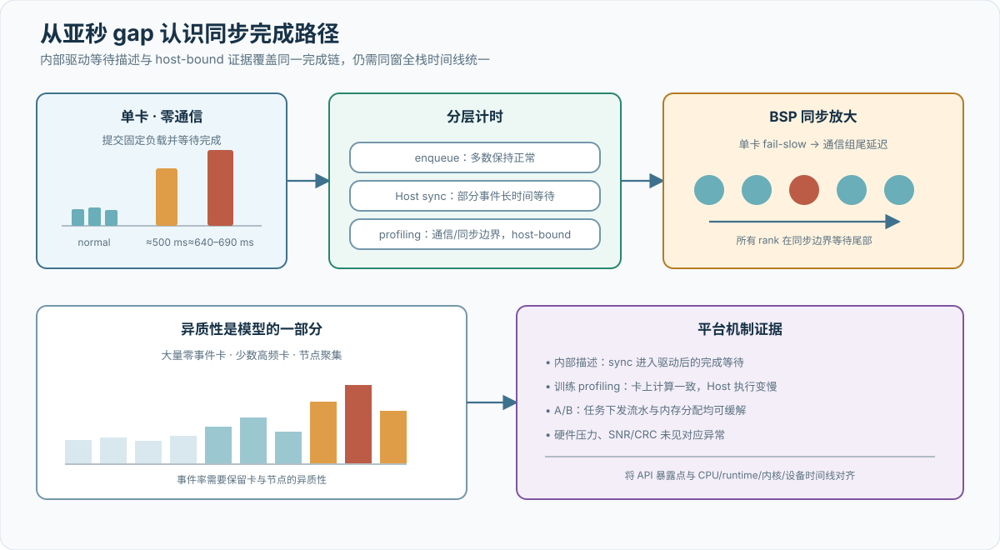
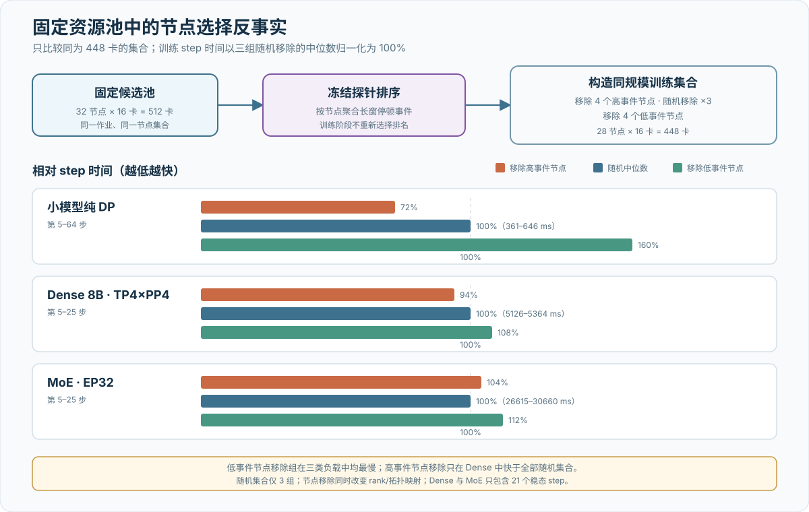
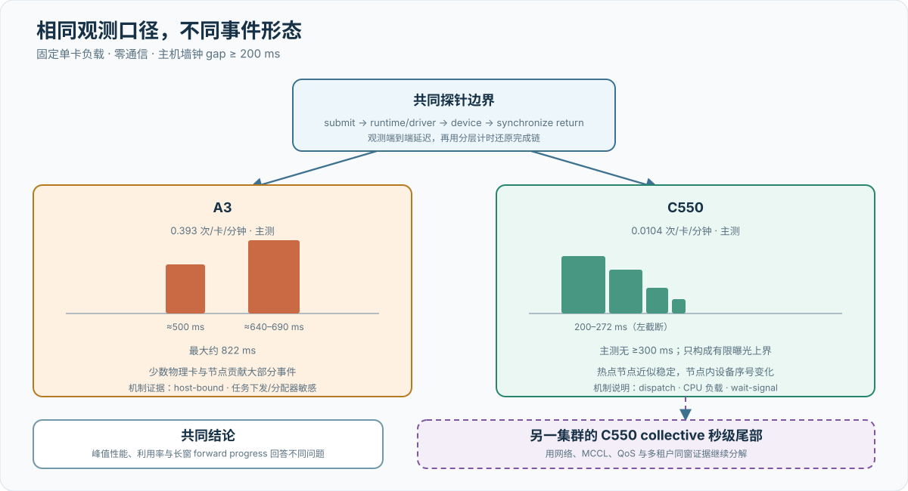

# 平台案例与结果分析

## 证据状态

现有材料共同揭示了一类容易被平均吞吐掩盖的现象：单卡在绝大多数时间保持正常，但偶发同步等待会进入 BSP 训练关键路径。A3 与 C550 均在同步完成路径上表现出长尾，但事件频率、持续时间、空间结构和软件敏感性不同。沐曦材料以 non-direct dispatch、CPU 负载与 wait-signal 描述 C550 的交互路径；华为材料在 A3 训练中观察到 host-bound，并给出任务下发流水和内存分配器消融。并列分析用于比较共同的系统机制与不同的平台条件，不构成共同底层根因的判断。

当前证据可以分成三个层次。第一层是已经可以评审的方法：测试对象、计时边界、概率口径、判定逻辑和证据完整性要求已经定义，但这只证明实验可执行。第二层是平台案例：A3 的两个卡池长窗、分层计时、训练 step 摘要、软件消融和固定 512 卡反事实，以及 C550 的 64 卡长窗、dispatch 说明和另一集群的 collective 尾部，都已形成可讨论的汇总证据。它们仍缺原始时间线、物理身份、冻结配置、软件版本和完整性摘要，因此本章把数字限制在相应 cohort 和实验窗口内。

第三层是尚不存在的项目级结论。两节点或 32 节点 C550 历史运行不能替代 2,048 卡验收，现有 A3 案例也不能替代 8,192 卡全流程；两个资源池均未形成完整证据链之前，10,240 卡只描述部署规模，不描述有效训练能力。待导入的实验与结果字段集中保存在[实验记录](experiments.md)和[复现实验清单](appendix-b-reproducibility.md)，正文不再用成排空表模拟尚未取得的结果。

后续停顿分析统一保留四层语义：**测量事实**是给定负载、阈值、卡池和时长下直接记录的计数与时间；**统计解释**是事件率、上界、异质性和同步放大等可由数据重建的推论；**层次定位**指出额外时间落在哪条软硬件路径；**内部机制**再进一步描述线程、队列、锁、轮询、timeout 或重试分支。这样的分层让读者既能使用当前数据，又能看到下一轮测量要补齐哪一段时间。

## A3 案例：从单卡长尾到训练时间

内部材料将事件定义为：单卡完成一轮固定设备负载并等待完成的主机墙钟 gap 不小于 200 ms；正常轮次中位数约为 0.087 ms。门限与正常区间相隔三个数量级，使探针能够聚焦稀疏长尾而不把普通抖动混入事件。现有证据把观察范围收敛到 Host—runtime—内核驱动同步完成链；分析的重点是各层对固定时延的贡献、观测路径对事件率的影响、卡间异质性以及软件版本条件。[I007](references.md#i007) [I010](references.md#i010) [I012](references.md#i012) [I013](references.md#i013)

{ .technical-diagram loading=lazy }

| 证据面 | 内部材料报告的结果 | 本报告状态 |
| --- | --- | --- |
| 跨池复现 | 1,024 卡 × 19 分钟：7,658 次，0.393 次/卡/分钟；另一卡池 512 卡 × 30 分钟：6,972 次，0.454 次/卡/分钟 | 摘要已登记，逐事件数据待导入 |
| 宽度 | 两轮 P50 约 504/536 ms，P90 约 697/695 ms，最大值约 822/820 ms；整体呈约 500 ms 与 640–690 ms 两个密集区 | 峰型需在原始数据上用左截断混合模型复核 |
| 工作量响应 | 单次小矩阵、批量小矩阵和大矩阵均出现相近停顿宽度 | 支持“附加等待”模型；具体状态由后续分层计时命名 |
| 空间分布 | 1,024 卡运行中 76.1% 零事件；事件最多的卡 19 分钟 421 次；512 卡运行 top 10% 卡贡献 88.9% 累计停顿时间 | 数据与同质逐卡泊松模型不相容；卡/节点随机效应待估计 |
| 时间分层 | enqueue 保持正常；52.4% 事件的主机同步等待不小于 200 ms，37.9% 事件的设备 event 区间不小于 200 ms；watchdog 多数继续推进 | 早期结果缩小到同步/完成语义，但不同计时边界尚需同窗解释 |
| 层次定位综合 | 内部材料把等待放在 sync 进入内核驱动后；华为 profiling 报告卡上计算一致、异常位于通信/同步部分且为 host-bound | 两种计时边界共同描绘完成链；用同窗时间线继续分配层内时间 |
| 观测者效应 | 高频 profiler 或精细 event 使被观测进程更容易成为慢者，事件率约提高一倍 | 裸探针用于率估计，深度插桩只能用于独立诊断 cohort |
| 与峰值能力筛查的交集 | 16 个高事件率节点中，4 个同时在既有算力/HBM 排除集合，12 个未被该类测试标记；后者中 5 个进入过 256 卡候选集合 | 表明两类测量覆盖的系统属性不同；原始身份、门限和选择快照导入前，不计算通用漏检率 |
| BSP 影响 | 1,024 卡训练窗口报告慢步占比 91.9%–93.5%；快/慢 step 约 88/1,150 ms，固定工作量相对吞吐约剩 8.1% | 仅限该模型、配置和窗口；不是 A3 通用吞吐或绝对 MFU |

材料中的消融帮助安排机制研究的优先级：纯 Host 自旋未见同类空洞；单卡零通信可复现，说明 collective 不是事件出现的必要条件；4 字节 barrier 与大消息 AllReduce 的慢态增量接近，说明亚秒代价没有随传输量成比例增长；温度、常规 CPU 限流、设备管理查询频率及已观测 ECC/链路计数未与事件形成同量级关联。于是后续测量可以优先覆盖 Host—runtime—驱动完成链，同时保留这些变量作为同窗对照。

同口径的 NVIDIA 对照报告 25 卡 × 20 分钟零事件，95% 单侧墙钟率上界约为 0.006 次/卡/分钟。这个窄口径对照说明 200 ms gap 不是最小探针在所有环境中的必然产物；它覆盖的是空闲卡和单卡路径，因此用途是校准探针背景，而不是评价满载、多租户或集合通信性能。

综合来看，在所报告的 A3 卡池、软件栈和负载下，单卡概率性长延迟可以跨卡池复现；它不以集合通信为前提，事件率具有显著异质性，并会通过 BSP 同步边界放大。内部驱动等待定位、host-bound profiling 和软件消融共同把研究范围放在同步完成链。约 500 ms 与 640–690 ms 是需要解释的时间结构，TP broadcast 是等待显现的框架边界；下一步通过同窗时间线把它们映射到具体的线程、队列和驱动状态。[I010](references.md#i010) [I012](references.md#i012) [I013](references.md#i013)

### 训练侧观察：掩盖、profiling 与软件消融

华为首轮说明报告：整网单机 16 卡纯 DP、Qwen3-0.6B、无通信计算掩盖的小规模实验中，热点节点相对冷节点的 512-step 端到端总时间增加约 7%–10%；对于单步更长且具有通信计算掩盖的正常规模模型，预期相对影响有限。[I012](references.md#i012) 用前文的重叠模型理解，小负载到达同步点时可用余量 \(S\) 较小，固定等待更容易完整暴露；大模型是否能掩盖以及能掩盖多少，需要由其真实并行结构和时间线测量。

第二轮材料给出了更具体的节点对照。在第 3–512 步，冷节点总时间为 221,987.8 ms，热点节点 23 为 238,806.3 ms，即高 7.58%；另一个热点节点 83 为 223,212.3 ms，即高 0.55%。延长并重复到第 3–640 步后，节点 23 和 83 分别为最快节点总时间的 112.07% 和 106.09%。曲线显示热点节点的 step spike 更多，但节点 83 的增量显著低于节点 23，说明“热点”不是单一稳定效应量。[I013](references.md#i013)

profiling 报告所有设备的计算时间一致，额外时间归入通信部分，整体呈 host-bound。首轮 profiling 在 TP broadcast 同步点看到等待；即使训练未启用 TP，框架仍会经过该同步边界。这里“通信部分”是 profiler 的时间分类，“TP broadcast”是调用栈中的观察位置。结合单矩阵复现中热点节点内命中的设备不固定，下一轮采用 spike step 的单机全设备 profiling，可以先识别当步尾部设备，再沿其 Host—runtime—驱动时间线下钻。[I012](references.md#i012)

| 热点节点软件条件 | 第 3–500 步总时间均值 | 相对基线 | 已报告轮次 |
| --- | ---: | ---: | ---: |
| 基线 | 234,447.8 ms | 100.00% | 2 |
| 二级任务下发流水 | 188,643.4 ms | 80.46% | 3 |
| 替代内存分配器 | 207,358.9 ms | 88.45% | 3 |
| 二级任务下发流水 + 替代分配器 | 172,215.2 ms | 73.46% | 3 |

组合条件的总时间相对基线低 26.54%，单独任务下发流水和分配器分别低 19.54% 与 11.55%。这组数据展示了 Host 路径的可优化空间。为了理解优化发生在哪里，后续把总时间拆成无 spike 稳态基线、spike 次数和条件宽度；即使总收益相同，这三种组成也对应不同的系统机制。当前基线有两个已填报轮次，其他组有三个；透明大页给出了机制讨论但没有独立量化对照，中断绑核及共享周期性节律源仍在反向实验中。[I013](references.md#i013)

同机单矩阵用例在华为内部环境未复现，硬件压力测试及热点机 SNR/CRC 日志正常，BIOS/BMC/HDK/SDK 候选周期任务也未观察到明显关联。[I012](references.md#i012) 这些环境对照把研究重点带向现场特有状态：中断与绑核、Host 调度、任务下发、内存分配以及同步完成路径。硬件与链路数据仍作为时间线的背景事实保留，用来判断 spike 是否伴随底层错误。

### 固定 512 卡资源池中的训练影响对照

另一份内部材料固定同一个 32 节点、512 卡作业，先按单卡探针聚合得到节点事件排序，再冻结该排序进行训练实验。由于启动主节点必须保留，实际高事件移除集合使用排序第 2–5 位的 4 个节点，合计覆盖约 830 次探针事件；低事件集合移除 4 个近零事件节点，另生成 3 个随机移除集合。所有移除实验均保留 28 节点、448 卡，并调整全局 batch 以保持单卡负载口径。[I009](references.md#i009)

{ .technical-diagram loading=lazy }

下表只比较同为 448 卡的集合。数值为稳态 step 时间中位数；括号内为高事件节点移除组相对 3 个随机组中位数的差异，正值表示更快。

| 训练负载 | 高事件节点移除 | 随机移除 ×3 | 低事件节点移除 | 高事件移除相对随机中位数 | 有效窗口 |
| --- | ---: | --- | ---: | ---: | --- |
| 小模型纯 DP | 372 ms | 361 / 519 / 646 ms | 829 ms | +28.3% | 第 5–64 步 |
| Dense 8B，TP4×PP4 | 4,828 ms | 5,126 / 5,155 / 5,364 ms | 5,559 ms | +6.3% | 第 5–25 步 |
| MoE，EP32 | 30,996 ms | 26,615 / 29,882 / 30,660 ms | 33,502 ms | −3.7% | 第 5–25 步 |

三个工作负载中，低事件节点移除组的中位 step 时间都最高，即保留较多高事件节点的集合在当前样本中表现较慢。更严格的“高事件移除是否优于随机移除”则呈现工作负载依赖：Dense 的高事件移除组快于全部 3 个随机集合；小模型 DP 快于随机中位数但略慢于最快随机集合；MoE 慢于全部 3 个随机集合。因而，单卡停顿排序包含与训练关键路径相关的信息，但其作用会受到并行结构和节点到 rank 的映射调制。

512 卡全量运行的参考中位数分别为 527、5,443 和 24,482 ms，但它同时改变卡数和全局 batch，不能与 448 卡集合直接解释为“移除节点的收益”。Dense 与 MoE 的所有 448 卡集合都在约第 26 步出现 NaN，故表中只使用第 5–25 步；该现象跨高事件、随机和低事件集合出现，当前证据更符合配置或规模共享因素，不能归因到某一种节点选择策略。

这些结果展示了从探针到训练的两步映射。第一步，长窗单卡探针提供独立于峰值能力的风险特征，因为能力相近的节点仍可能具有不同的完成延迟分布。第二步，训练用并行结构解释这个风险特征：节点移除会同时改变拓扑、通信组和 rank 角色，因此需要多个区组随机集合、固定或交叉 rank 映射、step 尾部分布，以及单卡事件与训练时间线的同窗关联，才能形成适用于具体 workload 的资源策略。

## C550 案例：dispatch 路径与低频长尾

C550 材料使用与 A3 相同的单卡固定负载和 200 ms gap 阈值，但记录到的是更低频、更短的条件分布。主测运行在 64 张空闲 C550 上，持续一小时；复测在同日另一时段持续 20 分钟。[I008](references.md#i008)

{ .technical-diagram loading=lazy }

| 证据面 | 内部材料报告的结果 | 本报告状态 |
| --- | --- | --- |
| 跨时段复现 | 主测 40 次、0.0104 次/卡/分钟；复测 15 次、0.0117 次/卡/分钟 | 两轮率接近；逐事件与窗口数据待导入 |
| 完成机会 | 主测约 19.9 亿次同步，约 8,796 次/秒；经验每机会触发率约 \(2.0\times10^{-8}\) | 墙钟率和每机会率均可重建，需核对窗口完整性 |
| 宽度 | 主测 200.7–272.3 ms，P50 212.6 ms；40 次中无 ≥300 ms 或 ≥500 ms 事件 | 这是左截断条件分布和有限曝光上界，不能声称物理封顶 |
| 空间分布 | 6/64 卡有事件，40 次中的 30 次来自两张卡；两个时段热点节点排序近似稳定，但节点内设备序号变化 | 支持节点共享状态候选；样本量不足以排除随机迁移 |
| 时间聚集 | 没有跨卡同秒并发；少量同卡事件间隔约 2.3 秒 | 全局同步爆发未观察到；2.3 秒模式未达到确认标准 |
| NVIDIA 对照 | 25 卡 × 20 分钟零事件，C550 墙钟率约为其 95% 上界的 1.7 倍 | 统计上可分辨但属同量级；对照曝光更小且只覆盖空闲卡 |
| 简化规模影响 | 理想独立模型下，512/1,024 卡任意时刻受影响约 2.4%/4.7% | 不足以直接代表 step 慢步比例；需要训练时间线重放 |

在该卡池和软件环境中，C550 呈现低频、卡间异质的单卡长延迟；当前 200 ms 门限以上的已见样本短于 A3。短窗口验证用于确认路径和配置是否生效，长窗口用于估计事件率及 300 ms 以上右尾。物理卡—槽位交换、版本分组以及空闲/满载对照可以继续检验异质性更接近设备、位置还是节点共享状态。

### 机制解释：direct dispatch 的影响路径

沐曦提供的 trace 将暴露点放在 cudaDeviceSynchronize 等待信号返回。其机制说明区分两条任务提交路径：[I011](references.md#i011)

| 路径 | 任务组织 | 对短 kernel 高频同步的含义 |
| --- | --- | --- |
| 非 direct dispatch | 每个 stream 通过额外命令队列线程完成 enqueue/dequeue、任务提交、wait-signal 和唤醒 | 线程切换、队列和 CPU 相关操作积累，某次信号返回可能变长 |
| direct dispatch | 用户线程直接管理 stream 任务提交，不引入额外队列线程 | 减少 enqueue/queue、线程切换和唤醒开销，降低停顿概率 |

材料报告海光 CPU 与 C550 环境打开 direct dispatch 后，约 10 分钟未复现，同时说明这种改变用于降低事件概率，并不把理论概率设为零。在 non-direct 模式下，CPU 稳定性和性能改善也被观察到有帮助。将这些信息放入完成链，可以得到直观解释：额外队列线程让短 kernel 高频同步经过更多 enqueue/dequeue、切换和唤醒；direct dispatch 缩短 Host 提交路径，因而减少可累积的等待。材料说明 MXMACA 3.9 计划将其作为默认方案。

这个模型也为主测中的节点聚集提供了一个可检验方向：同一节点共享 CPU、调度和运行时状态，它们可能同时改变多张卡的完成等待概率。若在相同节点上进行 direct/non-direct 长窗交叉实验，并报告有效卡时、完成机会、CPU 利用、调度延迟和 200/300/500 ms 分层事件率，就能把“路径变短”进一步量化为“事件概率和宽度如何变化”。

### 与大规模通信尾部分离

C550 材料另记录了另一集群上的 256/512 卡大消息 AllReduce 尾部：部分重复运行的迭代 P99 达到约 1,043 ms；增加每连接 QP 数后，带宽和尾部没有按“更多路径减少 ECMP 极化”的简单预测改善；通信组销毁阶段还出现过进程崩溃。这三类事实分别属于运行期通信尾延迟、参数 A/B 和生命周期正确性，不应合成一个统一的“C550 停顿”结论。[I008](references.md#i008)

按当前单卡软停顿率与持续时间建立的独立单命中模型，其频率和持续时间不足以自然解释 20%–60% 重复运行出现秒级 collective 尾部。这支持将两者作为不同候选问题，但不是严格排除：一个 collective 可能包含多个等待阶段，多个事件可能串联，通信路径也会产生自身停顿。只有逐 rank 到达/完成时间、通信库阶段事件和同窗单卡 gap 才能计算实际贡献。

该通信测量缺少关键反事实：测试 fabric 可能有其他租户，容器内没有 RNIC counter，交换机 QoS/拥塞/重传事实不可见，且 256/512 卡重复次数有限。因此 QP 增加后的结果未支持“当前尾部由简单 ECMP 哈希极化主导且 QP 越多单调改善”的假说，但也不足以区分 MCCL、设备、网络或集群配置。退出阶段崩溃作为独立的软件生命周期正确性现象复现，不能用运行期带宽解释。

## 尚待形成的项目级结果

现有案例回答了“局部长尾怎样进入同步训练”，尚不能替代目标资源池的规模验收。后续由 A3 和 C550 分别建立规模—吞吐—扩展效率曲线，每个点绑定实验编号和冻结配置；同一条曲线只改变规模，模型、精度、序列长度、软件版本和强/弱扩展口径保持一致。获得数据后，正文优先展示曲线及拐点，再解释通信、负载不均和故障恢复怎样形成非线性损失，而不是逐行抄录实验台账。公式见[评测方法](07-evaluation-methodology.md)。

项目级结果需要同时呈现稳态训练和完整作业墙钟。稳态吞吐只统计冻结的 step 区间，作业墙钟还包含启动、数据等待、评估、检查点与故障恢复；两者之间的时间账本说明资源最终转化为多少有效 token。健康检查则按 run、phase 和节点状态汇总，训练稳定性按资源池与时间窗口汇总。一次健康检查 PASS 不能替代长稳训练，一次 FAIL 也不能在未定位前直接计为硬件故障。

单卡计算与存储可靠性结果应先按资源池和精确可比 cohort 组织，先交代期望设备和实际覆盖，再区分参考条件不足、资源竞争、持续性能离群、功能不可用和 SDC 可疑；矩阵吞吐、HBM 带宽、稳态/瞬时性能比、功耗及限频分布用于解释候选形成过程。SDC 还要按目标单元报告实际轮数、命中卡数、异常卡数、功耗遥测覆盖和 HBM 实际地址覆盖；固定容量抽样不得汇总成全显存无错误。

资源结论最终沿 candidate、selected、standby 和 excluded 的状态变化展开，并给出每次转换的硬失败或风险证据。训练拓扑按 `world_size + family + op + shape + group_size` 报告期望/实际 subgroup、最慢 subgroup、correctness 和错误分类，`BLOCKED` 与 `NOT_RUN` 进入覆盖率分母。资源进入真实训练后，再进一步报告有效训练时间、中断、MTBF、MTTR 和训练成功率。正文不填“待实测”占位值，完整字段保存在实验登记中。

## 观测质量与开销

性能数字必须同时给出观测质量，避免“只在正常 rank 上有数据”的幸存者偏差。每个关键实验在正文结果旁说明采集模式、期望与实际 rank、有效 step、丢弃事件、失败分区、partial 状态以及 P50/P95/Max 观测开销；完整逐运行字段留在实验记录中。

常驻路径、采样重路径、短窗口 profiler 和通信库原生插件分开报告开销。若关闭观测后性能改善，只能先确认观测路径存在增量；还需通过 dispatch、采样、设备时间读取、写表和查询等分层实验定位来源。观测开销超过预算或质量收据不完整时，该轮数据可用于诊断，但不得进入扩展效率主曲线。

跨 rank 分析先展示 step/rank 热力图、行为组和尾部 rank，再对少量对象下钻到精确事件。报告必须保存下钻所使用的 rank 集合、时间窗、对齐方式和过滤条件，使概览结论可以回到原始证据。对 compute、communication 和 idle 占用的计算先合并重叠区间，不直接相加原始 duration。

## 瓶颈分析

瓶颈分析从观察到的差异开始，依次写清直接证据、首要假设、仍成立的替代解释、能够区分它们的实验和当前状态，避免由“时间上同时发生”直接推出因果。训练资源验证可优先定位正确性失败、尾部 rank、尾部通信组和通信路径异常；最终归因仍需结合设备日志、交换机遥测、软件版本差异和训练 trace。一次异常沿“作业概览 → 节点/行为组 → rank/step → module/collective → 原生 task/kernel/stack”逐级收窄，避免先选择一段细粒度 trace 再事后构造全局解释。

## 消融与对比

Megatron 优化项逐项做 A/B，至少覆盖算子、并行组合、重计算、通信重叠和环境变量。每个对比保存完整配置差异，并同时检查吞吐、显存、数值一致性和稳定性。若多项改动合并后测试，只能报告“组合效果”，不能把收益拆分归给单个优化。

训练资源验证方法本身也需要消融：关闭/开启绝对 gate、不同消息矩阵、1 batch 与 3 batch、首次观察与复测、合成检查与训练复现。目标是量化漏检、误报和测量时长，而不是验证某一状态输出能够生成。

## 结果边界

- 两节点 C550 结果不外推到 2,048 卡；A3 工具路径未完成生产规模验证前不写成已验收。
- 合成 BusBW 不外推为 Megatron 吞吐或 MFU。
- 某消息大小、collective 或 EP pattern 的结果不外推到未测试 workload。
- 历史运行记录缺少原始测量、完整运行条件、版本和完整性摘要时，只能列为待导入线索。
- A3 与 C550 的结果分别报告，不合并为单一异构训练吞吐或扩展效率。

## 证据导入顺序

1. 按[复现实验清单](appendix-b-reproducibility.md)冻结测量方法、运行条件、软件环境与拓扑。
2. 导入最终实验条件、训练拓扑定义、超节点与节点选择依据及其完整性摘要。
3. 为每次实验建立稳定编号，保存可评审的聚合结果，并登记受限原始证据的位置和完整性摘要。
4. 先生成“候选—硬通过—selected—standby—excluded”准入漏斗、失败类型、物理路径候选和 topology coverage，再关联训练作业与维修工单。
5. 数据评审通过后，将“待实测”替换为数字，并同步更新[执行摘要](00-executive-summary.md)。
