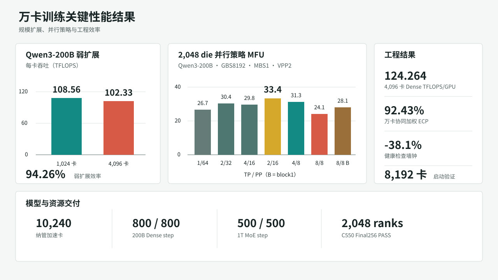
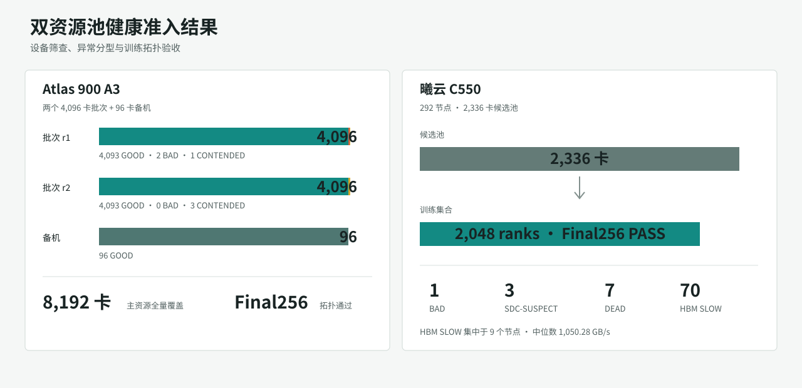

# 结果与分析

## 结果总览

本章汇总十四组实验，覆盖资源准入、Dense/MoE 训练、并行策略、通信消融、规模扩展、前向进展、健康检查效率和工程资产完整性。

| 实验 | 验证对象 | 主要结果 |
| --- | --- | --- |
| [EXP-001](https://github.com/reiase/tenk_report/blob/master/experiments/exp-001-a3-1024-tuning/README.md) | A3 1,024 卡配置搜索 | mapping0 在五组配对中取得更高吞吐，最高点 135.00 TFLOPS/GPU |
| [EXP-002](https://github.com/reiase/tenk_report/blob/master/experiments/exp-002-a3-4096-dp-communication/README.md) | A3 4,096 卡通信消融 | no-overlap 与 bucket-128m 形成高性能候选 |
| [EXP-003](https://github.com/reiase/tenk_report/blob/master/experiments/exp-003-a3-1024-4096-weak-scaling/README.md) | A3 弱扩展 | 1,024→4,096 卡扩展效率 94.26% |
| [EXP-004](https://github.com/reiase/tenk_report/blob/master/experiments/exp-004-tenk-weighted-acceptance/README.md) | 万卡协同窗口 | 加权 ECP 保留率 92.43% |
| [EXP-005](https://github.com/reiase/tenk_report/blob/master/experiments/exp-005-a3-8192-startup/README.md) | A3 8,192 卡启动 | 完成通信建组并进入 iteration 7 |
| [EXP-006](https://github.com/reiase/tenk_report/blob/master/experiments/exp-006-a3-2048die-parallelism-mfu/README.md) | 2,048 die 并行网格 | TP2/PP16/uniform1 达到 MFU 33.4% |
| [EXP-007](https://github.com/reiase/tenk_report/blob/master/experiments/exp-007-a3-forward-progress-stall/README.md) | A3 Stall | 定位 IPVS timer 与 NPU CQ tasklet 竞争 |
| [EXP-008](https://github.com/reiase/tenk_report/blob/master/experiments/exp-008-c550-stall-and-communication-tail/README.md) | C550 Stall 与通信尾延迟 | 64 卡事件 P50 212.6 ms，形成 direct dispatch 优化方向 |
| [EXP-009](https://github.com/reiase/tenk_report/blob/master/experiments/exp-009-200b-1t-delivery-evidence/README.md) | 200B/1T 模型运行 | Dense 800/800 step，MoE 500/500 step |
| [EXP-010](https://github.com/reiase/tenk_report/blob/master/experiments/exp-010-fleet-health-admission/README.md) | 双资源池健康准入 | A3 两批 4,096 卡；C550 2,336 卡筛查与 Final256 |
| [EXP-011](https://github.com/reiase/tenk_report/blob/master/experiments/exp-011-healthcheck-runtime-optimization/README.md) | 健康检查运行时 | 64 节点完整流水线 1,706→1,056 秒 |
| [EXP-012](https://github.com/reiase/tenk_report/blob/master/experiments/exp-012-a3-4096-tp2pp16-dense/README.md) | Dense 4,096 卡 TP2/PP16 | 124.264 TFLOPS/GPU，CV 1.68% |
| [EXP-013](https://github.com/reiase/tenk_report/blob/master/experiments/exp-013-a3-qwen3-1t-moe-tuning/README.md) | 1T MoE 1,024--4,096 卡 | last5 65.60/61.82/57.66 TFLOPS/GPU |
| [EXP-014](https://github.com/reiase/tenk_report/blob/master/experiments/exp-014-training-assets-backup/README.md) | 工程资产快照 | 10 tar、6 bundle、75 项 SHA256 全部通过 |

{ .technical-diagram loading=lazy }

## 训练性能与规模扩展

### Qwen3-200B 弱扩展

EXP-003 在相同代码、模型、sequence length 4096、TP1/PP64/VPP2、MBS1 和 256 个 microbatch 条件下比较 1,024 卡与 4,096 卡。DP 与 GBS 随规模同步扩大 4 倍，统计窗口为 iteration 6--12。

| 规模 | DP | GBS | 每卡吞吐 | 总吞吐加速比 | 弱扩展效率 |
| ---: | ---: | ---: | ---: | ---: | ---: |
| 1,024 卡 | 16 | 4,096 | 108.5571 TFLOPS | 1.0000x | 100.00% |
| 4,096 卡 | 64 | 16,384 | 102.3286 TFLOPS | 3.7705x | **94.26%** |

扩展到 4 倍规模后，每卡吞吐保持 94.26%，总吞吐提升 3.7705 倍。结果说明 TP1/PP64 方案在该模型与批大小下保持了较高的弱扩展效率。

### 万卡协同加权 ECP

协同验收使用 4 个 A3 训练组、4 个 C550 训练组和 64 个参数服务器。8 个训练组在共同连续 47,436 秒窗口内分别统计 ECP，并按 8,192:2,048 的设备规模加权。

| 指标 | A3 | C550 | 加权值 |
| --- | ---: | ---: | ---: |
| 独立基线 | 108.5571 TFLOPS/卡 | 60.9000 TFLOPS/卡 | 99.0257 TFLOPS/卡 |
| 共同窗口 ECP | 101.6508 TFLOPS/卡 | 51.0364 TFLOPS/卡 | 91.5279 TFLOPS/卡 |
| 基线保留率 | 93.64% | 83.80% | **92.43%** |

该指标评价两个资源池相对各自基线的协同运行水平，训练组内部维持独立模型并行与集合通信域。

### 4,096 卡 Dense 方案

EXP-012 的 TP2/PP16/DP128/VPP2/uniform1 在 iteration 6--30 的 25 个稳态步中达到：

- 平均吞吐 **124.264 TFLOPS/GPU**
- 平均 step time **162.398 秒**
- 变异系数 **1.68%**
- skipped iteration / NaN：**0 / 0**

同窗口 TP8/PP8/VPP4/block1/no-overlap 为 111.764 TFLOPS/GPU。TP2/PP16 方案提升 11.18%，体现了并行度、microbatch、VPP 和重计算组合优化后的整体收益。

### 1T MoE 短程扩展

EXP-013 固定 TP1/PP16/EP16、每 DP 副本 64 个 microbatch、block7、no-param-overlap、bucket256M 和 optimizer CPU offload：

| 规模 | DP / GBS | last5 TFLOPS/GPU | last10 TFLOPS/GPU | 相对 1,024 卡 last5 |
| ---: | --- | ---: | ---: | ---: |
| 1,024 卡 | DP64 / 4,096 | **65.60** | 65.30 | 100.00% |
| 2,048 卡 | DP128 / 8,192 | **61.82** | 57.43 | 94.24% |
| 4,096 卡 | DP256 / 16,384 | **57.66** | 57.47 | **87.90%** |

4,096 卡单卡吞吐保持 1,024 卡的 87.90%。从 last5/last10 对比可见，2,048 卡窗口波动高于 1,024 与 4,096 卡，后续性能定位重点放在 EP All-to-All、CPU offload、重计算和 placement 的分项耗时。

## 并行度与 MFU

### 2,048 die 配置网格

Qwen3-200B、GBS8192、MBS1、VPP2 的七点搜索结果如下：

| TP | PP | 重计算 | TP×PP | MFU |
| ---: | ---: | --- | ---: | ---: |
| 1 | 64 | uniform1 | 64 | 26.7% |
| 2 | 32 | uniform1 | 64 | 30.4% |
| 4 | 16 | uniform1 | 64 | 29.8% |
| **2** | **16** | **uniform1** | **32** | **33.4%** |
| 4 | 8 | uniform1 | 32 | 31.3% |
| 8 | 8 | uniform1 | 64 | 24.1% |
| 8 | 8 | block1 | 64 | 28.1% |

TP2/PP16/uniform1 取得最高 MFU 33.4%。在 TP×PP=64 的 uniform1 组内，TP2/PP32 优于 TP4/PP16、TP1/PP64 和 TP8/PP8，说明 TP 通信域和 PP 流水线深度需要联合选择。

### GBS 与重计算

在 TP8/PP8/VPP4、2,048 die 条件下，GBS 从 1,024 增至 8,192 后，MFU 从约 20.7% 提升至约 24.1%，增加 3.4 个百分点。

uniform1 切换为 block1 后：

| 配置 | uniform1 | block1 | 提升 |
| --- | ---: | ---: | ---: |
| TP8/PP8 | 24.1% | 28.1% | +4.0 个百分点 |
| TP1/PP64 | 26.7% | 27.0% | +0.3 个百分点 |

block1 在 PP8 下重计算 8 层，在 PP64 下重计算 64 层；重计算层数减少幅度解释了两组收益差异。优化时需同时记录策略名称与实际重计算层数。

### 大 TP 通信特征

| 观察量 | TP8 | TP2/PP8 | 分析 |
| --- | ---: | ---: | --- |
| scaling 后 forward-compute 增长 | 约 3.1x | 约 1.83x | TP8 前向阶段增量更高 |
| 未重叠通信增长 | 120% | 54% | 大 TP 暴露更多通信时延 |
| 小消息 AllReduce 时延增长 | 约 4--19x | 较低 | 固定时延在短计算窗口中的占比上升 |
| ReduceScatter 增长相对幅度 | 基准 | 约为 TP8 的 1/4 | DP 通信尾部压力显著降低 |

该结果与 TP8/PP8 较低 MFU 的趋势一致，优化重点包括缩短 TP 通信距离、降低小消息固定开销、均衡 ReduceScatter 发射和优化物理 placement。

## 模型功能运行

| 模型 | 参数量 | 规模 | 完成进度 | 运行表现 |
| --- | ---: | ---: | ---: | --- |
| Qwen3-200B Dense | 201.42B | 1,024 die | 800/800 step | loss 曲线连续，训练过程完成 |
| Qwen3-1T MoE | 1,099.55B | 2,048 die | 500/500 step | loss 曲线连续，训练过程完成 |

两组功能运行验证了模型构建、分布式初始化、前向反向、优化器更新和持续迭代链路，为性能调优和检查点策略提供运行基线。

## 健康准入结果

{ .technical-diagram loading=lazy }

### A3 资源池

| 批次 | 覆盖 | GOOD | BAD | CONTENDED | 拓扑结果 |
| --- | ---: | ---: | ---: | ---: | --- |
| 4,096-r1 | 4,096 卡 | 4,093 | 2 | 1 | Final256 PASS |
| 4,096-r2 | 4,096 卡 | 4,093 | 0 | 3 | 节点定位 256 PASS，定向复测通过 |
| 备机 | 96 卡 | 96 | 0 | 0 | 单卡筛查通过 |

A3 两批主资源共完成 8,192 卡覆盖，备机池完成 96 卡覆盖。correctness BAD、计时 CONTENDED 和配置异常采用独立状态处理，为训练成员选择提供明确依据。

### C550 资源池

C550 对 292 节点、2,336 张卡完成候选池筛查：

| 状态 | 数量 | 处置 |
| --- | ---: | --- |
| correctness BAD | 1 卡 | 硬隔离 |
| SDC-SUSPECT | 3 卡 | 冻结复测 |
| DEAD | 7 卡 | 节点/设备处置 |
| HBM SLOW | 70 卡 | 性能复测与节点聚类分析 |
| 最终训练集合 | 256 节点 / 2,048 ranks | Final256 PASS |

70 张 HBM SLOW 集中在 9 个节点，带宽范围 1,045.05--1,054.11 GB/s，中位数 1,050.28 GB/s；全体有效卡中位数为 1,488.66 GB/s。节点聚集特征提高了物理定位与批量处置效率。

## 健康检查运行效率

64 节点、1,024 ranks 的完整健康检查流水线由 1,706 秒缩短至 1,056 秒，减少 650 秒，墙钟下降 38.1%。按 1,024 ranks 计算，单次完整检查释放约 **184.9 加速卡时**。

主要优化点包括：

- SQLite 热库从共享 AFS 调整为本地运行路径。
- Pairwise 任务减少执行波次并优化分组。
- round barrier、超时和复测流程采用独立计时。
- 后台任务执行、状态查询与结果回收解耦。
- Final topology 的长尾采用定向复测快速定位。

C550 主轮的 Scale8 出现 6 个 TIMEOUT，定向复测 4/4 PASS；Scale16/32/64/128 与 Final256 均通过。该流程保留首轮状态与复测结果，便于区分瞬时控制面长尾和稳定通信异常。

## 前向进展与故障定位

### A3 Stall

A3 最小同步探针在 1,024 卡×19 分钟中记录 7,658 次事件，在 512 卡×30 分钟中记录 6,972 次事件，gap P50/P90 为 504/697 ms。系统 trace 将代表事件定位到 IPVS `estimation_timer` 在软中断上下文占用约 875 ms，阻塞同 CPU 上的 NPU CQ tasklet。

TaskQueue level 2 与 jemalloc 组合将固定窗口耗时降低至基线的 73.46%。系统处置方向包括 IPVS timer 与 NPU CQ tasklet 的 CPU/IRQ 隔离，以及同条件同步探针回归。

### C550 Stall 与通信尾延迟

C550 64 卡×1 小时探针记录 40 次事件，P50 为 212.6 ms，最大 272.3 ms；事件在节点和设备上呈现聚集。direct dispatch 用于缩短主机派发路径，并与零通信探针构成稳定性优化组合。

256/512 卡 AllReduce 重复实验同时发现通信尾延迟和 QP 退化，定位流程将单卡派发、通信栈与交换网络分别观测，以固定 cohort、端口计数器和真实训练通信组完成分层诊断。

### 8,192 卡启动

8,192 卡首轮在训练首步前出现 Gloo 全互连建组失败。修正启动器并启用 `--disable-gloo-group` 后，作业完成通信建组并进入 iteration 7。该结果验证了分布式优化器无 Gloo 路径在目标规模的启动有效性。

## 消融与工程结论

| 方向 | 观察 | 工程结论 |
| --- | --- | --- |
| rank mapping | mapping0 五组配对均高于 mapping1 | rank 顺序与物理拓扑共同固化 |
| 通信重叠 | 4,096 卡 no-overlap 相对基线 +6.89% | overlap 以实际暴露通信和调度开销评价 |
| DDP bucket | 128M 在 Dense 中形成候选，MoE 低于 256M | bucket 按模型与规模分别搜索 |
| Gloo 路径 | no-Gloo 解决 8,192 卡建组问题 | 启动通信域与训练通信域分层设计 |
| 重计算 | TP8/PP8 block1 +4.0 个百分点 | 以实际重计算层数解释收益 |
| MoE EP | EP8/recompute6 触发 OOM，EP16 稳定运行 | EP、重计算和显存联合约束 |
| main grad | BF16 路径与融合反向算子冲突 | 当前 MoE 采用 FP32 main grad |
| Stall | A3 指向 IPVS timer/CQ tasklet 竞争 | 系统 IRQ/CPU 隔离与训练侧缓解协同 |
| 健康检查控制面 | 本地热库和任务解耦降低墙钟 | 设备执行与控制面分别优化 |

## 工程资产

EXP-014 建立约 2.6 GB 的工程快照，包含训练配置、运行脚本、实验汇总和 Git 历史：

| 校验项 | 结果 |
| --- | ---: |
| tar 归档 | 10 / 10 通过 |
| Git bundle | 6 / 6 通过 |
| SHA256 清单 | 75 / 75 通过 |

约 22 TB 的 checkpoint、权重和派生数据，以及 84 GB profiler 原件纳入对象清单管理，形成主快照、增量和大对象分层归档结构。

## 综合分析

项目已形成“资源准入—并行搜索—通信优化—规模扩展—稳定性定位—资产归档”的完整技术链路。A3 资源池在 4,096 卡实现 94.26% 弱扩展效率，并完成 8,192 卡启动验证；C550 完成 2,336 卡筛查和 2,048-rank 拓扑验收；两类资源池通过 8 个训练组和 64 个参数服务器实现万卡协同运行。

性能结果进一步表明，万卡训练优化需要同时控制并行组合、物理拓扑、通信固定时延、重计算层数、健康成员质量和控制面长尾。单点算力提升只有与跨 rank 方差、扩展效率和稳定性共同优化，才能转化为持续有效训练算力。

从可靠性工程角度看，MFU、扩展效率和 ECP 描述训练处于有效推进状态时的效率；有效训练时间占比和集群有效产出进一步纳入故障中断、重启恢复、检查点开销、排队等待和调度扰动。外部大规模 ML 集群研究也采用 MTTF、ETTR 和 Goodput 联合解释训练生产率，说明健康准入、故障隔离和恢复路径本身就是万卡训练性能体系的一部分。[R019](references.md#r019)
