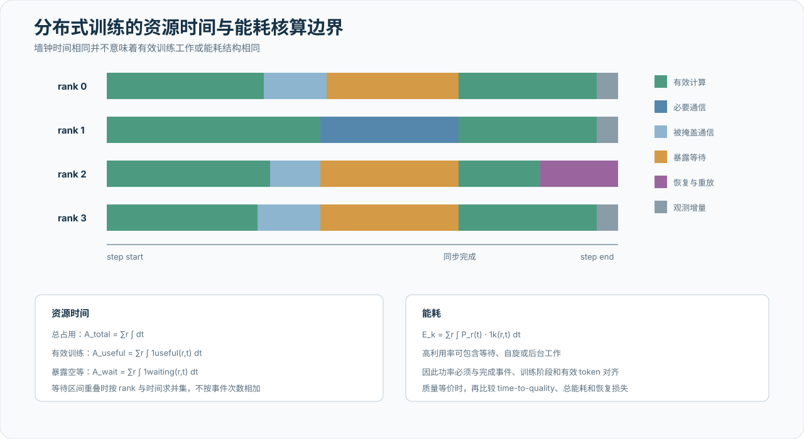

# 系统影响、能耗与资源效率

## 从单卡时间到系统资源

训练系统首先核算 accelerator-seconds，而不是只记录单卡事件次数。设作业的 rank 集合为 \(\mathcal R\)，rank \(r\) 的有效运行区间为 \(\mathcal T_r\)，则总资源时间为

\[
A_{\mathrm{total}}
=
\sum_{r\in\mathcal R}
\int_{t\in\mathcal T_r}\mathrm dt.
\]

若同步组规模为 \(N\)，一个 rank 在关键路径上暴露额外等待 \(D_{\mathrm{exposed}}\)，其余成员已经到达同步边界，则空等资源量近似为

\[
C_{\mathrm{idle}}
\approx (N-1)D_{\mathrm{exposed}}.
\]

实际核算使用逐 rank 到达和完成时间线，对重叠等待取区间并集；多个 rank 同时变慢时，step 增量由关键路径决定，不能把每张卡的 gap 直接相加。报告至少区分：

- 正常计算与必要通信；
- 可被计算隐藏的异步通信；
- 在消费点暴露的等待；
- fail-slow 造成的同步组空等；
- timeout、重启和 checkpoint 回退造成的重复计算。

这些量共同决定有效训练卡时、MFU、扩展效率和作业完工时间。峰值 TFLOPS 与 HBM 带宽描述能力包络，accelerator-seconds 损失描述系统实际未能转化为训练进度的容量。

{ .technical-diagram loading=lazy }

有效资源时间占比定义为

\[
\eta_{\mathrm{resource}}
=
\frac{A_{\mathrm{useful}}}{A_{\mathrm{total}}},
\]

其中“有效”必须绑定训练进度，例如最终被接受的 token、未被回滚的 optimizer step 或达到目标质量的计算。仅设备忙碌而未形成可保留训练进度的时间不进入分子。

## 能耗与碳排口径

记录功率采样位置、PUE、时间范围和排放因子来源。空等 rank 可能仍保持较高设备利用率或功耗，因此能耗不能简单按“有效计算时间比例”缩放。训练、通信等待、故障恢复、训练资源验证和观测分别积分：

\[
E_k
=
\sum_{r\in\mathcal R}
\int_{t\in k}P_r(t)\,\mathrm dt.
\]

若设施电能使用效率为 PUE，电力排放因子为 \(\gamma(t)\)，则运行碳排估算为

\[
C_{\mathrm{operational}}
=
\int
\mathrm{PUE}(t)P_{\mathrm{IT}}(t)\gamma(t)\,\mathrm dt.
\]

无法直接测量的部分明确标注为估算，并保留采样周期、缺失窗口、功率计量边界及排放因子的时间与地域范围。

## 资源效率

区分设备时间占用率、有效训练资源时间、计算利用率和集群可用率。观测成本至少分为常驻路径每个 step 支付的固定 dispatch，以及按采样率或触发率摊销的深度采集成本。短窗口 profiler、变量 watch、通信库原生插件、崩溃 grace window 和跨 rank 查询分别核算，避免用低频采样掩盖常驻 hook 的固定成本，也避免把异常时的高成本取证平均到极长运行时间后宣称其“近似免费”。

万卡场景的证据存储按“本地有界事实、节点/作业聚合、异常原始证据”三层估算。成功样本可以按预注册比例抽样，失败和异常窗口保留较高分辨率；但节省存储不能以删除覆盖率、失败成员和完整性摘要为代价。

## 低通信训练的效率账本

低通信或弹性训练不能只报告跨 island 字节减少。完整账本还包括：

| 收益或成本 | 需要报告的量 |
| --- | --- |
| 通信收益 | 平均与峰值带宽、outer update 字节、阻塞时间 |
| 计算成本 | island 数、inner step 数、总 FLOPs、重复计算 |
| 优化效率 | 相同 token 与相同计算预算下的 loss/困惑度 |
| 弹性收益 | 故障期间继续产生的有效 token、减少的全局重启次数 |
| 状态服务成本 | PS 分片、复制、日志、snapshot 与发布流量 |
| 恢复成本 | 丢失进度、重放 token、模型版本回退和重新加入时间 |

DiLoCo 类方法降低 outer synchronization 频率，但多个 island 可能消耗更多总计算；Parameter Server 提供状态和成员弹性，也引入复制、版本和持久化成本。因此比较对象应是“达到相同模型质量所需的墙钟、总计算、网络和恢复损失”，而不是单一通信压缩倍数。

对预注册质量门限 \(q\)，定义

\[
\mathrm{TTQ}(q)
=
\inf\{t:Q(t)\ge q\},
\qquad
\mathrm{ETQ}(q)
=
\int_0^{\mathrm{TTQ}(q)}
P_{\mathrm{IT}}(t)\,\mathrm dt.
\]

低通信方案只有在 time-to-quality、energy-to-quality、总 FLOPs 与恢复损失共同披露时，才能与同步训练形成完整比较。

## 财务成本边界

若需要进一步换算财务成本，核算边界包含服务器、网络、存储、机房、软件、人力和闲置资源，并单列健康检查与在线观测消耗。资本支出、运营支出、折旧周期和价格来源应与技术指标分开；敏感价格可以指数化或区间化，不影响 accelerator-seconds 和能耗的技术结论。

## 敏感性分析

说明利用率、电价、故障率、训练周期、同步组规模、采样率、异常触发频率、outer synchronization 周期和原始证据保留期变化对结论的影响。观测成本降低是否导致漏检率、MTTR 或结论置信度变化，应与资源节省同时报告；outer period 增大是否降低网络成本但损害优化效率，也应进入同一敏感性矩阵。
