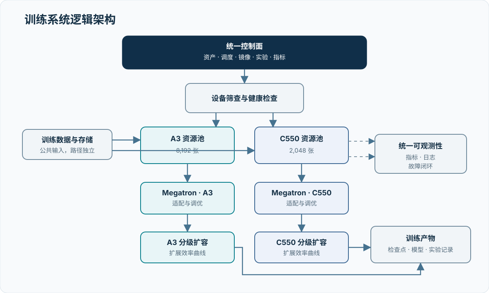

# 万卡国产加速卡训练技术报告

本报告系统总结 10,240 张国产加速卡训练基础设施的架构设计、资源准入、Megatron 适配、并行策略、通信优化、稳定性治理和规模化验证结果。项目由 8,192 张华为 Atlas 900 A3 与 2,048 张沐曦曦云 C550 构成，采用统一控制、异构分池、分组训练和周期参数同步的组织方式。

## 项目概览

| 资源池 | 纳管规模 | 训练组织 | 重点工作 |
| --- | ---: | --- | --- |
| Atlas 900 A3 | 8,192 张 | 4 个 2,048 卡训练组 | HCCL 拓扑、TP/PP/DP 联合调优、弱扩展、Stall 治理 |
| 曦云 C550 | 2,048 张 | 4 个 512 卡训练组 | MCCL 通信、健康筛查、前向进展探针、拓扑验收 |
| 协同控制面 | 10,240 张 | 8 个训练组 + 64 个参数服务器 | 资源编排、状态汇总、周期同步、加权验收 |

{ .technical-diagram loading=lazy }

## 关键成果

| 方向 | 代表结果 |
| --- | --- |
| 规模扩展 | Qwen3-200B 在 1,024→4,096 卡同配置弱扩展中达到 **94.26%** 扩展效率 |
| 并行策略 | 2,048 die 网格中 TP2/PP16/uniform1 达到最高 MFU **33.4%** |
| Dense 性能 | 4,096 卡 TP2/PP16 方案达到 **124.264 TFLOPS/GPU**，稳态 CV 1.68% |
| 协同验收 | 8 个训练组在 47,436 秒共同窗口内达到 **92.43%** 加权 ECP 保留率 |
| 模型运行 | 200B Dense 完成 800/800 step；1T MoE 完成 500/500 step |
| 健康准入 | A3 完成两批 4,096 卡筛查；C550 完成 2,336 卡筛查及 2,048-rank Final256 |
| 稳定性治理 | A3 Stall 定位到 IPVS timer 与 NPU CQ tasklet 竞争；健康检查墙钟由 1,706 秒降至 1,056 秒 |
| 工程资产 | 10/10 个 tar、6/6 个 Git bundle、75/75 项 SHA256 校验通过 |

## 技术主线

1. **资源准入与健康治理**：以静态检查、单卡计算与 HBM 测试、成对通信、精确节点选择和训练拓扑验收构成分层准入流程。
2. **训练系统与并行调优**：围绕 TP、PP、DP、EP、VPP、GBS、重计算、通信重叠和显存策略开展联合优化。
3. **通信与拓扑优化**：依据节点、逻辑超节点和跨域网络的通信距离完成 rank 映射、HCCL/MCCL 参数配置和拥塞定位。
4. **稳定性与可观测性**：以 step、rank、module、collective 和系统事件为统一坐标，逐级定位慢卡、通信长尾与前向进展异常。
5. **规模化评测**：通过短程稳态、弱扩展、协同窗口、功能运行和健康拓扑等互补实验评价系统能力。

## 章节导航

| 章节 | 内容 |
| --- | --- |
| [执行摘要](00-executive-summary.md) | 项目规模、关键指标与核心结论 |
| [项目背景与建设目标](01-background-and-goals.md) | 建设任务、技术挑战与评价体系 |
| [系统总体架构](02-system-architecture.md) | 双资源池架构、控制面、数据面与作业链路 |
| [加速卡与软件栈](03-accelerator-and-software-stack.md) | 硬件形态、运行栈、精度与适配策略 |
| [集群、网络与存储](04-cluster-network-storage.md) | 故障域、通信网络、数据与检查点链路 |
| [A3 HCCL 通信优化](04a-a3-hccl-communication-optimization.md) | 超节点亲和调度、rank 映射与验证方法 |
| [训练系统与并行策略](05-training-and-parallelism.md) | Dense/MoE 工作负载、并行网格与扩展路径 |
| [稳定性、容错与可观测性](06-reliability-and-observability.md) | 健康检查、Stall、ECC/RAS、恢复与诊断 |
| [训练通信观测](06a-training-communication-observability.md) | HCCL 原生观测、公共 Torch 路径与联邦分析 |
| [评测方法与实验设计](07-evaluation-methodology.md) | 指标公式、变量控制、统计方法与实验矩阵 |
| [结果与分析](08-results-and-analysis.md) | 性能、扩展、稳定性、健康准入与消融结果 |
| [成本、能耗与资源效率](09-cost-energy-efficiency.md) | 卡时、能耗、存储和运维效率模型 |
| [工程实践](10-lessons-learned.md) | 关键问题、有效实践与复用清单 |
| [结论与持续优化](11-conclusion-and-future-work.md) | 总体结论与后续技术路线 |

## 阅读路径

- 管理与验收：执行摘要 → 结果与分析 → 成本与资源效率 → 结论
- 系统与平台：总体架构 → 集群网络 → 稳定性 → 工程实践
- 训练与性能：硬件软件栈 → 并行策略 → 通信优化 → 评测方法 → 结果
- 复现与审计：实验记录 → 参考资料 → 复现实验清单

报告中的指标均关联稳定实验编号，实验摘要、配置、统计窗口和完整性摘要在[实验记录](experiments.md)中统一索引。
